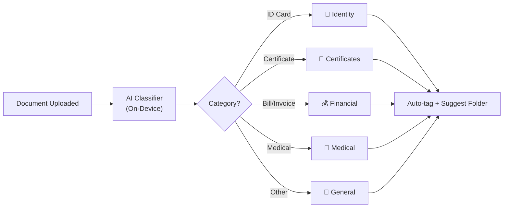
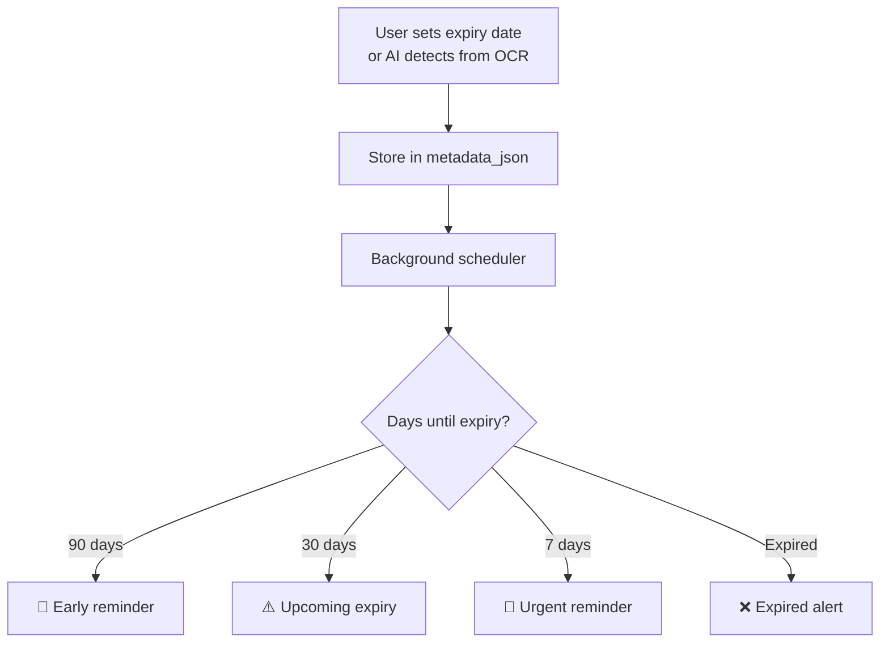
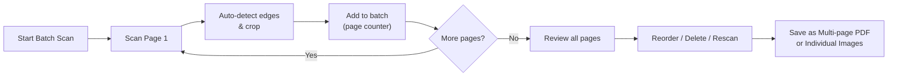
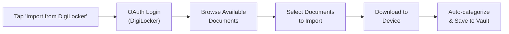
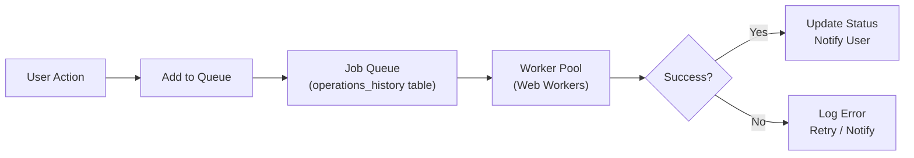

# Additional Features — Suggested Enhancements

> **Project:** Kagaz
> **Purpose:** Feature backlog of high-value enhancements beyond core functionality
> **Last Updated:** 2026-06-07

---

## Table of Contents

- [Overview](#overview)
- [Feature Summary Matrix](#feature-summary-matrix)
- [1. Smart Features](#1-smart-features)
- [2. Productivity Features](#2-productivity-features)
- [3. Social & Community Features (V3)](#3-social--community-features-v3)
- [4. Technical Features](#4-technical-features)
- [Priority Matrix Visualization](#priority-matrix-visualization)
- [Implementation Recommendations](#implementation-recommendations)

---

## Overview

These features extend Kagaz's core document management capability into a truly intelligent, productivity-enhancing platform. Each feature is rated across three dimensions:

| Dimension | Levels | Meaning |
|---|---|---|
| **Impact** | 🟢 High / 🟡 Medium / 🔴 Low | Value to users and differentiation |
| **Effort** | 🟢 Low / 🟡 Medium / 🔴 High | Development time and complexity |
| **Version** | V1 / V2 / V3 | Target release |

---

## Feature Summary Matrix

| # | Feature | Category | Impact | Effort | Version |
|---|---|---|---|---|---|
| 1 | Auto-categorization | Smart | 🟢 High | 🟡 Medium | V1 |
| 2 | Duplicate Detection | Smart | 🟢 High | 🟢 Low | V1 |
| 3 | Document Expiry Tracking | Smart | 🟢 High | 🟡 Medium | V1 |
| 4 | Smart Suggestions | Smart | 🟡 Medium | 🟡 Medium | V2 |
| 5 | Quick Actions (Widgets) | Smart | 🟡 Medium | 🟡 Medium | V2 |
| 6 | Templates | Productivity | 🟡 Medium | 🟡 Medium | V2 |
| 7 | Batch Scan | Productivity | 🟢 High | 🟡 Medium | V1 |
| 8 | Document Comparison | Productivity | 🟡 Medium | 🔴 High | V2 |
| 9 | Annotation / Markup | Productivity | 🟢 High | 🔴 High | V2 |
| 10 | Print | Productivity | 🟡 Medium | 🟢 Low | V1 |
| 11 | CSC Ratings | Social | 🟡 Medium | 🟡 Medium | V3 |
| 12 | Service Alerts | Social | 🟢 High | 🟡 Medium | V3 |
| 13 | Fee Comparison | Social | 🟡 Medium | 🟡 Medium | V3 |
| 14 | Process Updates | Social | 🟡 Medium | 🔴 High | V3 |
| 15 | DigiLocker Integration | Social | 🟢 High | 🔴 High | V3 |
| 16 | Background Processing | Technical | 🟢 High | 🟡 Medium | V1 |
| 17 | Intelligent Storage | Technical | 🟡 Medium | 🟡 Medium | V2 |
| 18 | Cross-Device Handoff | Technical | 🟡 Medium | 🔴 High | V2 |
| 19 | NFC Tap to Share | Technical | 🔴 Low | 🟡 Medium | V2 |
| 20 | Offline Maps for CSC | Technical | 🟡 Medium | 🔴 High | V3 |

---

## 1. Smart Features

### Feature 1: Auto-Categorization

> AI automatically categorizes uploaded documents by type (ID, certificate, bill, medical, financial, etc.)

| Attribute | Value |
|---|---|
| **Impact** | 🟢 **High** — Eliminates manual organizing for most users |
| **Effort** | 🟡 **Medium** — Requires image classification model |
| **Version** | **V1** |

**How it works:**



**Implementation details:**
- Lightweight image classification model (MobileNet or custom) running on-device
- Combines image features + OCR text for higher accuracy
- Presents suggestion to user: *"This looks like an Aadhaar Card. Move to Identity Documents?"*
- User can accept, modify, or dismiss the suggestion
- Learns from user corrections over time (local feedback loop)

**Recognized categories:**

| Category | Document Types |
|---|---|
| 📇 Identity | Aadhaar, PAN, Voter ID, Passport, Driving License |
| 📜 Certificates | Birth, Death, Marriage, Educational, Professional |
| 💰 Financial | Bills, Invoices, Bank Statements, Tax Returns |
| 🏥 Medical | Prescriptions, Lab Reports, Insurance Cards |
| 🏠 Property | Deeds, Rent Agreements, Utility Bills |
| 📄 General | Everything else |

---

### Feature 2: Duplicate Detection

> Hash-based detection of duplicate documents to prevent wasted storage.

| Attribute | Value |
|---|---|
| **Impact** | 🟢 **High** — Prevents clutter, saves storage |
| **Effort** | 🟢 **Low** — SHA-256 hash already in schema |
| **Version** | **V1** |

**How it works:**
- Every imported document gets a SHA-256 hash stored in `documents.file_hash`
- On import, check if hash already exists in database
- If duplicate found, show user: *"This document already exists as '{name}'. Import anyway?"*
- Periodic scan: *"Found 3 duplicate documents using 15 MB. Review?"*

**Detection methods:**

| Method | Accuracy | Performance | When |
|---|---|---|---|
| **Exact hash match** | 100% for identical files | ⚡ Instant | On import |
| **Perceptual hash** (images) | ~95% for similar images | 🔄 Moderate | Background scan |
| **Content similarity** (text) | ~85% for similar PDFs | 🐢 Slow | Background scan |

```sql
-- Find exact duplicates
SELECT file_hash, COUNT(*) as copies,
    GROUP_CONCAT(name, ' | ') as document_names,
    SUM(file_size) as total_size
FROM documents
WHERE file_hash IS NOT NULL AND deleted_at IS NULL
GROUP BY file_hash
HAVING COUNT(*) > 1
ORDER BY total_size DESC;
```

---

### Feature 3: Document Expiry Tracking

> Track expiration dates for IDs, licenses, insurance, and other time-sensitive documents. Get reminders before they expire.

| Attribute | Value |
|---|---|
| **Impact** | 🟢 **High** — Prevents missed renewals, huge real-world value |
| **Effort** | 🟡 **Medium** — Needs UI for setting dates + notification system |
| **Version** | **V1** |

**How it works:**



**Tracked document types:**

| Document | Typical Validity | Reminder Schedule |
|---|---|---|
| Driving License | 20 years | 90, 30, 7 days before |
| Passport | 10 years | 180, 90, 30 days before |
| Vehicle Insurance | 1 year | 60, 30, 7 days before |
| Health Insurance | 1 year | 60, 30, 7 days before |
| Rent Agreement | 11 months | 60, 30, 7 days before |
| Visa | Variable | 90, 30, 7 days before |

**AI auto-detection:**
- AI scans OCR text for dates using pattern matching
- *"Valid until: 15/03/2028"* → Auto-suggest expiry date
- User confirms or corrects

---

### Feature 4: Smart Suggestions

> Context-aware suggestions based on the user's documents and activities.

| Attribute | Value |
|---|---|
| **Impact** | 🟡 **Medium** — Delightful UX, but not critical |
| **Effort** | 🟡 **Medium** — Needs context analysis engine |
| **Version** | **V2** |

**Example suggestions:**

| Context | Suggestion |
|---|---|
| ITR filing season (July) | *"Your PAN card and Form 16 are in the vault. Need them for ITR filing?"* |
| Passport in vault, no visa | *"Planning to travel? You might need a visa application."* |
| Car insurance expiring | *"Your car insurance expires in 30 days. Here's your current policy."* |
| Multiple ID scans | *"You've scanned 5 IDs today. Create a 'Government IDs' folder?"* |
| New school year | *"School admission season — gather your child's birth certificate and report cards."* |

---

### Feature 5: Quick Actions (Home Screen Widgets)

> Home screen widgets for quick access to frequently used actions.

| Attribute | Value |
|---|---|
| **Impact** | 🟡 **Medium** — Convenience for power users |
| **Effort** | 🟡 **Medium** — Platform-specific widget development |
| **Version** | **V2** |

**Widget types:**

| Widget | Size | Function |
|---|---|---|
| **Quick Scan** | 1×1 | One-tap to open camera scanner |
| **Recent Docs** | 2×2 | Show last 4 documents with thumbnails |
| **Search** | 2×1 | Search bar with voice input |
| **Favorites** | 2×2 | Grid of favorited documents |
| **Expiring Soon** | 2×1 | Documents expiring within 30 days |

---

## 2. Productivity Features

### Feature 6: Templates

> Pre-built templates for common documents users might need to create.

| Attribute | Value |
|---|---|
| **Impact** | 🟡 **Medium** — Useful for specific use cases |
| **Effort** | 🟡 **Medium** — Template engine + editor |
| **Version** | **V2** |

**Template categories:**

| Category | Templates |
|---|---|
| **Professional** | Resume/CV, Cover Letter, Business Card |
| **Personal** | ID Xerox (formatted), Emergency Contact Card |
| **Legal** | Affidavit (template), Authorization Letter, NOC |
| **Financial** | Invoice, Receipt, Expense Report |
| **Education** | Student ID template, Fee Receipt |

**How it works:**
- Templates are pre-designed PDF/image layouts with fillable fields
- User fills in fields → generates final document
- Generated document saved to vault like any other document
- AI can assist filling: *"I see a PAN card in your vault. Auto-fill PAN number?"*

---

### Feature 7: Batch Scan

> Scan multiple pages in one continuous session, with auto-sorting and document boundary detection.

| Attribute | Value |
|---|---|
| **Impact** | 🟢 **High** — Essential for multi-page documents |
| **Effort** | 🟡 **Medium** — Camera session management + page detection |
| **Version** | **V1** |

**Workflow:**



**Features:**
- Continuous scan mode — camera stays open between pages
- Page counter shows progress (e.g., "Page 4 of batch")
- Auto-edge detection and perspective correction per page
- Reorder pages via drag-and-drop in review screen
- Delete or rescan individual pages
- Save as single multi-page PDF or individual images
- Auto-naming: *"Scan - June 7, 2026 (5 pages)"*

---

### Feature 8: Document Comparison

> Side-by-side view of two documents for visual comparison.

| Attribute | Value |
|---|---|
| **Impact** | 🟡 **Medium** — Niche but valuable for specific workflows |
| **Effort** | 🔴 **High** — Split-screen rendering, sync scrolling |
| **Version** | **V2** |

**Use cases:**
- Compare original vs. compressed document
- Compare two versions of a form
- Verify that a scanned copy matches the original
- Compare before/after annotation

**Features:**
- Split-screen view (vertical or horizontal)
- Synchronized scrolling and zooming
- Overlay mode for image documents (transparency slider)
- Difference highlighting for text documents (via OCR diff)

---

### Feature 9: Annotation / Markup

> Draw, highlight, add text notes, and mark up documents directly within the app.

| Attribute | Value |
|---|---|
| **Impact** | 🟢 **High** — Highly requested feature in document apps |
| **Effort** | 🔴 **High** — Canvas rendering, save/load annotations, PDF integration |
| **Version** | **V2** |

**Annotation tools:**

| Tool | Icon | Description |
|---|---|---|
| **Highlighter** | 🟡 | Semi-transparent color overlay on text/areas |
| **Pen/Draw** | ✏️ | Freehand drawing with color/thickness options |
| **Text Note** | 📝 | Add text boxes at any position |
| **Arrow** | ➡️ | Draw arrows to point at specific areas |
| **Shape** | ⬜ | Rectangle, circle, line |
| **Stamp** | 📌 | Pre-built stamps: "APPROVED", "DRAFT", "CONFIDENTIAL" |
| **Signature** | ✍️ | Draw or load saved signature |
| **Redact** | ⬛ | Black out sensitive information (permanent) |

**Implementation approach:**
- Annotations stored as a separate layer (JSON) — non-destructive
- Original document preserved unchanged
- Export with annotations burned in (flattened PDF/image)
- Undo/redo history for annotation session

---

### Feature 10: Print

> Print documents to nearby printers directly from the app.

| Attribute | Value |
|---|---|
| **Impact** | 🟡 **Medium** — Useful when visiting CSCs or offices |
| **Effort** | 🟢 **Low** — Native print APIs available on both platforms |
| **Version** | **V1** |

**Implementation:**
- Uses native OS print dialog (Android Print Framework / iOS AirPrint)
- Supports PDF and image documents
- Print preview with options (copies, pages, orientation)
- Cloud Print support for remote printers

```typescript
import { Plugins } from '@capacitor/core';

async function printDocument(filePath: string): Promise<void> {
  // Use Capacitor printer plugin or Web Print API
  await Plugins.Printer.print({
    filePath: filePath,
    name: 'Kagaz - Print',
  });
}
```

---

## 3. Social & Community Features (V3)

### Feature 11: CSC Ratings

> Rate and review your Common Service Centre experience.

| Attribute | Value |
|---|---|
| **Impact** | 🟡 **Medium** — Helps community, encourages accountability |
| **Effort** | 🟡 **Medium** — Needs server-side data + moderation |
| **Version** | **V3** |

**Features:**
- 1–5 star rating per CSC visit
- Text review with categories (speed, behavior, cleanliness, knowledge)
- Photo upload (optional)
- Average rating displayed on CSC search results
- Filter CSCs by rating

---

### Feature 12: Service Alerts

> Push notifications about new government schemes, deadlines, and service updates relevant to the user.

| Attribute | Value |
|---|---|
| **Impact** | 🟢 **High** — Directly helps users avoid missing benefits |
| **Effort** | 🟡 **Medium** — Notification system + content curation |
| **Version** | **V3** |

**Alert types:**

| Type | Example |
|---|---|
| **New Scheme** | *"PM Kisan Samman Nidhi registration now open. You may be eligible."* |
| **Deadline** | *"ITR filing deadline: July 31. Your PAN card is in the vault."* |
| **Service Update** | *"Aadhaar-PAN linking deadline extended to March 31, 2027."* |
| **Rate Change** | *"Passport fees revised. New fee: ₹1,500 (was ₹1,000)."* |

**Privacy-safe implementation:**
- Alerts are **broadcast** (same for all users) — no personalization that requires user data
- AI assistant can **locally personalize** which alerts to surface based on vault contents
- All alert processing happens on-device

---

### Feature 13: Fee Comparison

> Compare fees for the same service across nearby CSCs.

| Attribute | Value |
|---|---|
| **Impact** | 🟡 **Medium** — Helps users find best value |
| **Effort** | 🟡 **Medium** — Needs CSC fee data + location services |
| **Version** | **V3** |

**Features:**
- Search for a service (e.g., "Aadhaar enrollment")
- See government fee + CSC service charge for nearby centers
- Sort by total cost, distance, or rating
- Highlight centers with transparent pricing

---

### Feature 14: Process Updates

> Community-contributed updates on service processes, requirements, and tips.

| Attribute | Value |
|---|---|
| **Impact** | 🟡 **Medium** — Crowdsourced knowledge is powerful |
| **Effort** | 🔴 **High** — Needs moderation system, user-generated content management |
| **Version** | **V3** |

**Features:**
- Users can submit process tips (e.g., *"Bring 2 passport-size photos for voter ID"*)
- Community voting on accuracy
- Moderator verification badges
- Localized tips (different processes in different states)
- AI assistant can reference community tips

---

### Feature 15: DigiLocker Integration

> Import documents directly from India's official DigiLocker platform.

| Attribute | Value |
|---|---|
| **Impact** | 🟢 **High** — Access to government-issued digital documents |
| **Effort** | 🔴 **High** — DigiLocker API integration, OAuth, government approvals |
| **Version** | **V3** |

**Importable documents from DigiLocker:**

| Issuer | Documents |
|---|---|
| UIDAI | Aadhaar Card (e-Aadhaar) |
| Income Tax | PAN Card, Form 26AS |
| RTO | Driving License, Vehicle RC |
| CBSE/State Boards | Marksheets, Certificates |
| Universities | Degrees, Transcripts |
| Insurance | Policy Documents |

**Workflow:**



> [!NOTE]
> DigiLocker integration requires approval from the Ministry of Electronics and Information Technology (MeitY). The application process typically takes 2–3 months.

---

## 4. Technical Features

### Feature 16: Background Processing

> Queue heavy operations (OCR, compression, batch conversion) to run in the background without blocking the UI.

| Attribute | Value |
|---|---|
| **Impact** | 🟢 **High** — Essential for good UX with heavy operations |
| **Effort** | 🟡 **Medium** — Web Workers + job queue system |
| **Version** | **V1** |

**Queue-eligible operations:**

| Operation | Typical Duration | Background? |
|---|---|---|
| OCR (single page) | 2–5 seconds | ✅ |
| OCR (multi-page PDF) | 10–60 seconds | ✅ |
| Compress large PDF | 5–15 seconds | ✅ |
| Batch compress (10 docs) | 30–120 seconds | ✅ |
| Merge PDFs | 3–10 seconds | ✅ |
| Generate thumbnail | < 1 second | ❌ (fast enough) |

**Architecture:**



**User experience:**
- Progress indicator in notification bar
- Operations continue even when navigating away
- Toast notification on completion: *"OCR complete for 5 documents"*
- Failed operations can be retried with one tap

---

### Feature 17: Intelligent Storage Management

> Automatically compress old, infrequently accessed documents to save device storage.

| Attribute | Value |
|---|---|
| **Impact** | 🟡 **Medium** — Important on budget devices with limited storage |
| **Effort** | 🟡 **Medium** — Needs access pattern tracking + compression logic |
| **Version** | **V2** |

**Storage optimization strategies:**

| Strategy | Trigger | Savings |
|---|---|---|
| **Compress old images** | Not accessed in 90 days | 40–70% per image |
| **Reduce thumbnail quality** | Always (thumbnails are for preview) | 60–80% |
| **Remove duplicate thumbnails** | Same visual content | Variable |
| **Downscale large images** | Image > 4000px in any dimension | 50–75% |
| **Suggest deletion** | Documents in trash > 30 days | 100% |

**Dashboard:**

```
📊 Storage Overview
├── Documents:    245 MB (127 files)
├── Thumbnails:   18 MB  (127 files)
├── Backups:      89 MB  (2 backups)
├── Temp files:   0 MB   (cleaned)
└── Total:        352 MB

💡 Suggestions:
• Compress 23 old images → Save ~45 MB
• Empty trash (8 items) → Save ~12 MB
• Remove old backup → Save ~43 MB
```

---

### Feature 18: Cross-Device Handoff

> Start working on a document on your phone, continue on your tablet seamlessly.

| Attribute | Value |
|---|---|
| **Impact** | 🟡 **Medium** — Great for users with multiple devices |
| **Effort** | 🔴 **High** — Requires sync infrastructure, conflict resolution |
| **Version** | **V2** |

**Implementation options:**

| Approach | Pros | Cons |
|---|---|---|
| **Cloud sync** (V2 server) | Seamless, automatic | Requires server, internet |
| **Local Wi-Fi sync** | No internet needed, private | Requires same network, manual trigger |
| **Bluetooth sync** | Works anywhere, private | Slow for large files |

**Sync features:**
- Real-time document sync across devices
- Conflict resolution (last-write-wins or user-choice)
- Selective sync (choose which folders to sync)
- End-to-end encrypted sync (keys never leave devices)

---

### Feature 19: NFC Tap to Share

> Tap two phones together to share documents instantly via NFC.

| Attribute | Value |
|---|---|
| **Impact** | 🔴 **Low** — Cool but niche; Bluetooth/QR is more common |
| **Effort** | 🟡 **Medium** — NFC APIs + file transfer protocol |
| **Version** | **V2** |

**Workflow:**
1. Sender selects documents to share
2. Sender taps "Share via NFC"
3. Receiver opens Kagaz
4. Phones tap together → NFC handshake
5. Transfer via NFC (small files) or NFC-initiated Bluetooth (large files)
6. Documents saved to receiver's vault

> [!WARNING]
> NFC file transfer has limited bandwidth (~424 kbit/s). For documents > 1 MB, NFC should only initiate the connection, then hand off to Wi-Fi Direct or Bluetooth for the actual transfer.

---

### Feature 20: Offline Maps for CSC Locations

> Cached, offline-capable maps showing nearest Common Service Centres.

| Attribute | Value |
|---|---|
| **Impact** | 🟡 **Medium** — Very useful in rural areas with poor connectivity |
| **Effort** | 🔴 **High** — Map tile caching, CSC location database, GPS integration |
| **Version** | **V3** |

**Features:**
- Download map tiles for user's district/state
- CSC locations with details (address, phone, hours, rating)
- Directions via GPS (walking/driving)
- Filter by services offered
- Works fully offline once map data is downloaded
- CSC data updated when connectivity is available

**Map data size estimates:**

| Coverage | Tile Size (approx.) | CSC Data |
|---|---|---|
| Single district | 10–30 MB | < 1 MB |
| Single state | 100–300 MB | 1–5 MB |
| All India | 2–5 GB | ~20 MB |

---

## Priority Matrix Visualization

```mermaid
quadrantChart
    title Feature Priority: Impact vs Effort
    x-axis Low Effort --> High Effort
    y-axis Low Impact --> High Impact
    quadrant-1 Plan for V2
    quadrant-2 Do First (V1)
    quadrant-3 Quick Wins
    quadrant-4 Consider Dropping
    "Auto-categorize": [0.50, 0.90]
    "Duplicate Detection": [0.20, 0.85]
    "Expiry Tracking": [0.50, 0.88]
    "Smart Suggestions": [0.55, 0.55]
    "Widgets": [0.55, 0.50]
    "Templates": [0.50, 0.55]
    "Batch Scan": [0.45, 0.85]
    "Doc Comparison": [0.80, 0.50]
    "Annotation": [0.85, 0.82]
    "Print": [0.15, 0.55]
    "CSC Ratings": [0.50, 0.50]
    "Service Alerts": [0.55, 0.80]
    "Fee Comparison": [0.55, 0.50]
    "Process Updates": [0.80, 0.50]
    "DigiLocker": [0.90, 0.85]
    "Background Proc": [0.45, 0.88]
    "Storage Mgmt": [0.50, 0.55]
    "Cross-Device": [0.85, 0.55]
    "NFC Share": [0.55, 0.25]
    "Offline Maps": [0.85, 0.50]
```

---

## Implementation Recommendations

### V1 — Launch (Must-Have)

These features should ship with the initial release:

| Priority | Feature | Rationale |
|---|---|---|
| P0 | **Background Processing** (#16) | Required for OCR, compression — blocks UX without it |
| P0 | **Batch Scan** (#7) | Multi-page documents are extremely common |
| P1 | **Duplicate Detection** (#2) | Low effort, high value — prevents clutter from day one |
| P1 | **Document Expiry Tracking** (#3) | Major differentiator, high real-world value |
| P1 | **Auto-categorization** (#1) | AI-first experience, makes onboarding smooth |
| P2 | **Print** (#10) | Low effort, useful for CSC visits |

### V2 — Growth

| Priority | Feature | Rationale |
|---|---|---|
| P0 | **Annotation / Markup** (#9) | Most-requested feature in document apps |
| P1 | **Smart Suggestions** (#4) | Deepens AI assistant value |
| P1 | **Templates** (#6) | Expands app utility beyond storage |
| P1 | **Intelligent Storage** (#17) | Critical for budget devices |
| P2 | **Quick Actions / Widgets** (#5) | Power user convenience |
| P2 | **Document Comparison** (#8) | Niche but valuable |
| P2 | **Cross-Device Handoff** (#18) | Requires V2 sync infrastructure |
| P3 | **NFC Tap to Share** (#19) | Cool but low priority |

### V3 — Platform

| Priority | Feature | Rationale |
|---|---|---|
| P0 | **DigiLocker Integration** (#15) | Largest impact, requires early planning |
| P0 | **Service Alerts** (#12) | Direct user value from government scheme awareness |
| P1 | **CSC Ratings** (#11) | Community building |
| P1 | **Fee Comparison** (#13) | Transparency and user trust |
| P2 | **Process Updates** (#14) | Community knowledge, needs moderation |
| P2 | **Offline Maps** (#20) | Rural India impact, heavy implementation |

> [!TIP]
> Start the **DigiLocker API approval process** during V1 development. Government approvals take 2–3 months, and you'll want it ready by V3.

---

*This feature backlog is a living document. Prioritization should be reviewed quarterly based on user feedback, competitive landscape, and development capacity.*
