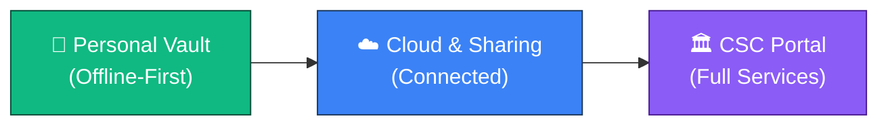
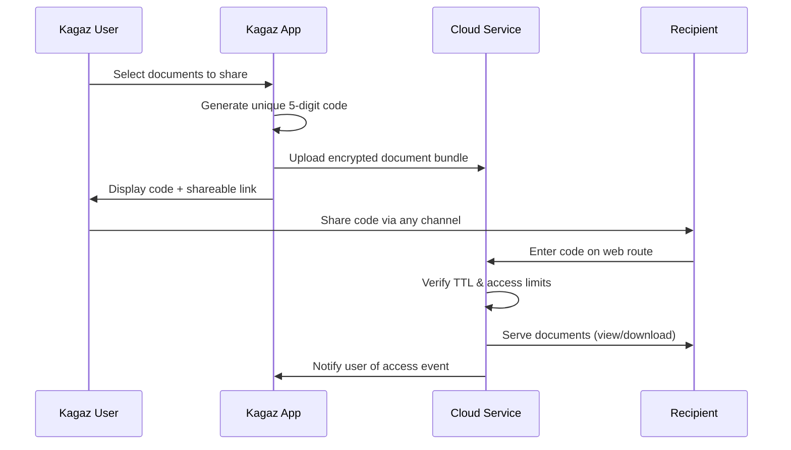
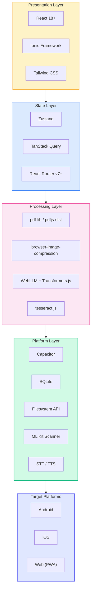
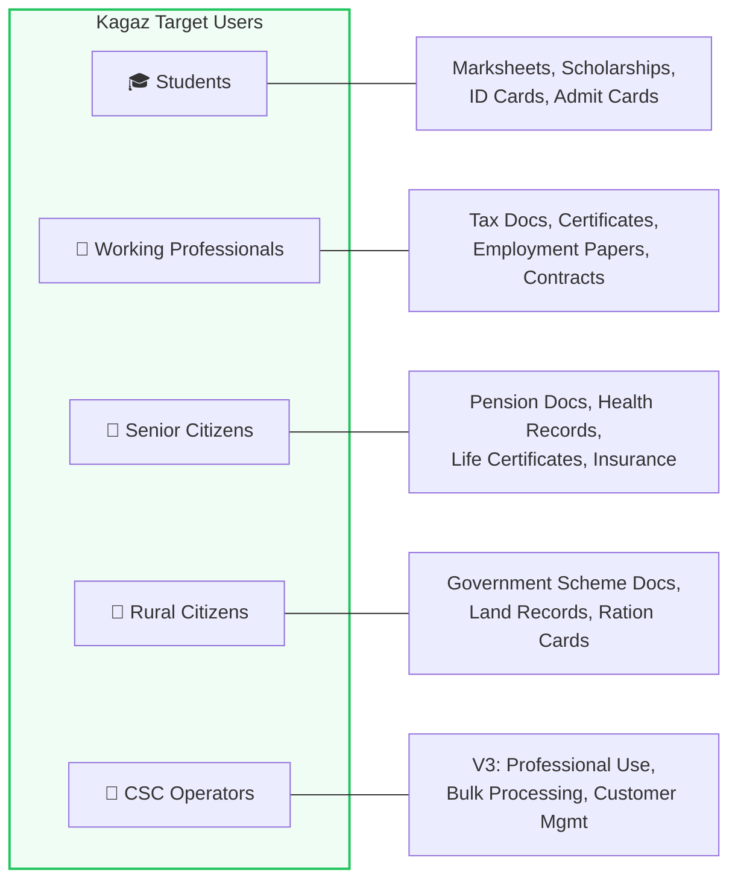
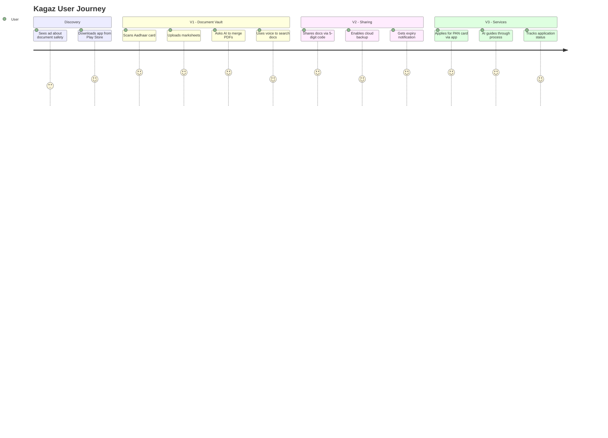

# Kagaz — by Omni Docs

> **Sab kagaj — ek Jagah.**
> **All your papers — one place.**
>
> Smart Document & Services Hub for India.
>
> **Project Overview** · Version 1.0 · Last Updated: 2026-06-08

---

## Table of Contents

- [Vision](#vision)
- [Business Model: "Fear is Our Strategy"](#business-model-fear-is-our-strategy)
- [App Portfolio (the two-app strategy)](#app-portfolio-the-two-app-strategy)
- [Version Roadmap](#version-roadmap)
  - [V1: Document Vault (Fully Offline)](#v1-document-vault-fully-offline)
  - [V2: Cloud & Sharing](#v2-cloud--sharing)
  - [V3: Consumer CSC Services](#v3-consumer-csc-services)
  - [V4: Operator Platform (separate app)](#v4-operator-platform-separate-app)
- [Version Progression Diagram](#version-progression-diagram)
- [Tech Stack Summary](#tech-stack-summary)
- [Target Users](#target-users)
- [Success Metrics](#success-metrics)

---

## Vision

> An all-in-one document management and government services app for India's **1.4 billion** citizens.

Kagaz starts with **personal document organization** and **AI-powered document operations**, scales to **cloud-shared documents**, and ultimately becomes a **digital CSC (Common Service Centre)** — bringing **800+ government services** to every smartphone.



**Core Principle**: Every feature works offline first. Cloud is an enhancement, never a requirement. No user should be excluded because of connectivity.

---

## App Portfolio (the two-app strategy)

Kagaz ships as **two distinct apps in one monorepo**, not one app with a role-selector. See [13-app-portfolio.md](./13-app-portfolio.md) for the full rationale.

| App | Audience | Form factor | Versions | Distribution |
|---|---|---|---|---|
| **Kagaz** | Every citizen — students, working pros, seniors, rural users | Mobile-first (Android primary, iOS secondary, PWA fallback) | V1 → V2 → **V3 (consumer CSC services)** | Play Store, App Store |
| **Kagaz Operator** | CSC operators, agents, sub-agents | Tablet/desktop-first PWA (Android tablet build optional) | **V4** | Direct install (web) + Play Store (tablet) |

### Why two apps, not one

- **App size.** The consumer app already carries the WebLLM model (~600 MB cached after first run). Adding operator dashboards, customer-management UI, and bulk-processing tools would push installs onto the edge of what 16 GB rural phones can handle.
- **UX divergence.** A farmer scanning his Aadhaar and a CSC operator processing 40 applications per day need fundamentally different interfaces. Bundling both creates a worst-of-both compromise.
- **Audience confusion.** Asking a first-time user "Are you a Simple User or a CSC Operator?" hurts conversion. Most don't know what CSC means. Default everyone to the consumer app; let operators self-select by installing the Operator app.
- **Different release cadences.** The consumer app needs to be stable for 100M+ users. The operator app evolves faster with operator feedback.

### What they share

A pnpm monorepo with `packages/*` for: design tokens, UI primitives, PDF engine, image engine, OCR, AI kit, DB, crypto, and agent-kit. Both apps consume the same Kagaz backend (V2+) and the same Kagaz account.

### No role-selector on first launch

The consumer app **defaults to consumer**. Operators discover the Operator app via:
- Settings → "Become a CSC Operator" → opens the Operator app's install page.
- Marketing — operator outreach is direct (CSC associations, agent networks), not in-app.

---

## Business Model: "Fear is Our Strategy"

Kagaz is built on a fundamental human truth — **people act on fear faster than on convenience**. Our four fear pillars drive user acquisition and retention:

| Fear Pillar | User Pain Point | Kagaz Solution |
|---|---|---|
| 🔒 **Fear of Losing Documents** | Aadhaar, PAN, marksheets, certificates can be lost, damaged, or stolen | Secure on-device vault with biometric lock, encrypted backup, organized storage |
| ⏰ **Fear of Missing Deadlines** | Scholarship forms, exam registrations, government scheme deadlines slip by | Smart notifications, deadline tracking, auto-reminders for renewals |
| 😰 **Fear of Complex Processes** | Which forms? Which documents? What steps? Government processes are opaque | AI-guided workflows, step-by-step assistance, auto-fill from stored documents |
| 🛡️ **Fear of Getting Scammed** | Local CSC shops overcharge, steal data, or provide incomplete services | Transparent fee comparison, secure processing, verified service providers |

> **Kagaz turns fear into trust** — secure, transparent, AI-guided, always accessible.

### Revenue Model (Planned)

| Tier | Price | App | Features |
|---|---|---|---|
| **Free** | ₹0 | Kagaz | Unlimited local storage, AI assistant (basic), all document operations |
| **Pro** | ₹99/month | Kagaz | Cloud backup, sharing, cross-device sync, priority AI (V2+) |
| **CSC Operator** | ₹499/month | Kagaz Operator | Operator dashboard, bulk processing, customer management, operator analytics (V4) |
| **Enterprise/Gov** | Custom | Both | White-label, API access, government integrations |

---

## Version Roadmap

### V1: Document Vault (Fully Offline)

> **Status**: Active Development · **Target**: MVP Launch  
> **Core Promise**: "Your documents, always safe, always accessible — no internet needed."

#### Feature Set

| Category | Features |
|---|---|
| **Document Capture** | Upload from gallery, camera capture, file picker, document scanning with edge detection |
| **AI Document Operations** | Merge PDFs, split PDFs, convert formats (image↔PDF), compress files, encrypt/decrypt, OCR text extraction |
| **AI Chatbot** | Tool-calling capable LLM, can perform all document operations via natural conversation |
| **Voice Interface** | Offline Speech-to-Text (STT) and Text-to-Speech (TTS), full voice-driven document management |
| **Smart Navigation** | AI can navigate app screens automatically for user convenience |
| **Multilingual** | Hindi, English, + regional languages (Tamil, Telugu, Bengali, Marathi, and more) |
| **Smart Search** | Full-text search across document names, descriptions, OCR text, and tags |
| **Organization** | Nested folders, custom tags, categories, favorites, recent documents |
| **Security** | Biometric lock (fingerprint/face) for sensitive documents, per-document locking |
| **Accessibility** | Screen reader support, high contrast mode, adjustable font scaling, haptic feedback |
| **Storage** | 100% offline, on-device storage, usage stats, cleanup suggestions |

#### Key Differentiators (V1)

- **Fully offline AI** — no server, no data leaves the device
- **Voice-first design** — critical for accessibility and rural users
- **AI tool calling** — say "merge my Aadhaar and PAN into one PDF" and it's done
- **Edge-detected scanning** — professional quality document scans from any camera

---

### V2: Cloud & Sharing

> **Status**: Planned · **Requires**: V1 stable  
> **Core Promise**: "Share any document with anyone, anywhere — securely and on your terms."

#### Feature Set

| Category | Features |
|---|---|
| **Shareable Links** | Generate expirable, TTL-based sharing links for any document |
| **5-Digit Code Sharing** | Simple unique code — anyone enters it on a web route to access shared docs |
| **Cloud Backup** | End-to-end encrypted backup to cloud storage |
| **Cross-Device Sync** | Seamless sync across phone, tablet, and web |
| **Consent Management** | Granular control over who can access, download, or view shared documents |
| **Voice AI (Upgraded)** | Voice-to-voice AI assistant with improved conversational abilities |
| **Expiry Notifications** | Alerts for documents nearing expiry (licenses, certificates, IDs) |

#### Sharing Flow



---

### V3: Consumer CSC Services

> **Status**: Planned · **Requires**: V2 stable · **App**: Kagaz (consumer)
> **Core Promise**: "Every government service, in your pocket, in your language."
>
> Scope: features in the **consumer app** only. The CSC *operator* platform is V4 — see below.

#### Feature Set

| Category | Features |
|---|---|
| **Guided Workflows** | Step-by-step guidance for PAN card, Aadhaar, Passport, Income Certificate, Caste Certificate, etc. |
| **AI Service Expert** | Chatbot knows all processes, required documents, fees, timelines, and common pitfalls |
| **Auto-Fill Forms** | Automatically populate government forms from stored documents using OCR data |
| **My Application Tracking** | The user tracks the status of their *own* submitted applications (not customers'). |
| **CSC Locator** | Find nearest physical CSC centers with ratings, reviews, and fee comparison |
| **Fee Transparency** | Compare Kagaz's fees with local CSC rates — show users how much they save |
| **Community Features** | User reviews, tips, success stories, help forums |

#### Service Categories

```
📋 Identity Documents      — Aadhaar, PAN Card, Voter ID, Passport
📚 Education               — Marksheets, Certificates, Scholarship Applications  
💰 Financial               — Income Certificate, Tax Filing, Bank Account Opening
🏠 Property                — Land Records, Property Registration, Mutation
👨‍👩‍👧‍👦 Social Welfare          — Ration Card, Pension, Widow/Disability Benefits
🏥 Health                  — Ayushman Bharat, Health ID, Insurance Claims
💼 Employment              — PF, ESI, Labour Card, MSME Registration
🌾 Agriculture             — Kisan Credit Card, PM-KISAN, Crop Insurance
```

---

### V4: Operator Platform (separate app)

> **Status**: Planned · **Requires**: V3 stable · **App**: **Kagaz Operator** (new, separate)
> **Core Promise**: "Run your CSC business from one screen. Your customers, your services, your earnings."
>
> Ships as a **distinct PWA + Android tablet app**, not a mode toggle inside the consumer app. See [13-app-portfolio.md](./13-app-portfolio.md).

#### Feature Set

| Category | Features |
|---|---|
| **Operator Dashboard** | Tablet/desktop-first dashboard with today's queue, in-progress applications, revenue snapshot. |
| **Customer Management (CRM)** | Each operator's customer list with contact info, document vault references (with the customer's consent), and application history. |
| **Bulk Processing** | Process the same service type for many customers in parallel (e.g., 20 Ayushman cards in one sitting). |
| **Operator Analytics** | Services delivered, revenue, average completion time, customer ratings, top services. |
| **Customer Ratings & Reviews** | Operators receive ratings from consumer-app users; ratings feed into V3's CSC Locator. |
| **Receipt & Invoicing** | Auto-generated GST-compliant receipts; downloadable monthly statements. |
| **Dispute Resolution** | In-app workflow for service issues, refunds, and resolution tracking. |
| **Operator Onboarding** | KYC verification, training modules, certification quizzes before activation. |
| **Subscription Billing** | ₹499/month subscription management, auto-renew, grace period. |

#### How operators get customer documents

V4 introduces a **document-share grant**: a consumer (using the Kagaz app) can grant a specific operator scoped, time-limited access to selected vault documents via the 5-digit code mechanism (V2) — extended with operator-aware semantics. The operator's app receives only what's needed for the service; the consumer can revoke any time.

---

## Version Progression Diagram

```mermaid
graph TB
    subgraph V1["🟢 V1: Document Vault (Offline)"]
        V1A["📄 Document Upload/Capture/Scan"]
        V1B["🤖 AI Operations<br/>(merge, split, convert, compress, encrypt, OCR)"]
        V1C["💬 AI Chatbot + Tool Calling"]
        V1D["🎙️ Voice Input/Output (Offline)"]
        V1E["🔍 Smart Search + Filters + Tags"]
        V1F["🔐 Biometric Lock"]
        V1G["🌐 Multilingual Support"]
        V1H["♿ Full Accessibility"]
        V1I["🧭 AI Screen Navigation"]
    end

    subgraph V2["🔵 V2: Cloud & Sharing"]
        V2A["🔗 Shareable TTL Links"]
        V2B["🔢 5-Digit Code Sharing"]
        V2C["☁️ E2E Encrypted Cloud Backup"]
        V2D["🔄 Cross-Device Sync"]
        V2E["✅ Consent Management"]
        V2F["🎙️ Voice-to-Voice AI (Upgraded)"]
        V2G["⏰ Document Expiry Notifications"]
    end

    subgraph V3["🟣 V3: Consumer CSC Services (Kagaz)"]
        V3A["📝 Guided Service Workflows"]
        V3B["🤖 AI Service Expert"]
        V3C["📋 Auto-Fill Government Forms"]
        V3D["📊 My Application Tracking"]
        V3E["📍 Nearest CSC Locator + Ratings"]
        V3F["💰 Fee Transparency"]
        V3G["👥 Community Features"]
    end

    subgraph V4["🟠 V4: Operator Platform (Kagaz Operator)"]
        V4A["🖥️ Operator Dashboard"]
        V4B["👥 Customer Management (CRM)"]
        V4C["📦 Bulk Processing"]
        V4D["📈 Operator Analytics"]
        V4E["⭐ Ratings & Disputes"]
        V4F["🧾 GST Receipts & Invoicing"]
        V4G["🪪 Operator KYC & Onboarding"]
    end

    V1 -->|"+ Cloud Layer"| V2
    V2 -->|"+ Services Layer"| V3
    V3 -.->|"separate app"| V4

    style V1 fill:#ecfdf5,stroke:#10b981,stroke-width:2px
    style V2 fill:#eff6ff,stroke:#3b82f6,stroke-width:2px
    style V3 fill:#f5f3ff,stroke:#8b5cf6,stroke-width:2px
    style V4 fill:#fff7ed,stroke:#f97316,stroke-width:2px
```



---

## Tech Stack Summary

### Frontend & UI

| Technology | Purpose | Version |
|---|---|---|
| **React** | UI library | 18.x+ |
| **TypeScript** | Type safety | 5.x+ |
| **Ionic Framework** | Mobile-optimized UI components | 8.x+ |
| **Tailwind CSS** | Utility-first styling | 3.x+ |
| **Vite** | Build tool & dev server | 5.x+ |

### State Management & Data Fetching

| Technology | Purpose |
|---|---|
| **Zustand** | Lightweight global state management |
| **TanStack Query** | Async data fetching, caching, and synchronization |
| **React Router v7+** or **Ionic React Router** | Client-side routing |

### Platform & Native

| Technology | Purpose |
|---|---|
| **Capacitor** | Native bridge for iOS, Android, and Web |
| **@capacitor-mlkit/document-scanner** | ML-powered document scanning with edge detection |
| **Native Capacitor STT/TTS Plugins** | Offline speech-to-text and text-to-speech |

### Document Processing

| Technology | Purpose |
|---|---|
| **pdf-lib** | PDF creation, modification, merging, splitting |
| **pdfjs-dist** | PDF rendering and text extraction |
| **@pdfsmaller/pdf-encrypt** | PDF encryption and password protection |
| **browser-image-compression** | Client-side image compression |
| **heic-to** | HEIC to JPEG/PNG conversion |
| **Canvas API** | Image manipulation, cropping, enhancement |

### AI & ML

| Technology | Purpose |
|---|---|
| **WebLLM (@mlc-ai/web-llm)** | On-device LLM inference for AI chatbot |
| **Transformers.js** | On-device ML models for document classification |
| **tesseract.js** | Client-side OCR text extraction |

### Database & Storage

| Technology | Purpose |
|---|---|
| **SQLite (@capacitor-community/sqlite)** | Primary structured data storage (native) |
| **Dexie.js** | IndexedDB wrapper (web fallback) |
| **Capacitor Filesystem** | Document file storage |

### Tech Stack Architecture



---

## Target Users

### Primary User Personas



| Persona | Age Range | Key Needs | Version |
|---|---|---|---|
| **🎓 Students** | 15–25 | Store marksheets, track scholarship deadlines, manage admission documents | V1 |
| **💼 Working Professionals** | 25–55 | Tax documents, professional certificates, employment papers, quick sharing | V1 + V2 |
| **👴 Senior Citizens** | 55+ | Pension documents, health records, life certificates — needs voice & accessibility | V1 |
| **🌾 Rural Citizens** | All ages | Government scheme documents, land records, ration cards — needs multilingual + voice | V1 + V3 |
| **🏪 CSC Operators** | 25–50 | Professional document processing, customer management, service workflows | **V4 — separate Kagaz Operator app** |

### User Journey



---

## Success Metrics

| Metric | V1 (Kagaz) | V2 (Kagaz) | V3 (Kagaz) | V4 (Kagaz Operator) |
|---|---|---|---|---|
| **Downloads** | 100K | 500K | 2M | 5K active operators |
| **DAU** | 10K | 50K | 200K | 3K operators/day |
| **Retention (D30)** | 40% | 50% | 60% | 80% (paying) |
| **Documents Stored** | 500K | 5M | 50M | — |
| **AI Interactions/Day** | 5K | 25K | 100K | 50K |
| **NPS Score** | 50+ | 60+ | 70+ | 60+ |
| **Services Processed** | — | — | 10K/month | 100K/month |
| **Revenue** | — | ₹5L/month | ₹50L/month | +₹25L/month (operator subs) |

---

> [!NOTE]
> This document serves as the north star for Kagaz development. All architectural and design decisions should align with the vision outlined here. Each version builds on the previous one — **V1 must be rock-solid before V2 begins**.

---

*Document maintained by the Kagaz Architecture Team*
