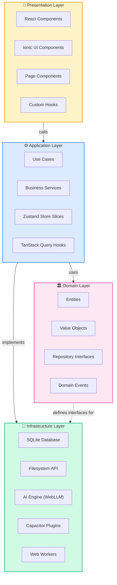
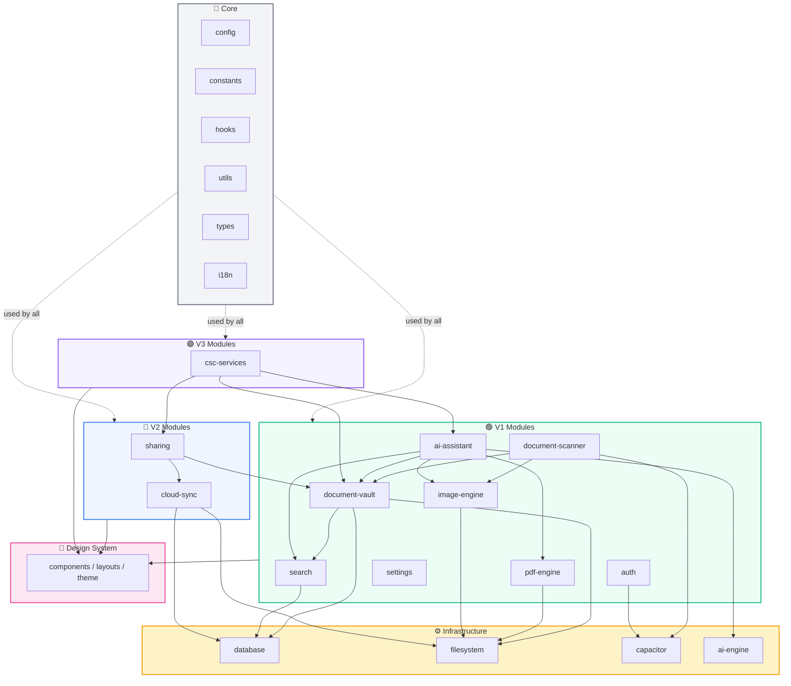
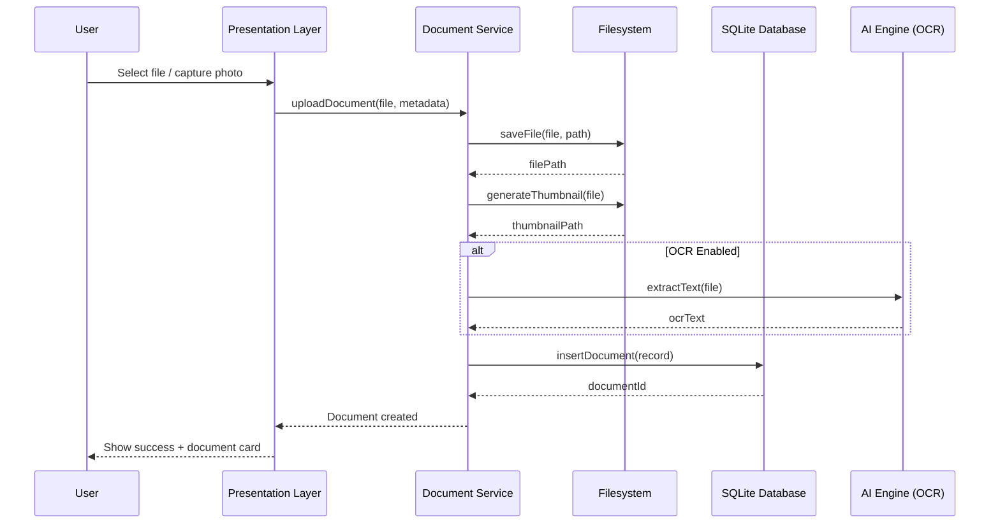
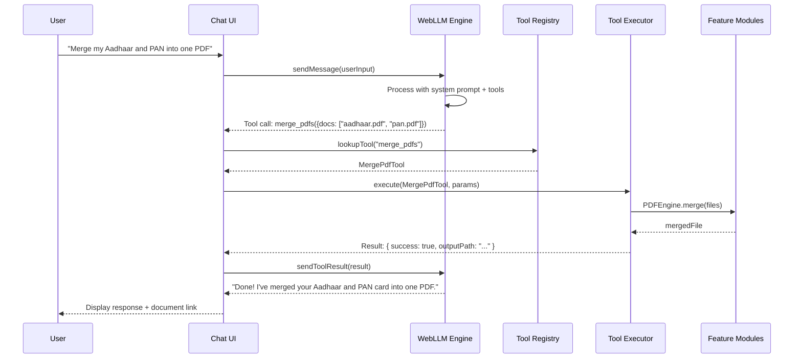
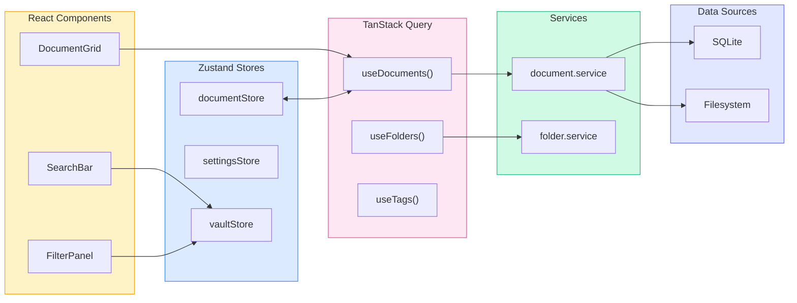
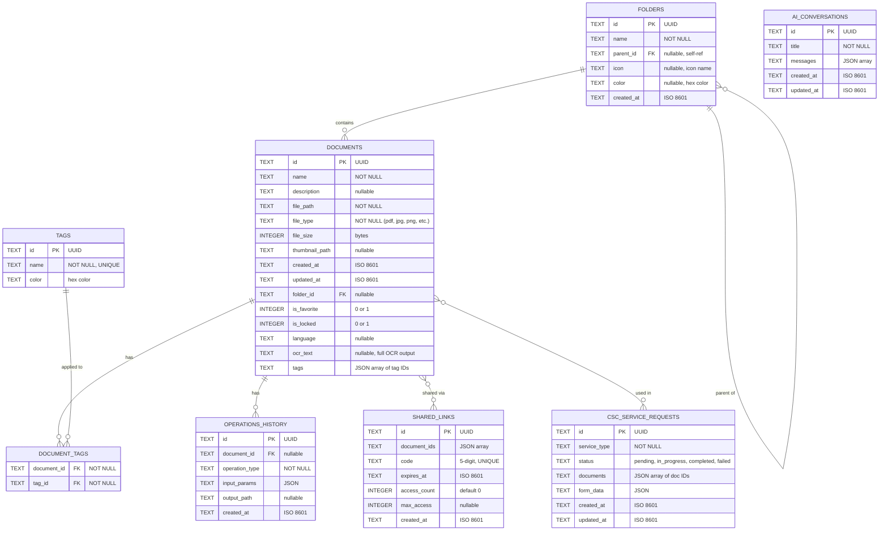
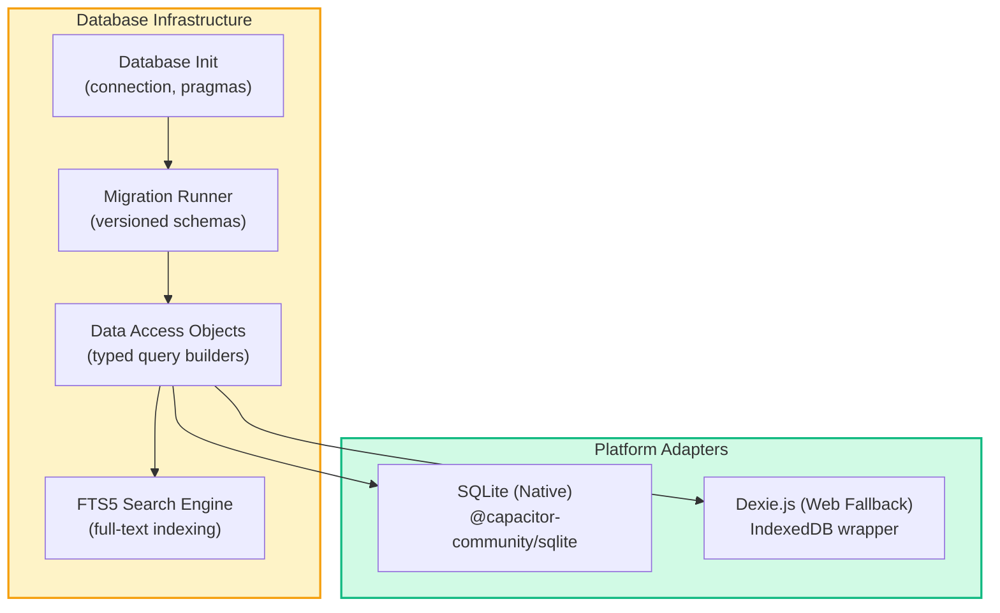
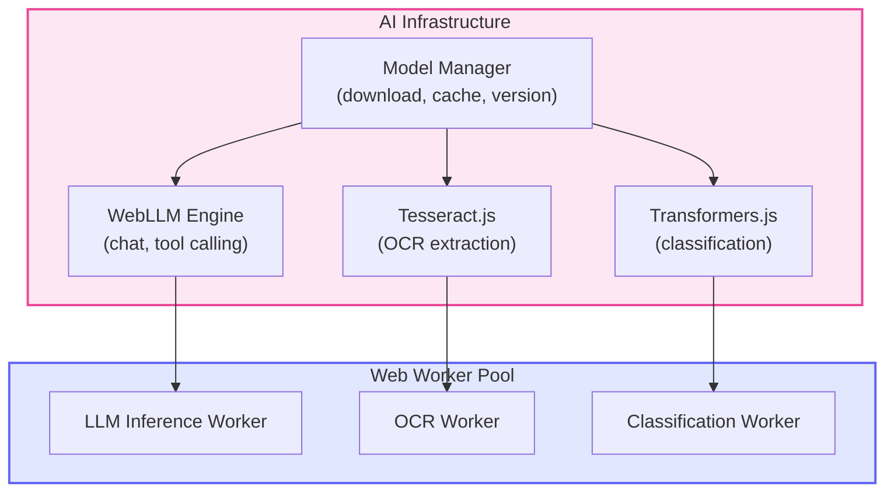

# Kagaz — System Architecture

> **Architecture Document** · Version 1.0 · Last Updated: 2026-06-07

---

## Table of Contents

- [Architecture Overview](#architecture-overview)
- [Architecture Principles](#architecture-principles)
- [Layer Architecture](#layer-architecture)
- [Module Structure](#module-structure)
- [Module Dependency Map](#module-dependency-map)
- [Data Flow Architecture](#data-flow-architecture)
- [Database Schema](#database-schema)
- [Infrastructure Services](#infrastructure-services)
- [Build & Platform Configuration](#build--platform-configuration)
- [Performance & Optimization Strategy](#performance--optimization-strategy)

---

## Architecture Overview

Kagaz follows a **Clean Architecture** pattern combined with a **feature-based modular structure**. This ensures:

- **Separation of concerns** — each layer has a clear responsibility
- **Testability** — business logic is isolated from framework code
- **Scalability** — new modules (V2, V3) can be added without modifying existing ones
- **Maintainability** — feature modules are self-contained and independently deployable



> [!IMPORTANT]
> The **Domain Layer** has **zero dependencies** on any other layer. All interfaces are defined in the domain and implemented in the infrastructure layer. This is the core principle of Clean Architecture — the dependency rule flows inward.

---

## Architecture Principles

| Principle | Description |
|---|---|
| **Offline-First** | Every feature must work without network. Cloud is an enhancement, never a requirement. |
| **Feature Modules** | Each module is self-contained with its own components, services, store, types, and pages. |
| **Dependency Inversion** | High-level modules don't depend on low-level modules. Both depend on abstractions (interfaces). |
| **Single Responsibility** | Each service, component, and hook has one clear purpose. |
| **Progressive Enhancement** | V2 and V3 features are additive modules that never break V1 functionality. |
| **Web Worker Offloading** | All heavy computations (PDF ops, image processing, AI inference) run in Web Workers to keep the UI thread responsive. |
| **Type Safety** | Strict TypeScript throughout — no `any` types in production code. |
| **Lazy Loading** | Modules are code-split and loaded on demand to minimize initial bundle size. |

---

## Layer Architecture

### Presentation Layer

> React + Ionic components, pages, layouts, and custom hooks that handle user interaction.

| Responsibility | Details |
|---|---|
| **UI Rendering** | React components styled with Ionic + Tailwind CSS |
| **User Input Handling** | Forms, gestures, voice input, camera triggers |
| **Navigation** | React Router v7+ or Ionic React Router for page transitions |
| **State Binding** | Zustand selectors and TanStack Query hooks for reactive data |
| **Accessibility** | ARIA labels, screen reader support, keyboard navigation, font scaling |
| **Theming** | Light/dark mode via CSS custom properties and Tailwind classes |

### Application Layer

> Use cases, business services, store slices, and query hooks that orchestrate operations.

| Responsibility | Details |
|---|---|
| **Use Cases** | Coordinate domain logic for specific user actions (e.g., `MergeDocumentsUseCase`) |
| **Business Services** | Encapsulate multi-step workflows (e.g., scan → enhance → OCR → save) |
| **State Management** | Zustand store slices for each module's state |
| **Data Fetching** | TanStack Query hooks for async data with caching and invalidation |
| **Error Handling** | Centralized error boundaries and toast notifications |

### Domain Layer

> Pure business entities, value objects, and interfaces — zero framework dependencies.

| Responsibility | Details |
|---|---|
| **Entities** | `Document`, `Folder`, `Tag`, `AIConversation`, `SharedLink`, `ServiceRequest` |
| **Value Objects** | `FileType`, `OperationType`, `DocumentStatus`, `SharePermission` |
| **Repository Interfaces** | `IDocumentRepository`, `IFolderRepository`, `ITagRepository`, etc. |
| **Domain Events** | `DocumentCreated`, `DocumentShared`, `OperationCompleted`, etc. |
| **Validation Rules** | Entity-level validation (file size limits, name constraints, etc.) |

### Infrastructure Layer

> Concrete implementations of domain interfaces, database access, file I/O, AI engines, and Capacitor plugins.

| Responsibility | Details |
|---|---|
| **Database (SQLite)** | Schema, migrations, DAOs, query builders |
| **Filesystem** | File storage abstraction over Capacitor Filesystem API |
| **AI Engine** | WebLLM initialization, model loading, inference, tool calling |
| **Capacitor Plugins** | Wrapper services for camera, biometrics, scanner, STT/TTS |
| **Web Workers** | Thread pool for PDF operations, image processing, OCR |

---

## Module Structure

The project follows a **feature-first** organization. Each module under `src/modules/` is a self-contained feature package.

```
src/
├── core/                          # Shared core module
│   ├── config/                    # App configuration
│   │   ├── app.config.ts          # App-wide settings (limits, defaults)
│   │   ├── capacitor.config.ts    # Capacitor platform config
│   │   └── ai.config.ts           # AI model settings & parameters
│   ├── constants/                 # App-wide constants
│   │   ├── file-types.ts          # Supported file types & MIME mappings
│   │   ├── operation-types.ts     # Document operation enums
│   │   └── routes.ts              # Route path constants
│   ├── hooks/                     # Shared React hooks
│   │   ├── useDebounce.ts
│   │   ├── useMediaQuery.ts
│   │   ├── usePlatform.ts         # Detect iOS/Android/Web
│   │   └── useAccessibility.ts    # Font scale, high contrast
│   ├── utils/                     # Utility functions
│   │   ├── date.utils.ts
│   │   ├── file.utils.ts
│   │   ├── format.utils.ts
│   │   └── validation.utils.ts
│   ├── types/                     # Global TypeScript types
│   │   ├── common.types.ts
│   │   ├── capacitor.types.ts
│   │   └── api.types.ts
│   └── i18n/                      # Internationalization setup
│       ├── i18n.ts                # i18next configuration
│       ├── locales/
│       │   ├── en.json            # English translations
│       │   ├── hi.json            # Hindi translations
│       │   ├── ta.json            # Tamil translations
│       │   ├── te.json            # Telugu translations
│       │   ├── bn.json            # Bengali translations
│       │   └── mr.json            # Marathi translations
│       └── language-detector.ts
│
├── modules/
│   ├── document-vault/            # V1: Core document management
│   │   ├── components/            # UI components
│   │   │   ├── DocumentCard.tsx
│   │   │   ├── DocumentGrid.tsx
│   │   │   ├── DocumentList.tsx
│   │   │   ├── FolderTree.tsx
│   │   │   ├── TagChip.tsx
│   │   │   ├── BulkActionBar.tsx
│   │   │   ├── StorageIndicator.tsx
│   │   │   └── DocumentPreview.tsx
│   │   ├── hooks/                 # Module-specific hooks
│   │   │   ├── useDocuments.ts
│   │   │   ├── useFolders.ts
│   │   │   ├── useTags.ts
│   │   │   └── useBulkActions.ts
│   │   ├── services/              # Business logic services
│   │   │   ├── document.service.ts
│   │   │   ├── folder.service.ts
│   │   │   ├── tag.service.ts
│   │   │   └── storage.service.ts
│   │   ├── store/                 # Zustand store slices
│   │   │   ├── document.store.ts
│   │   │   └── vault.store.ts
│   │   ├── types/                 # Module types
│   │   │   ├── document.types.ts
│   │   │   ├── folder.types.ts
│   │   │   └── tag.types.ts
│   │   └── pages/                 # Route pages
│   │       ├── VaultHomePage.tsx
│   │       ├── FolderPage.tsx
│   │       ├── DocumentDetailPage.tsx
│   │       └── StoragePage.tsx
│   │
│   ├── document-scanner/          # V1: Camera/scan functionality
│   │   ├── components/
│   │   │   ├── ScannerViewfinder.tsx
│   │   │   ├── CropOverlay.tsx
│   │   │   ├── EdgeDetectionPreview.tsx
│   │   │   └── ScanResultCarousel.tsx
│   │   ├── services/
│   │   │   ├── scanner.service.ts
│   │   │   ├── edge-detection.service.ts
│   │   │   └── image-enhance.service.ts
│   │   └── pages/
│   │       ├── ScannerPage.tsx
│   │       └── ScanReviewPage.tsx
│   │
│   ├── pdf-engine/                # V1: PDF operations engine
│   │   ├── services/              # pdf-lib, pdfjs-dist wrappers
│   │   │   ├── pdf-merge.service.ts
│   │   │   ├── pdf-split.service.ts
│   │   │   ├── pdf-convert.service.ts
│   │   │   ├── pdf-compress.service.ts
│   │   │   ├── pdf-encrypt.service.ts
│   │   │   ├── pdf-render.service.ts
│   │   │   └── pdf-metadata.service.ts
│   │   ├── workers/               # Web Workers for heavy ops
│   │   │   ├── pdf-merge.worker.ts
│   │   │   ├── pdf-split.worker.ts
│   │   │   ├── pdf-compress.worker.ts
│   │   │   └── pdf-render.worker.ts
│   │   └── types/
│   │       └── pdf.types.ts
│   │
│   ├── image-engine/              # V1: Image operations engine
│   │   ├── services/
│   │   │   ├── image-compress.service.ts
│   │   │   ├── image-convert.service.ts
│   │   │   ├── image-crop.service.ts
│   │   │   ├── image-enhance.service.ts
│   │   │   └── heic-converter.service.ts
│   │   ├── workers/
│   │   │   ├── image-compress.worker.ts
│   │   │   └── image-convert.worker.ts
│   │   └── types/
│   │       └── image.types.ts
│   │
│   ├── ai-assistant/              # V1: AI chatbot with tool calling
│   │   ├── components/            # Chat UI, voice buttons
│   │   │   ├── ChatWindow.tsx
│   │   │   ├── ChatBubble.tsx
│   │   │   ├── VoiceButton.tsx
│   │   │   ├── ToolCallIndicator.tsx
│   │   │   └── SuggestedPrompts.tsx
│   │   ├── services/              # WebLLM engine, tool registry
│   │   │   ├── llm-engine.service.ts
│   │   │   ├── tool-registry.service.ts
│   │   │   ├── tool-executor.service.ts
│   │   │   ├── stt.service.ts
│   │   │   └── tts.service.ts
│   │   ├── tools/                 # Tool definitions for AI
│   │   │   ├── merge-pdf.tool.ts
│   │   │   ├── split-pdf.tool.ts
│   │   │   ├── compress-document.tool.ts
│   │   │   ├── convert-format.tool.ts
│   │   │   ├── search-documents.tool.ts
│   │   │   ├── navigate-screen.tool.ts
│   │   │   └── tool.types.ts
│   │   ├── prompts/               # System prompts
│   │   │   ├── system-prompt.ts
│   │   │   └── tool-instructions.ts
│   │   └── pages/
│   │       └── ChatPage.tsx
│   │
│   ├── search/                    # V1: Search & filter engine
│   │   ├── services/
│   │   │   ├── search.service.ts
│   │   │   ├── filter.service.ts
│   │   │   └── sort.service.ts
│   │   ├── hooks/
│   │   │   ├── useSearch.ts
│   │   │   └── useFilters.ts
│   │   └── components/
│   │       ├── SearchBar.tsx
│   │       ├── FilterPanel.tsx
│   │       ├── SortSelector.tsx
│   │       └── SearchResults.tsx
│   │
│   ├── settings/                  # V1: App settings & preferences
│   │   ├── components/
│   │   │   ├── LanguagePicker.tsx
│   │   │   ├── ThemeToggle.tsx
│   │   │   ├── AccessibilityPanel.tsx
│   │   │   └── StorageSettings.tsx
│   │   ├── pages/
│   │   │   └── SettingsPage.tsx
│   │   └── store/
│   │       └── settings.store.ts
│   │
│   ├── auth/                      # V1: Biometric + local auth
│   │   ├── services/
│   │   │   ├── biometric.service.ts
│   │   │   ├── pin.service.ts
│   │   │   └── auth-guard.service.ts
│   │   └── components/
│   │       ├── BiometricPrompt.tsx
│   │       ├── PinEntry.tsx
│   │       └── LockScreen.tsx
│   │
│   ├── sharing/                   # V2: Document sharing
│   │   ├── services/              # Link generation, TTL, codes
│   │   │   ├── share-link.service.ts
│   │   │   ├── code-generator.service.ts
│   │   │   ├── ttl-manager.service.ts
│   │   │   └── consent.service.ts
│   │   ├── components/
│   │   │   ├── ShareDialog.tsx
│   │   │   ├── CodeDisplay.tsx
│   │   │   ├── ConsentManager.tsx
│   │   │   └── ShareHistory.tsx
│   │   └── pages/
│   │       ├── SharePage.tsx
│   │       └── SharedDocumentViewPage.tsx
│   │
│   ├── cloud-sync/                # V2: Cloud backup & sync
│   │   ├── services/
│   │   │   ├── sync-engine.service.ts
│   │   │   ├── backup.service.ts
│   │   │   ├── encryption.service.ts
│   │   │   └── conflict-resolver.service.ts
│   │   ├── workers/
│   │   │   ├── sync.worker.ts
│   │   │   └── backup.worker.ts
│   │   └── store/
│   │       └── sync.store.ts
│   │
│   └── csc-services/              # V3: CSC service workflows
│       ├── components/
│       │   ├── ServiceCard.tsx
│       │   ├── WorkflowStepper.tsx
│       │   ├── FormAutoFill.tsx
│       │   ├── StatusTracker.tsx
│       │   └── CSCLocatorMap.tsx
│       ├── services/
│       │   ├── workflow-engine.service.ts
│       │   ├── form-autofill.service.ts
│       │   ├── service-tracker.service.ts
│       │   └── csc-locator.service.ts
│       ├── data/                  # Service definitions, requirements
│       │   ├── pan-card.workflow.json
│       │   ├── aadhaar.workflow.json
│       │   ├── passport.workflow.json
│       │   └── service-catalog.json
│       └── pages/
│           ├── ServiceCatalogPage.tsx
│           ├── WorkflowPage.tsx
│           ├── ApplicationStatusPage.tsx
│           └── CSCLocatorPage.tsx
│
├── infrastructure/
│   ├── database/                  # SQLite setup, migrations, DAOs
│   │   ├── database.ts            # Database initialization & connection
│   │   ├── migrations/
│   │   │   ├── 001-initial-schema.ts
│   │   │   ├── 002-add-ocr-fields.ts
│   │   │   └── 003-v2-sharing-tables.ts
│   │   ├── dao/
│   │   │   ├── document.dao.ts
│   │   │   ├── folder.dao.ts
│   │   │   ├── tag.dao.ts
│   │   │   ├── operation.dao.ts
│   │   │   ├── conversation.dao.ts
│   │   │   └── shared-link.dao.ts
│   │   └── repositories/
│   │       ├── sqlite-document.repository.ts
│   │       ├── sqlite-folder.repository.ts
│   │       └── sqlite-tag.repository.ts
│   ├── filesystem/                # File storage abstraction
│   │   ├── file-storage.ts        # Abstract file storage interface
│   │   ├── capacitor-fs.ts        # Capacitor Filesystem implementation
│   │   ├── web-fs.ts              # Web fallback (IndexedDB-backed)
│   │   └── thumbnail.service.ts   # Thumbnail generation & caching
│   ├── capacitor/                 # Capacitor plugin wrappers
│   │   ├── camera.plugin.ts
│   │   ├── biometric.plugin.ts
│   │   ├── scanner.plugin.ts
│   │   ├── share.plugin.ts
│   │   └── haptics.plugin.ts
│   └── ai/                        # AI engine initialization
│       ├── webllm-engine.ts       # WebLLM setup & model management
│       ├── transformers-engine.ts # Transformers.js setup
│       ├── tesseract-engine.ts    # Tesseract.js OCR setup
│       └── model-cache.ts         # Model download & caching manager
│
├── design-system/                 # Shared UI components
│   ├── components/                # Button, Card, Modal, etc.
│   │   ├── Button.tsx
│   │   ├── Card.tsx
│   │   ├── Modal.tsx
│   │   ├── Toast.tsx
│   │   ├── Badge.tsx
│   │   ├── Skeleton.tsx
│   │   ├── EmptyState.tsx
│   │   ├── ProgressBar.tsx
│   │   ├── FAB.tsx
│   │   └── BottomSheet.tsx
│   ├── layouts/                   # Page layouts
│   │   ├── MainLayout.tsx
│   │   ├── FullScreenLayout.tsx
│   │   └── SplitPaneLayout.tsx
│   ├── theme/                     # Theme tokens, dark mode
│   │   ├── tokens.css             # CSS custom properties
│   │   ├── dark-mode.css
│   │   └── high-contrast.css
│   └── animations/                # Shared animations
│       ├── page-transitions.ts
│       ├── list-animations.ts
│       └── micro-interactions.ts
│
└── app/                           # App shell
    ├── routes/                    # Route definitions
    │   ├── index.tsx              # Route tree
    │   ├── guards/                # Route guards (auth, version)
    │   │   ├── AuthGuard.tsx
    │   │   └── VersionGuard.tsx
    │   └── lazy-imports.ts        # Lazy-loaded route components
    ├── providers/                 # Context providers
    │   ├── AppProviders.tsx       # Combined provider wrapper
    │   ├── ThemeProvider.tsx
    │   ├── I18nProvider.tsx
    │   ├── DatabaseProvider.tsx
    │   └── AIProvider.tsx
    └── App.tsx                    # Root component
```

---

## Module Dependency Map

Each module has explicit, unidirectional dependencies. This prevents circular references and enables independent development.



> [!WARNING]
> **Dependency Rule**: Modules may only depend on modules from the **same version or earlier**. V2 modules can depend on V1 modules, but V1 modules must **never** depend on V2 or V3 modules. This ensures backward compatibility and clean version boundaries.

---

## Data Flow Architecture

### Document Upload Flow



### AI Chat with Tool Calling Flow



### State Management Flow



---

## Database Schema

### Entity-Relationship Diagram



### Table Definitions

#### `documents` — Core document records

| Column | Type | Constraints | Description |
|---|---|---|---|
| `id` | TEXT | PRIMARY KEY | UUID v4 |
| `name` | TEXT | NOT NULL | User-visible document name |
| `description` | TEXT | — | Optional description or notes |
| `file_path` | TEXT | NOT NULL | Relative path in app storage |
| `file_type` | TEXT | NOT NULL | File extension (pdf, jpg, png, heic, etc.) |
| `file_size` | INTEGER | NOT NULL | File size in bytes |
| `thumbnail_path` | TEXT | — | Path to generated thumbnail |
| `created_at` | TEXT | NOT NULL | ISO 8601 timestamp |
| `updated_at` | TEXT | NOT NULL | ISO 8601 timestamp |
| `folder_id` | TEXT | FK → folders.id | Parent folder (null = root) |
| `is_favorite` | INTEGER | DEFAULT 0 | Boolean flag (0/1) |
| `is_locked` | INTEGER | DEFAULT 0 | Requires biometric to view |
| `language` | TEXT | — | Detected or user-set language |
| `ocr_text` | TEXT | — | Full OCR extracted text for search |
| `tags` | TEXT | — | JSON array of tag IDs (denormalized for query speed) |

#### `folders` — Hierarchical folder structure

| Column | Type | Constraints | Description |
|---|---|---|---|
| `id` | TEXT | PRIMARY KEY | UUID v4 |
| `name` | TEXT | NOT NULL | Folder name |
| `parent_id` | TEXT | FK → folders.id | Parent folder (null = root level) |
| `icon` | TEXT | — | Icon identifier |
| `color` | TEXT | — | Hex color code for folder |
| `created_at` | TEXT | NOT NULL | ISO 8601 timestamp |

#### `tags` — User-created tags

| Column | Type | Constraints | Description |
|---|---|---|---|
| `id` | TEXT | PRIMARY KEY | UUID v4 |
| `name` | TEXT | NOT NULL, UNIQUE | Tag label |
| `color` | TEXT | NOT NULL | Hex color for tag chip |

#### `document_tags` — Many-to-many join table

| Column | Type | Constraints | Description |
|---|---|---|---|
| `document_id` | TEXT | FK → documents.id, NOT NULL | Document reference |
| `tag_id` | TEXT | FK → tags.id, NOT NULL | Tag reference |

> Composite primary key: (`document_id`, `tag_id`)

#### `operations_history` — Audit log of all document operations

| Column | Type | Constraints | Description |
|---|---|---|---|
| `id` | TEXT | PRIMARY KEY | UUID v4 |
| `document_id` | TEXT | FK → documents.id | Source document (null if multi-doc op) |
| `operation_type` | TEXT | NOT NULL | Enum: merge, split, convert, compress, encrypt, decrypt, ocr |
| `input_params` | TEXT | — | JSON of operation parameters |
| `output_path` | TEXT | — | Path to operation output file |
| `created_at` | TEXT | NOT NULL | ISO 8601 timestamp |

#### `ai_conversations` — Chat history with AI assistant

| Column | Type | Constraints | Description |
|---|---|---|---|
| `id` | TEXT | PRIMARY KEY | UUID v4 |
| `title` | TEXT | NOT NULL | Conversation title (auto-generated or user-set) |
| `messages` | TEXT | NOT NULL | JSON array of message objects `{role, content, toolCalls?, timestamp}` |
| `created_at` | TEXT | NOT NULL | ISO 8601 timestamp |
| `updated_at` | TEXT | NOT NULL | ISO 8601 timestamp |

#### `shared_links` — V2: Document sharing links

| Column | Type | Constraints | Description |
|---|---|---|---|
| `id` | TEXT | PRIMARY KEY | UUID v4 |
| `document_ids` | TEXT | NOT NULL | JSON array of shared document IDs |
| `code` | TEXT | UNIQUE, NOT NULL | 5-digit alphanumeric sharing code |
| `expires_at` | TEXT | NOT NULL | ISO 8601 expiry timestamp |
| `access_count` | INTEGER | DEFAULT 0 | Number of times accessed |
| `max_access` | INTEGER | — | Maximum allowed accesses (null = unlimited) |
| `created_at` | TEXT | NOT NULL | ISO 8601 timestamp |

#### `csc_service_requests` — V3: Government service requests

| Column | Type | Constraints | Description |
|---|---|---|---|
| `id` | TEXT | PRIMARY KEY | UUID v4 |
| `service_type` | TEXT | NOT NULL | Service identifier (pan_card, aadhaar_update, passport, etc.) |
| `status` | TEXT | NOT NULL | Enum: pending, in_progress, completed, failed |
| `documents` | TEXT | — | JSON array of attached document IDs |
| `form_data` | TEXT | — | JSON of form field values |
| `created_at` | TEXT | NOT NULL | ISO 8601 timestamp |
| `updated_at` | TEXT | NOT NULL | ISO 8601 timestamp |

### Indexes

```sql
-- Performance-critical indexes
CREATE INDEX idx_documents_folder ON documents(folder_id);
CREATE INDEX idx_documents_type ON documents(file_type);
CREATE INDEX idx_documents_favorite ON documents(is_favorite);
CREATE INDEX idx_documents_created ON documents(created_at DESC);
CREATE INDEX idx_documents_updated ON documents(updated_at DESC);
CREATE INDEX idx_documents_name ON documents(name);

-- Full-text search index (SQLite FTS5)
CREATE VIRTUAL TABLE documents_fts USING fts5(
    name, description, ocr_text,
    content='documents',
    content_rowid='rowid'
);

-- Folder hierarchy
CREATE INDEX idx_folders_parent ON folders(parent_id);

-- Tags
CREATE INDEX idx_document_tags_doc ON document_tags(document_id);
CREATE INDEX idx_document_tags_tag ON document_tags(tag_id);

-- Operations
CREATE INDEX idx_operations_doc ON operations_history(document_id);
CREATE INDEX idx_operations_type ON operations_history(operation_type);

-- Sharing (V2)
CREATE UNIQUE INDEX idx_shared_links_code ON shared_links(code);
CREATE INDEX idx_shared_links_expires ON shared_links(expires_at);

-- CSC (V3)
CREATE INDEX idx_csc_requests_type ON csc_service_requests(service_type);
CREATE INDEX idx_csc_requests_status ON csc_service_requests(status);
```

---

## Infrastructure Services

### Database Service



### Filesystem Service

| Operation | Native (Capacitor) | Web Fallback |
|---|---|---|
| **Save File** | `Filesystem.writeFile()` → app data directory | IndexedDB blob storage |
| **Read File** | `Filesystem.readFile()` → base64/binary | IndexedDB blob retrieval |
| **Delete File** | `Filesystem.deleteFile()` | IndexedDB entry removal |
| **List Files** | `Filesystem.readdir()` | IndexedDB cursor scan |
| **Get URI** | `Filesystem.getUri()` → native file URI | `URL.createObjectURL()` |
| **Thumbnail** | Canvas API resize → save to cache dir | Canvas API → IndexedDB |

### AI Engine Service



---

## Build & Platform Configuration

### Vite Build Configuration

| Feature | Configuration |
|---|---|
| **Code Splitting** | Route-based chunks via `React.lazy()` and dynamic imports |
| **Web Workers** | Vite's built-in worker support with `?worker` suffix |
| **Asset Optimization** | Image compression, SVG inlining, font subsetting |
| **Environment Variables** | `.env.development`, `.env.production`, `.env.test` |
| **Bundle Analysis** | `rollup-plugin-visualizer` for bundle size monitoring |

### Capacitor Platform Targets

| Platform | Min Version | Notes |
|---|---|---|
| **Android** | API 24 (Android 7.0) | Primary target, 95%+ India market |
| **iOS** | iOS 15+ | Secondary target |
| **Web** | Modern browsers | PWA fallback, sharing web route |

### Build Output

```
dist/
├── index.html
├── assets/
│   ├── js/
│   │   ├── vendor.[hash].js       # React, Ionic, shared deps
│   │   ├── app.[hash].js          # App shell + core
│   │   ├── vault.[hash].js        # Document vault module
│   │   ├── scanner.[hash].js      # Scanner module (lazy)
│   │   ├── ai.[hash].js           # AI assistant (lazy)
│   │   ├── pdf-engine.[hash].js   # PDF engine (lazy)
│   │   └── csc.[hash].js          # CSC services (lazy, V3)
│   ├── css/
│   │   └── styles.[hash].css
│   └── workers/
│       ├── pdf.worker.[hash].js
│       ├── image.worker.[hash].js
│       └── ocr.worker.[hash].js
└── models/                        # AI model cache directory
```

---

## Performance & Optimization Strategy

| Area | Strategy | Target |
|---|---|---|
| **Initial Load** | Code-split by route, lazy-load modules, tree-shake unused Ionic components | < 3s FCP on mid-range Android |
| **Document Operations** | All heavy ops in Web Workers; progress callbacks for UI feedback | Non-blocking UI during processing |
| **AI Model Loading** | Progressive loading with skeleton UI; cache models in IndexedDB/filesystem | First load < 30s, subsequent < 3s |
| **Database Queries** | FTS5 for search, proper indexes, pagination for large collections | < 100ms for typical queries |
| **Image Thumbnails** | Generate on upload, cache aggressively, lazy-load in grids | < 50ms per thumbnail render |
| **Memory Management** | Release blob URLs, dispose Web Workers when idle, limit concurrent operations | < 150MB active memory |
| **Bundle Size** | Per-route code splitting, dynamic imports, icon tree-shaking | < 500KB initial JS (gzipped) |
| **Offline Resilience** | Service Worker for web, Capacitor for native — all data local | 100% functional offline |

> [!TIP]
> Use `React.lazy()` and `Suspense` for all module-level page components. This ensures that V2 and V3 modules are never loaded until the user navigates to them, keeping the V1-only experience fast and lightweight.

---

*Document maintained by the Kagaz Architecture Team*
