# Kagaz — Document Vault Module Architecture

> **Module: `document-vault`** · Version: V1 (Core) · Last Updated: 2026-06-12

---

## Table of Contents

- [Module Overview](#module-overview)
- [Document Data Model](#document-data-model)
- [Module File Structure](#module-file-structure)
- [Document Upload Flow](#document-upload-flow)
- [Document Scanning Flow](#document-scanning-flow)
- [Folder Organization](#folder-organization)
- [Tag System](#tag-system)
- [Search Engine](#search-engine)
- [Filter System](#filter-system)
- [Sort Options](#sort-options)
- [Favorites & Recently Accessed](#favorites--recently-accessed)
- [Document Preview](#document-preview)
- [Document Details View](#document-details-view)
- [Bulk Operations](#bulk-operations)
- [Multilingual Support](#multilingual-support)
- [Accessibility Features](#accessibility-features)
- [Storage Management](#storage-management)
- [Error Handling](#error-handling)

---

## Module Overview

The **Document Vault** module is the heart of Kagaz V1. It manages the complete lifecycle of documents — from capture and upload, through organization and search, to preview and management. Every other V1 module either feeds into or reads from the document vault.

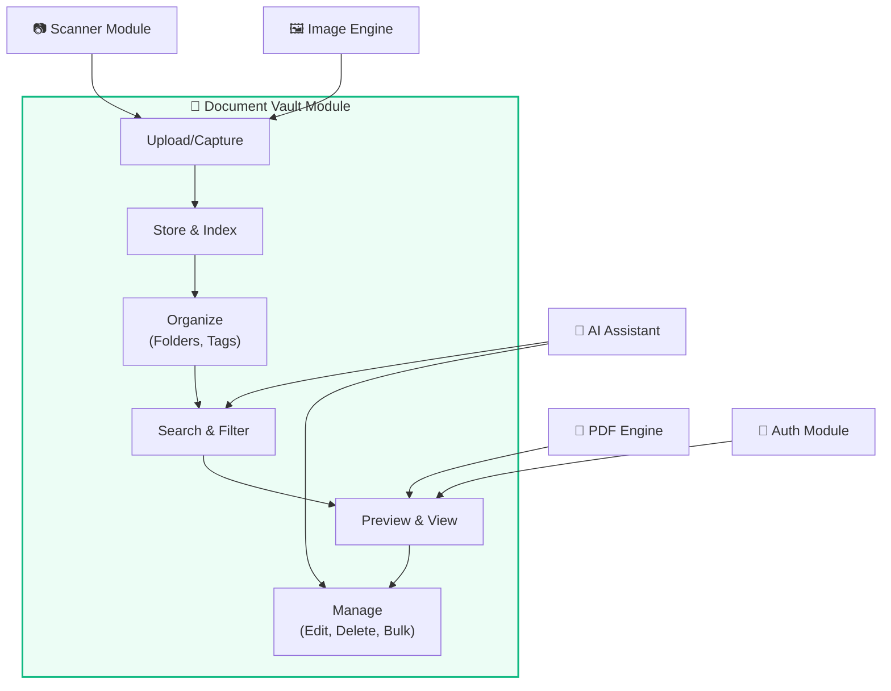

### Module Responsibilities

| Responsibility | Description |
|---|---|
| **Document CRUD** | Create, read, update, delete documents with full metadata |
| **File Management** | Save files to device storage, generate thumbnails, manage file paths |
| **Folder Organization** | Nested folder hierarchy, move/copy operations |
| **Tag Management** | Create/assign/remove tags, filter by tags |
| **Search & Filter** | Full-text search with multiple filter dimensions |
| **Preview** | Render PDFs and images with zoom, pan, and page navigation |
| **Bulk Operations** | Multi-select with batch delete, move, merge, export |
| **Storage Stats** | Track usage, provide cleanup suggestions |

---

## Document Data Model

### `Document` Entity

```typescript
interface Document {
  // Identity
  id: string;                    // UUID v4
  name: string;                  // User-visible name (without extension)
  description: string | null;    // Optional user notes

  // File Information
  filePath: string;              // Relative path in app storage
  fileType: FileType;            // Enum: pdf, jpg, png, heic, webp, docx, etc.
  fileSize: number;              // Size in bytes
  mimeType: string;              // MIME type string
  thumbnailPath: string | null;  // Path to generated thumbnail

  // Organization
  folderId: string | null;       // Parent folder ID (null = root)
  tags: string[];                // Array of tag IDs
  isFavorite: boolean;           // Favorited by user
  isLocked: boolean;             // Requires biometric to view

  // AI/OCR
  language: string | null;       // Detected or user-set language code
  ocrText: string | null;        // Full OCR extracted text
  ocrStatus: OcrStatus;          // none, pending, completed, failed

  // Metadata
  pageCount: number | null;      // For multi-page documents (PDFs)
  createdAt: string;             // ISO 8601
  updatedAt: string;             // ISO 8601
  lastAccessedAt: string | null; // ISO 8601, for "recent" sorting
}
```

### Supporting Types

```typescript
enum FileType {
  PDF = 'pdf',
  JPG = 'jpg',
  JPEG = 'jpeg',
  PNG = 'png',
  HEIC = 'heic',
  WEBP = 'webp',
  TIFF = 'tiff',
  BMP = 'bmp',
  GIF = 'gif',
  DOCX = 'docx',
  TXT = 'txt',
}

enum OcrStatus {
  NONE = 'none',
  PENDING = 'pending',
  COMPLETED = 'completed',
  FAILED = 'failed',
}

interface Folder {
  id: string;
  name: string;
  parentId: string | null;
  icon: string | null;         // Icon identifier (e.g., 'folder-medical')
  color: string | null;        // Hex color code
  documentCount: number;       // Computed: count of docs in folder
  childFolderCount: number;    // Computed: count of sub-folders
  createdAt: string;
}

interface Tag {
  id: string;
  name: string;
  color: string;               // Hex color for display
  documentCount: number;       // Computed: count of tagged docs
}

interface OperationRecord {
  id: string;
  documentId: string | null;
  operationType: OperationType;
  inputParams: Record<string, unknown>;
  outputPath: string | null;
  createdAt: string;
}

enum OperationType {
  MERGE = 'merge',
  SPLIT = 'split',
  CONVERT = 'convert',
  COMPRESS = 'compress',
  ENCRYPT = 'encrypt',
  DECRYPT = 'decrypt',
  OCR = 'ocr',
  CROP = 'crop',
  ENHANCE = 'enhance',
  RENAME = 'rename',
  MOVE = 'move',
  COPY = 'copy',
  DELETE = 'delete',
}
```

### Validation Rules

| Field | Rule |
|---|---|
| `name` | 1–255 characters, no path separators (`/`, `\`), trimmed whitespace |
| `description` | Max 2000 characters |
| `fileSize` | Max 100 MB per document |
| `fileType` | Must be in the `FileType` enum (supported types only) |
| `tags` | Max 20 tags per document |
| `folderId` | Must reference an existing folder or be null |
| `thumbnailPath` | Auto-generated, not user-editable |

---

## Module File Structure

```
src/modules/document-vault/
├── components/
│   ├── DocumentCard.tsx           # Card view for a single document
│   ├── DocumentGrid.tsx           # Grid layout of document cards
│   ├── DocumentList.tsx           # List/table layout of documents
│   ├── DocumentListItem.tsx       # Single row in list view
│   ├── FolderTree.tsx             # Nested folder navigation tree
│   ├── FolderCard.tsx             # Card view for a folder
│   ├── FolderBreadcrumb.tsx       # Breadcrumb navigation for folder path
│   ├── TagChip.tsx                # Individual tag chip (with color)
│   ├── TagSelector.tsx            # Multi-select tag picker
│   ├── BulkActionBar.tsx          # Floating bar for bulk operations
│   ├── StorageIndicator.tsx       # Storage usage bar/ring
│   ├── DocumentPreview.tsx        # Full-screen document preview
│   ├── PDFViewer.tsx              # PDF rendering with page navigation
│   ├── ImageViewer.tsx            # Image viewer with zoom/pan
│   ├── UploadFAB.tsx              # Floating action button for upload
│   ├── UploadOptionsSheet.tsx     # Bottom sheet with upload options
│   ├── DocumentDetailPanel.tsx    # Side panel / page with doc details
│   ├── RenameDialog.tsx           # Rename document/folder dialog
│   ├── MoveToFolderDialog.tsx     # Folder picker for move operations
│   └── EmptyVaultState.tsx        # Empty state illustration + CTA
│
├── hooks/
│   ├── useDocuments.ts            # TanStack Query hook for document list
│   ├── useDocument.ts             # Single document by ID
│   ├── useFolders.ts              # Folder list / tree
│   ├── useTags.ts                 # Tag list
│   ├── useBulkActions.ts          # Multi-select state & operations
│   ├── useUpload.ts               # Upload flow state management
│   ├── useDocumentPreview.ts      # Preview state (current page, zoom)
│   └── useStorageStats.ts         # Storage usage statistics
│
├── services/
│   ├── document.service.ts        # Document CRUD business logic
│   ├── folder.service.ts          # Folder CRUD + tree operations
│   ├── tag.service.ts             # Tag CRUD + assignment
│   ├── upload.service.ts          # File upload pipeline
│   ├── thumbnail.service.ts       # Thumbnail generation
│   ├── storage.service.ts         # Storage stats & cleanup
│   └── export.service.ts          # Export documents (share intent)
│
├── store/
│   ├── document.store.ts          # Zustand: selected docs, view mode
│   └── vault.store.ts             # Zustand: current folder, filters, sort
│
├── types/
│   ├── document.types.ts          # Document, FileType, OcrStatus
│   ├── folder.types.ts            # Folder types
│   └── tag.types.ts               # Tag types
│
└── pages/
    ├── VaultHomePage.tsx           # Main vault page (grid/list + folders) — "Documents" tab
    ├── FolderPage.tsx              # Contents of a specific folder
    ├── DocumentDetailPage.tsx      # Document detail + operations
    ├── FavoritesPage.tsx           # Starred documents (F-33) — "Favorites" tab
    └── StoragePage.tsx             # Storage management page — "Storage" tab
```

### Bottom-tab navigation

The app shell (`app/routes/index.tsx`) wraps the router outlet in an
`IonTabs` bottom bar with three destinations, each a vault page:

| Tab | Route | Page | Icon |
|-----|-------|------|------|
| **Documents** | `/vault` | `VaultHomePage` | folder |
| **Favorites** | `/favorites` | `FavoritesPage` | star |
| **Storage** | `/storage` | `StoragePage` | hard-drive |

`/` redirects to `/vault` via `<Redirect>` (a history *replace*, so it
adds no back-stack entry). `IonTabs` reserves the bar's height plus the
device safe-area inset, so each tab's `IonContent` — and the upload FAB
(`IonFab slot="fixed"`) — sits *above* the bar, never behind it. The
Android hardware-back handler lives above Ionic's navigation handler so
that back pops a folder → pops the route → double-back-to-exit at the
true root (see `app/routes/index.tsx` header comment).

---

## Document Upload Flow

The upload pipeline handles multiple input sources and processes files through a consistent pipeline.

### Input Sources

| Source | Method | Details |
|---|---|---|
| **Gallery** | `Camera.pickImages()` | Pick one or more images from device gallery |
| **Camera** | `Camera.getPhoto()` | Capture a new photo directly |
| **File Picker** | `FilePicker.pickFiles()` | Select files of any supported type |
| **Scanner** | `DocumentScanner.scanDocument()` | ML-powered document scanning with edge detection |
| **Drag & Drop** | Web API | Drag files onto the vault (web only) |

### Upload Pipeline

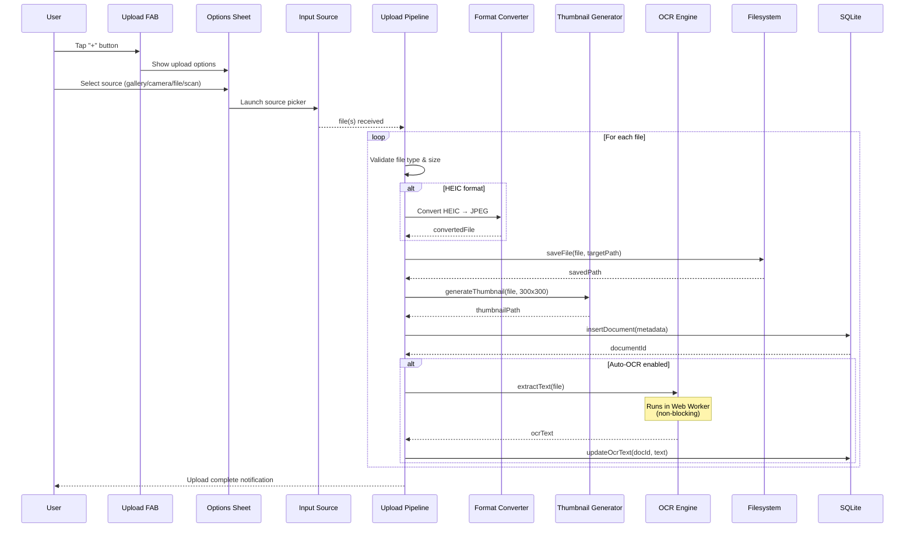

### Upload Service Interface

```typescript
interface UploadService {
  // Upload from different sources
  uploadFromGallery(folderId?: string): Promise<Document[]>;
  uploadFromCamera(folderId?: string): Promise<Document>;
  uploadFromFilePicker(folderId?: string): Promise<Document[]>;
  uploadFromScanner(folderId?: string): Promise<Document>;
  
  // Upload pipeline (internal)
  processFile(file: File, options: UploadOptions): Promise<Document>;
  validateFile(file: File): ValidationResult;
  
  // Progress tracking
  onProgress(callback: (progress: UploadProgress) => void): void;
}

interface UploadOptions {
  folderId?: string;
  tags?: string[];
  autoOcr?: boolean;           // Default: from settings
  compressionQuality?: number; // 0-1, default: 0.8 for images
  generateThumbnail?: boolean; // Default: true
}

interface UploadProgress {
  currentFile: number;
  totalFiles: number;
  fileName: string;
  stage: 'validating' | 'converting' | 'saving' | 'thumbnail' | 'ocr' | 'complete';
  progress: number;            // 0-100
}
```

### File Validation Rules

| Check | Rule | Error Message |
|---|---|---|
| **File Type** | Must be in supported `FileType` enum | "Unsupported file format. Supported: PDF, JPG, PNG, HEIC, WEBP, TIFF, DOCX, TXT" |
| **File Size** | Max 100 MB | "File exceeds maximum size of 100 MB" |
| **File Name** | Non-empty after sanitization | "Invalid file name" |
| **Corruption** | File header validation (magic bytes) | "File appears to be corrupted" |
| **Storage Space** | Available space > file size × 1.5 | "Insufficient storage space" |

---

## Document Scanning Flow

The scanning feature uses ML Kit's document scanner for automatic edge detection, perspective correction, and image enhancement.

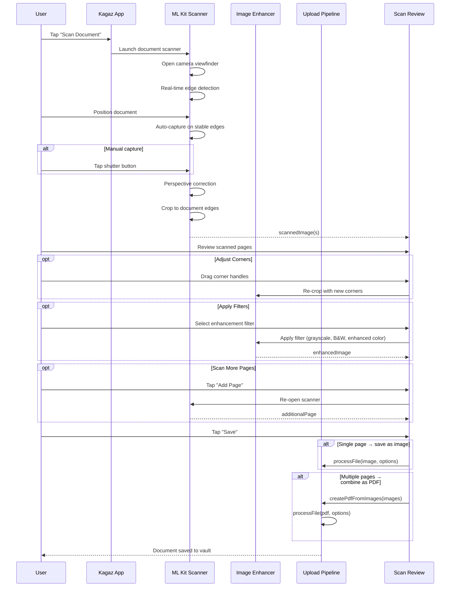

### Scan Enhancement Options

| Filter | Description | Use Case |
|---|---|---|
| **Original** | No enhancement, keep as captured | Color documents, photos |
| **Enhanced** | Auto-levels, contrast boost, sharpening | General purpose, best default |
| **Grayscale** | Convert to grayscale + contrast adjust | Text documents, forms |
| **Black & White** | Adaptive thresholding for clean B&W | High-contrast text, signatures |
| **Magic Color** | White balance + saturation + denoising | Certificates, colored forms |

### Scanner Service Interface

```typescript
interface ScannerService {
  // Check scanner availability
  isAvailable(): Promise<boolean>;
  
  // Launch scanner
  scan(options?: ScanOptions): Promise<ScannedPage[]>;
  
  // Image enhancement
  enhancePage(page: ScannedPage, filter: ScanFilter): Promise<ScannedPage>;
  
  // Convert multiple scanned pages to PDF
  pagesToPdf(pages: ScannedPage[]): Promise<File>;
}

interface ScanOptions {
  maxPages?: number;           // Default: unlimited
  defaultFilter?: ScanFilter;  // Default: 'enhanced'
  allowGalleryImport?: boolean;// Allow picking from gallery too
}

interface ScannedPage {
  imageUri: string;            // Local URI of scanned image
  width: number;
  height: number;
  corners: Corner[];           // Four corner coordinates
  filter: ScanFilter;
}

type ScanFilter = 'original' | 'enhanced' | 'grayscale' | 'blackAndWhite' | 'magicColor';
```

---

## Folder Organization

### Folder Hierarchy

Folders support unlimited nesting depth (practically limited to ~10 levels for UX).

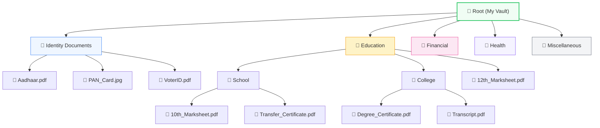

### Folder Operations

| Operation | Description | Behavior |
|---|---|---|
| **Create** | Create a new folder | At root or inside another folder. Name must be unique within parent. |
| **Rename** | Change folder name | Updates name, preserves all contents. |
| **Move** | Move folder to a different parent | Moves entire subtree. Cannot move to own descendant. |
| **Delete** | Delete an empty folder | Fails if folder contains documents or sub-folders. User must empty first. |
| **Force Delete** | Delete folder with all contents | Confirmation dialog. Recursively deletes all sub-folders and documents. |
| **Color/Icon** | Customize appearance | Choose from preset colors and icon set. |

### Folder Service Interface

```typescript
interface FolderService {
  // CRUD
  createFolder(name: string, parentId?: string): Promise<Folder>;
  renameFolder(id: string, newName: string): Promise<Folder>;
  deleteFolder(id: string, force?: boolean): Promise<void>;
  
  // Navigation
  getFolderContents(folderId: string | null): Promise<FolderContents>;
  getFolderPath(folderId: string): Promise<Folder[]>;  // Breadcrumb path
  getFolderTree(): Promise<FolderTreeNode[]>;           // Full tree
  
  // Organization
  moveFolder(id: string, newParentId: string | null): Promise<void>;
  moveDocumentsToFolder(docIds: string[], folderId: string): Promise<void>;
  customizeFolder(id: string, icon?: string, color?: string): Promise<Folder>;
}

interface FolderContents {
  folder: Folder | null;       // null for root
  subFolders: Folder[];
  documents: Document[];
  breadcrumb: Folder[];        // Path from root to current folder
}

interface FolderTreeNode extends Folder {
  children: FolderTreeNode[];
  isExpanded: boolean;
}
```

### Default Folder Templates

On first launch, the app offers to create a starter folder structure:

| Folder | Icon | Color | Description |
|---|---|---|---|
| 📋 Identity Documents | `id-card` | `#3b82f6` | Aadhaar, PAN, Voter ID, Driving License |
| 📚 Education | `graduation-cap` | `#f59e0b` | Marksheets, certificates, transcripts |
| 💰 Financial | `wallet` | `#10b981` | Tax documents, bank statements, salary slips |
| 🏥 Health | `heart-pulse` | `#ef4444` | Health records, prescriptions, reports |
| 🏠 Property | `home` | `#8b5cf6` | Land records, sale deeds, registrations |
| 💼 Employment | `briefcase` | `#6366f1` | Offer letters, experience certificates |
| 📄 Miscellaneous | `file-text` | `#6b7280` | Other documents |

---

## Tag System

Tags provide a cross-cutting organization layer that works alongside (not replacing) folders. A document can have multiple tags and exist in exactly one folder.

### Tag Data Flow

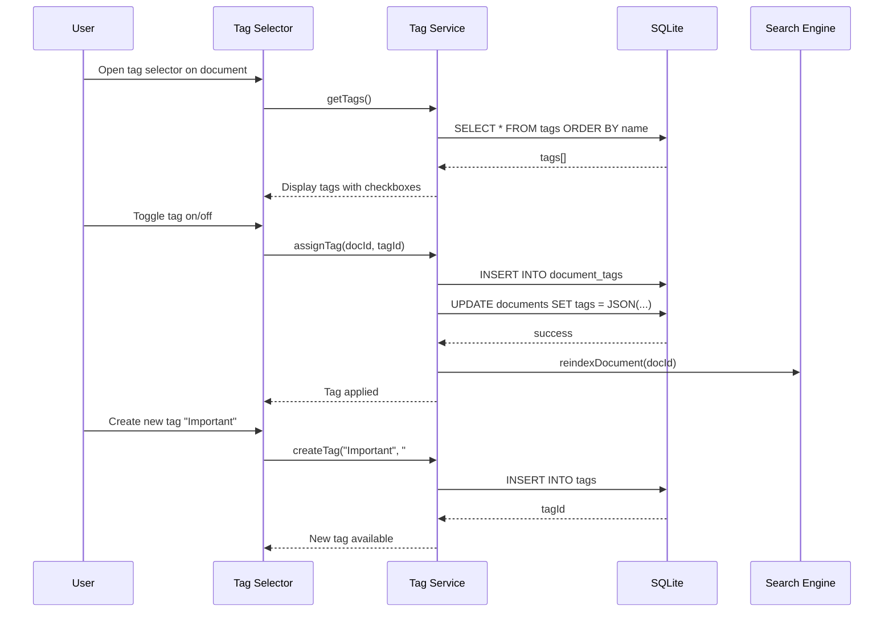

### Tag Service Interface

```typescript
interface TagService {
  // CRUD
  createTag(name: string, color: string): Promise<Tag>;
  updateTag(id: string, updates: Partial<Tag>): Promise<Tag>;
  deleteTag(id: string): Promise<void>;              // Removes from all documents
  getAllTags(): Promise<Tag[]>;
  
  // Assignment
  assignTag(documentId: string, tagId: string): Promise<void>;
  removeTag(documentId: string, tagId: string): Promise<void>;
  getDocumentTags(documentId: string): Promise<Tag[]>;
  
  // Querying
  getDocumentsByTag(tagId: string): Promise<Document[]>;
  getTagUsageCounts(): Promise<Map<string, number>>;
  
  // Bulk
  bulkAssignTag(documentIds: string[], tagId: string): Promise<void>;
  bulkRemoveTag(documentIds: string[], tagId: string): Promise<void>;
}
```

### Preset Tag Suggestions

| Tag | Color | Auto-apply trigger |
|---|---|---|
| 🔴 Urgent | `#ef4444` | Manual only |
| 🟢 Verified | `#22c55e` | Manual only |
| 🔵 Government | `#3b82f6` | AI detection of government docs |
| 🟡 Expiring Soon | `#eab308` | Auto: documents with detected expiry dates |
| 🟣 Personal | `#8b5cf6` | Manual only |
| 🟠 Financial | `#f97316` | AI detection of financial docs |
| ⚫ Archived | `#6b7280` | Manual only |

---

## Search Engine

The search engine provides fast, full-text search across all document metadata using SQLite FTS5.

### Searchable Fields

| Field | Weight | Source |
|---|---|---|
| `name` | High (3x) | Document name |
| `description` | Medium (2x) | User-provided description |
| `ocr_text` | Standard (1x) | OCR-extracted text content |
| `tags` (names) | High (3x) | Associated tag names |
| `folder` (name) | Low (0.5x) | Parent folder name |

### Search Architecture

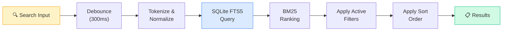

### Search Service Interface

```typescript
interface SearchService {
  // Full-text search
  search(query: string, options?: SearchOptions): Promise<SearchResults>;
  
  // Search suggestions (autocomplete)
  getSuggestions(partial: string, limit?: number): Promise<string[]>;
  
  // FTS index management
  reindexDocument(documentId: string): Promise<void>;
  reindexAll(): Promise<void>;
  
  // Recent searches
  getRecentSearches(limit?: number): Promise<string[]>;
  clearRecentSearches(): Promise<void>;
}

interface SearchOptions {
  folderId?: string;           // Scope to folder
  fileTypes?: FileType[];      // Filter by type
  tags?: string[];             // Filter by tags
  dateRange?: DateRange;       // Filter by date
  limit?: number;              // Max results (default: 50)
  offset?: number;             // Pagination offset
}

interface SearchResults {
  documents: SearchResultDocument[];
  totalCount: number;
  queryTime: number;           // milliseconds
}

interface SearchResultDocument extends Document {
  relevanceScore: number;      // BM25 score
  highlights: {                // Matched text snippets
    field: string;
    snippet: string;           // With <mark> tags around matches
  }[];
}
```

### FTS5 Query Examples

```sql
-- Simple search
SELECT d.*, rank
FROM documents_fts
JOIN documents d ON documents_fts.rowid = d.rowid
WHERE documents_fts MATCH 'aadhaar card'
ORDER BY rank;

-- Prefix search (autocomplete)
SELECT d.name
FROM documents_fts
JOIN documents d ON documents_fts.rowid = d.rowid
WHERE documents_fts MATCH 'aadh*'
LIMIT 5;

-- Search within a specific folder
SELECT d.*, rank
FROM documents_fts
JOIN documents d ON documents_fts.rowid = d.rowid
WHERE documents_fts MATCH 'marksheet'
  AND d.folder_id = ?
ORDER BY rank;
```

---

## Filter System

Filters can be combined (AND logic) for precise document discovery.

### Available Filters

| Filter | Type | Options |
|---|---|---|
| **File Type** | Multi-select | PDF, Image (JPG/PNG/HEIC/WEBP), Document (DOCX/TXT) |
| **Date Range** | Range picker | Today, Last 7 Days, Last 30 Days, Last Year, Custom Range |
| **File Size** | Range | < 1 MB, 1–5 MB, 5–25 MB, 25–100 MB |
| **Folder** | Single-select | Any folder in hierarchy |
| **Tags** | Multi-select | Any combination of user tags |
| **Favorites** | Toggle | Show only favorited documents |
| **Locked** | Toggle | Show only locked documents |
| **Has OCR** | Toggle | Show only documents with extracted text |
| **Language** | Multi-select | Hindi, English, Tamil, etc. |

### Filter Service Interface

```typescript
interface FilterService {
  // Apply combined filters
  applyFilters(filters: DocumentFilters): Promise<Document[]>;
  
  // Get filter option counts (for showing badge numbers)
  getFilterCounts(currentFilters: DocumentFilters): Promise<FilterCounts>;
  
  // Saved filter presets
  saveFilterPreset(name: string, filters: DocumentFilters): Promise<void>;
  getSavedPresets(): Promise<FilterPreset[]>;
  deletePreset(name: string): Promise<void>;
}

interface DocumentFilters {
  fileTypes?: FileType[];
  dateRange?: DateRange;
  sizeRange?: SizeRange;
  folderId?: string;
  tagIds?: string[];
  isFavorite?: boolean;
  isLocked?: boolean;
  hasOcr?: boolean;
  languages?: string[];
  searchQuery?: string;        // Combined with search
}

interface DateRange {
  from: string;                // ISO 8601
  to: string;                  // ISO 8601
}

interface SizeRange {
  minBytes: number;
  maxBytes: number;
}

interface FilterCounts {
  byType: Record<FileType, number>;
  byFolder: Record<string, number>;
  byTag: Record<string, number>;
  favorites: number;
  locked: number;
  withOcr: number;
}
```

### Filter Interaction Flow

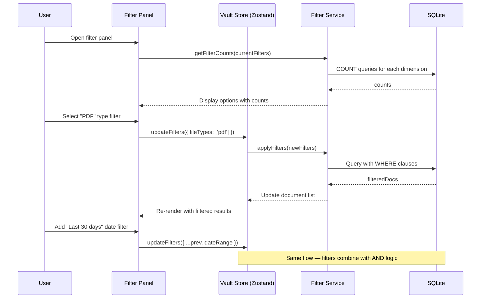

---

## Sort Options

| Sort Key | Label | Direction | Default |
|---|---|---|---|
| `name` | Name | A→Z / Z→A | A→Z |
| `createdAt` | Date Added | Newest / Oldest | Newest |
| `updatedAt` | Last Modified | Newest / Oldest | Newest |
| `lastAccessedAt` | Recently Opened | Most Recent / Least Recent | Most Recent |
| `fileSize` | File Size | Largest / Smallest | Largest |
| `fileType` | File Type | A→Z / Z→A | A→Z |

### Sort Interface

```typescript
interface SortService {
  sort(documents: Document[], sortBy: SortKey, direction: SortDirection): Document[];
}

type SortKey = 'name' | 'createdAt' | 'updatedAt' | 'lastAccessedAt' | 'fileSize' | 'fileType';
type SortDirection = 'asc' | 'desc';

// Zustand store slice
interface VaultStore {
  sortBy: SortKey;
  sortDirection: SortDirection;
  setSortBy: (key: SortKey) => void;
  toggleSortDirection: () => void;
}
```

---

## Favorites & Recently Accessed

### Favorites

- Toggle favorite with a tap on the star icon (available on card, list item, and detail view)
- Favorites appear in a dedicated "Favorites" quick-access section on the vault home page
- Filter by favorites to see only starred documents
- Favorite status syncs to the `documents.is_favorite` column

### Recently Accessed

- Every time a document is previewed/opened, `lastAccessedAt` is updated
- "Recent" section on vault home shows the last 10 accessed documents
- Sorted by `lastAccessedAt DESC`

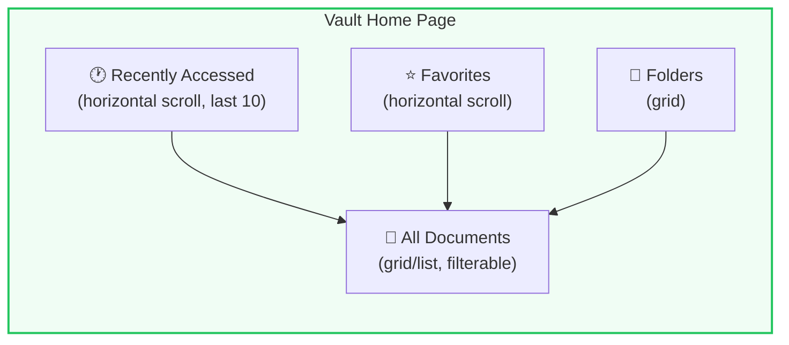

---

## Document Preview

### PDF Preview

| Feature | Implementation |
|---|---|
| **Rendering** | `pdfjs-dist` canvas rendering |
| **Page Navigation** | Swipe gestures + page number input |
| **Zoom** | Pinch-to-zoom + double-tap zoom |
| **Text Selection** | Text layer overlay for copy |
| **Thumbnails** | Sidebar/bottom strip with page thumbnails |
| **Search in PDF** | `pdfjs-dist` text search with highlighting |
| **Night Mode** | Invert colors for comfortable reading |

### Image Preview

| Feature | Implementation |
|---|---|
| **Rendering** | Native `` with CSS transform |
| **Zoom** | Pinch-to-zoom + double-tap + spread gesture |
| **Pan** | Drag to pan when zoomed |
| **Rotate** | Rotation controls (90° CW/CCW) |
| **Full Screen** | Immersive mode on mobile |

### Preview Sequence

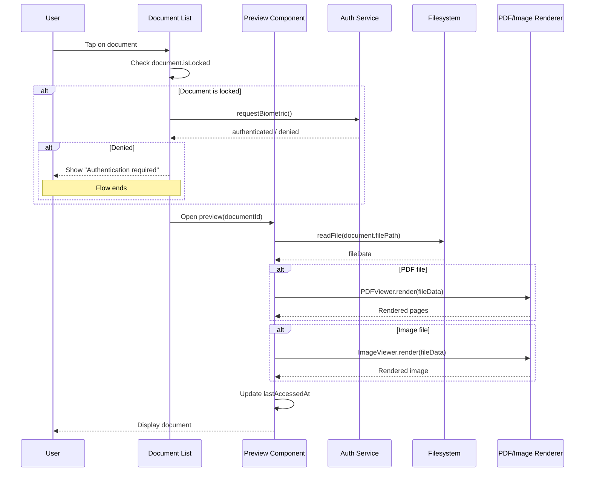

---

## Document Details View

The detail view shows comprehensive metadata and provides quick access to operations.

### Detail View Sections

| Section | Content |
|---|---|
| **Header** | Document name (editable), favorite toggle, lock toggle, share button |
| **Preview** | Embedded preview (first page / image thumbnail) — tap to open full preview |
| **Metadata** | File type, size (human-readable), page count, dimensions, created/modified dates |
| **Organization** | Current folder (with breadcrumb, tap to change), assigned tags (tap to edit) |
| **Description** | Editable text field for user notes |
| **OCR Text** | Collapsed/expandable section showing extracted text, with copy button |
| **Operations** | Quick action buttons: Merge, Split, Convert, Compress, Encrypt, OCR |
| **History** | Timeline of operations performed on this document |
| **Danger Zone** | Delete button with confirmation dialog |

### Detail View Mockup Layout

```
┌─────────────────────────────┐
│ ← Back    Document Name  ★ 🔒│
├─────────────────────────────┤
│                             │
│     [Document Preview]      │
│     (tap to open full)      │
│                             │
├─────────────────────────────┤
│ 📁 Identity Documents > ... │
│ 🏷️ [Government] [ID] [+]   │
├─────────────────────────────┤
│ Type: PDF   Size: 2.4 MB   │
│ Pages: 2    Created: Jun 5  │
│ Modified: Jun 7             │
├─────────────────────────────┤
│ 📝 Description              │
│ "My Aadhaar card, updated   │
│  address version from 2024" │
├─────────────────────────────┤
│ 📋 OCR Text           [▼]  │
│ "GOVERNMENT OF INDIA..."    │
├─────────────────────────────┤
│ ⚡ Quick Actions            │
│ [Merge] [Split] [Convert]  │
│ [Compress] [Encrypt] [OCR] │
├─────────────────────────────┤
│ 📜 Operation History        │
│ • Jun 7 — Compressed (80%) │
│ • Jun 5 — OCR completed    │
│ • Jun 5 — Uploaded          │
├─────────────────────────────┤
│ 🗑️ [Delete Document]        │
└─────────────────────────────┘
```

---

## Bulk Operations

Multi-select mode enables batch operations on multiple documents at once.

### Entering Bulk Mode

| Trigger | Behavior |
|---|---|
| **Long-press** | Long-press any document card/list item to enter bulk mode |
| **Select All** | Checkbox in toolbar to select all visible documents |
| **Range Select** | Tap first, then shift-tap last to select range (web only) |

### Available Bulk Operations

| Operation | Icon | Description | Confirmation Required |
|---|---|---|---|
| **Move** | 📁 | Move selected documents to a folder | No (but shows folder picker) |
| **Delete** | 🗑️ | Delete selected documents permanently | Yes — "Delete N documents?" |
| **Tag** | 🏷️ | Add/remove tags from all selected | No |
| **Merge** | 📎 | Merge selected PDFs into one (PDFs only) | No |
| **Compress** | 📦 | Compress all selected documents | No |
| **Export** | 📤 | Export/share selected documents | No |
| **Favorite** | ⭐ | Toggle favorite on all selected | No |
| **Lock** | 🔒 | Toggle lock on all selected | Biometric required |

### Bulk Action Flow

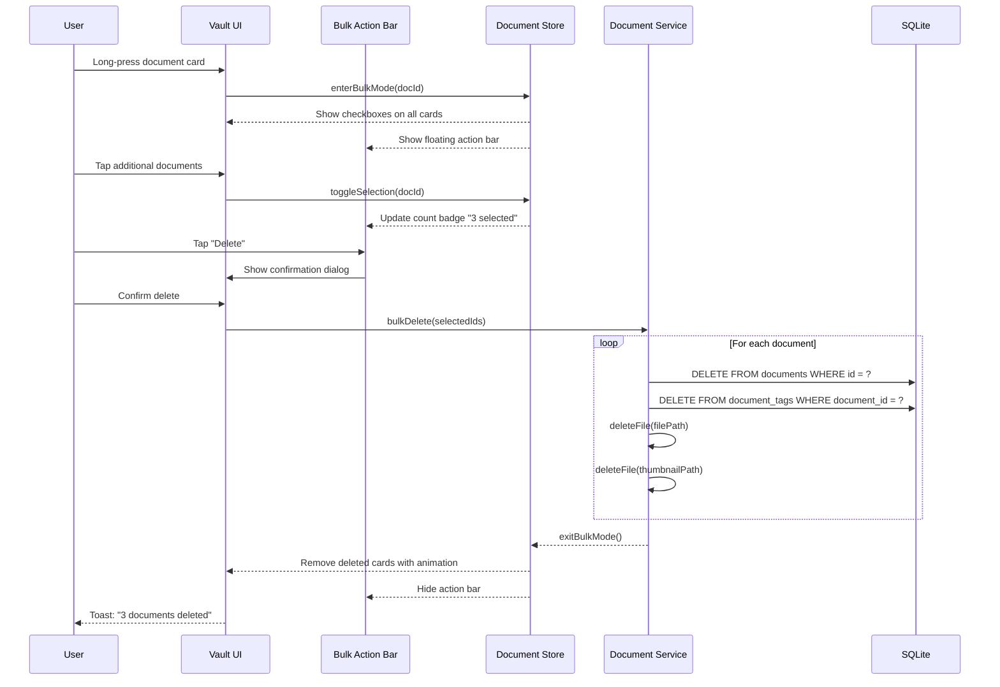

---

## Multilingual Support

### Supported Languages (V1)

| Language | Code | Script | Status |
|---|---|---|---|
| English | `en` | Latin | Primary |
| Hindi | `hi` | Devanagari | Primary |
| Tamil | `ta` | Tamil | Planned |
| Telugu | `te` | Telugu | Planned |
| Bengali | `bn` | Bengali | Planned |
| Marathi | `mr` | Devanagari | Planned |

### Implementation

| Area | Approach |
|---|---|
| **UI Strings** | i18next with JSON translation files, lazy-loaded per language |
| **Document Names** | Stored as-is in any script; search works across scripts |
| **OCR Language** | Tesseract.js supports Hindi, Tamil, Telugu, etc.; user can select language |
| **AI Chatbot** | System prompt includes multilingual instructions; model supports Hindi + English |
| **Voice Input** | STT plugin configured per language |
| **Voice Output** | TTS plugin with language-specific voice packs |
| **Date Formats** | Localized via Intl.DateTimeFormat |
| **Number Formats** | Localized via Intl.NumberFormat |

### Language Switch Flow

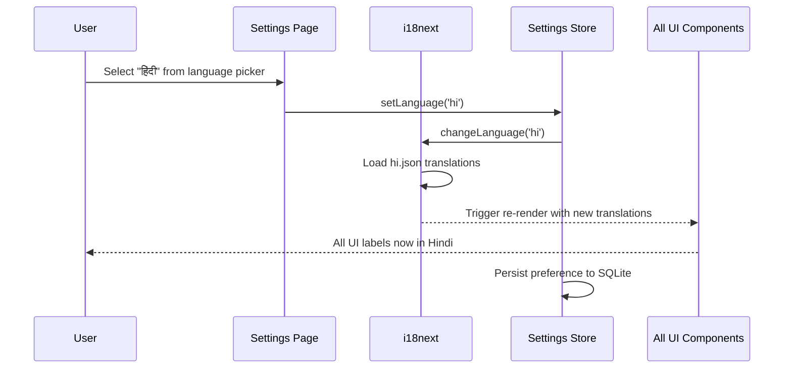

---

## Accessibility Features

> [!IMPORTANT]
> Accessibility is a **first-class requirement**, not an afterthought. India has 26.8 million people with disabilities, and many more senior citizens who benefit from accessibility features. Every component must pass WCAG 2.1 AA compliance.

### Feature Matrix

| Feature | Implementation | Notes |
|---|---|---|
| **Screen Reader** | Semantic HTML, ARIA labels, `aria-live` regions | All interactive elements have descriptive labels |
| **High Contrast** | `prefers-contrast` media query + manual toggle | High contrast theme with thicker borders, bolder text |
| **Font Scaling** | CSS `rem` units, respect system font size | Tested at 200% zoom — no layout breakage |
| **Touch Targets** | Minimum 48×48dp tap targets | All buttons, checkboxes, and interactive areas |
| **Keyboard Navigation** | `tabIndex`, focus management, skip links | Full app navigable without touch (web) |
| **Reduced Motion** | `prefers-reduced-motion` media query | Disable animations when user prefers |
| **Color Blindness** | Never rely on color alone; use icons + text | Tag labels include name, not just color dot |
| **Haptic Feedback** | Capacitor Haptics API | Subtle feedback on key interactions |
| **Voice Control** | AI chatbot + voice input | Full app control via voice commands |
| **Focus Indicators** | Visible focus rings on all interactive elements | Custom focus styles matching design system |

### Accessibility Service Interface

```typescript
interface AccessibilitySettings {
  fontSize: FontScale;           // 'small' | 'normal' | 'large' | 'xlarge'
  highContrast: boolean;
  reducedMotion: boolean;
  hapticFeedback: boolean;
  screenReaderOptimized: boolean; // Simplifies UI for screen readers
}

type FontScale = 'small' | 'normal' | 'large' | 'xlarge';

// CSS custom properties set based on settings
// --font-scale-factor: 0.85 | 1 | 1.15 | 1.3
// --motion-duration: 200ms | 0ms (reduced motion)
// --contrast-mode: 'normal' | 'high'
```

---

## Storage Management

### Storage Overview Page

| Metric | Display |
|---|---|
| **Total Used** | Circular progress ring + human-readable size (e.g., "247 MB of 2 GB") |
| **By File Type** | Stacked bar chart (PDFs: 60%, Images: 30%, Other: 10%) |
| **By Folder** | List sorted by size, with progress bars |
| **Largest Files** | Top 10 largest documents with quick actions |
| **Duplicate Detection** | Files with identical hash values flagged |
| **Cleanup Suggestions** | AI-generated suggestions (e.g., "5 screenshots are over 10 MB each — compress?") |

### Storage Service Interface

```typescript
interface StorageService {
  // Statistics
  getStorageStats(): Promise<StorageStats>;
  getUsageByType(): Promise<TypeUsage[]>;
  getUsageByFolder(): Promise<FolderUsage[]>;
  getLargestDocuments(limit?: number): Promise<Document[]>;
  
  // Cleanup
  findDuplicates(): Promise<DuplicateGroup[]>;
  getCleanupSuggestions(): Promise<CleanupSuggestion[]>;
  deleteOrphanedFiles(): Promise<number>;  // Cleanup files without DB records
  
  // Monitoring
  getAvailableSpace(): Promise<number>;    // bytes
  isLowOnSpace(threshold?: number): boolean;
}

interface StorageStats {
  totalUsed: number;           // bytes
  totalAvailable: number;      // bytes
  documentCount: number;
  thumbnailSize: number;       // bytes used by thumbnails
  lastCleanup: string | null;  // ISO 8601
}

interface CleanupSuggestion {
  type: 'compress' | 'delete_duplicates' | 'remove_thumbnails' | 'archive';
  description: string;         // Human-readable suggestion
  potentialSavings: number;    // estimated bytes saved
  affectedDocuments: string[]; // document IDs
}
```

### Storage Warning Flow

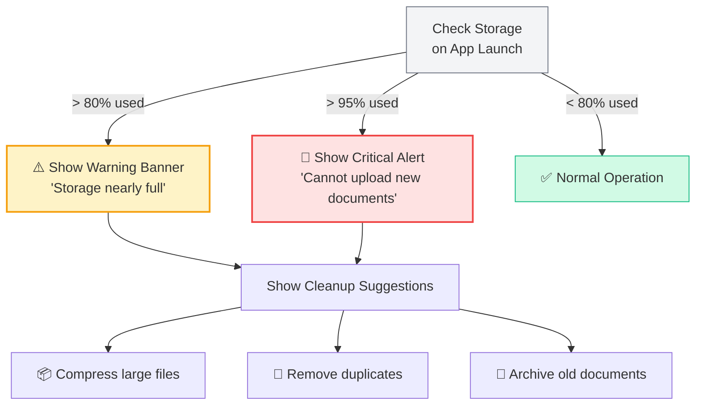

---

## Error Handling

### Error Categories

| Category | Examples | User Response |
|---|---|---|
| **Validation** | Invalid file type, name too long, storage full | Inline error message, prevent action |
| **File System** | Read/write failure, permission denied | Toast error + retry option |
| **Database** | Query failure, migration error | Error screen + "Contact Support" |
| **Scanner** | Camera unavailable, scanner not supported | Fallback to file picker |
| **OCR** | Extraction failed, unsupported language | Non-blocking warning, skip OCR |
| **Thumbnail** | Generation failed | Show generic file icon instead |

### Error Handling Strategy

```typescript
// Custom error types
class DocumentVaultError extends Error {
  constructor(
    message: string,
    public code: VaultErrorCode,
    public userMessage: string,   // i18n key for user-facing message
    public recoverable: boolean,
    public context?: Record<string, unknown>
  ) {
    super(message);
  }
}

enum VaultErrorCode {
  INVALID_FILE_TYPE = 'INVALID_FILE_TYPE',
  FILE_TOO_LARGE = 'FILE_TOO_LARGE',
  STORAGE_FULL = 'STORAGE_FULL',
  FILE_READ_ERROR = 'FILE_READ_ERROR',
  FILE_WRITE_ERROR = 'FILE_WRITE_ERROR',
  DB_QUERY_ERROR = 'DB_QUERY_ERROR',
  SCANNER_UNAVAILABLE = 'SCANNER_UNAVAILABLE',
  OCR_FAILED = 'OCR_FAILED',
  BIOMETRIC_DENIED = 'BIOMETRIC_DENIED',
  FOLDER_NOT_EMPTY = 'FOLDER_NOT_EMPTY',
  DUPLICATE_NAME = 'DUPLICATE_NAME',
}
```

> [!TIP]
> Always provide a **recoverable path** for errors. If a file can't be read, offer to re-import. If OCR fails, let the user retry or skip. If storage is full, show cleanup suggestions. Never leave the user at a dead end.

---

*Document maintained by the Kagaz Architecture Team*
