# Kagaz — Document Vault Module Architecture

> **Module: `document-vault`** · Version: V1 (Core) · Last Updated: 2026-07-25

---

## Table of Contents

- [Module Overview](#module-overview)
- [Document Data Model](#document-data-model)
- [Module File Structure](#module-file-structure)
- [Document Upload Flow](#document-upload-flow)
- [Document Scanning Flow](#document-scanning-flow)
- [Folder Organization](#folder-organization)
- [Tag System](#tag-system)
- [Search Engine](#search-engine)
- [Filter System](#filter-system)
- [Sort Options](#sort-options)
- [Favorites & Recently Accessed](#favorites--recently-accessed)
- [Document Preview](#document-preview)
- [Document Details View](#document-details-view)
- [Document Actions](#document-actions)
- [Quick Reference (F-84)](#quick-reference-f-84)
- [Bulk Operations](#bulk-operations)
- [Multilingual Support](#multilingual-support)
- [Accessibility Features](#accessibility-features)
- [Storage Management](#storage-management)
- [Error Handling](#error-handling)

---

## Module Overview

The **Document Vault** module is the heart of Kagaz V1. It manages the complete lifecycle of documents — from capture and upload, through organization and search, to preview and management. Every other V1 module either feeds into or reads from the document vault.

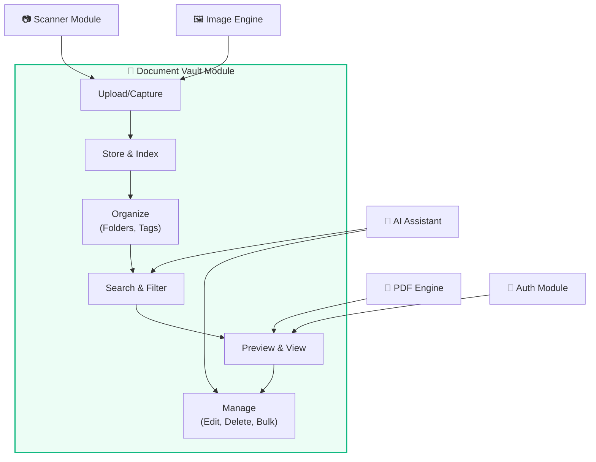

### Module Responsibilities

| Responsibility | Description |
|---|---|
| **Document CRUD** | Create, read, update, delete documents with full metadata |
| **File Management** | Save files to device storage, generate thumbnails, manage file paths |
| **Folder Organization** | Nested folder hierarchy, move/copy operations |
| **Tag Management** | Create/assign/remove tags, filter by tags |
| **Search & Filter** | Full-text search with multiple filter dimensions |
| **Preview** | Render PDFs and images with zoom, pan, and page navigation |
| **Bulk Operations** | Multi-select with batch delete, move, merge, export |
| **Storage Stats** | Track usage, provide cleanup suggestions |

---

## Document Data Model

### `Document` Entity

```typescript
interface Document {
  // Identity
  id: string;                    // UUID v4
  name: string;                  // User-visible name (without extension)
  description: string | null;    // Optional user notes

  // File Information
  filePath: string;              // Relative path in app storage
  fileType: FileType;            // Enum: pdf, jpg, png, heic, webp, docx, etc.
  fileSize: number;              // Size in bytes
  mimeType: string;              // MIME type string
  thumbnailPath: string | null;  // Path to generated thumbnail

  // Organization
  folderId: string | null;       // Parent folder ID (null = root)
  tags: string[];                // Array of tag IDs
  isFavorite: boolean;           // Favorited by user
  isLocked: boolean;             // Requires biometric to view

  // AI/OCR
  language: string | null;       // Detected or user-set language code
  ocrText: string | null;        // Full OCR extracted text
  ocrStatus: OcrStatus;          // none, pending, completed, failed

  // Metadata
  pageCount: number | null;      // For multi-page documents (PDFs)
  createdAt: string;             // ISO 8601
  updatedAt: string;             // ISO 8601
  lastAccessedAt: string | null; // ISO 8601, for "recent" sorting
}
```

### Supporting Types

```typescript
enum FileType {
  PDF = 'pdf',
  JPG = 'jpg',
  JPEG = 'jpeg',
  PNG = 'png',
  HEIC = 'heic',
  WEBP = 'webp',
  TIFF = 'tiff',
  BMP = 'bmp',
  GIF = 'gif',
  DOCX = 'docx',   // F-41: PDF → Word export; F-43 view
  TXT = 'txt',
  MD = 'md',       // F-40: PDF → Markdown export target
  XLSX = 'xlsx',   // F-42: PDF → Excel export
  CSV = 'csv',     // F-42: PDF → CSV export
}

enum OcrStatus {
  NONE = 'none',
  PENDING = 'pending',
  COMPLETED = 'completed',
  FAILED = 'failed',
}

interface Folder {
  id: string;
  name: string;
  parentId: string | null;
  icon: string | null;         // Icon identifier (e.g., 'folder-medical')
  color: string | null;        // Hex color code
  documentCount: number;       // Computed: count of docs in folder
  childFolderCount: number;    // Computed: count of sub-folders
  createdAt: string;
}

interface Tag {
  id: string;
  name: string;
  color: string;               // Hex color for display
  documentCount: number;       // Computed: count of tagged docs
}

interface OperationRecord {
  id: string;
  documentId: string | null;
  operationType: OperationType;
  inputParams: Record<string, unknown>;
  outputPath: string | null;
  createdAt: string;
}

enum OperationType {
  MERGE = 'merge',
  SPLIT = 'split',
  CONVERT = 'convert',
  COMPRESS = 'compress',
  ENCRYPT = 'encrypt',
  DECRYPT = 'decrypt',
  OCR = 'ocr',
  CROP = 'crop',
  ENHANCE = 'enhance',
  RENAME = 'rename',
  MOVE = 'move',
  COPY = 'copy',
  DELETE = 'delete',
}
```

### Validation Rules

| Field | Rule |
|---|---|
| `name` | 1–255 characters, no path separators (`/`, `\`), trimmed whitespace |
| `description` | Max 2000 characters |
| `fileSize` | Max 100 MB per document |
| `fileType` | Must be in the `FileType` enum (supported types only) |
| `tags` | Max 20 tags per document |
| `folderId` | Must reference an existing folder or be null |
| `thumbnailPath` | Auto-generated, not user-editable |

---

## Module File Structure

```
src/modules/document-vault/
├── components/
│   ├── DocumentCard.tsx           # Card view for a single document
│   ├── DocumentGrid.tsx           # Grid layout of document cards
│   ├── DocumentList.tsx           # List/table layout of documents
│   ├── DocumentListItem.tsx       # Single row in list view
│   ├── FolderTree.tsx             # Nested folder navigation tree
│   ├── FolderCard.tsx             # Card view for a folder
│   ├── FolderBreadcrumb.tsx       # Breadcrumb navigation for folder path
│   ├── TagChip.tsx                # Individual tag chip (with color)
│   ├── TagSelector.tsx            # Multi-select tag picker
│   ├── BulkActionBar.tsx          # Floating bar for bulk operations
│   ├── StorageIndicator.tsx       # Storage usage bar/ring
│   ├── DocumentPreview.tsx        # Full-screen document preview
│   ├── PDFViewer.tsx              # PDF rendering with page navigation
│   ├── ImageViewer.tsx            # Image viewer with zoom/pan
│   ├── UploadFAB.tsx              # Floating action button for upload
│   ├── UploadOptionsSheet.tsx     # Bottom sheet with upload options
│   ├── DocumentDetailPanel.tsx    # Side panel / page with doc details
│   ├── RenameDialog.tsx           # Rename document/folder dialog
│   ├── MoveToFolderDialog.tsx     # Folder picker for move operations
│   └── EmptyVaultState.tsx        # Empty state illustration + CTA
│
├── hooks/
│   ├── useDocuments.ts            # TanStack Query hook for document list
│   ├── useDocument.ts             # Single document by ID
│   ├── useFolders.ts              # Folder list / tree
│   ├── useTags.ts                 # Tag list
│   ├── useBulkActions.ts          # Multi-select state & operations
│   ├── useUpload.ts               # Upload flow state management
│   ├── useDocumentPreview.ts      # Preview state (current page, zoom)
│   └── useStorageStats.ts         # Storage usage statistics
│
├── services/
│   ├── document.service.ts        # Document CRUD business logic
│   ├── folder.service.ts          # Folder CRUD + tree operations
│   ├── tag.service.ts             # Tag CRUD + assignment
│   ├── upload.service.ts          # File upload pipeline
│   ├── thumbnail.service.ts       # Thumbnail generation
│   ├── storage.service.ts         # Storage stats & cleanup
│   └── export.service.ts          # Export documents (share intent)
│
├── store/
│   ├── document.store.ts          # Zustand: selected docs, view mode
│   └── vault.store.ts             # Zustand: current folder, filters, sort
│
├── types/
│   ├── document.types.ts          # Document, FileType, OcrStatus
│   ├── folder.types.ts            # Folder types
│   └── tag.types.ts               # Tag types
│
└── pages/
    ├── VaultHomePage.tsx           # Main vault page (grid/list + folders) — "Documents" tab
    ├── FolderPage.tsx              # Contents of a specific folder
    ├── DocumentDetailPage.tsx      # Document detail + operations
    ├── FavoritesPage.tsx           # Starred documents (F-33) — "Favorites" tab
    └── StoragePage.tsx             # Storage management page — "Storage" tab
```

### Bottom-tab navigation

The app shell (`app/routes/index.tsx`) wraps the router outlet in an
`IonTabs` bottom bar with three destinations, each a vault page:

| Tab | Route | Page | Icon |
|-----|-------|------|------|
| **Documents** | `/vault` | `VaultHomePage` | folder |
| **Favorites** | `/favorites` | `FavoritesPage` | star |
| **Storage** | `/storage` | `StoragePage` | hard-drive |

`/` redirects to `/vault` via `<Redirect>` (a history *replace*, so it
adds no back-stack entry). `IonTabs` reserves the bar's height plus the
device safe-area inset, so each tab's `IonContent` — and the upload FAB
(`IonFab slot="fixed"`) — sits *above* the bar, never behind it. The
Android hardware-back handler lives above Ionic's navigation handler so
that back pops a folder → pops the route → double-back-to-exit at the
true root (see `app/routes/index.tsx` header comment).

---

## Document Upload Flow

The upload pipeline handles multiple input sources and processes files through a consistent pipeline.

### Input Sources

| Source | Method | Details |
|---|---|---|
| **Gallery** | `Camera.pickImages()` | Pick one or more images from device gallery |
| **Camera** | `Camera.getPhoto()` | Capture a new photo directly |
| **File Picker** | `FilePicker.pickFiles()` | Select files of any supported type |
| **Scanner** | `DocumentScanner.scanDocument()` | ML-powered document scanning with edge detection |
| **Drag & Drop** | Web API | Drag files onto the vault (web only) |

### Upload Pipeline

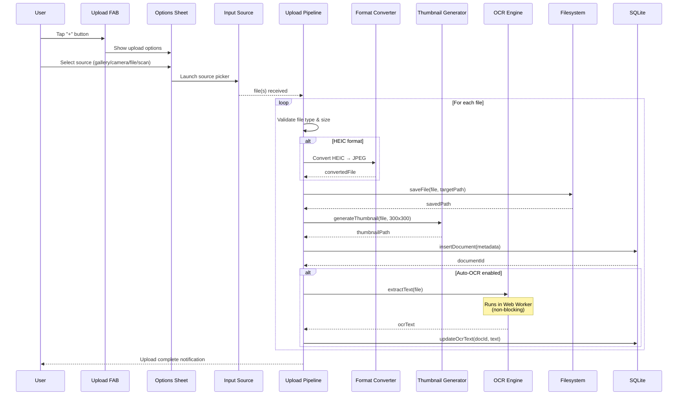

### Upload Service Interface

```typescript
interface UploadService {
  // Upload from different sources
  uploadFromGallery(folderId?: string): Promise<Document[]>;
  uploadFromCamera(folderId?: string): Promise<Document>;
  uploadFromFilePicker(folderId?: string): Promise<Document[]>;
  uploadFromScanner(folderId?: string): Promise<Document>;
  
  // Upload pipeline (internal)
  processFile(file: File, options: UploadOptions): Promise<Document>;
  validateFile(file: File): ValidationResult;
  
  // Progress tracking
  onProgress(callback: (progress: UploadProgress) => void): void;
}

interface UploadOptions {
  folderId?: string;
  tags?: string[];
  autoOcr?: boolean;           // Default: from settings
  compressionQuality?: number; // 0-1, default: 0.8 for images
  generateThumbnail?: boolean; // Default: true
}

interface UploadProgress {
  currentFile: number;
  totalFiles: number;
  fileName: string;
  stage: 'validating' | 'converting' | 'saving' | 'thumbnail' | 'ocr' | 'complete';
  progress: number;            // 0-100
}
```

### File Validation Rules

| Check | Rule | Error Message |
|---|---|---|
| **File Type** | Must be in supported `FileType` enum | "Unsupported file format. Supported: PDF, JPG, PNG, HEIC, WEBP, TIFF, DOCX, TXT, MD, XLSX, CSV" |
| **File Size** | Max 100 MB | "File exceeds maximum size of 100 MB" |
| **File Name** | Non-empty after sanitization | "Invalid file name" |
| **Corruption** | File header validation (magic bytes) | "File appears to be corrupted" |
| **Storage Space** | Available space > file size × 1.5 | "Insufficient storage space" |

---

## Document Scanning Flow

> [!IMPORTANT]
> **Engine confirmed by [ADR-018](../architecture/08-tech-stack-decisions.md#adr-018-document-scanner--google-ml-kit-via-play-services)** (2026-07-10).
> F-2 uses **Google ML Kit Document Scanner** via `@capacitor-mlkit/document-scanner`
> — exactly the "ML Kit Scanner" this sequence names. (An intermediate
> decision, ADR-016, briefly switched to jscanify + OpenCV.js over an offline
> concern that verification disproved — the plugin adds **no** `INTERNET`/`CAMERA`
> permission; Play Services fetches the model out-of-process. ADR-018 reverses
> that.) Unlike the flow drawn below, ML Kit renders its **own** native
> full-screen scan UI (edge detection → capture → perspective correction →
> multi-page review → filters), so the app does not build a custom camera or
> draggable-corner screen; it receives finished JPEG/PDF pages and imports
> them. **Android-only** (scan hidden where Play Services is absent).

The scanning feature provides automatic edge detection, perspective correction, and image enhancement, all on-device (Android, via Play Services).

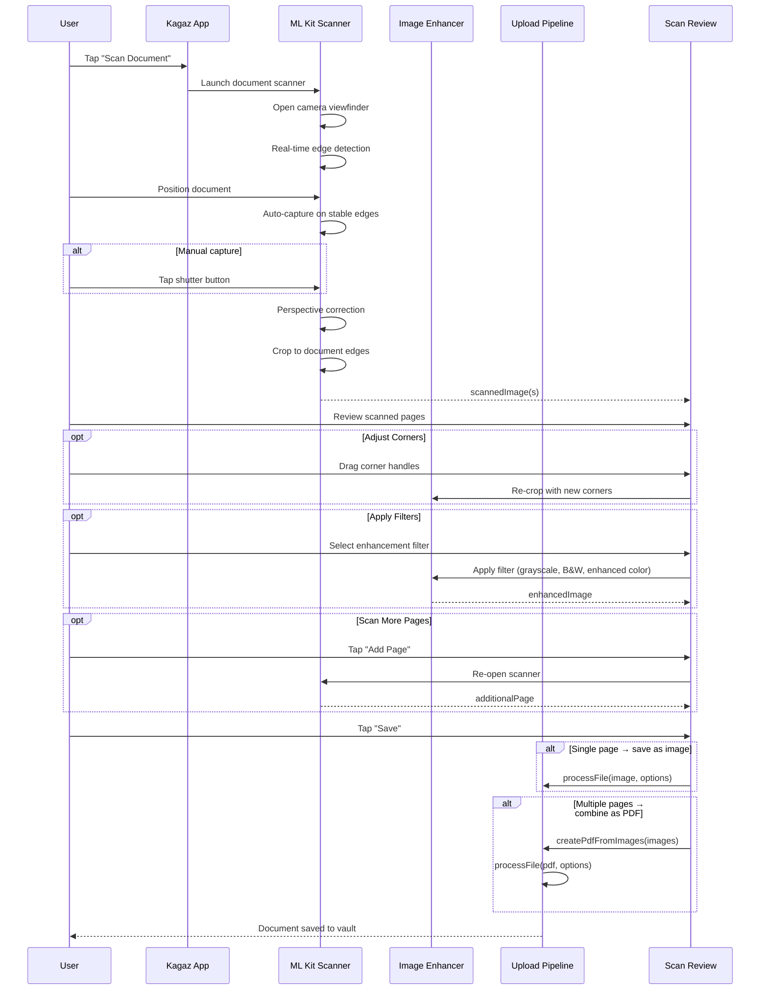

### Scan Enhancement Options

| Filter | Description | Use Case |
|---|---|---|
| **Original** | No enhancement, keep as captured | Color documents, photos |
| **Enhanced** | Auto-levels, contrast boost, sharpening | General purpose, best default |
| **Grayscale** | Convert to grayscale + contrast adjust | Text documents, forms |
| **Black & White** | Adaptive thresholding for clean B&W | High-contrast text, signatures |
| **Magic Color** | White balance + saturation + denoising | Certificates, colored forms |

### Scanner Service Interface

```typescript
interface ScannerService {
  // Check scanner availability
  isAvailable(): Promise<boolean>;
  
  // Launch scanner
  scan(options?: ScanOptions): Promise<ScannedPage[]>;
  
  // Image enhancement
  enhancePage(page: ScannedPage, filter: ScanFilter): Promise<ScannedPage>;
  
  // Convert multiple scanned pages to PDF
  pagesToPdf(pages: ScannedPage[]): Promise<File>;
}

interface ScanOptions {
  maxPages?: number;           // Default: unlimited
  defaultFilter?: ScanFilter;  // Default: 'enhanced'
  allowGalleryImport?: boolean;// Allow picking from gallery too
}

interface ScannedPage {
  imageUri: string;            // Local URI of scanned image
  width: number;
  height: number;
  corners: Corner[];           // Four corner coordinates
  filter: ScanFilter;
}

type ScanFilter = 'original' | 'enhanced' | 'grayscale' | 'blackAndWhite' | 'magicColor';
```

---

## Folder Organization

### Folder Hierarchy

Folders support unlimited nesting depth (practically limited to ~10 levels for UX).

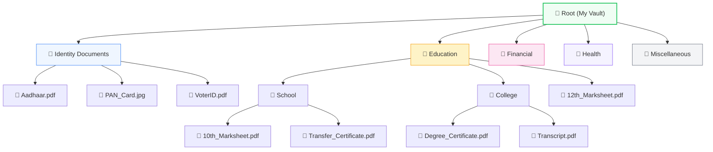

### Folder Operations

| Operation | Description | Behavior |
|---|---|---|
| **Create** | Create a new folder | At root or inside another folder. Name must be unique within parent. |
| **Rename** | Change folder name | Updates name, preserves all contents. |
| **Move** | Move folder to a different parent | Moves entire subtree. Cannot move to own descendant. |
| **Delete** | Delete an empty folder | Fails if folder contains documents or sub-folders. User must empty first. |
| **Force Delete** | Delete folder with all contents | Confirmation dialog. Recursively deletes all sub-folders and documents. |
| **Color/Icon** | Customize appearance | Choose from preset colors and icon set. |

> [!NOTE]
> **V1 implementation (2026-07-18)** — `useFolders.ts` + `FolderDao`, not the
> generic `FolderService` sketched below. Real differences from the spec
> table above: **Delete** always cascades (child folders cascade via the DB
> constraint; documents inside fall back to root via `ON DELETE SET NULL`) —
> there's no "fails if non-empty" / separate "Force Delete", just one
> **Delete** action behind a confirm alert. **Reorder** is move-up/move-down
> buttons swapping adjacent `sortOrder` values (`reorderFolder`), the same
> keyboard-accessible, no-pointer-drag approach F-35 uses for PDF pages —
> not real drag-and-drop. **Color** is a `FolderColorPicker` sheet limited to
> the 7 `FOLDER_TEMPLATES` colors (`FOLDER_COLORS`) plus a "default" clear
> option, not an open palette. All four (rename, color, reorder, delete) are
> reached from **FolderCard**'s overflow (⋮) button → a **folder-options**
> action sheet (`vault.home.folder-menu`) — this UI didn't exist until
> 2026-07-18 (the engine/DAO methods shipped 2026-06-12 but were never wired
> to anything, an F-9 checklist follow-up closed the same day as F-8/F-29's
> identical gap). Multi-level nesting, "unlimited depth," and move-folder
> (as opposed to move-*document*-into-folder, which does exist) remain
> spec-only.

### Folder Service Interface

```typescript
interface FolderService {
  // CRUD
  createFolder(name: string, parentId?: string): Promise<Folder>;
  renameFolder(id: string, newName: string): Promise<Folder>;
  deleteFolder(id: string, force?: boolean): Promise<void>;
  
  // Navigation
  getFolderContents(folderId: string | null): Promise<FolderContents>;
  getFolderPath(folderId: string): Promise<Folder[]>;  // Breadcrumb path
  getFolderTree(): Promise<FolderTreeNode[]>;           // Full tree
  
  // Organization
  moveFolder(id: string, newParentId: string | null): Promise<void>;
  moveDocumentsToFolder(docIds: string[], folderId: string): Promise<void>;
  customizeFolder(id: string, icon?: string, color?: string): Promise<Folder>;
}

interface FolderContents {
  folder: Folder | null;       // null for root
  subFolders: Folder[];
  documents: Document[];
  breadcrumb: Folder[];        // Path from root to current folder
}

interface FolderTreeNode extends Folder {
  children: FolderTreeNode[];
  isExpanded: boolean;
}
```

### Default Folder Templates

On first launch, the app offers to create a starter folder structure:

| Folder | Icon | Color | Description |
|---|---|---|---|
| 📋 Identity Documents | `id-card` | `#3b82f6` | Aadhaar, PAN, Voter ID, Driving License |
| 📚 Education | `graduation-cap` | `#f59e0b` | Marksheets, certificates, transcripts |
| 💰 Financial | `wallet` | `#10b981` | Tax documents, bank statements, salary slips |
| 🏥 Health | `heart-pulse` | `#ef4444` | Health records, prescriptions, reports |
| 🏠 Property | `home` | `#8b5cf6` | Land records, sale deeds, registrations |
| 💼 Employment | `briefcase` | `#6366f1` | Offer letters, experience certificates |
| 📄 Miscellaneous | `file-text` | `#6b7280` | Other documents |

---

## Tag System

Tags provide a cross-cutting organization layer that works alongside (not replacing) folders. A document can have multiple tags and exist in exactly one folder.

### Tag Data Flow

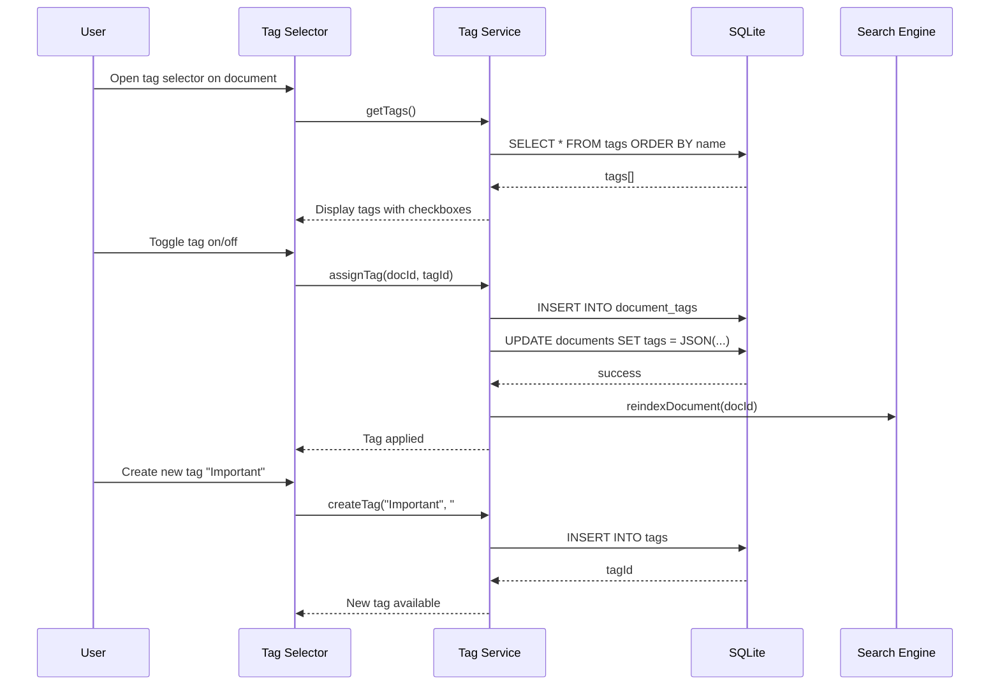

### Tag Service Interface

```typescript
interface TagService {
  // CRUD
  createTag(name: string, color: string): Promise<Tag>;
  updateTag(id: string, updates: Partial<Tag>): Promise<Tag>;
  deleteTag(id: string): Promise<void>;              // Removes from all documents
  getAllTags(): Promise<Tag[]>;
  
  // Assignment
  assignTag(documentId: string, tagId: string): Promise<void>;
  removeTag(documentId: string, tagId: string): Promise<void>;
  getDocumentTags(documentId: string): Promise<Tag[]>;
  
  // Querying
  getDocumentsByTag(tagId: string): Promise<Document[]>;
  getTagUsageCounts(): Promise<Map<string, number>>;
  
  // Bulk
  bulkAssignTag(documentIds: string[], tagId: string): Promise<void>;
  bulkRemoveTag(documentIds: string[], tagId: string): Promise<void>;
}
```

### Preset Tag Suggestions

| Tag | Color | Auto-apply trigger |
|---|---|---|
| 🔴 Urgent | `#ef4444` | Manual only |
| 🟢 Verified | `#22c55e` | Manual only |
| 🔵 Government | `#3b82f6` | AI detection of government docs |
| 🟡 Expiring Soon | `#eab308` | Auto: documents with detected expiry dates |
| 🟣 Personal | `#8b5cf6` | Manual only |
| 🟠 Financial | `#f97316` | AI detection of financial docs |
| ⚫ Archived | `#6b7280` | Manual only |

---

## Search Engine

The search engine provides fast, full-text search across all document metadata using SQLite FTS5.

### Searchable Fields

| Field | Weight | Source |
|---|---|---|
| `name` | High (3x) | Document name |
| `description` | Medium (2x) | User-provided description |
| `ocr_text` | Standard (1x) | OCR-extracted text content |
| `tags` (names) | High (3x) | Associated tag names |
| `folder` (name) | Low (0.5x) | Parent folder name |

### Search Architecture

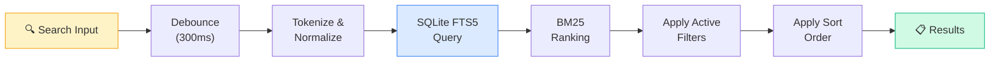

### Search Service Interface

```typescript
interface SearchService {
  // Full-text search
  search(query: string, options?: SearchOptions): Promise<SearchResults>;
  
  // Search suggestions (autocomplete)
  getSuggestions(partial: string, limit?: number): Promise<string[]>;
  
  // FTS index management
  reindexDocument(documentId: string): Promise<void>;
  reindexAll(): Promise<void>;
  
  // Recent searches
  getRecentSearches(limit?: number): Promise<string[]>;
  clearRecentSearches(): Promise<void>;
}

interface SearchOptions {
  folderId?: string;           // Scope to folder
  fileTypes?: FileType[];      // Filter by type
  tags?: string[];             // Filter by tags
  dateRange?: DateRange;       // Filter by date
  limit?: number;              // Max results (default: 50)
  offset?: number;             // Pagination offset
}

interface SearchResults {
  documents: SearchResultDocument[];
  totalCount: number;
  queryTime: number;           // milliseconds
}

interface SearchResultDocument extends Document {
  relevanceScore: number;      // BM25 score
  highlights: {                // Matched text snippets
    field: string;
    snippet: string;           // With <mark> tags around matches
  }[];
}
```

### FTS5 Query Examples

```sql
-- Simple search
SELECT d.*, rank
FROM documents_fts
JOIN documents d ON documents_fts.rowid = d.rowid
WHERE documents_fts MATCH 'aadhaar card'
ORDER BY rank;

-- Prefix search (autocomplete)
SELECT d.name
FROM documents_fts
JOIN documents d ON documents_fts.rowid = d.rowid
WHERE documents_fts MATCH 'aadh*'
LIMIT 5;

-- Search within a specific folder
SELECT d.*, rank
FROM documents_fts
JOIN documents d ON documents_fts.rowid = d.rowid
WHERE documents_fts MATCH 'marksheet'
  AND d.folder_id = ?
ORDER BY rank;
```

---

## Filter System

Filters can be combined (AND logic) for precise document discovery.

### Available Filters

| Filter | Type | Options |
|---|---|---|
| **File Type** | Multi-select | PDF, Image (JPG/PNG/HEIC/WEBP), Document (DOCX/TXT) |
| **Date Range** | Range picker | Today, Last 7 Days, Last 30 Days, Last Year, Custom Range |
| **File Size** | Range | < 1 MB, 1–5 MB, 5–25 MB, 25–100 MB |
| **Folder** | Single-select | Any folder in hierarchy |
| **Tags** | Multi-select | Any combination of user tags |
| **Favorites** | Toggle | Show only favorited documents |
| **Locked** | Toggle | Show only locked documents |
| **Has OCR** | Toggle | Show only documents with extracted text |
| **Language** | Multi-select | Hindi, English, Tamil, etc. |

### Filter Service Interface

```typescript
interface FilterService {
  // Apply combined filters
  applyFilters(filters: DocumentFilters): Promise<Document[]>;
  
  // Get filter option counts (for showing badge numbers)
  getFilterCounts(currentFilters: DocumentFilters): Promise<FilterCounts>;
  
  // Saved filter presets
  saveFilterPreset(name: string, filters: DocumentFilters): Promise<void>;
  getSavedPresets(): Promise<FilterPreset[]>;
  deletePreset(name: string): Promise<void>;
}

interface DocumentFilters {
  fileTypes?: FileType[];
  dateRange?: DateRange;
  sizeRange?: SizeRange;
  folderId?: string;
  tagIds?: string[];
  isFavorite?: boolean;
  isLocked?: boolean;
  hasOcr?: boolean;
  languages?: string[];
  searchQuery?: string;        // Combined with search
}

interface DateRange {
  from: string;                // ISO 8601
  to: string;                  // ISO 8601
}

interface SizeRange {
  minBytes: number;
  maxBytes: number;
}

interface FilterCounts {
  byType: Record<FileType, number>;
  byFolder: Record<string, number>;
  byTag: Record<string, number>;
  favorites: number;
  locked: number;
  withOcr: number;
}
```

### Filter Interaction Flow

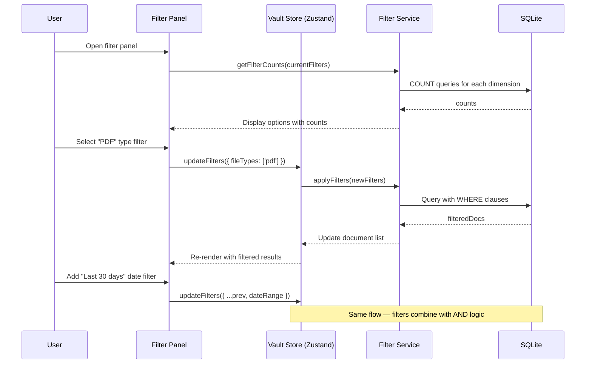

---

## Sort Options

| Sort Key | Label | Direction | Default |
|---|---|---|---|
| `name` | Name | A→Z / Z→A | A→Z |
| `createdAt` | Date Added | Newest / Oldest | Newest |
| `updatedAt` | Last Modified | Newest / Oldest | Newest |
| `lastAccessedAt` | Recently Opened | Most Recent / Least Recent | Most Recent |
| `fileSize` | File Size | Largest / Smallest | Largest |
| `fileType` | File Type | A→Z / Z→A | A→Z |

### Sort Interface

```typescript
interface SortService {
  sort(documents: Document[], sortBy: SortKey, direction: SortDirection): Document[];
}

type SortKey = 'name' | 'createdAt' | 'updatedAt' | 'lastAccessedAt' | 'fileSize' | 'fileType';
type SortDirection = 'asc' | 'desc';

// Zustand store slice
interface VaultStore {
  sortBy: SortKey;
  sortDirection: SortDirection;
  setSortBy: (key: SortKey) => void;
  toggleSortDirection: () => void;
}
```

---

## Favorites & Recently Accessed

### Favorites

- Toggle favorite with a tap on the star icon (available on card, list item, and detail view)
- Favorites appear in a dedicated "Favorites" quick-access section on the vault home page
- Filter by favorites to see only starred documents
- Favorite status syncs to the `documents.is_favorite` column

### Recently Accessed

- Every time a document is previewed/opened, `lastAccessedAt` is updated
- "Recent" section on vault home shows the last 10 accessed documents
- Sorted by `lastAccessedAt DESC`
- Collapsible (persisted in `core/preferences`)

#### Redesigned strip (UX-16): large cards, coverflow drag, swipe-up-to-Tools

Larger cards (72px thumbnails, up from 40px) in a native horizontal
scroll-snap carousel (`scroll-snap-type: x proximity` + `scroll-snap-align:
center` per card — the browser handles fling/snap, no custom paging JS).
As the row scrolls, `useCoverflowScroll`
(`document-vault/hooks/useCoverflowScroll.ts`) reads the row's own scroll
position on a rAF-throttled `scroll` listener and applies a `scale` +
`opacity` falloff to each card by its distance from the row's center —
transform/opacity only (no `rotateY` perspective coverflow), staying cheap
on the mid-range Android performance budget (CONTRIBUTING.md).

Swiping up on a card opens PDF Tools (`useSwipeUp`, `core/gestures/` — the
vertical counterpart to F-88's horizontal swipe-to-act gesture). Kept
strictly on the vertical axis so it never competes with the horizontal
carousel drag for the same pointer input; each card sets `touch-action:
pan-x` so the browser only native-scrolls it horizontally, leaving
vertical touch input on the card free for the gesture instead of racing
the page's own vertical scroll.

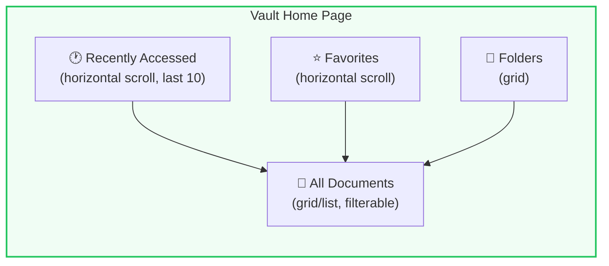

---

## Document Preview

### PDF Preview

| Feature | Implementation |
|---|---|
| **Rendering** | `pdfjs-dist` canvas rendering |
| **Page Navigation** | Swipe gestures + page number input |
| **Zoom** | Pinch-to-zoom + double-tap zoom |
| **Text Selection** | Text layer overlay for copy |
| **Thumbnails** | Sidebar/bottom strip with page thumbnails |
| **Search in PDF** | `pdfjs-dist` text search with highlighting |
| **Night Mode** | Invert colors for comfortable reading |

### Image Preview

| Feature | Implementation |
|---|---|
| **Rendering** | Native `` with CSS transform |
| **Zoom** | Pinch-to-zoom + double-tap + spread gesture |
| **Pan** | Drag to pan when zoomed |
| **Rotate** | Rotation controls (90° CW/CCW) |
| **Full Screen** | Immersive mode on mobile |

### Preview Sequence

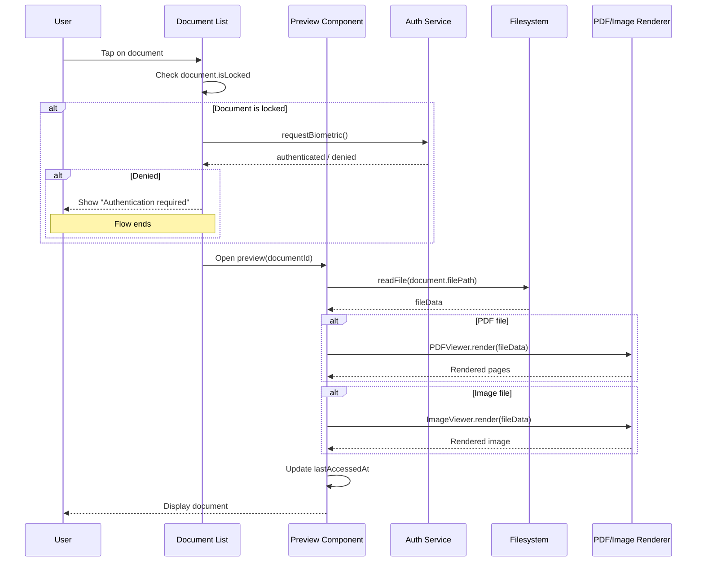

---

## Document Details View

> The table below and `DocumentDetailsSheet` are what actually shipped (F-67,
> 2026-07-16). The original wireframe further down this section (editable
> description, operation history timeline, an inline quick-actions row) was
> the pre-implementation sketch — **not built for V1**: it needs new schema
> (a free-text `description` column) and an operations-log table neither of
> which exist yet. Kept below for the V2 backlog; do not treat it as current
> behaviour.

`DocumentDetailsSheet` is a **read-only** `IonModal` opened from the **Details**
item in the vault list item-menu or the viewer menu (see
[Document Actions](#document-actions)). It renders directly off the already-loaded
`DocumentEntity` for every row except **Dimensions** — the one exception,
loaded lazily via `useImageDimensions` (F-8's `getImageInfo`, see [Convert
format](#convert-format-f-8)) for Canvas-decodable image documents only, and
simply omitted for everything else (PDFs, HEIC, non-image types) — no new
dependency either way.

### Detail View Sections (as shipped)

| Row | Content | Source |
|---|---|---|
| **Name** | Document display name | `document.name` |
| **Type** | File type (PDF / JPG / DOCX / …) | `document.fileType` |
| **Dimensions** | Pixel width × height (images only, added 2026-07-18) | `useImageDimensions` → F-8 `getImageInfo` |
| **Size** | Human-readable size | `formatFileSize(document.size)` |
| **Added** | Creation date, locale-formatted | `formatDateTime(document.createdAt)` |
| **Modified** | Last-modified date, locale-formatted | `formatDateTime(document.updatedAt)` |
| **Original filename** | The name the file arrived with (camera/scanner/picker), if different from the current name | `document.originalName` |
| **Status** | Locked / Favorite badges, or "—" if neither | `document.isLocked`, `document.isFavorite` |
| **Integrity hash** | The stored content hash (tamper-evidence, §10) | `document.contentHash` |

en/hi i18n; excluded from unit coverage (IonModal overlay, device-verified like
the other sheets — `pnpm --filter kagaz vitest src/modules/document-vault/components`
covers the pure pieces it composes).

### V2 backlog (not implemented)

The earlier design additionally sketched: an editable description field, a
folder/tag quick-edit surface inline in the sheet, an operations-history
timeline, and quick-action buttons for Merge/Split/Convert/Compress/Encrypt/OCR
directly from the details view. None of these shipped in V1 — folder/tag
editing already has its own entry points (move dialog, tag sheet) and the PDF
operations live in the PDF Tools hub ([03](03-pdf-engine-module.md)) instead of
being duplicated here. Revisit if user feedback asks for it.

---

## Document Actions

Per-document actions are offered two ways: the **vault list item-menu**
(`IonActionSheet`, `data-agent-id="vault.home.item-menu"`, long-press or the
overflow button on a list row) and the **viewer menu** (opened from
`DocumentViewerPage`). Both are agent-actionable — every button has a
`data-agent-id` and a matching entry in the Action Registry per
[`agent-interface.md`](../design-system/agent-interface.md).

### Vault list item-menu (top → bottom)

| Action | Feature | Shown when | Handler |
|---|---|---|---|
| Add tag | — | always | opens the tag-edit sheet |
| Move | — | always | opens `MoveToFolderDialog` |
| Select | — | always | enters bulk-selection mode |
| Lock / Unlock | — | always | toggles `document.isLocked` |
| **Open with…** | F-64 | native platform only | `document-intent.service.openDocumentWith` |
| **Share…** | F-65 | native platform only | `document-intent.service.shareDocument` |
| **Details** | F-67 | always | opens `DocumentDetailsSheet` |
| **Copy text** | F-68 | `document.ocrText` has non-whitespace content | `core/clipboard.copyToClipboard` |
| **Convert format** | F-8 | image document in a Canvas-decodable format (`canConvertImageFormat`: jpg/jpeg/png/webp) | opens a target-format action sheet → `useImageFormatConversion.convert` |
| **Enhance photo** | F-29 | same gate as Convert format (`canApplyImageFilter`) | opens a filter-preset action sheet → `useImageEnhancement.applyFilter` |
| **Resize & compress** | F-85 | same gate as Convert format (`canConvertImageFormat`) | opens a dimensions + size-target sheet → `useResizeCompress.run` |
| **Compress** | F-5 UX follow-up | PDF document (`isPdf`) | one-tap, no sheet → `usePdfEngine().compressPdf(doc, 'medium')` |
| **Extract pages** | F-66 UX follow-up | PDF document (`isPdf`) | opens a page-range sheet → `usePdfEngine().extractPages` |
| **Save page as image** | F-86 | PDF document (`isPdf`) | opens a page-range sheet → `usePdfEngine().pdfToImages` |
| Extract text (OCR) | F-20 | image document, native platform (`canOcr`) | runs OCR, stores `ocrText` — for PDFs (triggered elsewhere; `canExtractText` also covers them), per-page OCR fallback fixed 2026-07-21, see below |
| Delete | — | always | soft-delete → Trash (recoverable) |

#### Item-menu-first PDF tools (UX follow-up, 2026-07-21)

Compress, Extract pages, and Save Page as Image (F-86) are reachable directly
from a PDF's own item-menu, not only through the Tools hub's tool-first flow
(`/pdf-tools` → pick an op card → pick a document from an in-sheet picker —
2 screens, 3+ taps, and the document you already tapped to get here has to be
found again). Promoted these three specifically because they're the
highest-frequency single-document PDF operations (shrinking a scan under a
government-portal size limit; pulling a subset of pages out; grabbing one
page as a shareable image) — the item-menu already has 12 entries for a PDF
document, so promoting all 14 Tools-hub ops here instead of a deliberate
subset would trade one kind of friction for another. The remaining ops
(Merge, Watermark, Encrypt/Decrypt, Fill form, format exports, …) stay
Tools-hub-only: either inherently multi-document (Merge) or infrequent
enough that the extra hop doesn't cost most users much. Each promoted action
calls the *same* engine method the Tools-hub card already used — no new
pdf-engine code, only a faster door to it. Compress runs at a fixed 'medium'
quality with no confirmation sheet at all (one tap, matching this app's
one-primary-action design principle); a different quality still requires the
Tools hub.

### Viewer menu (`DocumentViewerPage`)

Same **Open with…** / **Share…** (native-gated) / **Details** / **Delete**
actions as above, plus an inline **Copy** button under the extracted-text panel
(same `copyToClipboard` helper) once text has been extracted or OCR'd.

### OS document intents (F-64 / F-65)

`document-intent.service.ts` wraps two Android intents behind one contract
(`isIntentSupported`, `openDocumentWith`, `shareDocument`):

| Action | Plugin | Android intent | Purpose |
|---|---|---|---|
| **Open with…** | `@capacitor-community/file-opener` (MIT) — `open({ filePath, contentType, openWithDefault: false })` | `ACTION_VIEW` | Shows the OS **"Open with"** app chooser for every app that can view the document's MIME type |
| **Share…** | `@capacitor/share` (already a dependency) — `Share.share({ url })` | `ACTION_SEND` | Shows the OS share sheet for every app that accepts the file |

`Filesystem.getUri` (`Directory.Data`) itself returns a plain `file://` URI —
correction (2026-07-21): an earlier revision of this doc claimed it returns
`content://` directly, which is wrong. The `file://` → `content://` conversion
happens later, natively, inside each plugin via `FileProvider.getUriForFile`
(so the document's real on-disk path is still never exposed to the receiving
app) — `@capacitor-community/file-opener` mints its own FileProvider
(`${applicationId}.file.opener.provider`) for **Open with…**, while
**Share…** goes through `@capacitor/share`'s call into the app's *own*
FileProvider (`${applicationId}.fileprovider`, declared in
`AndroidManifest.xml`), whose allowed roots are `android/app/src/main/res/xml/file_paths.xml`.
**Bug fixed 2026-07-21**: that file was missing a `<files-path>` entry, so
`FileProvider.getUriForFile` threw `IllegalArgumentException: Failed to find
configured root` for every document (all of which live under `Directory.Data`)
— **Share… failed for every target, including WhatsApp**, while Open with…
kept working (different provider, whose paths file already covered it). MIME
type comes from `mimeTypeFor(document.fileType)`. `useDocumentIntents` is the
React hook: it resolves `supported = Capacitor.getPlatform() !== 'web'` once,
and both actions swallow user-cancellation (dismissing the chooser/share sheet
is not an error — only a genuine failure surfaces a toast).

**[SEC]** Both are user-initiated (the user explicitly picked the action from
the menu) and read-only from the vault's perspective — no network call is made
by the app; the receiving app's own behaviour is outside Kagaz's boundary.

### Receive Share (F-108)

The inbound counterpart to F-64/F-65: Kagaz appears in Android's native
share sheet from *any* other app (Gallery, WhatsApp, a file manager, …) and
imports what's shared straight into the vault.

Android has no equivalent of `@capacitor/share` for the *receiving* side, so
this is a small custom plugin rather than a third-party dependency —
`ShareReceiverPlugin.java` (`apps/kagaz/android/app/src/main/java/in/kagaz/app/`,
same app-local pattern as `RootCheckPlugin`/`OcrPlugin`, not a standalone
`packages/` plugin package, since this is very Kagaz-specific integration
rather than a reusable one). `AndroidManifest.xml` declares `ACTION_SEND` /
`ACTION_SEND_MULTIPLE` intent-filters on `MainActivity` scoped to the types
the upload pipeline already accepts (PDF, images, txt/md/csv, doc/docx,
xls/xlsx) — not a catch-all `*/*`, so Kagaz doesn't show up for every share on
the device (audio, video, arbitrary APKs, …).

| Layer | Piece | Responsibility |
|---|---|---|
| Native | `ShareReceiverPlugin.java` | Resolves the pending/incoming `Intent`'s `EXTRA_STREAM` (single or `ArrayList<Uri>`) + `EXTRA_TEXT` into a plain JS payload (`{ items: [{uri, mimeType, name}], text }`); consumes the intent after reading so backgrounding/resuming doesn't re-import the same share twice |
| Native | `MainActivity.onNewIntent` | `launchMode="singleTask"` means a share arriving while the app is already running lands here (not a fresh `onCreate`) — forwards it to the plugin, which emits a `shareReceived` event |
| Service | `share-receive.service.ts` | `getPendingShare()` (cold-start poll), `onShareReceived()` (warm-start event), `sharedItemToIncomingFile()` — reads the shared `content://` URI via `Capacitor.convertFileSrc` (resolves through the WebView's content-resolver bridge against the **sending app's own FileProvider** — no native copy step, no change needed to Kagaz's own `file_paths.xml`) and turns it into an `IncomingFile` |
| Hook | `useShareIntent()` | Mounted once at the app root (`routes/index.tsx`, same posture as the hardware-back handler) — checks for a pending share on mount, subscribes to live shares, feeds every converted item through the **existing** `useUpload().ingestFiles()` pipeline (F-1's validate → hash → store → thumbnail → DB-row path — no new upload logic), then navigates to `/vault` and toasts the result |

**Scope decision — text-only shares are ignored.** A share with `EXTRA_TEXT`
but no `EXTRA_STREAM` (e.g. sharing a link or a chat message, not a file) is
dropped silently — this is a document-import surface, not a general text
capture one. `source_type` for a share-imported document is `file_picker`
(no new DB enum value / migration — a shared file is, functionally, a file
the user picked from another app rather than this app's own file picker).

**[SEC]** No network call: the shared bytes come from the sending app's own
FileProvider via an OS-granted URI permission, entirely on-device, then flow
through the same validated/hashed upload pipeline every other source uses.

### Copy text (F-68)

`core/clipboard.copyToClipboard(text)` — the async Clipboard API
(`navigator.clipboard.writeText`, which works inside the Capacitor Android
WebView's secure `capacitor://` context) with a hidden-`<textarea>` +
`execCommand('copy')` fallback for older WebViews. Used by both the item-menu's
**Copy text** (copies `document.ocrText` without opening the viewer — gated on
`documentHasCopyableText`, `useCopyDocumentText`) and the viewer's inline Copy
button.

**[SEC]** the copied text is document content (may include OCR'd PII) — it is
handed straight to the platform clipboard and never logged.

### Convert format (F-8)

`useImageFormatConversion.ts` wraps `image-engine/services/image-engine.service.convertFormat`
(Canvas `createImageBitmap` → `canvas.toBlob`, main thread — see
[04-image-engine-module.md](04-image-engine-module.md)) with the vault's file
storage + upload pipeline. `canConvertImageFormat(document)` gates the
item-menu entry to documents whose stored `fileType` (lowercased extension)
is `jpg`/`jpeg`/`png`, or `webp` — HEIC/BMP/TIFF/GIF are decode-only
(ADR-016, no bundled LGPL decoder) so they're never offered as a source.
Choosing **Convert format** opens a second, small `IonActionSheet`
(`vault.home.convert-format-sheet`) listing `conversionTargetsFor(document)`
— the two Canvas formats other than the document's own. Converting reads the
original file, encodes to the target MIME, and saves the result as a **new**
document via `useUpload().ingestFiles` (`source: 'ai_generated'`, same
non-destructive pattern the PDF Power Tools use) named `<original base
name>.<target extension>` — the original document is untouched.

### Enhance photo (F-29)

`useImageEnhancement.ts` applies one of `image-engine/services/image-filters.ts`'s
`FILTER_PRESETS` (grayscale, black & white, auto-enhance, invert — pure RGBA
transforms, canvas glue via `applyImageFilter`) and saves the result as a
**new** document, mirroring Convert format's non-destructive pattern exactly
— same `canApplyImageFilter` gate (re-exports `canConvertImageFormat`, since
a filter needs the same Canvas-decodable source), same `ingestFiles` save
path. The output keeps the document's own format (`mimeTypeFor(fileType)` is
passed through to `applyImageFilter`'s `deps.mime`, not forced to JPEG) and
is named `<original>_<preset>.<extension>`.

Brightness/contrast are parameterized filters the engine already exposes but
aren't offered in this action-sheet UI — a numeric adjustment needs a slider
surface, not a pick-one list; a follow-up, not scope creep on this pass.

### Resize & Compress for Forms (F-85)

`useResizeCompress.ts` wraps `image-engine/services/resize-compress.service.ts`
(pure Canvas — see [04-image-engine-module.md](04-image-engine-module.md) §9
for the engine spec) with the same non-destructive save pattern as Convert
format/Enhance photo — same `canConvertImageFormat` gate (any Canvas-decodable
image), same `ingestFiles` save path, output named
`<original>_resized.<extension>`. Choosing **Resize & compress** opens a form
sheet: target width × height (with an aspect-ratio-lock toggle so changing one
dimension proportionally updates the other), a handful of preset dimension
chips for common Indian government-form specs (passport photo, PAN photo,
signature), and a target file-size range (min–max KB, or "as small as
possible"). Running it resizes first (to the exact requested dimensions —
stretching, not just fitting within a box, since government forms often
require an exact non-proportional size), then iteratively re-encodes at
decreasing JPEG quality until the result lands inside the size range or hits a
quality floor (surfaced as a warning rather than silently producing a
blown-out image). See §9.3 of the image-engine doc for the full algorithm.

**[SEC]** pure on-device Canvas transform of an already-owned document — no
new data collected, no network, output stored the same way as any other
document.

**Bug this pass found and fixed**: `document.name` (the DB-stored value)
never carries a file extension — `upload.service.ts`'s `splitFileName`
strips it into `fileType` at save time. The first version of this hook tried
to extract/reuse an extension from `name` and silently produced an
extension-less filename whenever `name` had none (i.e. always, in real
data), which the upload pipeline's own validation then rejected as
`INVALID_FILE_TYPE` — device-verified failing, then fixed to always derive
the extension from `document.fileType` instead, and reconfirmed live. F-8's
Convert format never had this bug (it always appends a fresh extension for
the target format regardless of the source name), but its own tests shared
the same unrealistic fixture (`name: 'photo.jpg'` instead of `'photo'`),
which had been masking exactly this class of bug — fixed in both test files.

### Save Page as Image (F-86)

`PdfPageImageSheet.tsx` — a quick, single-document entry point into the
existing F-6 `pdfToImages` renderer, reached directly from the PDF
item-menu (`isPdf(document.fileType)` gate) rather than the Tools hub's
tool-first flow: a page-range text field (reusing `parse-ranges.ts`'s
`parsePageRanges`, the same "1, 3-4" syntax as Split/Extract pages) defaults
to `"1"` so the common single-page case is one tap; `flattenPageRanges` (new)
expands the parsed ranges into the flat, deduped, ascending page-index array
`RenderOptions.pages` needs. Running it calls `usePdfEngine().pdfToImages`
unchanged — no new engine code, this is purely a faster UI path onto an
already-shipped capability.

**Deliberately whole-page rasterisation, not "extract the embedded
picture"**: a scanned PDF page can carry a stamped page-number or watermark
on top (via Stamp/Page Numbers), composited over the actual scan content.
Only rendering the complete page (pdfjs `page.render()`, exactly what F-6's
renderer already does) guarantees the saved image matches what the page
visually shows; pulling out "the" embedded image object by content-stream
inspection would risk grabbing the wrong element or missing the composited
result entirely. Same reasoning as `useDocumentOcr`'s per-page OCR fix
(§Extract text below) — anywhere this module decides "what's really on this
page," it renders the page rather than trusting a single embedded object or
text-layer fragment.

No Action Registry entry beyond the existing `agentAction="vault.savePageAsImage"`
string on the Run button (unregistered, matching F-85's `vault.resizeCompress`
— an existing gap in this codebase's own convention, not introduced here).

### Select text & Detected numbers (F-83)

The viewer's extracted-text panel is explicitly selectable
(`user-select: text` / `-webkit-user-select: text`, `viewer.css`
`.kg-viewer__text-body`) — native drag-select + the WebView's long-press
"Copy" affordance work on any substring, not just the whole block via the
**Copy text** button.

For the common case of wanting just *one* number out of a longer block
(account number, PIN code, phone number, date, invoice amount, …),
`document-vault/services/extract-numbers.ts` (`extractNumberSequences`) runs a
pure regex over the already-displayed text (digit runs of 4+ digits, allowing
internal spaces/hyphens for grouped IDs like "1234 5678 9012") and the viewer
renders each match as its own tap-to-copy chip under **Detected numbers**
(shown only when at least one match exists, capped at 20). Purely a read-time
UI convenience — it extracts nothing new and stores nothing; the same text is
already fully visible in the panel above it.

**[SEC]** same posture as Copy text — copies straight to the clipboard, never
logged.

Each detected-number chip also carries a secondary **Save to Quick Reference**
action (F-84, see the section below) — pre-fills a new Quick Reference entry's
value with the tapped number and links it to the source document, so the
common "I want to keep grabbing this one number later without reopening the
document" case is one tap instead of a manual copy-paste round trip.

---

### Swipe-to-act gestures (F-88)

Gmail-style swipe-left/swipe-right on a document row, revealing a colored
action behind it (icon + `var(--color-*)` background) that fires once the
drag passes a commit threshold (`SWIPE_COMMIT_PX = 88px`, or 40% of the
row's own width if that's smaller). Built on `core/gestures/`:

- `useSwipeGesture` — the pointer-events primitive (pointerdown/move/up,
  axis-lock between horizontal-swipe and vertical-scroll after a 10px
  deadzone, `setPointerCapture` once locked). No new dependency — mirrors
  the long-press pointer-capture pattern `DocumentListItem` already used
  for entering multi-select (F-25).
- `SwipeableRow` — the visual wrapper (1:1 finger tracking, spring-back
  transition on release). Deliberately **action-vocabulary-agnostic**: it
  takes a resolved `{ icon, colorVar } | null` reveal per side, not an
  enum. This lets Trash reuse the exact same primitive for a completely
  different action pair (restore / delete forever) without inheriting the
  vault's own vocabulary.
- `SwipeActionKind` / `SWIPE_ACTION_META` (`core/gestures/vault-swipe-
  actions.ts`) — the vault's own action vocabulary: `delete | favorite |
  move | tags | none`. Lives in `core/` (not this module) because
  `core/preferences` — which must stay module-agnostic — persists the
  two Settings choices.

**Configuration**: Settings → Documents → Swipe actions lets the user pick
the action for swipe-left and swipe-right independently (`settings.
setSwipeAction`, persisted via `usePreferencesStore.swipeLeftAction` /
`swipeRightAction`). Defaults: left = delete, right = favorite.

**Where it's wired**: the vault list, search results, and Favorites (all
via `DocumentListItem`'s optional `swipeLeftAction`/`swipeRightAction`/
`onSwipeAction` props — every handler delegates to the exact same mutation
path the row's own menu/star button already uses, so swipe is purely an
accelerator, never a second code path). Trash gets its own **fixed**,
non-configurable swipe actions (restore / delete forever) since that
vocabulary doesn't fit the vault's Settings enum. Multi-select mode
disables swipe entirely (`disabled` prop) to avoid two conflicting
gestures on the same row.

**[SEC]/Accessibility**: every swipe action also has a non-swipe path (the
row's own tap-menu or star button) — WCAG 2.1 AA has no reliable swipe
equivalent for switch/keyboard users, so swipe must never be the *only*
way to reach an action.

**Undo**: swipe-delete and bulk-delete both show a generalized
`UndoToast` (`core/components/UndoToast.tsx`, 4s duration) offering
Undo → `restore()`. This closed a real gap — bulk delete previously had
no undo at all, unlike the single-row delete path (UX-1).

### Archive (F-89)

`is_archived` (§4.1 of the database doc — `DEFAULT 0`, "Soft archive —
hidden from default views") existed in the schema from V1's original
design but was never wired to any query or UI until this item — the DAO
already read/wrote the column via the generic `update()` patch, but
nothing filtered on it and no screen surfaced it.

**Archive vs. delete — the distinction that drives every query decision
below**: archiving hides a document from the *active browsing surfaces*
without treating it as gone. Concretely:

| Surface | Filters out archived? |
|---|---|
| Main list (`findByFolder`) | **Yes** — the core "get this out of my daily view" behavior |
| Recent (`findRecent`) | **Yes** — a document the user just archived shouldn't immediately resurface as "recent" |
| Search (`search`) | No — still fully findable |
| Favorites (`findFavorites`) | No — an archived-but-starred document still shows in Favorites |
| Storage stats / duplicates | No — archived documents still occupy disk space |
| Backup export (`findAll`) | No — archiving is not a reason to drop a document from the encrypted backup |

`DocumentDao.findArchived()` is the one query that filters *to*
`is_archived = 1` (mirrors `findTrashed()`'s shape/posture, but archiving
has no retention window or file cleanup, so it needed no dedicated service
file — `useArchive` calls the DAO directly).

**Where it's reachable**: `archive`/`unarchive` on `useVaultMutations`
(optimistic, same pattern as `softDelete`/`restore`) — used by (a) the
vault item-menu's new **Archive** entry, (b) `SwipeActionKind`'s new
`'archive'` member (`core/gestures/vault-swipe-actions.ts`, `Archive` icon
added to `@kagaz/ui`'s curated Lucide set), selectable per-side in
Settings → Swipe actions same as delete/favorite/move/tags. New
**Archived** page (`ArchivedPage.tsx`, reached from Settings → Data &
Privacy → Archived, mirroring the existing Trash entry point) lists
archived documents with fixed (non-configurable) swipe actions — right =
unarchive, left = delete straight to Trash — the same "Trash gets its own
vocabulary, doesn't inherit the vault's Settings enum" posture F-88
established. `vault.archiveDocument` is a real Action Registry entry
(reversible, `requiresConfirmation: false`); unarchive/delete-to-trash on
the Archived page are user-only, same posture as Trash's own
restore/delete-forever (no registry entries).

`DocumentDetailsSheet`'s status row now includes "Archived" alongside
Locked/Favorite when `document.isArchived` is true.

---

## Quick Reference (F-84)

A personal key-value vault for the numbers/text users copy out of their
documents often — Aadhaar/PAN/mobile/bank account/IFSC, social handles,
emails, or anything else the user names. Reached from a **Quick Reference**
button in the vault home header (same pattern as the existing **Tools**
button that opens PDF Tools — a header entry, not a bottom tab; see
`app/routes/index.tsx`'s 3-tab bar, which this deliberately does not extend).

### Why a separate feature from Tags/Details

Tags (F-10) organize *documents*; Quick Reference stores *values extracted
from* documents (or typed standalone) for fast retrieval independent of
opening the source document again. A value here is not document content
duplicated for its own sake — it is the specific fragment (a number, an ID, a
URL) the user actually needs to paste elsewhere, e.g. filling a government
form that asks for "PAN" without wanting to hunt through a scanned PDF for it.

### Data model

```typescript
interface QuickReferenceEntry {
  id: string;
  label: string;              // fully user-typed; the app never assigns
                               // semantic meaning to a label (see Security)
  value: string;               // text value; masked by default in the UI
  linkedDocumentId: string | null; // provenance / "Copy image" source
  tagIds: string[];            // reuses the F-10 tag system, not a new one
  createdAt: string;           // ISO 8601
  updatedAt: string;
}
```

One new table, `quick_reference_entries` (migration 005) — see
[09-database-design.md](09-database-design.md) §4.12 for the DDL, and §10 for
how it folds into the F-31 encrypted backup.

### Template suggestions (not a schema)

The "new entry" sheet offers a row of tappable label suggestions — Aadhaar
No, PAN No, Mobile Number, Bank A/C No, IFSC Code, Email, Voter ID, Driving
Licence No, Passport No, UAN — the same empty-state-CTA interaction F-30's
folder templates established. Tapping one only pre-fills the **label** text
field; the user still types the value. **This is presentation-layer
convenience only** — there is no `label_type` column, no per-label
validation, and no code path that treats an "Aadhaar No"-labelled entry any
differently from a custom one the user typed themselves. See
[10-security-architecture.md](10-security-architecture.md) §3.6 for why this
distinction matters.

### List, mask, and reveal

Entries render label + a masked value (`•••• ` + last 4 characters, tap to
reveal — the standard secure-notes pattern) grouped/filterable by tag (reuses
F-10's `TagSelector`/filter UI, no new tag picker built). The whole
**Quick Reference** screen requires a biometric prompt to open (reuses F-16's
`biometric.service`, same call the per-document lock uses) — this data is
denser and more sensitive than a single locked document, so it gets the
stronger of the two existing lock postures rather than a new third one.

### Copy actions

| Action | Behavior |
|---|---|
| **Copy value** | Copies the raw value via `core/clipboard.copyToClipboard` (F-68's helper). |
| **Copy with label** | Copies `"<label>: <value>"`. |
| **Copy image** | Only shown when `linkedDocumentId` resolves to an image document — copies the image bytes to the OS clipboard (`ClipData`/`ClipboardItem` with an image MIME type; supported by Android's clipboard and consumable by Gboard's clipboard picker like any other image copy). |

All three **auto-clear the clipboard ~30s after copy** — a new
`core/clipboard.copyToClipboard` option (`autoClearMs`), which re-reads the
clipboard before clearing and only clears if it still holds exactly what was
copied (so a second, unrelated copy in that window is never clobbered). This
is new behavior beyond F-68/F-83's plain copy — those stay opt-in per call
site, existing callers are unaffected.

### Multi-select & bulk copy

Long-press an entry to enter selection mode — the exact F-25 pattern
(`useBulkActions`-style selection store, a floating `BulkActionBar`-shaped
toolbar) reused rather than a new one invented. Bulk actions: **Copy** (all
selected values, one per line), **Copy with labels** (`Label: Value` per
line), **Delete**, **Add tag**.

### Linking to a document

An entry can be created two ways: standalone (from the Quick Reference
screen's own **+** button) or linked (from a document's Details sheet or the
viewer's Detected-numbers chips — see above). A linked entry shows a small
provenance chip ("from <document name>") that opens the source document on
tap; deleting the source document does not delete the entry (`linkedDocumentId`
is nulled, `ON DELETE SET NULL` — the value the user saved is theirs to keep
independent of the document it came from).

### Agent contract

New page trio (`QuickReferencePage.tsx` / `.agent.ts` / `.skill.md`) per
[agent-interface.md](../design-system/agent-interface.md). Actions:
`quickref.create`, `quickref.edit`, `quickref.delete`, `quickref.copyValue`,
`quickref.copyWithLabel`, `quickref.copyImage`, `quickref.reveal`,
`quickref.bulkCopy`, `quickref.bulkCopyWithLabels`, `quickref.bulkDelete`.
Copy actions keep an `agentAction` (voice/AI can trigger them, same posture as
F-68's Copy text — user-initiated, non-destructive, never logged); per F-16's
own precedent the **biometric unlock prompt itself has no `agentAction`** so
an AI tool call cannot bypass the screen's lock.

---

## Bulk Operations

Multi-select mode enables batch operations on multiple documents at once.

### Entering Bulk Mode

| Trigger | Behavior |
|---|---|
| **Long-press** | Long-press any document card/list item to enter bulk mode |
| **Select All** | Checkbox in toolbar to select all visible documents |
| **Range Select** | Tap first, then shift-tap last to select range (web only) |

### Available Bulk Operations

| Operation | Icon | Description | Confirmation Required |
|---|---|---|---|
| **Move** | 📁 | Move selected documents to a folder | No (but shows folder picker) |
| **Delete** | 🗑️ | Delete selected documents permanently | Yes — "Delete N documents?" |
| **Tag** | 🏷️ | Add/remove tags from all selected | No |
| **Merge** | 📎 | Merge selected PDFs into one (PDFs only) | No |
| **Compress** | 📦 | Compress all selected documents | No |
| **Share** | 📤 | Share selected documents in one OS share sheet (F-65 bulk-select follow-up, 2026-07-21) — `document-intent.service.shareDocuments`, one `files[]` share for 2+, delegates to the single-document `url` shape for exactly 1. Native-only (hidden on web); no Action Registry entry, same posture as the single-document Share… button. | No |
| **Favorite** | ⭐ | Toggle favorite on all selected | No |
| **Lock** | 🔒 | Toggle lock on all selected | Biometric required |

### Bulk Action Flow

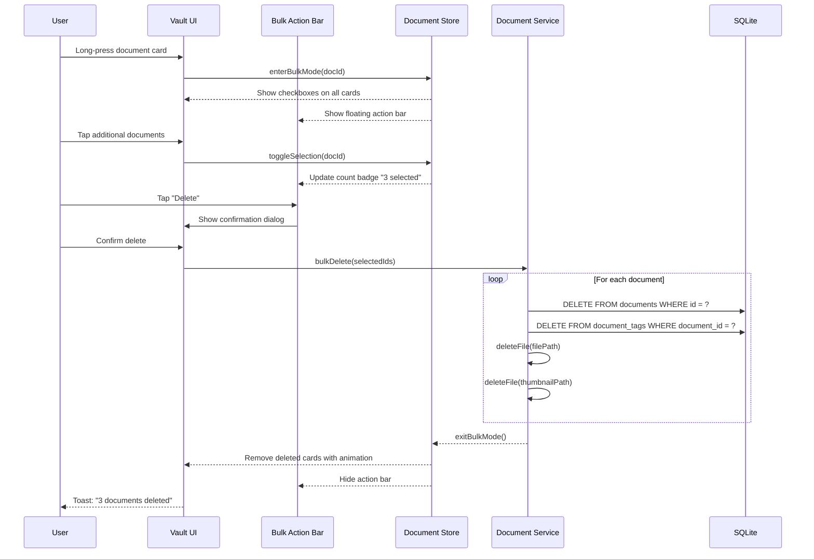

---

## Multilingual Support

### Supported Languages (V1)

| Language | Code | Script | Status |
|---|---|---|---|
| English | `en` | Latin | Primary |
| Hindi | `hi` | Devanagari | Primary |
| Tamil | `ta` | Tamil | Planned |
| Telugu | `te` | Telugu | Planned |
| Bengali | `bn` | Bengali | Planned |
| Marathi | `mr` | Devanagari | Planned |

### Implementation

| Area | Approach |
|---|---|
| **UI Strings** | i18next with JSON translation files, lazy-loaded per language |
| **Document Names** | Stored as-is in any script; search works across scripts |
| **OCR Language** | Tesseract.js supports Hindi, Tamil, Telugu, etc.; user can select language |
| **AI Chatbot** | System prompt includes multilingual instructions; model supports Hindi + English |
| **Voice Input** | STT plugin configured per language |
| **Voice Output** | TTS plugin with language-specific voice packs |
| **Date Formats** | Localized via Intl.DateTimeFormat |
| **Number Formats** | Localized via Intl.NumberFormat |

### Language Switch Flow

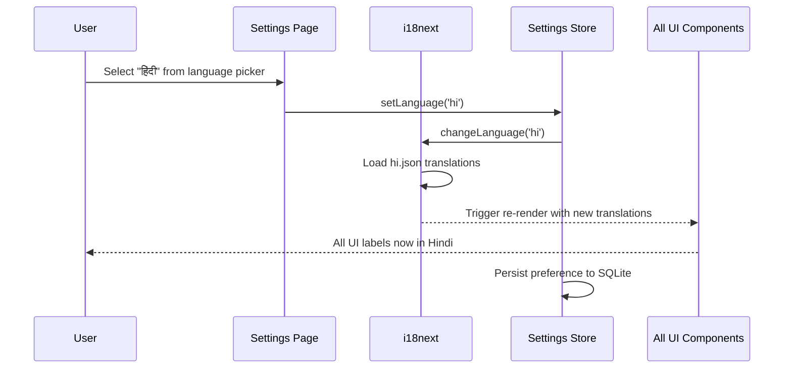

---

## Accessibility Features

> [!IMPORTANT]
> Accessibility is a **first-class requirement**, not an afterthought. India has 26.8 million people with disabilities, and many more senior citizens who benefit from accessibility features. Every component must pass WCAG 2.1 AA compliance.

### Feature Matrix

| Feature | Implementation | Notes |
|---|---|---|
| **Screen Reader** | Semantic HTML, ARIA labels, `aria-live` regions | All interactive elements have descriptive labels |
| **High Contrast** | `prefers-contrast` media query + manual toggle | High contrast theme with thicker borders, bolder text |
| **Font Scaling** | CSS `rem` units, respect system font size | Tested at 200% zoom — no layout breakage |
| **Touch Targets** | Minimum 48×48dp tap targets | All buttons, checkboxes, and interactive areas |
| **Keyboard Navigation** | `tabIndex`, focus management, skip links | Full app navigable without touch (web) |
| **Reduced Motion** | `prefers-reduced-motion` media query | Disable animations when user prefers |
| **Color Blindness** | Never rely on color alone; use icons + text | Tag labels include name, not just color dot |
| **Haptic Feedback** | Capacitor Haptics API | Subtle feedback on key interactions |
| **Voice Control** | AI chatbot + voice input | Full app control via voice commands |
| **Focus Indicators** | Visible focus rings on all interactive elements | Custom focus styles matching design system |

### Accessibility Service Interface

```typescript
interface AccessibilitySettings {
  fontSize: FontScale;           // 'small' | 'normal' | 'large' | 'xlarge'
  highContrast: boolean;
  reducedMotion: boolean;
  hapticFeedback: boolean;
  screenReaderOptimized: boolean; // Simplifies UI for screen readers
}

type FontScale = 'small' | 'normal' | 'large' | 'xlarge';

// CSS custom properties set based on settings
// --font-scale-factor: 0.85 | 1 | 1.15 | 1.3
// --motion-duration: 200ms | 0ms (reduced motion)
// --contrast-mode: 'normal' | 'high'
```

---

## Storage Management

### Storage Overview Page

| Metric | Display |
|---|---|
| **Total Used** | Circular progress ring + human-readable size (e.g., "247 MB of 2 GB") |
| **By File Type** | Stacked bar chart (PDFs: 60%, Images: 30%, Other: 10%) |
| **By Folder** | List sorted by size, with progress bars |
| **Largest Files** | Top 10 largest documents with quick actions |
| **Duplicate Detection** | Files with identical hash values flagged |
| **Cleanup Suggestions** | AI-generated suggestions (e.g., "5 screenshots are over 10 MB each — compress?") |

### Storage Service Interface

```typescript
interface StorageService {
  // Statistics
  getStorageStats(): Promise<StorageStats>;
  getUsageByType(): Promise<TypeUsage[]>;
  getUsageByFolder(): Promise<FolderUsage[]>;
  getLargestDocuments(limit?: number): Promise<Document[]>;
  
  // Cleanup
  findDuplicates(): Promise<DuplicateGroup[]>;
  getCleanupSuggestions(): Promise<CleanupSuggestion[]>;
  deleteOrphanedFiles(): Promise<number>;  // Cleanup files without DB records
  
  // Monitoring
  getAvailableSpace(): Promise<number>;    // bytes
  isLowOnSpace(threshold?: number): boolean;
}

interface StorageStats {
  totalUsed: number;           // bytes
  totalAvailable: number;      // bytes
  documentCount: number;
  thumbnailSize: number;       // bytes used by thumbnails
  lastCleanup: string | null;  // ISO 8601
}

interface CleanupSuggestion {
  type: 'compress' | 'delete_duplicates' | 'remove_thumbnails' | 'archive';
  description: string;         // Human-readable suggestion
  potentialSavings: number;    // estimated bytes saved
  affectedDocuments: string[]; // document IDs
}
```

### Storage Warning Flow

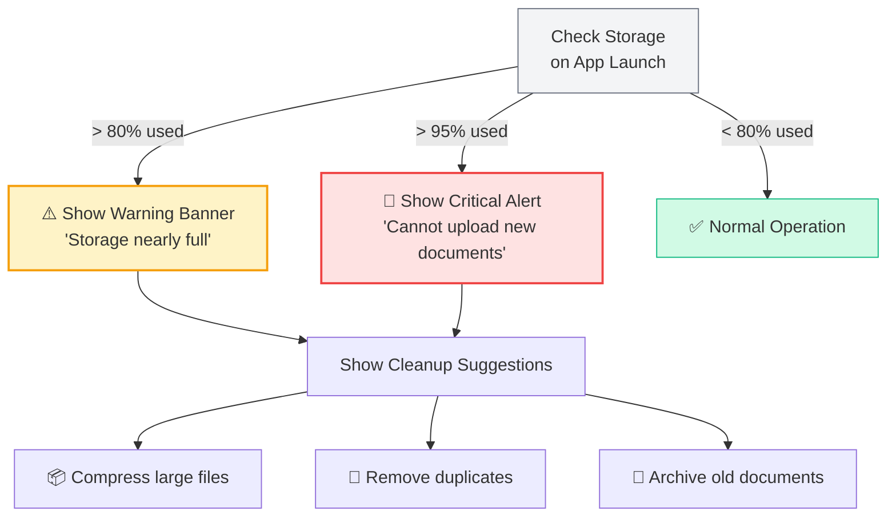

---

## Error Handling

### Error Categories

| Category | Examples | User Response |
|---|---|---|
| **Validation** | Invalid file type, name too long, storage full | Inline error message, prevent action |
| **File System** | Read/write failure, permission denied | Toast error + retry option |
| **Database** | Query failure, migration error | Error screen + "Contact Support" |
| **Scanner** | Camera unavailable, scanner not supported | Fallback to file picker |
| **OCR** | Extraction failed, unsupported language | Non-blocking warning, skip OCR |
| **Thumbnail** | Generation failed | Show generic file icon instead |

### Error Handling Strategy

```typescript
// Custom error types
class DocumentVaultError extends Error {
  constructor(
    message: string,
    public code: VaultErrorCode,
    public userMessage: string,   // i18n key for user-facing message
    public recoverable: boolean,
    public context?: Record<string, unknown>
  ) {
    super(message);
  }
}

enum VaultErrorCode {
  INVALID_FILE_TYPE = 'INVALID_FILE_TYPE',
  FILE_TOO_LARGE = 'FILE_TOO_LARGE',
  STORAGE_FULL = 'STORAGE_FULL',
  FILE_READ_ERROR = 'FILE_READ_ERROR',
  FILE_WRITE_ERROR = 'FILE_WRITE_ERROR',
  DB_QUERY_ERROR = 'DB_QUERY_ERROR',
  SCANNER_UNAVAILABLE = 'SCANNER_UNAVAILABLE',
  OCR_FAILED = 'OCR_FAILED',
  BIOMETRIC_DENIED = 'BIOMETRIC_DENIED',
  FOLDER_NOT_EMPTY = 'FOLDER_NOT_EMPTY',
  DUPLICATE_NAME = 'DUPLICATE_NAME',
}
```

> [!TIP]
> Always provide a **recoverable path** for errors. If a file can't be read, offer to re-import. If OCR fails, let the user retry or skip. If storage is full, show cleanup suggestions. Never leave the user at a dead end.

---

*Document maintained by the Kagaz Architecture Team*
