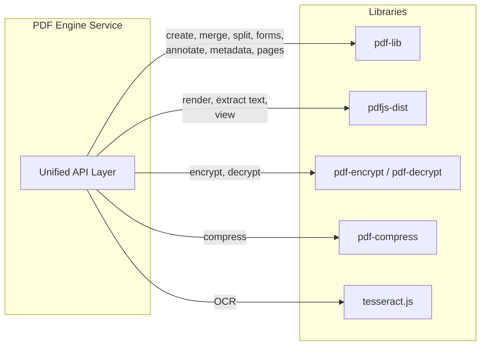
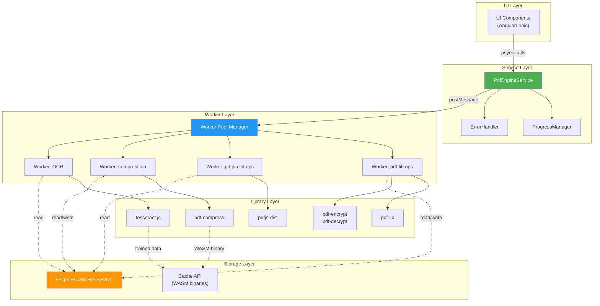
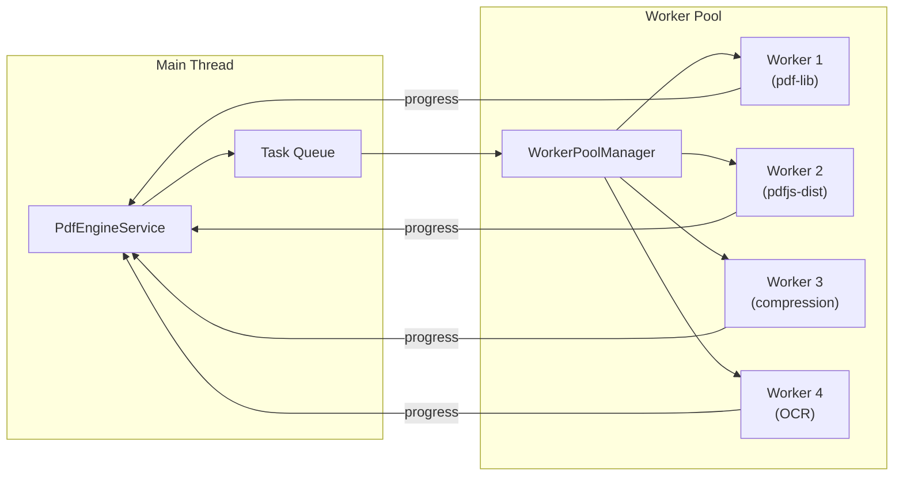
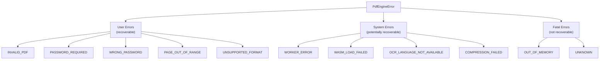
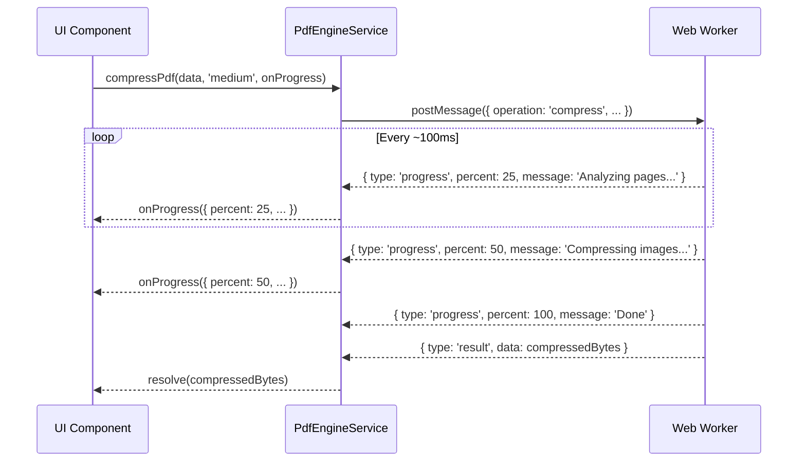
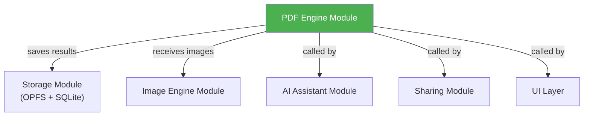

# 03 — PDF Engine Module Architecture

> **Module**: `@kagaz/pdf-engine`
> **Version**: 1.0.0
> **Status**: Partially implemented (F-3/F-4/F-5)
> **Last Updated**: 2026-07-13

---

> [!NOTE]
> **Implementation status (2026-06-13).** F-3 (merge), F-4 (split), and F-5
> (compress) are implemented as the **real** worker-backed `PdfEngineServiceImpl`
> (`apps/kagaz/src/modules/pdf-engine/`) — no mock in the shipped path. The
> behavioural contract runs against the real service via `@vitest/web-worker`.
> Compression's byte-reduction step rasterises pages (needs a canvas), so that
> assertion is **device-verified** rather than run in jsdom CI. The rest of the
> API below (creation, conversion, security, OCR, forms, metadata, annotation)
> is the target design for later items. Code samples here predate the React
> decision (ADR-001) and show Angular `@Injectable` for illustration only — the
> app is React.

## 1. Overview

The PDF Engine module is the core document-processing backbone of Kagaz. It provides a unified, promise-based API for every PDF operation the application needs — creation, merging, splitting, form filling, encryption, compression, OCR, and more — while keeping the UI thread completely free by delegating all heavy work to **Web Workers**.

> [!IMPORTANT]
> Every operation in the PDF Engine is **client-side only**. No PDF data ever leaves the user's device. This is a hard architectural constraint for privacy and offline capability.

---

## 2. Library Stack

| Library | License | Role | Size (gzip) |
|---|---|---|---|
| **pdf-lib** | MIT | Primary — creation, merging, splitting, form filling, annotations, image embedding, metadata, page manipulation | ~200 KB |
| **pdfjs-dist** | Apache 2.0 | Rendering — PDF → image, text extraction, in-app PDF viewing | ~400 KB |
| **@pdfsmaller/pdf-encrypt** | MIT | AES-256 + RC4 encryption | ~18 KB |
| **@pdfsmaller/pdf-decrypt** | MIT | Decryption (matching encrypt counterpart) | ~18 KB |
| **pdfjs-dist + pdf-lib** (rasterise) | Apache 2.0 / MIT | Compression — render pages → JPEG → rebuild PDF (F-5). ~~@quicktoolsone/pdf-compress~~ dropped: it loads a Go WASM + pdfjs worker from a CDN, which fails on the zero-network app (see implementation note + ADR-017) | (reuses pdfjs) |
| **tesseract.js** | Apache 2.0 | OCR for scanned documents (50+ languages) | ~1 MB (core) + language data |

### Library Responsibility Matrix



### Why These Libraries?

| Concern | Decision | Rationale |
|---|---|---|
| PDF manipulation | pdf-lib | Pure JS, no native deps, excellent TypeScript support, actively maintained |
| PDF rendering | pdfjs-dist | Mozilla's battle-tested renderer, used by Firefox, only viable browser option |
| Encryption | @pdfsmaller/pdf-encrypt + pdf-decrypt | Tiny (~36 KB combined), AES-256 + RC4, MIT licensed |
| Compression | pdfjs-dist + pdf-lib (rasterise) | The only offline + permissive (MIT/Apache) + no-CSP-eval path. Lossy (text→raster), fine for scans/photos. MuPDF/Ghostscript (lossless) are AGPL — forbidden; MuPDF-commercial is the upgrade path |
| OCR | tesseract.js | Industry-standard Tesseract via WASM, 50+ languages, Web Worker native |

---

## 3. Architecture Layers



---

## 4. `PdfEngineService` — Unified API

### 4.1 Service Interface

```typescript
/**
 * Unified PDF Engine Service.
 * All methods are async and run heavy work in Web Workers.
 * All Uint8Array parameters represent raw PDF bytes.
 */
interface PdfEngineService {
  // ── Creation ──────────────────────────────────────────
  /** Create a new PDF from scratch */
  createPdf(options: CreatePdfOptions): Promise<Uint8Array>;
  /** Convert one or more images into a single PDF */
  imagesToPdf(images: ImageInput[]): Promise<Uint8Array>;

  // ── Manipulation ──────────────────────────────────────
  /** Merge multiple PDFs into a single document */
  mergePdfs(pdfs: Uint8Array[]): Promise<Uint8Array>;
  /** Split a PDF into multiple documents by page ranges */
  splitPdf(pdf: Uint8Array, ranges: PageRange[]): Promise<Uint8Array[]>;
  /** Stamp a diagonal text watermark across every page (F-37) */
  watermarkPdf(pdf: Uint8Array, text: string): Promise<Uint8Array>;
  /** Stamp sequential page numbers onto every page (F-36) */
  addPageNumbers(pdf: Uint8Array, options: PageNumberOptions): Promise<Uint8Array>;
  /** Rotate a specific page */
  rotatePage(pdf: Uint8Array, pageIndex: number, degrees: RotationDegrees): Promise<Uint8Array>;
  /** Delete a specific page */
  deletePage(pdf: Uint8Array, pageIndex: number): Promise<Uint8Array>;
  /** Reorder pages according to the given order */
  reorderPages(pdf: Uint8Array, newOrder: number[]): Promise<Uint8Array>;

  // ── Conversion ────────────────────────────────────────
  /** Render PDF pages to images */
  pdfToImages(pdf: Uint8Array, options: RenderOptions): Promise<Blob[]>;

  // ── Security ──────────────────────────────────────────
  /** Encrypt a PDF with a password (AES-256) */
  encryptPdf(pdf: Uint8Array, password: string): Promise<Uint8Array>;
  /** Decrypt a password-protected PDF */
  decryptPdf(pdf: Uint8Array, password: string): Promise<Uint8Array>;

  // ── Compression ───────────────────────────────────────
  /** Compress a PDF to reduce file size */
  compressPdf(pdf: Uint8Array, quality: CompressionLevel): Promise<Uint8Array>;

  // ── Text & OCR ────────────────────────────────────────
  /** Extract selectable text from a PDF (F-40 exports it to .txt/.md) */
  extractText(pdf: Uint8Array): Promise<string>;
  /** Run OCR on a scanned PDF to extract text */
  ocrPdf(pdf: Uint8Array, language: string): Promise<string>;

  // ── Forms ─────────────────────────────────────────────
  /** List all fillable form fields */
  getFormFields(pdf: Uint8Array): Promise<FormField[]>;
  /** Fill form fields with provided values */
  fillForm(pdf: Uint8Array, values: Record<string, string>): Promise<Uint8Array>;

  // ── Metadata ──────────────────────────────────────────
  /** Read PDF metadata (title, author, subject, keywords) (F-39) */
  getMetadata(pdf: Uint8Array): Promise<PdfMetadata>;
  /** Update PDF metadata (F-39) */
  setMetadata(pdf: Uint8Array, metadata: PdfMetadata): Promise<Uint8Array>;

  // ── Annotation ────────────────────────────────────────
  /** Add a text watermark to all pages */
  addWatermark(pdf: Uint8Array, text: string, options: WatermarkOptions): Promise<Uint8Array>;
  /** Stamp an image onto specific pages */
  addStamp(pdf: Uint8Array, image: Uint8Array, position: StampPosition): Promise<Uint8Array>;

  // ── Lifecycle ─────────────────────────────────────────
  /** Initialize the engine (preload WASM, spawn workers) */
  initialize(): Promise<void>;
  /** Terminate all workers and free resources */
  destroy(): Promise<void>;
}
```

### 4.2 Progress-Aware Variant

For long-running operations, an overloaded signature accepts a progress callback:

```typescript
interface PdfEngineServiceWithProgress extends PdfEngineService {
  mergePdfs(pdfs: Uint8Array[], onProgress?: ProgressCallback): Promise<Uint8Array>;
  splitPdf(pdf: Uint8Array, ranges: PageRange[], onProgress?: ProgressCallback): Promise<Uint8Array[]>;
  compressPdf(pdf: Uint8Array, quality: CompressionLevel, onProgress?: ProgressCallback): Promise<Uint8Array>;
  pdfToImages(pdf: Uint8Array, options: RenderOptions, onProgress?: ProgressCallback): Promise<Blob[]>;
  ocrPdf(pdf: Uint8Array, language: string, onProgress?: ProgressCallback): Promise<string>;
}
```

---

## 5. TypeScript Interfaces

### 5.1 Creation & Input Types

```typescript
interface CreatePdfOptions {
  /** Page size */
  pageSize: PageSize;
  /** Content blocks to add to the PDF */
  content: PdfContentBlock[];
  /** Optional metadata */
  metadata?: Partial<PdfMetadata>;
}

type PageSize = 'A4' | 'Letter' | 'Legal' | 'A3' | 'A5' | { width: number; height: number };

type PdfContentBlock =
  | { type: 'text'; text: string; fontSize?: number; font?: string; x: number; y: number }
  | { type: 'image'; data: Uint8Array; x: number; y: number; width: number; height: number }
  | { type: 'page-break' };

interface ImageInput {
  /** Raw image data */
  data: Uint8Array | Blob;
  /** MIME type (image/jpeg, image/png, etc.) */
  mimeType: string;
  /** Optional: fit mode on the PDF page */
  fit?: 'contain' | 'cover' | 'stretch';
}
```

### 5.2 Page Manipulation Types

```typescript
interface PageRange {
  /** Start page (0-indexed, inclusive) */
  start: number;
  /** End page (0-indexed, inclusive) */
  end: number;
}

/** Only 90° increments are supported */
type RotationDegrees = 0 | 90 | 180 | 270;
```

### 5.3 Rendering Types

```typescript
interface RenderOptions {
  /** Target format for rendered images */
  format: 'png' | 'jpeg' | 'webp';
  /** Scale factor (1 = 72 DPI, 2 = 144 DPI, etc.) */
  scale: number;
  /** Specific pages to render (undefined = all pages) */
  pages?: number[];
  /** JPEG/WebP quality (0–1) */
  quality?: number;
  /** Background color (default: white) */
  backgroundColor?: string;
}
```

### 5.4 Compression Types

```typescript
/**
 * Compression quality levels.
 * - 'low'    → aggressive compression, smaller file, lower image quality
 * - 'medium' → balanced compression (recommended default)
 * - 'high'   → light compression, preserves quality
 */
type CompressionLevel = 'low' | 'medium' | 'high';

interface CompressionResult {
  data: Uint8Array;
  originalSize: number;
  compressedSize: number;
  compressionRatio: number;
}
```

### 5.5 Form Types

```typescript
interface FormField {
  /** Internal field name */
  name: string;
  /** Human-readable label (if available) */
  label?: string;
  /** Field type */
  type: 'text' | 'checkbox' | 'radio' | 'dropdown' | 'date' | 'signature';
  /** Current value */
  value: string | boolean;
  /** Whether the field is required */
  required: boolean;
  /** Dropdown/radio options */
  options?: string[];
  /** Page number (0-indexed) */
  page: number;
  /** Bounding rectangle on the page */
  rect: { x: number; y: number; width: number; height: number };
}
```

### 5.6 Metadata Types

```typescript
interface PdfMetadata {
  title: string;
  author: string;
  subject: string;
  keywords: string[];
  creator: string;
  producer: string;
  creationDate: Date;
  modificationDate: Date;
  pageCount: number;
  /** Detected PDF version (e.g. "1.7") */
  pdfVersion: string;
  /** Whether the PDF is encrypted */
  isEncrypted: boolean;
  /** File size in bytes */
  fileSize: number;
}
```

### 5.7 Watermark & Stamp Types

```typescript
interface WatermarkOptions {
  /** Font size (default: 48) */
  fontSize?: number;
  /** Text color as hex (default: '#cccccc') */
  color?: string;
  /** Opacity 0–1 (default: 0.3) */
  opacity?: number;
  /** Rotation in degrees (default: -45) */
  rotation?: number;
  /** Apply to specific pages (default: all) */
  pages?: number[];
  /** Position pattern */
  position?: 'center' | 'diagonal' | 'tiled';
}

interface StampPosition {
  /** Page indices to stamp (default: all) */
  pages?: number[];
  /** Anchor position on each page */
  anchor: 'top-left' | 'top-right' | 'bottom-left' | 'bottom-right' | 'center';
  /** Offset from anchor in points */
  offsetX?: number;
  offsetY?: number;
  /** Stamp width (auto-calculates height to preserve aspect ratio) */
  width: number;
  /** Opacity 0–1 (default: 1) */
  opacity?: number;
}
```

### 5.8 Progress & Error Types

```typescript
interface ProgressEvent {
  /** Operation identifier */
  operationId: string;
  /** Operation type */
  operation: string;
  /** 0–100 percentage */
  percent: number;
  /** Human-readable status message */
  message: string;
  /** Current step / total steps (for multi-step ops) */
  currentStep?: number;
  totalSteps?: number;
  /** Bytes processed (for I/O-bound ops) */
  bytesProcessed?: number;
  totalBytes?: number;
}

type ProgressCallback = (event: ProgressEvent) => void;

interface PdfEngineError {
  /** Machine-readable error code */
  code: PdfErrorCode;
  /** Human-readable message */
  message: string;
  /** Original error (if wrapping a library error) */
  cause?: Error;
  /** Operation that failed */
  operation: string;
  /** Additional context */
  details?: Record<string, unknown>;
}

type PdfErrorCode =
  | 'INVALID_PDF'
  | 'PASSWORD_REQUIRED'
  | 'WRONG_PASSWORD'
  | 'CORRUPTED_FILE'
  | 'PAGE_OUT_OF_RANGE'
  | 'UNSUPPORTED_FORMAT'
  | 'WORKER_ERROR'
  | 'WASM_LOAD_FAILED'
  | 'OCR_LANGUAGE_NOT_AVAILABLE'
  | 'COMPRESSION_FAILED'
  | 'ENCRYPTION_FAILED'
  | 'OUT_OF_MEMORY'
  | 'OPERATION_CANCELLED'
  | 'UNKNOWN';
```

---

## 6. Web Worker Strategy

### 6.1 Worker Pool Architecture



### 6.2 Worker Types

| Worker | Library | Concurrency | Notes |
|---|---|---|---|
| `pdf-manipulation.worker.ts` | pdf-lib, pdf-encrypt/decrypt | 1–2 instances | Handles create, merge, split, forms, metadata, watermark, stamp |
| `pdf-render.worker.ts` | pdfjs-dist | 1 instance | Handles rendering, text extraction |
| `pdf-compress.worker.ts` | @quicktoolsone/pdf-compress | 1 instance | WASM-based, memory intensive |
| `pdf-ocr.worker.ts` | tesseract.js | 1 instance | Long-running, has its own progress |

### 6.3 Worker Communication Protocol

All worker messages follow a typed envelope pattern:

```typescript
/** Main thread → Worker */
interface WorkerRequest<T = unknown> {
  id: string;              // Unique request ID (UUID)
  operation: string;       // e.g. 'mergePdfs'
  payload: T;              // Operation-specific data
  transferables?: ArrayBuffer[]; // For zero-copy transfer
}

/** Worker → Main thread */
type WorkerResponse<T = unknown> =
  | { id: string; type: 'result'; data: T }
  | { id: string; type: 'progress'; event: ProgressEvent }
  | { id: string; type: 'error'; error: PdfEngineError };
```

### 6.4 Transferable Objects

To avoid expensive copies when passing PDF data between threads, we use `Transferable` objects:

```typescript
// Sending PDF bytes to worker (zero-copy)
const buffer = pdfBytes.buffer;
worker.postMessage(
  { id, operation: 'mergePdfs', payload: { pdfs: [buffer] } },
  [buffer]  // Transfer ownership — main thread can no longer access this buffer
);
```

> [!WARNING]
> After transferring an `ArrayBuffer` to a worker, the original reference becomes **detached** (zero-length). Always clone the buffer first if the main thread still needs access.

---

## 7. Error Handling Strategy

### 7.1 Error Classification



### 7.2 Error Handling Rules

| Category | Strategy | User Impact |
|---|---|---|
| **User Errors** | Show actionable toast/dialog | "This PDF is password-protected. Please enter the password." |
| **System Errors** | Retry once automatically, then show error | "Compression failed. Please try again." |
| **Fatal Errors** | Log to analytics, show generic error, offer restart | "Something went wrong. Please restart the app." |

### 7.3 Error Recovery

```typescript
class PdfEngineErrorHandler {
  async handleError(error: PdfEngineError): Promise<ErrorRecoveryAction> {
    switch (error.code) {
      case 'WORKER_ERROR':
        // Respawn the worker and retry
        return { action: 'retry', delay: 500 };

      case 'WASM_LOAD_FAILED':
        // Clear cache and re-download
        await caches.delete('pdf-engine-wasm');
        return { action: 'retry', delay: 1000 };

      case 'OUT_OF_MEMORY':
        // Terminate all workers, free memory, notify user
        await this.workerPool.terminateAll();
        return { action: 'abort', userMessage: 'File too large to process on this device.' };

      case 'PASSWORD_REQUIRED':
        return { action: 'prompt', promptType: 'password' };

      default:
        return { action: 'abort', userMessage: error.message };
    }
  }
}
```

---

## 8. Progress Reporting

### 8.1 Progress Flow



### 8.2 Progress Granularity by Operation

| Operation | Progress Source | Granularity |
|---|---|---|
| `mergePdfs` | Per-file processed | `(filesProcessed / totalFiles) * 100` |
| `splitPdf` | Per-range processed | `(rangesProcessed / totalRanges) * 100` |
| `pdfToImages` | Per-page rendered | `(pagesRendered / totalPages) * 100` |
| `compressPdf` | Internal WASM callbacks | Approximate, provided by library |
| `ocrPdf` | Per-page + tesseract internal | Combined: page progress + recognition progress |
| `encryptPdf` | Single step | 0 → 100 (fast, minimal granularity) |
| `fillForm` | Single step | 0 → 100 (fast, minimal granularity) |

### 8.3 Cancellation Support

Long-running operations support cancellation via `AbortController`:

```typescript
const controller = new AbortController();

const promise = pdfEngine.ocrPdf(pdfBytes, 'hin', {
  signal: controller.signal,
  onProgress: (e) => console.log(`${e.percent}%`),
});

// User presses cancel
controller.abort();
// promise rejects with PdfEngineError { code: 'OPERATION_CANCELLED' }
```

---

## 9. Performance Considerations

### 9.1 Memory Management

| Concern | Mitigation |
|---|---|
| Large PDFs (50+ MB) | Stream-process page by page, never load entire PDF into memory at once |
| Multiple operations | Queue operations, limit concurrent workers to available cores |
| WASM memory | Pre-allocate WASM memory pool, reuse across operations |
| Image rendering | Render one page at a time, release canvas after each page |

### 9.2 Lazy Loading

Libraries are loaded on-demand to minimize initial bundle:

```typescript
// pdf-lib is loaded only when a manipulation op is first called
const { PDFDocument } = await import('pdf-lib');

// tesseract.js is loaded only when OCR is requested
const Tesseract = await import('tesseract.js');

// WASM binary for compression is fetched and cached
const wasmModule = await loadCompressWasm();
```

### 9.3 WASM Binary Caching

```typescript
async function loadCompressWasm(): Promise<WebAssembly.Module> {
  const cache = await caches.open('pdf-engine-wasm-v1');
  const cached = await cache.match('/wasm/pdf-compress.wasm');

  if (cached) {
    const buffer = await cached.arrayBuffer();
    return WebAssembly.compile(buffer);
  }

  const response = await fetch('/wasm/pdf-compress.wasm');
  await cache.put('/wasm/pdf-compress.wasm', response.clone());
  return WebAssembly.compileStreaming(response);
}
```

---

## 10. Integration Points

### 10.1 Module Dependencies



### 10.2 Usage Example

```typescript
// In an Angular component or service
@Injectable({ providedIn: 'root' })
class DocumentService {
  constructor(private pdfEngine: PdfEngineService) {}

  async mergeSelectedDocuments(files: File[]): Promise<void> {
    const pdfs = await Promise.all(
      files.map(f => f.arrayBuffer().then(b => new Uint8Array(b)))
    );

    const merged = await this.pdfEngine.mergePdfs(pdfs, (progress) => {
      this.progressBar.setValue(progress.percent);
      this.statusText.set(progress.message);
    });

    await this.storage.saveDocument({
      name: 'Merged Document.pdf',
      data: merged,
      type: 'application/pdf',
    });
  }
}
```

---

## 11. Testing Strategy

| Layer | Approach | Tools |
|---|---|---|
| Unit tests | Test each operation in isolation with sample PDFs | Vitest, pdf-lib test fixtures |
| Integration tests | Test worker communication round-trips | Vitest with `@vitest/web-worker` |
| E2E tests | Test full UI flows (upload → process → download) | Cypress / Playwright |
| Performance tests | Benchmark operations with various file sizes | Custom benchmarks, Lighthouse |
| Memory tests | Detect memory leaks in worker lifecycle | Chrome DevTools Memory profiler |

### Sample Test PDFs

Maintain a fixture set in `test/fixtures/pdf/`:
- `simple-1page.pdf` — basic text PDF
- `multipage-50.pdf` — 50-page document
- `form-fillable.pdf` — PDF with form fields
- `scanned-hindi.pdf` — scanned document in Hindi
- `encrypted-aes256.pdf` — AES-256 encrypted PDF
- `large-100mb.pdf` — stress test file (git-ignored)

---

## 12. Security Considerations

> [!CAUTION]
> The PDF Engine processes potentially untrusted files. All parsing is sandboxed inside Web Workers, which provides an extra layer of isolation from the main thread and DOM.

| Threat | Mitigation |
|---|---|
| Malicious PDF exploits | Worker sandbox + library-level validation |
| Password exposure | Passwords never stored, only held in memory during operation |
| Memory snooping | Zero-out buffers after use via `crypto.getRandomValues` fill |
| WASM tampering | Integrity check (SHA-256) on cached WASM binaries |

---

## 13. Future Enhancements

| Feature | Version | Notes |
|---|---|---|
| Digital signatures (sign PDF) | V2 | Requires Web Crypto API integration |
| PDF/A conversion | V2 | For archival-quality documents |
| Redaction (permanent) | V2 | Black-out sensitive information |
| PDF comparison (diff) | V3 | Visual diff between two PDF versions |
| Batch processing queue | V2 | Process multiple files with a single command |
