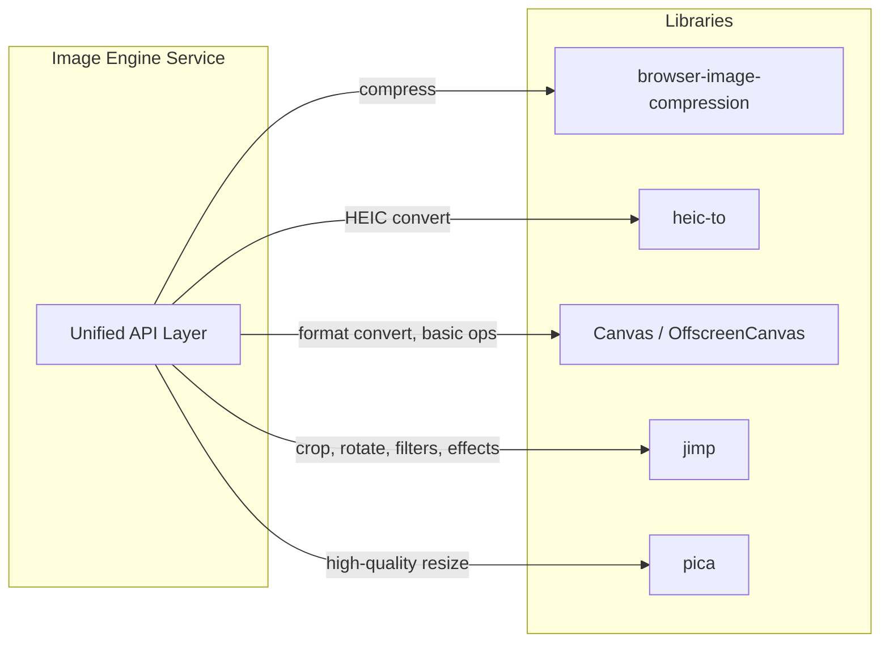
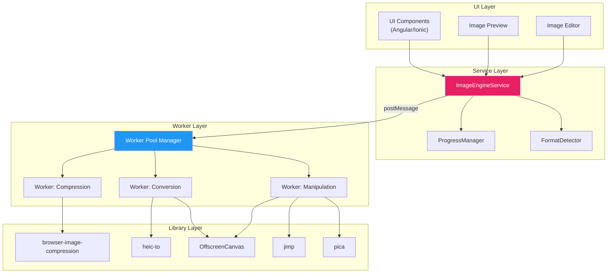
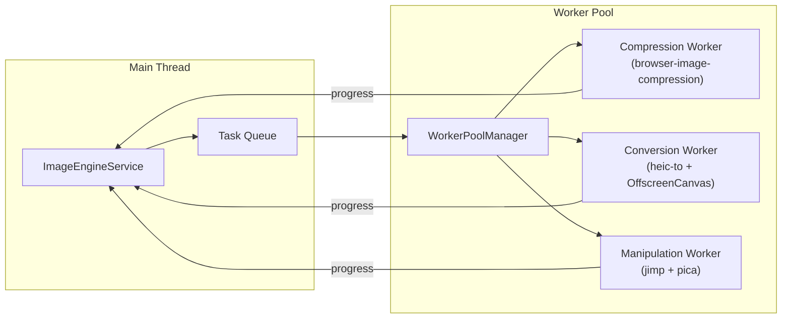
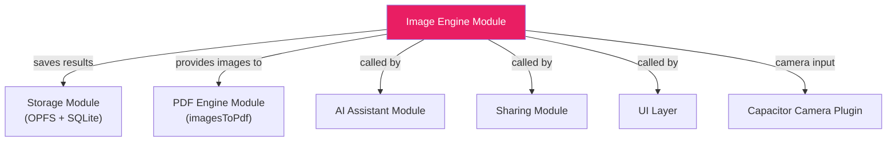
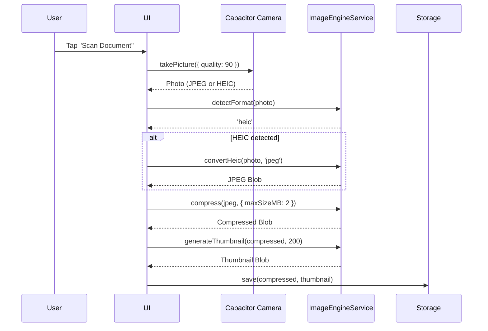

# 04 — Image Engine Module Architecture

> **Module**: `@docvault/image-engine`
> **Version**: 1.0.0
> **Status**: Draft
> **Last Updated**: 2026-06-07

---

## 1. Overview

The Image Engine module handles all client-side image processing in Kagaz — format conversion, compression, resizing, cropping, rotation, and visual enhancements. Like the PDF Engine, **all processing happens on-device** using Web Workers to keep the UI responsive.

The module is optimized for the typical Kagaz use case: users take photos of documents with their phone cameras (often in HEIC format on iOS) and need to convert, compress, and organize them.

> [!IMPORTANT]
> All image processing is performed client-side. No image data is sent to any server. This guarantees privacy and enables full offline functionality.

---

## 2. Library Stack

| Library | Role | Size (gzip) | Web Worker | Notes |
|---|---|---|---|---|
| **browser-image-compression** | Client-side compression | ~25 KB | ✅ Built-in | Supports EXIF orientation, quality control |
| **heic-to** | HEIC → JPEG/PNG/WebP | ~80 KB | ✅ Via wrapper | Essential for iOS photos |
| **Canvas API** | Format conversion, basic manipulation | Native | ❌ (OffscreenCanvas ✅) | Zero bundle cost, available everywhere |
| **jimp** | Advanced manipulation & filters | ~150 KB | ✅ Pure JS | Crop, rotate, color adjust, effects |
| **pica** | High-quality image resizing | ~45 KB | ✅ Built-in | Lanczos3 filter, much better than canvas resize |

### Library Responsibility Matrix



### Why These Libraries?

| Concern | Decision | Rationale |
|---|---|---|
| Compression | browser-image-compression | Built-in Web Worker support, handles EXIF, widely adopted |
| HEIC conversion | heic-to | Lightweight, supports multiple output formats, no native deps |
| Format conversion | Canvas API | Free (browser-native), fast, supports PNG/JPEG/WebP |
| Advanced manipulation | jimp | Pure JS (no WASM/native), full feature set, works in Workers |
| Resizing | pica | Lanczos3 quality far superior to canvas `drawImage` downscaling |

---

## 3. Architecture Layers



---

## 4. `ImageEngineService` — Unified API

### 4.1 Service Interface

```typescript
/**
 * Unified Image Engine Service.
 * All methods are async and offload work to Web Workers where possible.
 */
interface ImageEngineService {
  // ── Format Conversion ─────────────────────────────────
  /** Convert an image to a different format */
  convertFormat(image: Blob, targetFormat: ImageFormat): Promise<Blob>;
  /** Convert HEIC/HEIF to a standard web format */
  convertHeic(heicFile: Blob, targetFormat: 'jpeg' | 'png' | 'webp'): Promise<Blob>;

  // ── Compression ───────────────────────────────────────
  /** Compress an image to reduce file size */
  compress(image: Blob, options: CompressionOptions): Promise<Blob>;

  // ── Manipulation ──────────────────────────────────────
  /** Resize an image to specific dimensions */
  resize(image: Blob, width: number, height: number, options?: ResizeOptions): Promise<Blob>;
  /** Crop a rectangular region from an image */
  crop(image: Blob, rect: CropRect): Promise<Blob>;
  /** Rotate an image by the specified degrees */
  rotate(image: Blob, degrees: number): Promise<Blob>;
  /** Flip an image horizontally or vertically */
  flip(image: Blob, direction: 'horizontal' | 'vertical'): Promise<Blob>;

  // ── Enhancement ───────────────────────────────────────
  /** Adjust brightness (-100 to +100) */
  adjustBrightness(image: Blob, value: number): Promise<Blob>;
  /** Adjust contrast (-100 to +100) */
  adjustContrast(image: Blob, value: number): Promise<Blob>;
  /** Convert to grayscale */
  grayscale(image: Blob): Promise<Blob>;

  // ── Batch Operations ──────────────────────────────────
  /** Convert multiple images to a target format */
  batchConvert(images: Blob[], targetFormat: ImageFormat, onProgress?: BatchProgressCallback): Promise<Blob[]>;
  /** Compress multiple images */
  batchCompress(images: Blob[], options: CompressionOptions, onProgress?: BatchProgressCallback): Promise<Blob[]>;

  // ── Utilities ─────────────────────────────────────────
  /** Get image metadata (dimensions, format, EXIF, etc.) */
  getImageInfo(image: Blob): Promise<ImageInfo>;
  /** Generate a thumbnail */
  generateThumbnail(image: Blob, maxSize: number): Promise<Blob>;
  /** Detect the image format from its binary header */
  detectFormat(image: Blob): Promise<ImageFormat>;

  // ── Lifecycle ─────────────────────────────────────────
  /** Initialize the engine and pre-warm workers */
  initialize(): Promise<void>;
  /** Terminate all workers and free resources */
  destroy(): Promise<void>;
}
```

---

## 5. Supported Formats

### 5.1 Format Enum

```typescript
type ImageFormat = 'jpeg' | 'png' | 'webp' | 'bmp' | 'tiff' | 'heic' | 'gif';
```

### 5.2 Format Conversion Matrix

The table below shows which conversions are supported. ✅ = supported, ❌ = not supported, 🔄 = passthrough (no conversion needed).

| Source ↓ / Target → | JPEG | PNG | WebP | BMP | TIFF | GIF |
|---|:---:|:---:|:---:|:---:|:---:|:---:|
| **JPEG** | 🔄 | ✅ | ✅ | ✅ | ✅ | ✅ |
| **PNG** | ✅ | 🔄 | ✅ | ✅ | ✅ | ✅ |
| **WebP** | ✅ | ✅ | 🔄 | ✅ | ✅ | ✅ |
| **BMP** | ✅ | ✅ | ✅ | 🔄 | ✅ | ✅ |
| **TIFF** | ✅ | ✅ | ✅ | ✅ | 🔄 | ✅ |
| **HEIC** | ✅ | ✅ | ✅ | ❌ | ❌ | ❌ |
| **GIF** | ✅ | ✅ | ✅ | ✅ | ✅ | 🔄 |

> [!NOTE]
> HEIC conversion is handled by the `heic-to` library, which only supports JPEG, PNG, and WebP as target formats. For other targets, HEIC is first converted to PNG, then to the desired format via Canvas.

### 5.3 Format Detection

Format is detected from the file's magic bytes, not the extension:

| Format | Magic Bytes (hex) |
|---|---|
| JPEG | `FF D8 FF` |
| PNG | `89 50 4E 47` |
| WebP | `52 49 46 46 ... 57 45 42 50` |
| BMP | `42 4D` |
| TIFF (LE) | `49 49 2A 00` |
| TIFF (BE) | `4D 4D 00 2A` |
| GIF | `47 49 46 38` |
| HEIC | `... 66 74 79 70 68 65 69 63` (ftyp box) |

---

## 6. TypeScript Interfaces

### 6.1 Compression Options

```typescript
interface CompressionOptions {
  /** Maximum file size in MB (e.g. 1.0 = 1 MB) */
  maxSizeMB?: number;
  /** Maximum width or height in pixels (maintains aspect ratio) */
  maxWidthOrHeight?: number;
  /** Output format (default: same as input) */
  outputFormat?: 'jpeg' | 'png' | 'webp';
  /** Quality 0–1 for lossy formats (default: 0.8) */
  quality?: number;
  /** Whether to preserve EXIF data (default: false) */
  preserveExif?: boolean;
  /** Use Web Worker for compression (default: true) */
  useWebWorker?: boolean;
}
```

### 6.2 Manipulation Types

```typescript
interface CropRect {
  /** X offset from left (pixels) */
  x: number;
  /** Y offset from top (pixels) */
  y: number;
  /** Width of crop area (pixels) */
  width: number;
  /** Height of crop area (pixels) */
  height: number;
}

interface ResizeOptions {
  /** Resize mode */
  fit: 'contain' | 'cover' | 'fill' | 'inside' | 'outside';
  /** Background color for 'contain' mode (default: transparent) */
  background?: string;
  /** Use high-quality Lanczos3 (pica) or fast canvas resize */
  quality?: 'high' | 'fast';
}
```

### 6.3 Image Info

```typescript
interface ImageInfo {
  /** Image width in pixels */
  width: number;
  /** Image height in pixels */
  height: number;
  /** Detected format */
  format: ImageFormat;
  /** File size in bytes */
  fileSize: number;
  /** MIME type */
  mimeType: string;
  /** Color depth (bits per channel) */
  colorDepth?: number;
  /** Whether the image has an alpha channel */
  hasAlpha: boolean;
  /** EXIF data (if available) */
  exif?: ExifData;
}

interface ExifData {
  orientation?: number;
  dateTime?: string;
  make?: string;
  model?: string;
  gpsLatitude?: number;
  gpsLongitude?: number;
  width?: number;
  height?: number;
  [key: string]: unknown;
}
```

### 6.4 Batch & Progress Types

```typescript
interface BatchProgressEvent {
  /** Total number of items in the batch */
  total: number;
  /** Number of items completed */
  completed: number;
  /** Currently processing item index */
  currentIndex: number;
  /** Per-item progress (0–100) */
  currentItemProgress: number;
  /** Overall progress (0–100) */
  overallPercent: number;
}

type BatchProgressCallback = (event: BatchProgressEvent) => void;
```

### 6.5 Error Types

```typescript
interface ImageEngineError {
  code: ImageErrorCode;
  message: string;
  cause?: Error;
  operation: string;
}

type ImageErrorCode =
  | 'INVALID_IMAGE'
  | 'UNSUPPORTED_FORMAT'
  | 'CONVERSION_FAILED'
  | 'COMPRESSION_FAILED'
  | 'HEIC_DECODE_FAILED'
  | 'CANVAS_ERROR'
  | 'WORKER_ERROR'
  | 'OUT_OF_MEMORY'
  | 'INVALID_DIMENSIONS'
  | 'OPERATION_CANCELLED'
  | 'UNKNOWN';
```

---

## 7. Web Worker Strategy

### 7.1 Worker Architecture



### 7.2 Worker Assignment

| Worker | Libraries | Operations |
|---|---|---|
| `image-compress.worker.ts` | browser-image-compression | `compress`, `batchCompress`, `generateThumbnail` |
| `image-convert.worker.ts` | heic-to, OffscreenCanvas | `convertFormat`, `convertHeic`, `batchConvert`, `detectFormat` |
| `image-manipulate.worker.ts` | jimp, pica, OffscreenCanvas | `resize`, `crop`, `rotate`, `flip`, brightness, contrast, grayscale |

### 7.3 OffscreenCanvas Usage

For format conversion via Canvas API inside workers, we use `OffscreenCanvas`:

```typescript
// Inside image-convert.worker.ts
async function convertViaCanvas(imageData: ImageBitmap, targetFormat: string, quality: number): Promise<Blob> {
  const canvas = new OffscreenCanvas(imageData.width, imageData.height);
  const ctx = canvas.getContext('2d')!;
  ctx.drawImage(imageData, 0, 0);
  return canvas.convertToBlob({ type: `image/${targetFormat}`, quality });
}
```

> [!NOTE]
> `OffscreenCanvas` is supported in all modern browsers (Chrome 69+, Firefox 105+, Safari 16.4+). For older browsers, fallback to main-thread Canvas is provided.

---

## 8. Conversion Pipeline

### 8.1 Pipeline Flow

```mermaid
flowchart TD
    INPUT["Input Image<br/>(any format)"]
    DETECT["Detect Format<br/>(magic bytes)"]
    HEIC{"Is HEIC?"}
    HEIC_CONV["heic-to<br/>→ PNG intermediate"]
    CANVAS{"Canvas-compatible<br/>format?"}
    JIMP["jimp decode"]
    OC["OffscreenCanvas<br/>drawImage"]
    TARGET["Convert to target<br/>via canvas.convertToBlob"]
    OUTPUT["Output Blob"]

    INPUT --> DETECT
    DETECT --> HEIC
    HEIC -->|Yes| HEIC_CONV
    HEIC -->|No| CANVAS
    HEIC_CONV --> OC
    CANVAS -->|Yes| OC
    CANVAS -->|No (TIFF, BMP)| JIMP
    JIMP --> OC
    OC --> TARGET
    TARGET --> OUTPUT
```

### 8.2 HEIC Conversion Detail

HEIC is the default photo format on iOS 11+ and is not natively supported by most web APIs. The conversion flow:

1. User uploads `.heic` / `.heif` file
2. `heic-to` decodes the HEIC container (handles single and multi-image HEIC)
3. Outputs JPEG, PNG, or WebP `Blob`
4. If the target format is BMP or TIFF, the output is further converted via Canvas → jimp

```typescript
import heicTo from 'heic-to';

async function convertHeicToJpeg(heicBlob: Blob): Promise<Blob> {
  const buffer = await heicBlob.arrayBuffer();
  const result = await heicTo({
    blob: new Blob([buffer]),
    type: 'image/jpeg',
    quality: 0.92,
  });
  return result; // JPEG Blob
}
```

---

## 9. Compression Strategy

### 9.1 Compression Tiers

| Tier | Target Size | Quality | Use Case |
|---|---|---|---|
| **Thumbnail** | ≤ 50 KB | 0.6 | Gallery previews, list views |
| **Preview** | ≤ 200 KB | 0.75 | Document preview, sharing preview |
| **Standard** | ≤ 1 MB | 0.85 | General storage, good balance |
| **High Quality** | ≤ 5 MB | 0.92 | When quality matters |
| **Original** | No limit | 1.0 | Uncompressed archival |

### 9.2 Smart Compression

The engine implements smart compression that adapts based on image content:

```typescript
async function smartCompress(image: Blob, targetSizeMB: number): Promise<Blob> {
  const info = await getImageInfo(image);

  // Skip if already under target
  if (info.fileSize <= targetSizeMB * 1024 * 1024) {
    return image;
  }

  // Step 1: Resize if dimensions are excessive (> 4000px)
  let processed = image;
  if (info.width > 4000 || info.height > 4000) {
    processed = await resize(processed, 4000, 4000, { fit: 'inside', quality: 'high' });
  }

  // Step 2: Compress with browser-image-compression
  return compress(processed, {
    maxSizeMB: targetSizeMB,
    maxWidthOrHeight: 4000,
    useWebWorker: true,
  });
}
```

---

## 10. Performance Considerations

### 10.1 Memory Management

| Concern | Mitigation |
|---|---|
| Large images (20+ MP) | Downsample before manipulation, process in tiles if needed |
| Batch operations | Process sequentially to limit peak memory |
| Object URLs | Track and revoke all `URL.createObjectURL` references |
| Canvas memory | Explicitly clear and release canvas after each operation |

### 10.2 Performance Benchmarks (Target)

| Operation | Image Size | Target Time | Library |
|---|---|---|---|
| JPEG → PNG | 5 MP (3 MB) | < 500 ms | Canvas |
| HEIC → JPEG | 12 MP (5 MB) | < 2 s | heic-to |
| Compress 5 MB → 1 MB | 12 MP | < 1 s | browser-image-compression |
| Resize 4000×3000 → 800×600 | 12 MP | < 300 ms | pica |
| Crop 500×500 region | 12 MP | < 200 ms | jimp |
| Rotate 90° | 12 MP | < 400 ms | jimp |
| Grayscale | 5 MP | < 300 ms | jimp |
| Batch compress (10 images) | Mixed | < 10 s | browser-image-compression |

### 10.3 Lazy Loading

```typescript
// Libraries are imported on-demand
async function getJimp() {
  const { Jimp } = await import('jimp');
  return Jimp;
}

async function getPica() {
  const Pica = (await import('pica')).default;
  return new Pica();
}

async function getHeicTo() {
  return (await import('heic-to')).default;
}
```

---

## 11. Integration Points

### 11.1 Module Dependencies



### 11.2 Camera Integration Flow



---

## 12. Error Handling

### 12.1 Error Recovery Matrix

| Error | Recovery Strategy | User Message |
|---|---|---|
| `INVALID_IMAGE` | Show error, suggest re-upload | "This file doesn't appear to be a valid image." |
| `UNSUPPORTED_FORMAT` | List supported formats | "This format is not supported. Supported: JPEG, PNG, WebP, BMP, TIFF, HEIC, GIF." |
| `HEIC_DECODE_FAILED` | Retry once, fallback to JPEG extraction | "Could not convert this HEIC file. Try taking the photo again." |
| `COMPRESSION_FAILED` | Retry with lower quality, then abort | "Compression failed. The image may be corrupted." |
| `OUT_OF_MEMORY` | Release resources, suggest smaller image | "This image is too large to process. Try a smaller image." |
| `CANVAS_ERROR` | Fallback to jimp-based processing | (transparent to user) |

---

## 13. Testing Strategy

| Layer | Approach | Tools |
|---|---|---|
| Unit tests | Test each operation with fixture images | Vitest |
| Format tests | Verify all conversion matrix cells | Vitest with binary fixtures |
| Quality tests | Assert output dimensions, file size ranges | Vitest |
| Visual tests | Pixel comparison for manipulation ops | Vitest + pixelmatch |
| Performance tests | Benchmark with large images | Custom benchmark suite |
| Device tests | Test on actual iOS/Android devices | Capacitor test app |

### Test Fixtures

Maintain fixture images in `test/fixtures/images/`:
- `photo-5mp.jpg` — standard phone photo
- `photo-12mp.heic` — iOS HEIC photo
- `document-scan.png` — scanned document
- `transparent.png` — PNG with alpha channel
- `animated.gif` — animated GIF
- `large-20mp.jpg` — stress test image
- `tiny-100x100.bmp` — small BMP
- `sample.tiff` — TIFF sample
- `sample.webp` — WebP sample

---

## 14. Future Enhancements

| Feature | Version | Notes |
|---|---|---|
| Background removal | V2 | ML-based, using ONNX Runtime Web |
| Document edge detection | V2 | Auto-crop scanned documents |
| Image filters (sepia, blur, sharpen) | V2 | Via jimp filter pipeline |
| SVG rasterization | V2 | Convert SVG → PNG/JPEG |
| RAW format support (DNG, CR2) | V3 | For professional photography |
| Image diff/comparison | V3 | Before/after slider view |
| Batch watermarking | V2 | Add text/image watermark to multiple images |
