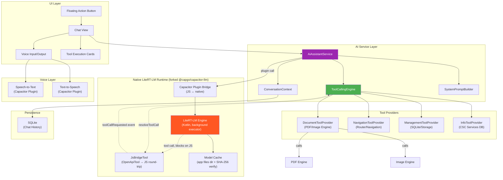
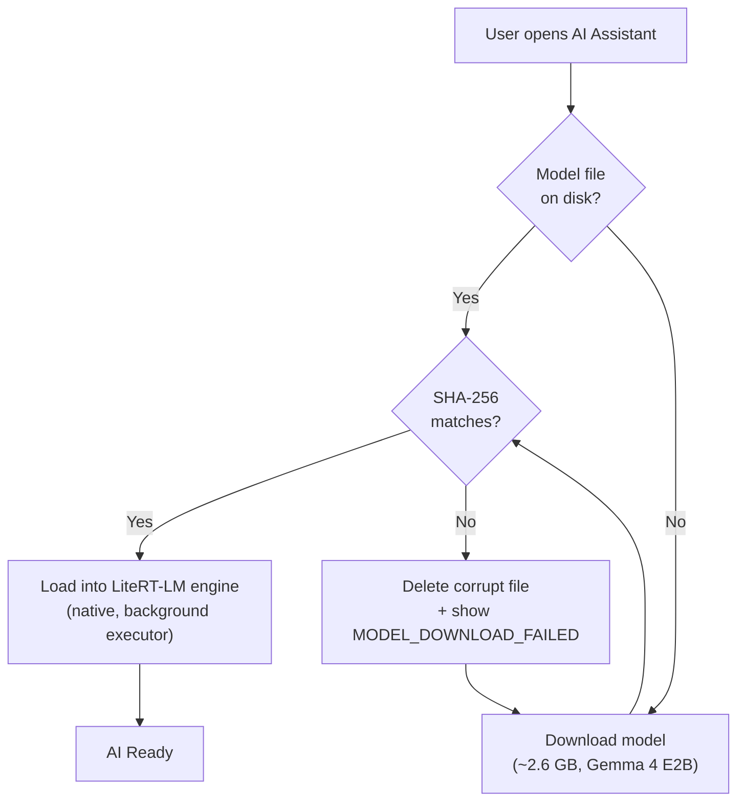
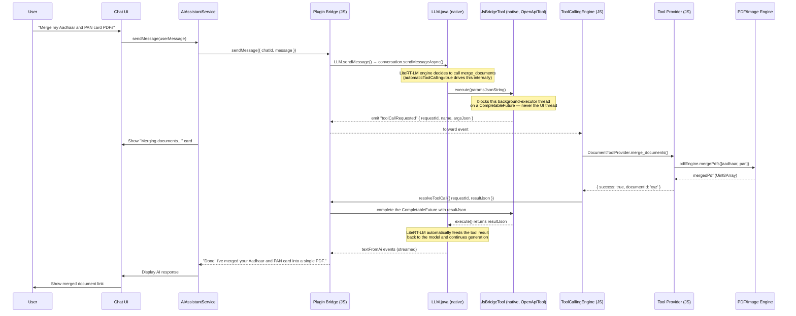
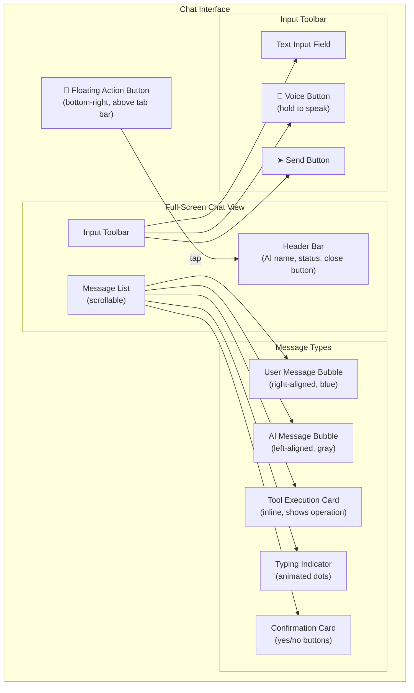
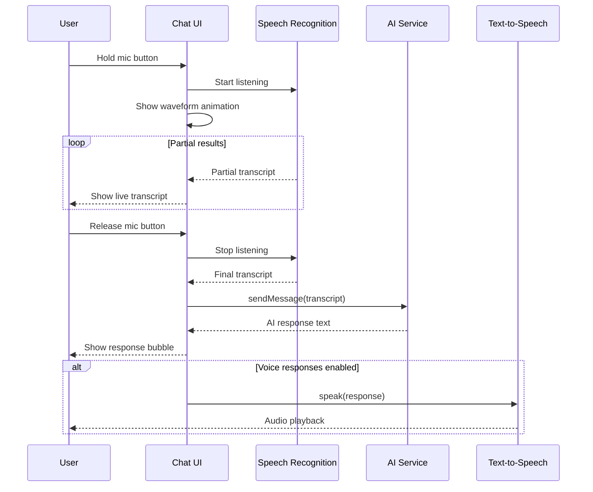

# 05 — AI Assistant Module Architecture

> **Module**: `@kagaz/ai-assistant`
> **Version**: 2.0.0
> **Status**: Draft
> **Last Updated**: 2026-10-31 (**Gemma 4 everywhere; skills, online mode, GenUI forms, attachments, markdown** — §3.6–§3.8, §4.2.4–§4.2.5; earlier: engine switched from WebLLM to LiteRT-LM, §3.0)

---

## 1. Overview

The AI Assistant is Kagaz's on-device conversational interface. It lets users interact with the app using natural language — in Hindi, English, or a mix of both (code-switching). Powered by **LiteRT-LM** (Google AI Edge) running through a **native Capacitor plugin**, the AI runs entirely on the user's device, ensuring complete privacy: no document content or conversation data ever leaves the device.

The AI can perform document operations, navigate the app, manage files, and answer questions about CSC services — all through a simple chat interface with optional voice input/output.

> [!IMPORTANT]
> The AI model runs **100% on-device** via Android's native ML acceleration stack (NNAPI/GPU/CPU delegate). After the initial model download, the assistant works fully offline. No API keys, no server costs, no data leaks.

---

## 2. AI Architecture Overview



---

## 3. Core AI Engine — LiteRT-LM (native, forked plugin)

### 3.0 Why LiteRT-LM instead of WebLLM (decided 2026-07-24)

This module originally speced **WebLLM** (`@mlc-ai/web-llm`, `WebWorkerMLCEngine`, WebGPU) — still referenced by the `AIProvider` stub scaffolded in P0-10 and the `@mlc-ai/web-llm` dependency in `package.json` (both now dead weight, remove in the stale-code sweep when F-13 closes). That plan was reconsidered before implementation began, for one concrete reason: **WebGPU support inside Android's System WebView is genuinely unreliable on the API 24+ mid-range fleet this app targets.** A live device check on `Pixel6_API34` (Android 14, Chrome/WebView 150 — a *modern* combination) found `navigator.gpu` present but `navigator.gpu.requestAdapter()` returning `null` — no usable adapter. Emulator GPU passthrough is known-unreliable so this alone isn't proof it fails on real hardware too, but it's a strong enough signal, combined with Chrome's own GPU-driver blocklisting on Android being real and broad, that betting the entire feature on WebGPU-in-WebView was too risky — especially given this codebase already made the identical call once before for the document scanner (ADR-017/ADR-018: OpenCV-in-WebView's WASM/CSP problems → moved to a **native** ML Kit plugin, no WebView involved at all).

**LiteRT-LM** (Google AI Edge's on-device LLM runtime, successor branding to TensorFlow Lite) runs through Android's native ML acceleration stack (NNAPI/GPU/CPU delegates) — the same class of "go native, skip the WebView" move. Integrated via a **forked copy of `@capgo/capacitor-llm`** (npm, MPL-2.0, verified real and actively maintained — v8.1.3 as of 2026-07-11, Capacitor ≥8 compatible, `minSdkVersion 24`, matching this app's target exactly), vendored as a local workspace package rather than an external npm dependency so we can maintain the fork long-term. **Why forked, not used as-is:** the plugin's native Android layer (`ee.forgr.capgo_llm.LLM.java`, verified by reading the real source, not just the README) already depends on `com.google.ai.edge.litertlm:litertlm-android:0.10.0` and that engine natively supports tool calling — but the plugin's JS bridge (`definitions.ts`) never threads a `tools` array through to the native `ConversationConfig`, so tool calling was unreachable from the app layer as shipped. See §4 for the fork's tool-calling bridge design (`JsBridgeTool`).

**License note**: the plugin itself is MPL-2.0 — a weak, file-level copyleft, not in CLAUDE.md's default-allowed list (MIT/Apache-2.0/BSD/ISC) but explicitly accepted for this dependency as a deliberate exception (unlike GPL/AGPL/SSPL, MPL's copyleft doesn't propagate to the surrounding proprietary app — only modifications to the MPL-covered files themselves need to stay disclosed, which our fork already does by keeping the modified files' MPL headers and publishing the fork). The model itself is **Apache-2.0** (Gemma 4, which moved off the old, more restrictive Gemma Terms of Use in April 2026) — clean.

### 3.1 Library Setup

| Component | Source | Role |
|---|---|---|
| **LiteRT-LM engine** | `com.google.ai.edge.litertlm:litertlm-android:0.10.0` (Maven, transitive via the fork) | On-device LLM inference (CPU/GPU/NPU backends) |
| **Plugin fork** | `packages/capacitor-llm-litert` (vendored, forked from `@capgo/capacitor-llm` v8.1.3, MPL-2.0) | Capacitor JS↔native bridge + our added tool-calling support |
| **Model format** | `.litertlm` | Pre-quantized model bundle, downloaded once and cached |
| **Model source** | `litert-community` on Hugging Face | Publishes ready-to-download `.litertlm` bundles |

### 3.2 Model Choice

| Model | Size (download) | License | Notes |
|---|---|---|---|
| **Gemma 4 E2B** (the on-device model) | ~2.6 GB (2,588,147,712 bytes) | Apache-2.0 | `litert-community/gemma-4-E2B-it-litert-lm` — public, not gated. Text + native function calling. Needs a recent phone with plenty of free memory. **Not yet verified on a physical device** (2026-10-31). |

**One model, no fallback (decided 2026-10-31).** Earlier revisions defaulted to Qwen3-0.6B (~0.5 GB) for the small download; it has been removed entirely — Gemma 4 E2B is the only on-device model, matching the Gemma 4 used in the demo's local (Ollama) and online (Vertex AI) engines. The size is far above the original 600 MB–1.7 GB budget, so the Settings screen shows the real size before the user taps Download, and the file is checksum-verified on every load. A smaller tier can be re-added behind the same `MODEL_*` constants if device testing shows the memory cost is too high.

No dynamic VRAM-based model selection — LiteRT-LM's CPU/GPU/NPU backend selection happens per-inference-call, not per-model, and Android doesn't expose a WebGPU-style `adapter.limits` heuristic.

### 3.3 Capability Gating

Same posture as `isScanningSupported()` (document-scanner module) and voice's `supported` flag — a plain, synchronous, no-permission-needed check:

```typescript
// ai-assistant/services/ai-engine.service.ts
export function isAiSupported(): boolean {
  return Capacitor.getPlatform() === 'android' && Capacitor.isNativePlatform();
}
```

Real capability (whether the *specific device* can actually run the model — RAM, NNAPI/GPU delegate availability) is only knowable once the native `setModel()` call resolves or rejects; `isAiSupported()` only gates whether the feature *attempts* to load at all (hides the entry point on iOS/web, where the fork's Android-only native code isn't present). A load failure past that gate surfaces through the existing `AiStatus = 'error'` state — see §9.

### 3.4 Engine Initialization & Model Lifecycle

Mirrors the design note already in `DEVELOPMENT-CHECKLIST.md` (download → progress → checksum → ready → delete → graceful-degrade), adapted to the fork's real event names:

```typescript
// ai-assistant/services/ai-engine.service.ts
import { CapacitorLlmLiteRT } from '@kagaz/capacitor-llm-litert';

class AiEngineManager {
  async downloadAndVerify(onProgress: (pct: number) => void): Promise<string> {
    const sub = await CapacitorLlmLiteRT.addListener('downloadProgress', (e) =>
      onProgress(e.progress)
    );
    const { path } = await CapacitorLlmLiteRT.downloadModel({
      url: MODEL_URL,
      filename: MODEL_FILENAME, // gemma-4-E2B-it.litertlm
    });
    await sub.remove();

    const actualHash = await CapacitorLlmLiteRT.sha256File({ path }); // added in the fork
    if (actualHash !== EXPECTED_SHA256) {
      await CapacitorLlmLiteRT.deleteModel({ path }); // added in the fork
      throw new AiError('MODEL_DOWNLOAD_FAILED', 'Checksum mismatch');
    }
    return path;
  }

  async load(path: string, tools: ToolDefinition[]): Promise<void> {
    await CapacitorLlmLiteRT.setModel({
      path,
      modelType: 'litertlm',
      backend: 'cpu', // see the CPU-only note below — this is NOT the original plan
      tools, // added in the fork — see §4
    });
  }
}
```

**⚠️ CPU-only, not GPU-first (discovered 2026-07-25, on-device):** the original plan here was `backend: 'gpu'` with the assumption that the native side "falls back to cpu internally if unavailable" — i.e. no app-level fallback logic needed. A real-device test instead showed a GPU-delegate load **crashing the whole app process** partway through the "loading" state. That is a fatal flaw in the original assumption: a native process crash is not a catchable JS exception, so `ai-engine.service.ts`'s own `loadModel()` (which originally tried `gpu` first and caught a failure down to `cpu`) could never actually run its fallback — the process was already dead before any `catch` block executed. `ai-engine.service.ts` now requests `backend: 'cpu'` directly and never attempts `gpu` at all, matching the plugin's own `ModelOptions.backend` doc comment ("Use `cpu` for stable long generations") and iOS's own documented default (CPU first, GPU as a fallback). Re-enabling GPU needs a real pre-flight capability check (e.g. device RAM headroom) that decides *before* calling into native code — not a reactive JS `try/catch`, which cannot save a crashed process.

**What the fork adds over upstream `@capgo/capacitor-llm`** (full list, kept current as work lands):
- `sha256File({ path })` — the plugin has no built-in integrity verification; §11 requires it, so it's ours to add (`MessageDigest.getInstance("SHA-256")` over the cached file, off the main thread).
- `deleteModel({ path })` — upstream has no explicit delete; needed for the Storage-screen "AI model: N MB → Manage" entry the design note requires.
- `tools` param on `setModel`/`createChat` + `toolCallRequested`/`resolveToolCall` — the actual tool-calling bridge, §4.
- `getCapabilities()` — reports which backend actually loaded (`cpu`/`gpu`, in practice always `cpu` until the pre-flight check above lands) and total load time, for the Settings screen's "AI model ready" line.

### 3.5 Model Caching

Models are cached in the app's native files directory (not the WebView's Cache API — there is no WebView involvement in inference at all):



> [!NOTE]
> The first-time model download requires an internet connection. After that, the assistant works fully offline. Users are shown a progress bar during the initial download with estimated time remaining. Every load (not just the first) re-verifies the SHA-256 checksum before handing the file to the engine — a corrupted or tampered cache file must never be loaded silently.

---

### 3.6 Chat-engine seam and the demo Ollama engine (added 2026-10-31)

`useChat` no longer calls the native plugin directly. It talks to a `ChatEngine` (`services/chat-engine.ts`) whose surface mirrors the plugin's chat calls and events (`createChat`, `sendMessage`, `resolveToolCall`, and the `textFromAi` / `aiFinished` / `generationError` / `toolCallRequested` listeners), so the tool-dispatch and confirmation-card flow is engine-agnostic. The engine is chosen in `services/chat-engine.registry.ts`:

| Engine | `locality` | Selected when | Notes |
|---|---|---|---|
| `litertChatEngine` | `on-device` | default | Pure pass-through to `@kagaz/capacitor-llm-litert`; the model lifecycle stays in `ai-engine.service.ts`. |
| `OllamaChatEngine` | `local-server` | `VITE_OLLAMA_URL` is set (demo builds only) | Gemma 4 E2B (`gemma4:e2b`) on a local Ollama server. Works on any platform, including the desktop browser demo. |
| hosted API *(planned)* | `cloud` | explicit user opt-in | Must show a PII data-sharing warning and get consent first; not built. |

`locality` exists so the UI can gate anything that is not `on-device` behind a warning.

**Ollama engine behavior.** Ollama is stateless, so the engine keeps the message history per chat (system prompt from `prompts/system-prompt.ts`, trimmed to the last 40 messages and always restarting at a user turn). For each user message it streams `/api/chat` with the registered tools, emits any model tool calls as `toolCallRequested`, and waits for `resolveToolCall` before looping. Safeguards: at most 5 tool rounds per message, a 30 s timeout on an unanswered tool call (resolves to a timeout result instead of hanging; the same limit as the native bridge), one message in flight per chat, an explicit `num_ctx` of 8192 (the default silently truncates ~35 tool schemas), and failures surface as `generationError` events, never rejections. `AIProvider.activate` for this engine only checks that the server is reachable and the model is pulled; there is no download, checksum or local model load.

**Config and network.** All Ollama settings are read in one place, `infrastructure/ollama/` (`VITE_OLLAMA_URL`, `VITE_OLLAMA_CHAT_MODEL`, `VITE_OLLAMA_VISION_MODEL`, `VITE_OLLAMA_EMBEDDING_MODEL`). The shipped CSP is `connect-src 'self'`; `vite-plugins/demo-csp.ts` adds only the Ollama origin when the URL is set, and **fails a production build** that sets it. See [10-security-architecture.md](10-security-architecture.md) §3.5 and [ADR-022](08-tech-stack-decisions.md#adr-022-demo-engine--local-ollama-gemma-4-behind-a-chatengine-seam).

**Gemma vision.** Where native ML Kit is absent (the web build), OCR falls back to Gemma's vision input (`image-engine/services/vision-ocr.service.ts`). Separately, **Transcribe with Gemma** is offered next to **Extract text** in the document viewer and the vault item menu for images and PDFs *even when text was already extracted*: it re-reads every PDF page with the vision model (not only pages lacking a text layer) and replaces the stored text. It is user-only (no Action Registry entry) and appears only when Gemma is configured. Other formats are not offered; audio input is not wired.

**Semantic index (spike, not wired).** `modules/semantic-index/` defines `EmbeddingProvider` and `VectorStore` ports with an Ollama (`embeddinggemma`) adapter and an in-memory cosine store. It is not connected to the assistant or the search bar yet. Retrieving passages into prompts would cross the metadata-only boundary in §11 and needs the security docs, the DPIA and the privacy policy updated first.

---

### 3.7 Skills — tools on demand (added 2026-10-31)

A small model reads every tool schema on every turn, so the tool list is split into **skills**: `skills/pdf-tools.skill.md`, `image-tools`, `text-extraction`, `app-settings`. Each file is a frontmatter block (name, description, English + Hindi trigger words, the tool ids it unlocks) plus a short usage body. **Core tools** are derived — every registry action no skill claims (search, list, open screens, `ai.loadSkill`, `ai.askUser`) — so the action definitions stay the single source of truth; `skill-registry.test.ts` enforces that every listed tool exists and no tool is in two skills.

- **Router (no model call):** before each send, `matchSkills()` substring-matches the user's text against trigger words and pre-loads the matching skills.
- **`ai.loadSkill` (fallback):** if the model needs a tool that is not in its list it loads the skill itself.
- **Session:** loaded skills are sticky (changing the tool list invalidates the server's prompt cache) with a cap of 3, least-recently-used evicted.
- **Guard:** on engines that can change tools per request (Ollama, cloud) a call to a tool whose skill is not loaded is rejected in code and the error tells the model to load it. The native LiteRT engine fixes its tools when the conversation is created, so it keeps all of them (`ChatEngine.setActiveTools` is optional).

Two lessons recorded so nobody repeats them: (1) a core navigation tool named "open PDF Tools" was a look-alike — asked to compress, the model navigated instead and claimed success; moving it into `pdf-tools` fixed the fallback test. (2) Delivering a skill's *rules* to the model as a standing second system message made tool use **worse** in a controlled test (askUser used 3/3 without the rules, 1/6 with), so only the tools are loaded on demand and the rules stay out of the prompt.

### 3.8 Online mode (demo builds) (added 2026-10-31)

One switch in AI settings flips between **offline** (on-device, or a local Ollama server in demos) and **online** (Google Vertex AI). Turning it on first shows a plain-language warning that messages — and any document the user asks the assistant to read — go to Google Cloud and may contain personal information. The choice persists (`kagaz:ai-mode`); the chat header shows an Online/Offline badge.

- **Transport:** `vite-plugins/cloud-ai-proxy.ts` exposes `/api/ai/{health,chat,embed}` on the *dev server only*, using the developer's gcloud application-default credentials. The page never sees a credential; requests must be same-origin JSON; the model is pinned server-side. The build refuses to include it ([ADR-023](08-tech-stack-decisions.md#adr-023-online-mode--gemma-4-on-vertex-ai-via-a-dev-proxy)).
- **Models:** chat and vision use **Gemma 4 26B on Vertex AI** (`CLOUD_CHAT_MODEL` overrides, e.g. to compare with Gemini). Embeddings use `text-embedding-005` because EmbeddingGemma is not offered on Vertex (checked: 404).
- **Engine:** `CloudChatEngine` and `OllamaChatEngine` both extend `ToolLoopEngine` and differ only in wire format.

## 4. Tool Calling System

### 4.1 Tool Calling Flow

Unlike WebLLM's original plan (tools passed as a JSON array directly into a single JS-side `chat.completions.create()` call), LiteRT-LM's Kotlin API only supports tool calling through **native** `Tool` objects registered on `ConversationConfig` at conversation-creation time — the model itself runs entirely inside the native engine, so a tool call is a native→JS round-trip, not a JS-only one:



**Why the confirmation gate lives inside `JsBridgeTool.execute()`'s JS round-trip, not as a separate manual step**: LiteRT-LM's `automaticToolCalling=false` mode (§3 upstream docs) exists for apps that want to manually drive the tool-call/result loop, but since our bridge already intercepts every tool call as a JS round-trip regardless, we get the same interception point "for free" under `automaticToolCalling=true` — `TC.executeTool()` (§4.3) is still the one and only place that checks `requiresConfirmation()` before running anything, exactly as originally speced; only the transport underneath it changed.

### 4.2 Tool Definitions

Tool definitions stay exactly as speced below — this shape is engine-agnostic. What changed is only how they reach the engine: at conversation-creation time, each `ToolDefinition.function` is translated into one native `JsBridgeTool(name, openApiJsonSchema)` registered on `ConversationConfig.tools` (§3.4's fork addition), instead of being passed as a `tools` array on every WebLLM `chat.completions.create()` call.

#### 4.2.1 Document Operations

```typescript
const documentTools: ToolDefinition[] = [
  {
    type: 'function',
    function: {
      name: 'merge_documents',
      description: 'Merge multiple documents into a single PDF. Use when user wants to combine files.',
      parameters: {
        type: 'object',
        properties: {
          document_ids: {
            type: 'array',
            items: { type: 'string' },
            description: 'IDs of documents to merge (in order)',
          },
          output_name: {
            type: 'string',
            description: 'Name for the merged document',
          },
        },
        required: ['document_ids'],
      },
    },
  },
  {
    type: 'function',
    function: {
      name: 'split_document',
      description: 'Split a PDF into multiple documents by page ranges.',
      parameters: {
        type: 'object',
        properties: {
          document_id: { type: 'string', description: 'ID of the PDF to split' },
          ranges: {
            type: 'array',
            items: {
              type: 'object',
              properties: {
                start: { type: 'number', description: 'Start page (1-indexed)' },
                end: { type: 'number', description: 'End page (1-indexed, inclusive)' },
              },
            },
            description: 'Page ranges for each split',
          },
        },
        required: ['document_id', 'ranges'],
      },
    },
  },
  {
    type: 'function',
    function: {
      name: 'convert_format',
      description: 'Convert a document between formats (e.g., images to PDF, PDF to images).',
      parameters: {
        type: 'object',
        properties: {
          document_id: { type: 'string' },
          target_format: { type: 'string', enum: ['pdf', 'jpeg', 'png', 'webp'] },
        },
        required: ['document_id', 'target_format'],
      },
    },
  },
  {
    type: 'function',
    function: {
      name: 'compress_document',
      description: 'Reduce the file size of a document.',
      parameters: {
        type: 'object',
        properties: {
          document_id: { type: 'string' },
          quality: { type: 'string', enum: ['low', 'medium', 'high'], description: 'Compression quality' },
        },
        required: ['document_id'],
      },
    },
  },
  {
    type: 'function',
    function: {
      name: 'encrypt_document',
      description: 'Add password protection to a PDF document.',
      parameters: {
        type: 'object',
        properties: {
          document_id: { type: 'string' },
          password: { type: 'string', description: 'Password to set' },
        },
        required: ['document_id', 'password'],
      },
    },
  },
  {
    type: 'function',
    function: {
      name: 'extract_text',
      description: 'Extract text from a PDF using text extraction or OCR for scanned documents.',
      parameters: {
        type: 'object',
        properties: {
          document_id: { type: 'string' },
          use_ocr: { type: 'boolean', description: 'Use OCR for scanned documents' },
          language: { type: 'string', description: 'OCR language (e.g., hin, eng)', default: 'eng' },
        },
        required: ['document_id'],
      },
    },
  },
  {
    type: 'function',
    function: {
      name: 'add_watermark',
      description: 'Add a text watermark to a PDF document.',
      parameters: {
        type: 'object',
        properties: {
          document_id: { type: 'string' },
          text: { type: 'string', description: 'Watermark text' },
          opacity: { type: 'number', description: '0–1 opacity', default: 0.3 },
        },
        required: ['document_id', 'text'],
      },
    },
  },
  {
    type: 'function',
    function: {
      name: 'create_pdf_from_images',
      description: 'Combine multiple images into a single PDF document.',
      parameters: {
        type: 'object',
        properties: {
          image_ids: {
            type: 'array',
            items: { type: 'string' },
            description: 'IDs of images to combine',
          },
          output_name: { type: 'string', description: 'Name for the PDF' },
        },
        required: ['image_ids'],
      },
    },
  },
];
```

#### 4.2.2 App Navigation

```typescript
const navigationTools: ToolDefinition[] = [
  {
    type: 'function',
    function: {
      name: 'navigate_to',
      description: 'Navigate to a specific screen in the app.',
      parameters: {
        type: 'object',
        properties: {
          screen: {
            type: 'string',
            enum: ['home', 'documents', 'tools', 'settings', 'profile', 'services', 'scanner'],
            description: 'Target screen',
          },
        },
        required: ['screen'],
      },
    },
  },
  {
    type: 'function',
    function: {
      name: 'open_document',
      description: 'Open a document in the preview/viewer.',
      parameters: {
        type: 'object',
        properties: {
          document_id: { type: 'string' },
        },
        required: ['document_id'],
      },
    },
  },
  {
    type: 'function',
    function: {
      name: 'open_settings',
      description: 'Open the app settings page, optionally a specific section.',
      parameters: {
        type: 'object',
        properties: {
          section: {
            type: 'string',
            enum: ['general', 'storage', 'security', 'ai', 'about'],
          },
        },
      },
    },
  },
  {
    type: 'function',
    function: {
      name: 'show_search',
      description: 'Open the search interface with an optional pre-filled query.',
      parameters: {
        type: 'object',
        properties: {
          query: { type: 'string', description: 'Optional search query to pre-fill' },
        },
      },
    },
  },
];
```

#### 4.2.3 Document Management

```typescript
const managementTools: ToolDefinition[] = [
  {
    type: 'function',
    function: {
      name: 'search_documents',
      description: 'Search for documents by name, tag, or type.',
      parameters: {
        type: 'object',
        properties: {
          query: { type: 'string', description: 'Search query' },
          type: { type: 'string', enum: ['pdf', 'image', 'all'], description: 'Filter by type' },
          tags: { type: 'array', items: { type: 'string' }, description: 'Filter by tags' },
        },
        required: ['query'],
      },
    },
  },
  {
    type: 'function',
    function: {
      name: 'list_documents',
      description: 'List documents in a specific folder.',
      parameters: {
        type: 'object',
        properties: {
          folder_id: { type: 'string', description: 'Folder ID (omit for root)' },
          sort_by: { type: 'string', enum: ['name', 'date', 'size', 'type'] },
        },
      },
    },
  },
  {
    type: 'function',
    function: {
      name: 'get_document_info',
      description: 'Get detailed metadata about a specific document.',
      parameters: {
        type: 'object',
        properties: {
          document_id: { type: 'string' },
        },
        required: ['document_id'],
      },
    },
  },
  {
    type: 'function',
    function: {
      name: 'create_folder',
      description: 'Create a new folder for organizing documents.',
      parameters: {
        type: 'object',
        properties: {
          name: { type: 'string', description: 'Folder name' },
          parent_id: { type: 'string', description: 'Parent folder ID (omit for root)' },
        },
        required: ['name'],
      },
    },
  },
  {
    type: 'function',
    function: {
      name: 'move_document',
      description: 'Move a document to a different folder.',
      parameters: {
        type: 'object',
        properties: {
          document_id: { type: 'string' },
          target_folder_id: { type: 'string' },
        },
        required: ['document_id', 'target_folder_id'],
      },
    },
  },
  {
    type: 'function',
    function: {
      name: 'tag_document',
      description: 'Add or remove tags from a document.',
      parameters: {
        type: 'object',
        properties: {
          document_id: { type: 'string' },
          add_tags: { type: 'array', items: { type: 'string' } },
          remove_tags: { type: 'array', items: { type: 'string' } },
        },
        required: ['document_id'],
      },
    },
  },
];
```

#### 4.2.4 Information (V3)

```typescript
const informationTools: ToolDefinition[] = [
  {
    type: 'function',
    function: {
      name: 'get_service_info',
      description: 'Get information about a specific CSC service (fees, process, requirements).',
      parameters: {
        type: 'object',
        properties: {
          service_name: { type: 'string', description: 'Name of the CSC service (e.g., "PAN Card", "Aadhaar Update")' },
        },
        required: ['service_name'],
      },
    },
  },
  {
    type: 'function',
    function: {
      name: 'get_required_documents',
      description: 'Get list of documents required for a specific CSC service.',
      parameters: {
        type: 'object',
        properties: {
          service_name: { type: 'string' },
        },
        required: ['service_name'],
      },
    },
  },
  {
    type: 'function',
    function: {
      name: 'get_nearest_csc',
      description: 'Find the nearest CSC center based on location.',
      parameters: {
        type: 'object',
        properties: {
          latitude: { type: 'number' },
          longitude: { type: 'number' },
          max_results: { type: 'number', description: 'Max centers to return', default: 5 },
        },
        required: ['latitude', 'longitude'],
      },
    },
  },
];
```

### 4.3 Tool Calling Engine

```typescript
class ToolCallingEngine {
  private providers = new Map<string, ToolProvider>();

  registerProvider(provider: ToolProvider): void {
    for (const tool of provider.getTools()) {
      this.providers.set(tool.function.name, provider);
    }
  }

  async executeTool(name: string, args: Record<string, unknown>): Promise<ToolResult> {
    const provider = this.providers.get(name);
    if (!provider) {
      return { success: false, error: `Unknown tool: ${name}` };
    }

    try {
      // Check if operation requires confirmation
      if (this.requiresConfirmation(name)) {
        return { success: false, needsConfirmation: true, operation: name, args };
      }
      return await provider.execute(name, args);
    } catch (error) {
      return { success: false, error: error.message };
    }
  }

  private requiresConfirmation(toolName: string): boolean {
    // Destructive operations require user confirmation
    const destructive = ['split_document', 'encrypt_document', 'move_document'];
    return destructive.includes(toolName);
  }
}
```

**Native wiring**: `AIProvider` subscribes to the plugin's `toolCallRequested` event once at startup and pipes each occurrence through this exact `executeTool()` — the `needsConfirmation` branch surfaces a `Confirmation Card` (§5.4) in the chat UI exactly as before; once the user confirms, the app re-invokes `provider.execute()` and calls the plugin's `resolveToolCall({ requestId, resultJson: JSON.stringify(result) })` to unblock the native side. A `needsConfirmation` result is therefore *not* sent back to `resolveToolCall` immediately — the promise stays pending (bridge-side, with a timeout) until the user answers.

### 4.4 Tool Result Types

```typescript
interface ToolResult {
  success: boolean;
  data?: unknown;
  error?: string;
  needsConfirmation?: boolean;
  operation?: string;
  args?: Record<string, unknown>;
}

interface ToolProvider {
  getTools(): ToolDefinition[];
  execute(toolName: string, args: Record<string, unknown>): Promise<ToolResult>;
}
```

---

### 4.2.4 Image tools and the lock gate (added 2026-10-31)

Three tools reuse the same document-vault hooks the UI uses (`ai-image-ops.actions.ts`): `ai.resizeImage` (exact pixel size + a size budget in KB, F-85), `ai.enhanceImage` (grayscale / bw / enhance / invert, F-29) and `ai.runOcr` (stores the text for search, F-20). All three save a new copy and leave the source untouched, so `requiresConfirmation` is `false`. `ai.runOcr` returns **only a character count**, never the text.

**Lock gate.** Every tool that takes a document id resolves it through one function (`requireDocument` in `useChat.ts`), which refuses a locked document before anything runs. The pdf-engine and image hooks these tools reuse do not check the per-document lock themselves, so without this the model could process a locked file with no biometric prompt. (Before 2026-10-31 only list/search filtered locked documents; the id-based PDF tools did not.)

---

### 4.2.5 GenUI forms, attachments, result cards, markdown (added 2026-10-31)

- **`ai.askUser`** lets the model put a form (1–3 fields: choice, multi, number, text, toggle, date, document) in front of the user instead of asking in prose. The call **ends the model's turn**: the tool returns `waiting_for_user`, the form is stored as an assistant message part (`ai_messages.parts_json`, migration 007) and rendered with validation; the answer goes back as the user's *next message* (a readable summary plus an `answer` part that marks the form answered, so a reloaded form cannot be submitted twice). Ending the turn avoids a pending call that the native bridge would time out after 30 s. The schema is deliberately flat (a `type` enum, not a tagged union) because simple JSON Schema is what every function-calling model handles reliably. Forms that ask for passwords, OTPs, PINs or ID/card numbers are refused; model-written text is rendered as plain text.
- **Attachments:** the **+** button attaches vault documents (or uploads new ones through the existing upload sheet). Locked documents are never offered. The model receives a metadata-only line per file (`[Attached: "name" (id …, type)]`) so it never needs to ask for an id; `toModelText()` is the one function used for live sends and history replay.
- **Result cards:** a tool that reports `created > 0` produces a persisted card with an *Open* button (search/list results also carry a `documents` list and must not produce a card).
- **Markdown:** assistant, streaming and user bubbles render a safe subset through a React-element renderer (no HTML injection; http/https/mailto links only). The message box is a growing multi-line textarea (Enter sends, Shift+Enter newline, IME-safe).
- **Known weakness (live-tested):** the model sometimes asks in plain text instead of using the form, and may do only the first part of a two-part request.

## 5. Chat UI Design

### 5.1 UI Components



### 5.2 Message Data Model

```typescript
interface ChatMessage {
  id: string;
  role: 'user' | 'assistant' | 'system' | 'tool';
  content: string;
  timestamp: Date;
  /** Tool call info (if role === 'assistant' and AI invoked tools) */
  toolCalls?: ToolCallInfo[];
  /** Tool result (if role === 'tool') */
  toolResult?: ToolResult;
  /** Voice metadata */
  voice?: {
    wasSpoken: boolean;
    audioUri?: string;
    duration?: number;
  };
}

interface ToolCallInfo {
  id: string;
  name: string;
  arguments: Record<string, unknown>;
  status: 'pending' | 'executing' | 'completed' | 'failed' | 'cancelled';
  result?: ToolResult;
}
```

### 5.3 Tool Execution Card

When the AI calls a tool, a special card is displayed inline:

```
┌──────────────────────────────────┐
│ 📄 Merging Documents             │
│                                  │
│ Combining:                       │
│  • Aadhaar Card.pdf              │
│  • PAN Card.pdf                  │
│                                  │
│ ████████████░░░░ 75%             │
│                                  │
│ Estimated time: ~3 seconds       │
└──────────────────────────────────┘
```

### 5.4 Confirmation Card

For destructive operations, a confirmation card appears:

```
┌──────────────────────────────────┐
│ ⚠️ Confirm: Encrypt Document     │
│                                  │
│ This will password-protect:      │
│ "Aadhaar Card.pdf"               │
│                                  │
│ You won't be able to open it     │
│ without the password.            │
│                                  │
│  [Cancel]          [Confirm ✓]   │
└──────────────────────────────────┘
```

---

## 6. Voice Features

### 6.1 Speech-to-Text (STT)

| Feature | Implementation |
|---|---|
| Plugin | `@capacitor-community/speech-recognition` |
| Mode | Offline (native device STT) |
| Languages | Hindi (`hi-IN`), English (`en-IN`) |
| Auto-detect | Use device locale as default, switch based on detected language |
| Activation | Hold-to-speak button, release to send |

```typescript
import { SpeechRecognition } from '@capacitor-community/speech-recognition';

async function startListening(): Promise<string> {
  const available = await SpeechRecognition.available();
  if (!available.available) throw new Error('STT not available');

  await SpeechRecognition.requestPermissions();

  return new Promise((resolve, reject) => {
    SpeechRecognition.start({
      language: 'hi-IN',   // Hindi default
      maxResults: 1,
      partialResults: true,
      popup: false,
    });

    SpeechRecognition.addListener('partialResults', (data) => {
      // Update UI with partial transcription
      updateTranscriptPreview(data.matches[0]);
    });

    SpeechRecognition.addListener('result', (data) => {
      resolve(data.matches[0]);
    });
  });
}
```

### 6.2 Text-to-Speech (TTS)

| Feature | Implementation |
|---|---|
| Plugin | `@capacitor-community/text-to-speech` |
| Mode | Offline (native device TTS) |
| Languages | Hindi, English (auto-detect from response) |
| Speed | Configurable (0.75× – 1.5×) |
| Toggle | User can enable/disable voice responses |

```typescript
import { TextToSpeech } from '@capacitor-community/text-to-speech';

async function speak(text: string, language: string = 'hi-IN'): Promise<void> {
  await TextToSpeech.speak({
    text,
    lang: language,
    rate: 1.0,
    pitch: 1.0,
    volume: 1.0,
    category: 'playback',
  });
}
```

### 6.3 Voice Interaction Flow



### 6.4 Visual Feedback During Listening

```
┌──────────────────────────────────┐
│                                  │
│     🎤 Listening...              │
│                                  │
│     ╭─╮ ╭──╮ ╭╮ ╭───╮ ╭─╮      │
│     │ │ │  │ ││ │   │ │ │      │
│     ╰─╯ ╰──╯ ╰╯ ╰───╯ ╰─╯      │
│     (waveform animation)         │
│                                  │
│     "मेरा आधार कार्ड..."         │
│     (live transcript)            │
│                                  │
│           [Cancel]               │
└──────────────────────────────────┘
```

---

## 7. System Prompt Design

### 7.1 System Prompt Template

```typescript
const SYSTEM_PROMPT = `You are Kagaz AI, a helpful document assistant built into the Kagaz app. You help users manage their important documents like Aadhaar, PAN Card, Voter ID, and other Indian government and personal documents.

## Your Personality
- Friendly, patient, and helpful
- Speak naturally in Hindi, English, or Hinglish (Hindi-English mix) based on user's language
- Keep responses concise but informative
- Use simple, non-technical language

## What You Can Do
1. **Document Operations**: Merge, split, compress, encrypt, convert, watermark PDFs and images
2. **App Navigation**: Open screens, search documents, manage settings
3. **Document Management**: Search, organize, tag, and manage files
4. **CSC Service Info** (V3): Guide users about government services, required documents, fees

## Important Rules
- NEVER access or read the actual content of documents — you only see metadata (name, type, size, tags)
- Always ask for confirmation before destructive operations (delete, encrypt, split)
- When merging or converting, explain what will happen before doing it
- If a user asks about a document's content, politely explain you can't read it for privacy
- Suggest relevant actions based on context (e.g., "Would you like me to compress this PDF?")
- If unsure, ask clarifying questions rather than guessing

## Document Knowledge
You know about common Indian documents:
- Aadhaar Card (UID, 12-digit number, biometric ID)
- PAN Card (10-character alphanumeric, tax ID)
- Voter ID (EPIC, election photo ID)
- Passport (travel document)
- Driving License (state-issued)
- Ration Card (food subsidy)
- Birth/Death/Marriage Certificates
- Income/Caste/Domicile Certificates
- Marksheets and Degree Certificates
- Bank Passbook, Insurance documents
- Property documents

## Response Format
- Use short paragraphs
- Use bullet points for lists
- Use emojis sparingly for friendliness (📄, ✅, 📁)
- When listing documents or results, use a clean format

## Language Examples
- Hindi: "आपका आधार कार्ड PDF मिल गया। क्या आप इसे compress करना चाहते हैं?"
- English: "I found your Aadhaar card PDF. Would you like me to compress it?"
- Hinglish: "Maine aapka Aadhaar card PDF dhoondh liya. Kya aap isko compress karna chahte hain?"
`;
```

### 7.2 Context Injection

Before each request, the system prompt is augmented with:

```typescript
function buildContextualPrompt(context: ConversationContext): string {
  let prompt = SYSTEM_PROMPT;

  // Inject current screen context
  prompt += `\n\nThe user is currently on the "${context.currentScreen}" screen.`;

  // Inject recent document context
  if (context.recentDocuments.length > 0) {
    prompt += `\n\nRecently accessed documents:\n`;
    for (const doc of context.recentDocuments.slice(0, 5)) {
      prompt += `- "${doc.name}" (${doc.type}, ${formatSize(doc.size)}, tags: [${doc.tags.join(', ')}])\n`;
    }
  }

  // Inject folder context
  if (context.currentFolder) {
    prompt += `\n\nCurrent folder: "${context.currentFolder.name}" with ${context.currentFolder.documentCount} documents.`;
  }

  return prompt;
}
```

---

## 8. Chat History Persistence

### 8.1 SQLite Schema

```sql
CREATE TABLE IF NOT EXISTS chat_conversations (
  id           TEXT PRIMARY KEY,
  title        TEXT NOT NULL DEFAULT 'New Chat',
  created_at   TEXT NOT NULL DEFAULT (datetime('now')),
  updated_at   TEXT NOT NULL DEFAULT (datetime('now')),
  message_count INTEGER NOT NULL DEFAULT 0
);

CREATE TABLE IF NOT EXISTS chat_messages (
  id              TEXT PRIMARY KEY,
  conversation_id TEXT NOT NULL REFERENCES chat_conversations(id) ON DELETE CASCADE,
  role            TEXT NOT NULL CHECK (role IN ('user', 'assistant', 'system', 'tool')),
  content         TEXT NOT NULL,
  tool_calls      TEXT,  -- JSON array of ToolCallInfo
  tool_result     TEXT,  -- JSON ToolResult
  created_at      TEXT NOT NULL DEFAULT (datetime('now')),
  
  -- Indexes
  FOREIGN KEY (conversation_id) REFERENCES chat_conversations(id)
);

CREATE INDEX idx_messages_conversation ON chat_messages(conversation_id, created_at);
```

### 8.2 Conversation Management

```typescript
interface ConversationManager {
  /** Create a new conversation */
  createConversation(): Promise<string>;
  /** List all conversations (most recent first) */
  listConversations(): Promise<Conversation[]>;
  /** Load messages for a conversation */
  loadMessages(conversationId: string, limit?: number, offset?: number): Promise<ChatMessage[]>;
  /** Save a message */
  saveMessage(conversationId: string, message: ChatMessage): Promise<void>;
  /** Delete a conversation and all its messages */
  deleteConversation(conversationId: string): Promise<void>;
  /** Auto-generate conversation title from first message */
  generateTitle(conversationId: string): Promise<string>;
}
```

---

## 9. Error Handling

### 9.1 AI-Specific Errors

```typescript
type AiErrorCode =
  | 'PLATFORM_NOT_SUPPORTED' // was WEBGPU_NOT_SUPPORTED — native plugin is Android-only
  | 'MODEL_DOWNLOAD_FAILED' // includes checksum mismatch, see §3.5
  | 'MODEL_LOAD_FAILED' // native setModel() rejected — bad file, unsupported device, OOM
  | 'INFERENCE_FAILED'
  | 'TOOL_EXECUTION_FAILED'
  | 'TOOL_CALL_TIMEOUT' // resolveToolCall never arrived (bridge-side timeout, §4.3)
  | 'CONTEXT_TOO_LONG'
  | 'NOT_INITIALIZED'
  | 'STT_NOT_AVAILABLE'
  | 'TTS_NOT_AVAILABLE'
  | 'MIC_PERMISSION_DENIED';
```

### 9.2 Graceful Degradation

| Failure | Fallback |
|---|---|
| Platform not supported (iOS/web) | `isAiSupported()` (§3.3) hides the entry point entirely — same posture as the document scanner |
| Model download fails | Retry with exponential backoff, offer manual retry button |
| Checksum mismatch | Delete the corrupt file, force a fresh download, never load an unverified model |
| Model load fails on-device (low RAM, no accelerator) | Show `MODEL_LOAD_FAILED` with a plain-language message; do not auto-retry with a different model (single fixed model, §3.2) |
| Inference timeout | Abort after 30s, show error, allow retry |
| Tool execution fails | AI reports the error naturally: "Sorry, I couldn't merge those files. The PDF might be corrupted." |
| Tool call never resolved (JS-side bug/crash) | Bridge-side timeout (30s) rejects the native `CompletableFuture` so the executor thread is never blocked forever |
| STT not available | Hide voice button, text-only mode |
| Low memory | Model load itself fails cleanly (`MODEL_LOAD_FAILED`) rather than degrading to a smaller model — there is only one shipped model (§3.2) |

---

## 10. Performance Considerations

### 10.1 Inference Performance (indicative — re-measure on real target hardware before launch)

| Model | Backend | Notes |
|---|---|---|
| Gemma 4 E2B | CPU (current default) | `loadModel()` requests `backend: 'cpu'` directly — see §3.4's CPU-only note. GPU was found to crash the whole process on-device rather than gracefully falling back, so it's not attempted at all right now |
| Gemma 4 E2B | GPU delegate | Not currently used — would need a pre-flight capability check before this is safe to re-enable (§3.4) |

No published first-token/tokens-per-second numbers exist yet for LiteRT-LM + Gemma 4 E2B on the specific mid-range Android range this app targets — unlike the old WebLLM table (which quoted MLC's own desktop/mobile benchmarks), this needs a real device measurement pass once F-13 is implemented, not an assumed number.

### 10.2 Memory Usage

| Component | Memory |
|---|---|
| Model weights (Gemma 4 E2B, .litertlm) | ~2.6 GB on disk |
| Native engine (Kotlin, background executor) | Runs in the app's own process — no separate Worker process overhead the way a Web Worker has |
| Chat history (in-memory) | ~1 MB RAM |

### 10.3 Optimization Strategies

| Strategy | Description |
|---|---|
| Lazy loading | AI engine is only loaded when user first opens the chat |
| Model unload | `CapacitorLlmLiteRT`'s native `Engine.close()` frees the loaded model after inactivity (mirrors the old "unload after 5 min" plan, now a native `close()` call instead of `webllm.unload()`) |
| Context pruning | Keep last 20 messages + system prompt, summarize older context |
| Streaming | Stream tokens to UI as they're generated for perceived speed — the fork's `textFromAi` event already streams chunk-by-chunk |
| Background executor | All inference runs on the plugin's dedicated single-thread `Executor` (`LLM.java`), never the Android main/UI thread — the native equivalent of "Worker isolation" |

---

## 11. Privacy & Security

> [!CAUTION]
> The AI Assistant has access to document metadata but NEVER to document content. This is enforced at the architecture level — tool providers only expose metadata, and the system prompt explicitly forbids content access. This boundary is unaffected by the WebLLM→LiteRT-LM engine change: tool *logic* has always lived in TypeScript (§4.3's `ToolProvider`s), never in the LLM engine itself, native or otherwise.

| Principle | Implementation |
|---|---|
| No content access | Tools only return metadata (name, type, size, tags) |
| On-device inference | LiteRT-LM runs locally via Android's native ML stack, no server calls |
| No telemetry | No conversation data sent anywhere |
| Chat history encryption | SQLite DB encrypted with device key |
| Model integrity | SHA-256 checksum verification on cached models — added by our fork (§3.4), not present upstream |
| Permission model | Each tool category requires explicit user opt-in |
| Tool-call bridge safety | `JsBridgeTool.execute()` blocks a background executor thread only, never the UI thread; a bridge-side timeout prevents a stuck JS handler from hanging the native engine indefinitely |
| Fork provenance | Vendored as `packages/capacitor-llm-litert`, diffed against upstream `@capgo/capacitor-llm` on every version bump — MPL-2.0 requires our modifications to the covered files stay disclosed, which vendoring in this monorepo already satisfies |

---

## 12. Future Enhancements

| Feature | Version | Notes |
|---|---|---|
| Upstream tool-calling support | Whenever available | If `@capgo/capacitor-llm` adds native tool-calling to its own JS bridge, evaluate dropping our fork's `JsBridgeTool` patch in favor of upstream — reduces our maintenance surface |
| Multi-turn tool calling | V2 | Chain multiple tools in a single conversation turn |
| Document summarization | V2 | Summarize text extracted from PDFs (opt-in) |
| Smart tagging | V2 | AI auto-suggests tags based on document name |
| Model picker | V2 | Let users opt into a larger model (e.g. Gemma4-E2B, §3.2) for better quality at a bigger download/RAM cost |
| Proactive suggestions | V3 | AI suggests actions based on user patterns |
| Fine-tuned model | V3 | Kagaz-specific fine-tuned model for better accuracy |
| Multimodal input | V3+ | Accept image input for visual questions — LiteRT-LM's `Content.ImageBytes`/`ImageFile` already exist natively (§4.1), unlike WebLLM's text-only original plan |
