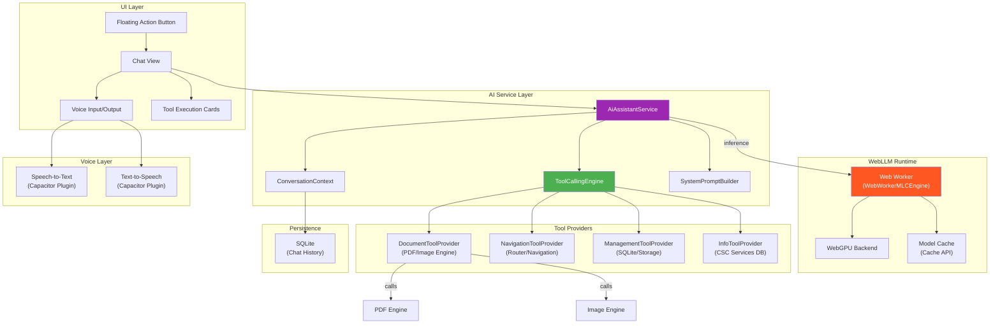
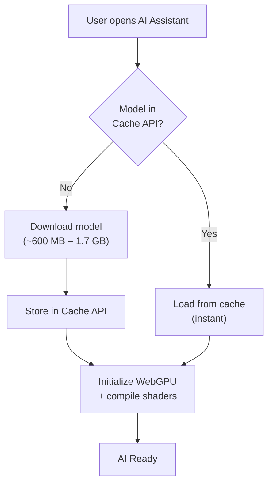
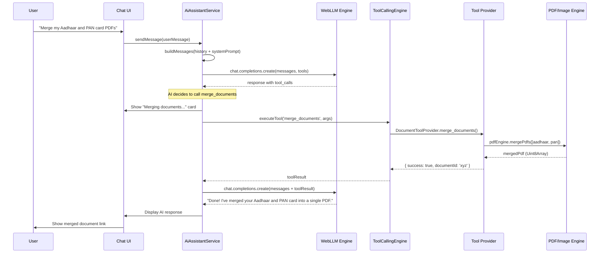
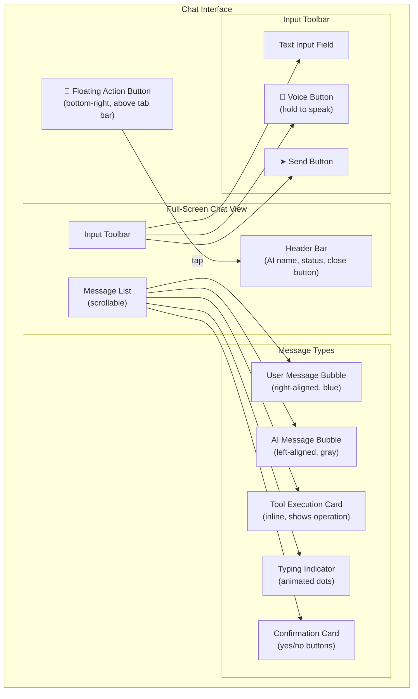
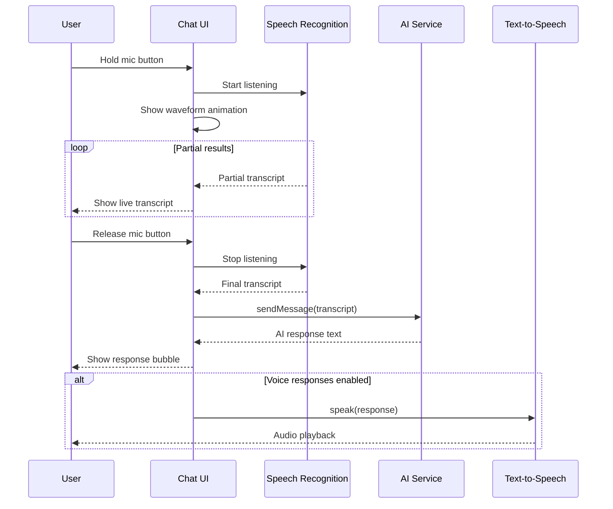

# 05 — AI Assistant Module Architecture

> **Module**: `@kagaz/ai-assistant`
> **Version**: 1.0.0
> **Status**: Draft
> **Last Updated**: 2026-06-10

---

## 1. Overview

The AI Assistant is Kagaz's on-device conversational interface. It lets users interact with the app using natural language — in Hindi, English, or a mix of both (code-switching). Powered by **WebLLM**, the AI runs entirely on the user's device via WebGPU, ensuring complete privacy: no document content or conversation data ever leaves the device.

The AI can perform document operations, navigate the app, manage files, and answer questions about CSC services — all through a simple chat interface with optional voice input/output.

> [!IMPORTANT]
> The AI model runs **100% on-device** via WebGPU. After the initial model download, the assistant works fully offline. No API keys, no server costs, no data leaks.

---

## 2. AI Architecture Overview



---

## 3. Core AI Engine — WebLLM

### 3.1 Library Setup

| Component | Package | Role |
|---|---|---|
| **WebLLM** | `@mlc-ai/web-llm` | LLM inference engine via WebGPU |
| **Worker Engine** | `WebWorkerMLCEngine` | Runs inference in a dedicated Web Worker |
| **Model Hub** | MLC model repository | Pre-quantized models optimized for browser |

### 3.2 Recommended Models

| Model | Parameters | Quantization | Size (Download) | Best For | Min VRAM |
|---|---|---|---|---|---|
| **Llama-3.2-1B-Instruct-q4f16_1-MLC** | 1B | 4-bit float16 | ~600 MB | Mobile devices, basic tasks | 2 GB |
| **Qwen2.5-1.5B-Instruct-q4f16_1-MLC** | 1.5B | 4-bit float16 | ~900 MB | Better tool calling, reasoning | 3 GB |
| **Llama-3.2-3B-Instruct-q4f16_1-MLC** | 3B | 4-bit float16 | ~1.7 GB | Best quality (desktop/high-end) | 4 GB |

### 3.3 Model Selection Strategy

```typescript
async function selectModel(): Promise<string> {
  const gpu = navigator.gpu;
  if (!gpu) {
    throw new AiError('WEBGPU_NOT_SUPPORTED', 'WebGPU is not available on this device');
  }

  const adapter = await gpu.requestAdapter();
  const info = await adapter?.requestAdapterInfo();
  
  // Estimate available VRAM (heuristic)
  const maxBufferSize = adapter?.limits.maxBufferSize ?? 0;
  const estimatedVRAM = maxBufferSize / (1024 * 1024 * 1024); // GB

  if (estimatedVRAM >= 4) {
    return 'Llama-3.2-3B-Instruct-q4f16_1-MLC';
  } else if (estimatedVRAM >= 3) {
    return 'Qwen2.5-1.5B-Instruct-q4f16_1-MLC';
  } else {
    return 'Llama-3.2-1B-Instruct-q4f16_1-MLC';
  }
}
```

### 3.4 Engine Initialization

```typescript
import { CreateWebWorkerMLCEngine, WebWorkerMLCEngine } from '@mlc-ai/web-llm';

class AiEngineManager {
  private engine: WebWorkerMLCEngine | null = null;

  async initialize(onProgress?: (progress: InitProgressEvent) => void): Promise<void> {
    const modelId = await selectModel();

    this.engine = await CreateWebWorkerMLCEngine(
      new Worker(new URL('./ai.worker.ts', import.meta.url), { type: 'module' }),
      modelId,
      {
        initProgressCallback: (progress) => {
          onProgress?.({
            phase: progress.text.includes('Loading') ? 'loading' : 'initializing',
            percent: progress.progress * 100,
            message: progress.text,
          });
        },
      }
    );
  }

  async chat(messages: ChatMessage[], tools?: ToolDefinition[]): Promise<ChatCompletion> {
    if (!this.engine) throw new AiError('NOT_INITIALIZED', 'AI engine not initialized');
    return this.engine.chat.completions.create({
      messages,
      tools,
      tool_choice: 'auto',
      temperature: 0.7,
      max_tokens: 1024,
    });
  }

  async destroy(): Promise<void> {
    await this.engine?.unload();
    this.engine = null;
  }
}
```

### 3.5 Model Caching

Models are cached via the **Cache API** for fully offline use:



> [!NOTE]
> The first-time model download requires an internet connection. After that, the assistant works fully offline. Users are shown a progress bar during the initial download with estimated time remaining.

---

## 4. Tool Calling System

### 4.1 Tool Calling Flow



### 4.2 Tool Definitions

All tools follow the OpenAI function-calling schema:

#### 4.2.1 Document Operations

```typescript
const documentTools: ToolDefinition[] = [
  {
    type: 'function',
    function: {
      name: 'merge_documents',
      description: 'Merge multiple documents into a single PDF. Use when user wants to combine files.',
      parameters: {
        type: 'object',
        properties: {
          document_ids: {
            type: 'array',
            items: { type: 'string' },
            description: 'IDs of documents to merge (in order)',
          },
          output_name: {
            type: 'string',
            description: 'Name for the merged document',
          },
        },
        required: ['document_ids'],
      },
    },
  },
  {
    type: 'function',
    function: {
      name: 'split_document',
      description: 'Split a PDF into multiple documents by page ranges.',
      parameters: {
        type: 'object',
        properties: {
          document_id: { type: 'string', description: 'ID of the PDF to split' },
          ranges: {
            type: 'array',
            items: {
              type: 'object',
              properties: {
                start: { type: 'number', description: 'Start page (1-indexed)' },
                end: { type: 'number', description: 'End page (1-indexed, inclusive)' },
              },
            },
            description: 'Page ranges for each split',
          },
        },
        required: ['document_id', 'ranges'],
      },
    },
  },
  {
    type: 'function',
    function: {
      name: 'convert_format',
      description: 'Convert a document between formats (e.g., images to PDF, PDF to images).',
      parameters: {
        type: 'object',
        properties: {
          document_id: { type: 'string' },
          target_format: { type: 'string', enum: ['pdf', 'jpeg', 'png', 'webp'] },
        },
        required: ['document_id', 'target_format'],
      },
    },
  },
  {
    type: 'function',
    function: {
      name: 'compress_document',
      description: 'Reduce the file size of a document.',
      parameters: {
        type: 'object',
        properties: {
          document_id: { type: 'string' },
          quality: { type: 'string', enum: ['low', 'medium', 'high'], description: 'Compression quality' },
        },
        required: ['document_id'],
      },
    },
  },
  {
    type: 'function',
    function: {
      name: 'encrypt_document',
      description: 'Add password protection to a PDF document.',
      parameters: {
        type: 'object',
        properties: {
          document_id: { type: 'string' },
          password: { type: 'string', description: 'Password to set' },
        },
        required: ['document_id', 'password'],
      },
    },
  },
  {
    type: 'function',
    function: {
      name: 'extract_text',
      description: 'Extract text from a PDF using text extraction or OCR for scanned documents.',
      parameters: {
        type: 'object',
        properties: {
          document_id: { type: 'string' },
          use_ocr: { type: 'boolean', description: 'Use OCR for scanned documents' },
          language: { type: 'string', description: 'OCR language (e.g., hin, eng)', default: 'eng' },
        },
        required: ['document_id'],
      },
    },
  },
  {
    type: 'function',
    function: {
      name: 'add_watermark',
      description: 'Add a text watermark to a PDF document.',
      parameters: {
        type: 'object',
        properties: {
          document_id: { type: 'string' },
          text: { type: 'string', description: 'Watermark text' },
          opacity: { type: 'number', description: '0–1 opacity', default: 0.3 },
        },
        required: ['document_id', 'text'],
      },
    },
  },
  {
    type: 'function',
    function: {
      name: 'create_pdf_from_images',
      description: 'Combine multiple images into a single PDF document.',
      parameters: {
        type: 'object',
        properties: {
          image_ids: {
            type: 'array',
            items: { type: 'string' },
            description: 'IDs of images to combine',
          },
          output_name: { type: 'string', description: 'Name for the PDF' },
        },
        required: ['image_ids'],
      },
    },
  },
];
```

#### 4.2.2 App Navigation

```typescript
const navigationTools: ToolDefinition[] = [
  {
    type: 'function',
    function: {
      name: 'navigate_to',
      description: 'Navigate to a specific screen in the app.',
      parameters: {
        type: 'object',
        properties: {
          screen: {
            type: 'string',
            enum: ['home', 'documents', 'tools', 'settings', 'profile', 'services', 'scanner'],
            description: 'Target screen',
          },
        },
        required: ['screen'],
      },
    },
  },
  {
    type: 'function',
    function: {
      name: 'open_document',
      description: 'Open a document in the preview/viewer.',
      parameters: {
        type: 'object',
        properties: {
          document_id: { type: 'string' },
        },
        required: ['document_id'],
      },
    },
  },
  {
    type: 'function',
    function: {
      name: 'open_settings',
      description: 'Open the app settings page, optionally a specific section.',
      parameters: {
        type: 'object',
        properties: {
          section: {
            type: 'string',
            enum: ['general', 'storage', 'security', 'ai', 'about'],
          },
        },
      },
    },
  },
  {
    type: 'function',
    function: {
      name: 'show_search',
      description: 'Open the search interface with an optional pre-filled query.',
      parameters: {
        type: 'object',
        properties: {
          query: { type: 'string', description: 'Optional search query to pre-fill' },
        },
      },
    },
  },
];
```

#### 4.2.3 Document Management

```typescript
const managementTools: ToolDefinition[] = [
  {
    type: 'function',
    function: {
      name: 'search_documents',
      description: 'Search for documents by name, tag, or type.',
      parameters: {
        type: 'object',
        properties: {
          query: { type: 'string', description: 'Search query' },
          type: { type: 'string', enum: ['pdf', 'image', 'all'], description: 'Filter by type' },
          tags: { type: 'array', items: { type: 'string' }, description: 'Filter by tags' },
        },
        required: ['query'],
      },
    },
  },
  {
    type: 'function',
    function: {
      name: 'list_documents',
      description: 'List documents in a specific folder.',
      parameters: {
        type: 'object',
        properties: {
          folder_id: { type: 'string', description: 'Folder ID (omit for root)' },
          sort_by: { type: 'string', enum: ['name', 'date', 'size', 'type'] },
        },
      },
    },
  },
  {
    type: 'function',
    function: {
      name: 'get_document_info',
      description: 'Get detailed metadata about a specific document.',
      parameters: {
        type: 'object',
        properties: {
          document_id: { type: 'string' },
        },
        required: ['document_id'],
      },
    },
  },
  {
    type: 'function',
    function: {
      name: 'create_folder',
      description: 'Create a new folder for organizing documents.',
      parameters: {
        type: 'object',
        properties: {
          name: { type: 'string', description: 'Folder name' },
          parent_id: { type: 'string', description: 'Parent folder ID (omit for root)' },
        },
        required: ['name'],
      },
    },
  },
  {
    type: 'function',
    function: {
      name: 'move_document',
      description: 'Move a document to a different folder.',
      parameters: {
        type: 'object',
        properties: {
          document_id: { type: 'string' },
          target_folder_id: { type: 'string' },
        },
        required: ['document_id', 'target_folder_id'],
      },
    },
  },
  {
    type: 'function',
    function: {
      name: 'tag_document',
      description: 'Add or remove tags from a document.',
      parameters: {
        type: 'object',
        properties: {
          document_id: { type: 'string' },
          add_tags: { type: 'array', items: { type: 'string' } },
          remove_tags: { type: 'array', items: { type: 'string' } },
        },
        required: ['document_id'],
      },
    },
  },
];
```

#### 4.2.4 Information (V3)

```typescript
const informationTools: ToolDefinition[] = [
  {
    type: 'function',
    function: {
      name: 'get_service_info',
      description: 'Get information about a specific CSC service (fees, process, requirements).',
      parameters: {
        type: 'object',
        properties: {
          service_name: { type: 'string', description: 'Name of the CSC service (e.g., "PAN Card", "Aadhaar Update")' },
        },
        required: ['service_name'],
      },
    },
  },
  {
    type: 'function',
    function: {
      name: 'get_required_documents',
      description: 'Get list of documents required for a specific CSC service.',
      parameters: {
        type: 'object',
        properties: {
          service_name: { type: 'string' },
        },
        required: ['service_name'],
      },
    },
  },
  {
    type: 'function',
    function: {
      name: 'get_nearest_csc',
      description: 'Find the nearest CSC center based on location.',
      parameters: {
        type: 'object',
        properties: {
          latitude: { type: 'number' },
          longitude: { type: 'number' },
          max_results: { type: 'number', description: 'Max centers to return', default: 5 },
        },
        required: ['latitude', 'longitude'],
      },
    },
  },
];
```

### 4.3 Tool Calling Engine

```typescript
class ToolCallingEngine {
  private providers = new Map<string, ToolProvider>();

  registerProvider(provider: ToolProvider): void {
    for (const tool of provider.getTools()) {
      this.providers.set(tool.function.name, provider);
    }
  }

  async executeTool(name: string, args: Record<string, unknown>): Promise<ToolResult> {
    const provider = this.providers.get(name);
    if (!provider) {
      return { success: false, error: `Unknown tool: ${name}` };
    }

    try {
      // Check if operation requires confirmation
      if (this.requiresConfirmation(name)) {
        return { success: false, needsConfirmation: true, operation: name, args };
      }
      return await provider.execute(name, args);
    } catch (error) {
      return { success: false, error: error.message };
    }
  }

  private requiresConfirmation(toolName: string): boolean {
    // Destructive operations require user confirmation
    const destructive = ['split_document', 'encrypt_document', 'move_document'];
    return destructive.includes(toolName);
  }
}
```

### 4.4 Tool Result Types

```typescript
interface ToolResult {
  success: boolean;
  data?: unknown;
  error?: string;
  needsConfirmation?: boolean;
  operation?: string;
  args?: Record<string, unknown>;
}

interface ToolProvider {
  getTools(): ToolDefinition[];
  execute(toolName: string, args: Record<string, unknown>): Promise<ToolResult>;
}
```

---

## 5. Chat UI Design

### 5.1 UI Components



### 5.2 Message Data Model

```typescript
interface ChatMessage {
  id: string;
  role: 'user' | 'assistant' | 'system' | 'tool';
  content: string;
  timestamp: Date;
  /** Tool call info (if role === 'assistant' and AI invoked tools) */
  toolCalls?: ToolCallInfo[];
  /** Tool result (if role === 'tool') */
  toolResult?: ToolResult;
  /** Voice metadata */
  voice?: {
    wasSpoken: boolean;
    audioUri?: string;
    duration?: number;
  };
}

interface ToolCallInfo {
  id: string;
  name: string;
  arguments: Record<string, unknown>;
  status: 'pending' | 'executing' | 'completed' | 'failed' | 'cancelled';
  result?: ToolResult;
}
```

### 5.3 Tool Execution Card

When the AI calls a tool, a special card is displayed inline:

```
┌──────────────────────────────────┐
│ 📄 Merging Documents             │
│                                  │
│ Combining:                       │
│  • Aadhaar Card.pdf              │
│  • PAN Card.pdf                  │
│                                  │
│ ████████████░░░░ 75%             │
│                                  │
│ Estimated time: ~3 seconds       │
└──────────────────────────────────┘
```

### 5.4 Confirmation Card

For destructive operations, a confirmation card appears:

```
┌──────────────────────────────────┐
│ ⚠️ Confirm: Encrypt Document     │
│                                  │
│ This will password-protect:      │
│ "Aadhaar Card.pdf"               │
│                                  │
│ You won't be able to open it     │
│ without the password.            │
│                                  │
│  [Cancel]          [Confirm ✓]   │
└──────────────────────────────────┘
```

---

## 6. Voice Features

### 6.1 Speech-to-Text (STT)

| Feature | Implementation |
|---|---|
| Plugin | `@capacitor-community/speech-recognition` |
| Mode | Offline (native device STT) |
| Languages | Hindi (`hi-IN`), English (`en-IN`) |
| Auto-detect | Use device locale as default, switch based on detected language |
| Activation | Hold-to-speak button, release to send |

```typescript
import { SpeechRecognition } from '@capacitor-community/speech-recognition';

async function startListening(): Promise<string> {
  const available = await SpeechRecognition.available();
  if (!available.available) throw new Error('STT not available');

  await SpeechRecognition.requestPermissions();

  return new Promise((resolve, reject) => {
    SpeechRecognition.start({
      language: 'hi-IN',   // Hindi default
      maxResults: 1,
      partialResults: true,
      popup: false,
    });

    SpeechRecognition.addListener('partialResults', (data) => {
      // Update UI with partial transcription
      updateTranscriptPreview(data.matches[0]);
    });

    SpeechRecognition.addListener('result', (data) => {
      resolve(data.matches[0]);
    });
  });
}
```

### 6.2 Text-to-Speech (TTS)

| Feature | Implementation |
|---|---|
| Plugin | `@capacitor-community/text-to-speech` |
| Mode | Offline (native device TTS) |
| Languages | Hindi, English (auto-detect from response) |
| Speed | Configurable (0.75× – 1.5×) |
| Toggle | User can enable/disable voice responses |

```typescript
import { TextToSpeech } from '@capacitor-community/text-to-speech';

async function speak(text: string, language: string = 'hi-IN'): Promise<void> {
  await TextToSpeech.speak({
    text,
    lang: language,
    rate: 1.0,
    pitch: 1.0,
    volume: 1.0,
    category: 'playback',
  });
}
```

### 6.3 Voice Interaction Flow



### 6.4 Visual Feedback During Listening

```
┌──────────────────────────────────┐
│                                  │
│     🎤 Listening...              │
│                                  │
│     ╭─╮ ╭──╮ ╭╮ ╭───╮ ╭─╮      │
│     │ │ │  │ ││ │   │ │ │      │
│     ╰─╯ ╰──╯ ╰╯ ╰───╯ ╰─╯      │
│     (waveform animation)         │
│                                  │
│     "मेरा आधार कार्ड..."         │
│     (live transcript)            │
│                                  │
│           [Cancel]               │
└──────────────────────────────────┘
```

---

## 7. System Prompt Design

### 7.1 System Prompt Template

```typescript
const SYSTEM_PROMPT = `You are Kagaz AI, a helpful document assistant built into the Kagaz app. You help users manage their important documents like Aadhaar, PAN Card, Voter ID, and other Indian government and personal documents.

## Your Personality
- Friendly, patient, and helpful
- Speak naturally in Hindi, English, or Hinglish (Hindi-English mix) based on user's language
- Keep responses concise but informative
- Use simple, non-technical language

## What You Can Do
1. **Document Operations**: Merge, split, compress, encrypt, convert, watermark PDFs and images
2. **App Navigation**: Open screens, search documents, manage settings
3. **Document Management**: Search, organize, tag, and manage files
4. **CSC Service Info** (V3): Guide users about government services, required documents, fees

## Important Rules
- NEVER access or read the actual content of documents — you only see metadata (name, type, size, tags)
- Always ask for confirmation before destructive operations (delete, encrypt, split)
- When merging or converting, explain what will happen before doing it
- If a user asks about a document's content, politely explain you can't read it for privacy
- Suggest relevant actions based on context (e.g., "Would you like me to compress this PDF?")
- If unsure, ask clarifying questions rather than guessing

## Document Knowledge
You know about common Indian documents:
- Aadhaar Card (UID, 12-digit number, biometric ID)
- PAN Card (10-character alphanumeric, tax ID)
- Voter ID (EPIC, election photo ID)
- Passport (travel document)
- Driving License (state-issued)
- Ration Card (food subsidy)
- Birth/Death/Marriage Certificates
- Income/Caste/Domicile Certificates
- Marksheets and Degree Certificates
- Bank Passbook, Insurance documents
- Property documents

## Response Format
- Use short paragraphs
- Use bullet points for lists
- Use emojis sparingly for friendliness (📄, ✅, 📁)
- When listing documents or results, use a clean format

## Language Examples
- Hindi: "आपका आधार कार्ड PDF मिल गया। क्या आप इसे compress करना चाहते हैं?"
- English: "I found your Aadhaar card PDF. Would you like me to compress it?"
- Hinglish: "Maine aapka Aadhaar card PDF dhoondh liya. Kya aap isko compress karna chahte hain?"
`;
```

### 7.2 Context Injection

Before each request, the system prompt is augmented with:

```typescript
function buildContextualPrompt(context: ConversationContext): string {
  let prompt = SYSTEM_PROMPT;

  // Inject current screen context
  prompt += `\n\nThe user is currently on the "${context.currentScreen}" screen.`;

  // Inject recent document context
  if (context.recentDocuments.length > 0) {
    prompt += `\n\nRecently accessed documents:\n`;
    for (const doc of context.recentDocuments.slice(0, 5)) {
      prompt += `- "${doc.name}" (${doc.type}, ${formatSize(doc.size)}, tags: [${doc.tags.join(', ')}])\n`;
    }
  }

  // Inject folder context
  if (context.currentFolder) {
    prompt += `\n\nCurrent folder: "${context.currentFolder.name}" with ${context.currentFolder.documentCount} documents.`;
  }

  return prompt;
}
```

---

## 8. Chat History Persistence

### 8.1 SQLite Schema

```sql
CREATE TABLE IF NOT EXISTS chat_conversations (
  id           TEXT PRIMARY KEY,
  title        TEXT NOT NULL DEFAULT 'New Chat',
  created_at   TEXT NOT NULL DEFAULT (datetime('now')),
  updated_at   TEXT NOT NULL DEFAULT (datetime('now')),
  message_count INTEGER NOT NULL DEFAULT 0
);

CREATE TABLE IF NOT EXISTS chat_messages (
  id              TEXT PRIMARY KEY,
  conversation_id TEXT NOT NULL REFERENCES chat_conversations(id) ON DELETE CASCADE,
  role            TEXT NOT NULL CHECK (role IN ('user', 'assistant', 'system', 'tool')),
  content         TEXT NOT NULL,
  tool_calls      TEXT,  -- JSON array of ToolCallInfo
  tool_result     TEXT,  -- JSON ToolResult
  created_at      TEXT NOT NULL DEFAULT (datetime('now')),
  
  -- Indexes
  FOREIGN KEY (conversation_id) REFERENCES chat_conversations(id)
);

CREATE INDEX idx_messages_conversation ON chat_messages(conversation_id, created_at);
```

### 8.2 Conversation Management

```typescript
interface ConversationManager {
  /** Create a new conversation */
  createConversation(): Promise<string>;
  /** List all conversations (most recent first) */
  listConversations(): Promise<Conversation[]>;
  /** Load messages for a conversation */
  loadMessages(conversationId: string, limit?: number, offset?: number): Promise<ChatMessage[]>;
  /** Save a message */
  saveMessage(conversationId: string, message: ChatMessage): Promise<void>;
  /** Delete a conversation and all its messages */
  deleteConversation(conversationId: string): Promise<void>;
  /** Auto-generate conversation title from first message */
  generateTitle(conversationId: string): Promise<string>;
}
```

---

## 9. Error Handling

### 9.1 AI-Specific Errors

```typescript
type AiErrorCode =
  | 'WEBGPU_NOT_SUPPORTED'
  | 'MODEL_DOWNLOAD_FAILED'
  | 'MODEL_TOO_LARGE'
  | 'INFERENCE_FAILED'
  | 'TOOL_EXECUTION_FAILED'
  | 'CONTEXT_TOO_LONG'
  | 'RATE_LIMITED'
  | 'NOT_INITIALIZED'
  | 'STT_NOT_AVAILABLE'
  | 'TTS_NOT_AVAILABLE'
  | 'MIC_PERMISSION_DENIED';
```

### 9.2 Graceful Degradation

| Failure | Fallback |
|---|---|
| WebGPU not available | Show message: "AI Assistant requires WebGPU. Please use a supported browser." |
| Model download fails | Retry with exponential backoff, offer manual retry button |
| Inference timeout | Abort after 30s, show error, allow retry |
| Tool execution fails | AI reports the error naturally: "Sorry, I couldn't merge those files. The PDF might be corrupted." |
| STT not available | Hide voice button, text-only mode |
| Low memory | Use smallest model, warn user about potential slowness |

---

## 10. Performance Considerations

### 10.1 Inference Performance

| Model | First Token | Tokens/sec (Desktop) | Tokens/sec (Mobile) |
|---|---|---|---|
| Llama-3.2-1B | ~1.5 s | 30–50 | 15–25 |
| Qwen2.5-1.5B | ~2.0 s | 20–40 | 10–20 |
| Llama-3.2-3B | ~3.0 s | 15–30 | 5–15 |

### 10.2 Memory Usage

| Component | Memory |
|---|---|
| Model weights (1B, q4) | ~600 MB VRAM |
| Model weights (1.5B, q4) | ~900 MB VRAM |
| KV cache (2K context) | ~100 MB VRAM |
| Chat history (in-memory) | ~1 MB RAM |
| Web Worker overhead | ~10 MB RAM |

### 10.3 Optimization Strategies

| Strategy | Description |
|---|---|
| Lazy loading | AI engine is only loaded when user first opens the chat |
| Model unload | Unload model after 5 minutes of inactivity to free VRAM |
| Context pruning | Keep last 20 messages + system prompt, summarize older context |
| Streaming | Stream tokens to UI as they're generated for perceived speed |
| Worker isolation | All inference in a dedicated Web Worker, never blocks UI |

---

## 11. Privacy & Security

> [!CAUTION]
> The AI Assistant has access to document metadata but NEVER to document content. This is enforced at the architecture level — tool providers only expose metadata, and the system prompt explicitly forbids content access.

| Principle | Implementation |
|---|---|
| No content access | Tools only return metadata (name, type, size, tags) |
| On-device inference | WebLLM runs locally, no server calls |
| No telemetry | No conversation data sent anywhere |
| Chat history encryption | SQLite DB encrypted with device key |
| Model integrity | SHA-256 checksum verification on cached models |
| Permission model | Each tool category requires explicit user opt-in |

---

## 12. Future Enhancements

| Feature | Version | Notes |
|---|---|---|
| Multi-turn tool calling | V2 | Chain multiple tools in a single conversation turn |
| Document summarization | V2 | Summarize text extracted from PDFs (opt-in) |
| Smart tagging | V2 | AI auto-suggests tags based on document name |
| Proactive suggestions | V3 | AI suggests actions based on user patterns |
| Multi-model support | V3 | Let users choose between available models |
| Fine-tuned model | V3 | Kagaz-specific fine-tuned model for better accuracy |
| Multimodal input | V3+ | Accept image input for visual questions |
