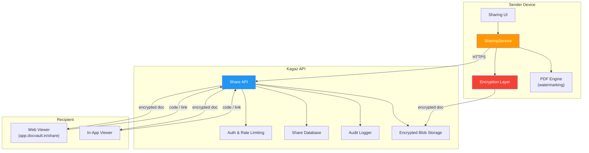
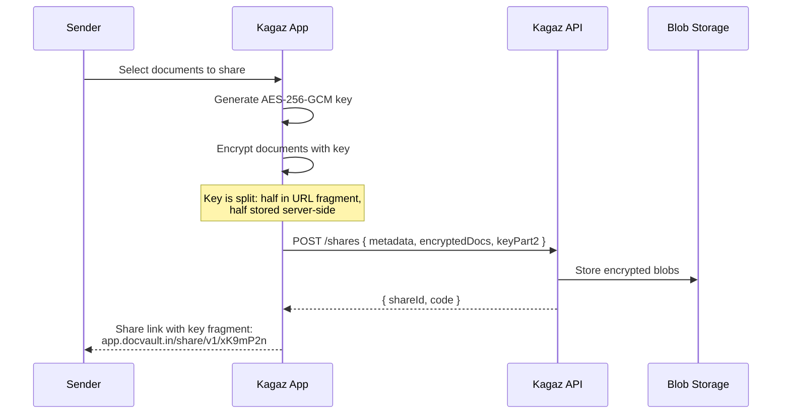
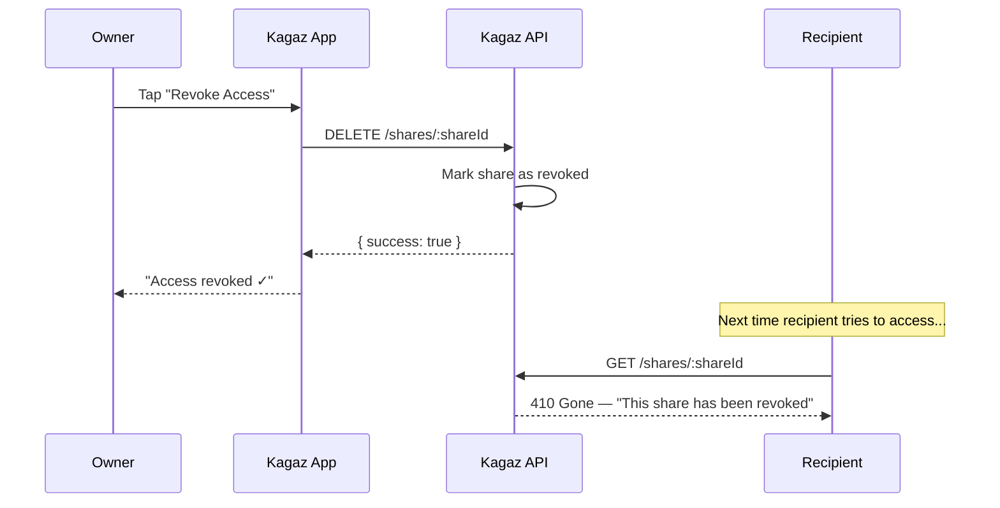
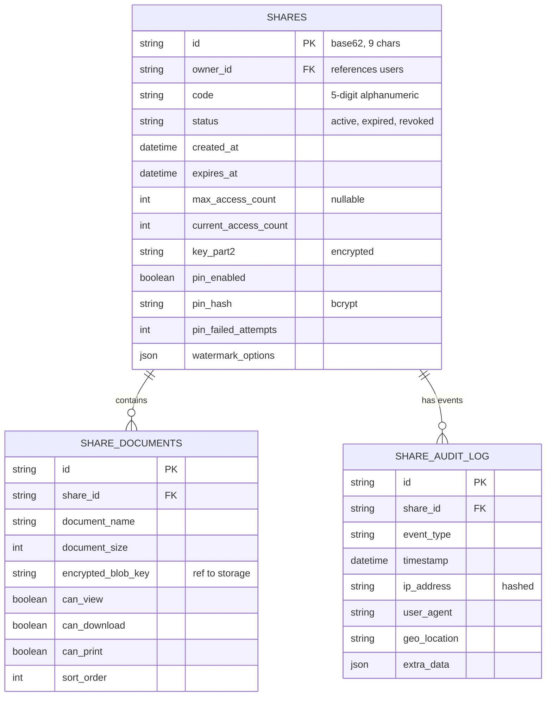
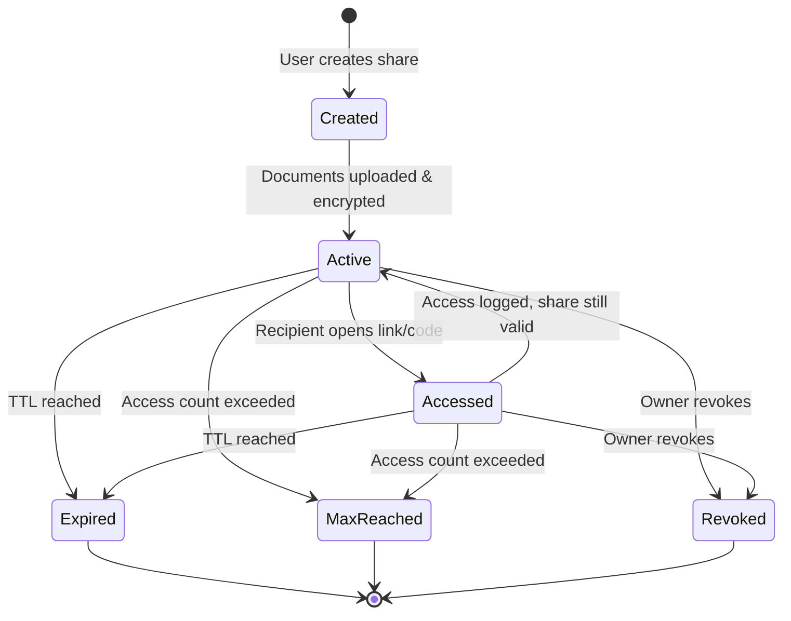
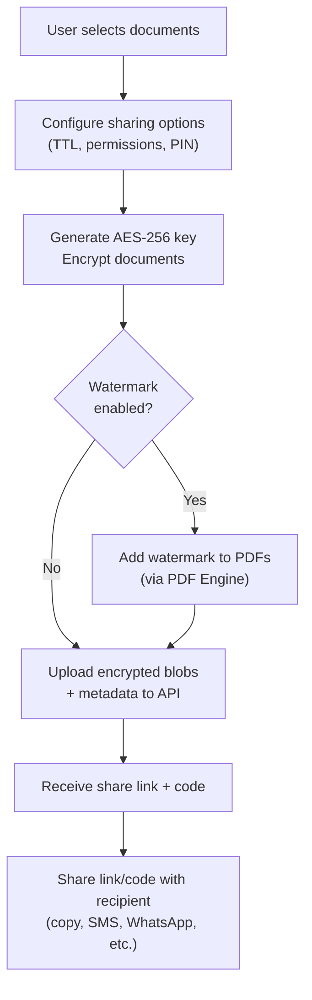
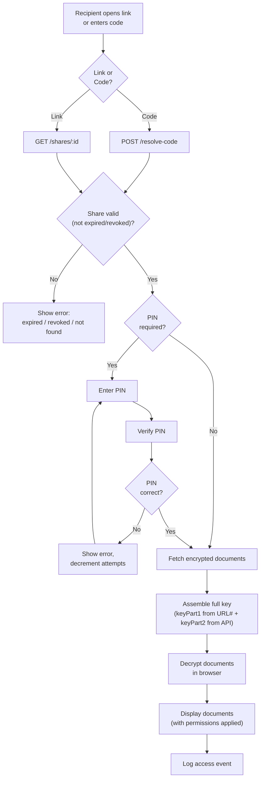

# 06 — Sharing Module Architecture

> **Module**: `@docvault/sharing`
> **Version**: 2.0.0 (V2 Feature)
> **Status**: Draft
> **Last Updated**: 2026-06-07

---

## 1. Overview

The Sharing module enables Kagaz users to securely share documents with others — via shareable links, 5-digit codes, or direct in-app sharing. Every share is time-limited, revocable, and auditable. Documents are encrypted in transit, and owners maintain full control over access permissions at all times.

> [!IMPORTANT]
> Sharing is a **V2 feature** that requires a backend service. Unlike the core PDF/Image engines (which are fully client-side), the sharing module communicates with the Kagaz API for link generation, access control, and audit logging.

---

## 2. Sharing Architecture Overview



---

## 3. Sharing Methods

### 3.1 Shareable Links

A unique URL is generated for each share session:

```
https://app.docvault.in/share/v1/xK9mP2nQ7
                                   └─── unique share ID (9 chars, base62)
```

| Property | Details |
|---|---|
| **Format** | `https://app.docvault.in/share/v1/{shareId}` |
| **ID Generation** | 9-character base62 (a–z, A–Z, 0–9) = 13.5 trillion combinations |
| **TTL Options** | 1 hour, 6 hours, 24 hours, 7 days, 30 days, custom (max 90 days) |
| **Max Access Count** | Optional: 1, 5, 10, 50, unlimited |
| **Revocable** | Owner can revoke anytime from the share management screen |
| **PIN Protection** | Optional 4–6 digit PIN for additional security |

### 3.2 5-Digit Code Sharing

For quick, in-person sharing (e.g., at a CSC center):

```
Code: A7K9M
```

| Property | Details |
|---|---|
| **Format** | 5 alphanumeric characters (uppercase) |
| **Character Set** | `A-Z, 2-9` (excluding 0, O, 1, I, L to avoid confusion) = 31 chars |
| **Combinations** | 31⁵ = ~28.6 million unique codes |
| **Entry Point** | `app.docvault.in/share` → enter code → view documents |
| **TTL** | Same as the parent shareable link TTL |
| **Rate Limiting** | Max 5 incorrect attempts per minute per IP |
| **Lockout** | After 15 failed attempts, block IP for 30 minutes |

### 3.3 Code Generation Algorithm

```typescript
const CODE_CHARSET = 'ABCDEFGHJKMNPQRSTUVWXYZ23456789'; // 31 chars, no 0/O/1/I/L

function generateShareCode(): string {
  const array = new Uint8Array(5);
  crypto.getRandomValues(array);
  return Array.from(array)
    .map(byte => CODE_CHARSET[byte % CODE_CHARSET.length])
    .join('');
}

// Examples: A7K9M, QR3VH, N8PTX
```

---

## 4. Security Architecture

### 4.1 Encryption Flow



### 4.2 Key Management

The encryption key is split for defense-in-depth:

| Component | Stored In | Purpose |
|---|---|---|
| **Key Part 1** | URL fragment (`#` part, never sent to server) | Client-side decryption |
| **Key Part 2** | Server database (linked to shareId) | Server-side key completion |
| **Full Key** | Only assembled in recipient's browser | AES-256-GCM decryption |

> [!WARNING]
> The URL fragment (after `#`) is never sent to the server in HTTP requests. This means even if the server is compromised, the attacker only has half the key and cannot decrypt the documents.

### 4.3 PIN Protection

Optional additional PIN layer:

```typescript
interface PinProtection {
  /** Whether PIN is required to access the share */
  enabled: boolean;
  /** PIN hash (bcrypt, stored server-side) */
  pinHash: string;
  /** Max PIN attempts before lockout */
  maxAttempts: number;
  /** Current failed attempt count */
  failedAttempts: number;
}
```

### 4.4 Watermarking

Shared documents are automatically watermarked with recipient identification:

```typescript
interface ShareWatermark {
  /** Text overlaid on each page */
  text: string; // e.g., "Shared via Kagaz • Code: A7K9M • 2026-06-07"
  /** Include recipient's IP (hashed) for traceability */
  includeAccessId: boolean;
  /** Watermark opacity */
  opacity: number; // 0.15 default
  /** Position */
  position: 'diagonal' | 'footer' | 'header';
}
```

### 4.5 Rate Limiting

| Endpoint | Limit | Window | Lockout |
|---|---|---|---|
| `POST /shares` (create) | 10 shares | per hour | 1 hour cooldown |
| `GET /shares/:id` (access) | 30 requests | per minute | N/A |
| `POST /shares/:id/verify-code` | 5 attempts | per minute | 30 min after 15 fails |
| `POST /shares/:id/verify-pin` | 3 attempts | per minute | 15 min after 10 fails |

---

## 5. Consent Management

### 5.1 Permission Model

```typescript
interface SharePermissions {
  /** Documents included in this share */
  documents: SharedDocument[];
  /** Global permissions (can be overridden per-document) */
  globalPermissions: DocumentPermissions;
  /** When the share expires */
  expiresAt: Date;
  /** Max access count (null = unlimited) */
  maxAccessCount: number | null;
  /** Whether the share is currently active */
  isActive: boolean;
}

interface SharedDocument {
  documentId: string;
  documentName: string;
  /** Per-document permission overrides */
  permissions: DocumentPermissions;
}

interface DocumentPermissions {
  /** Can the recipient view the document? */
  canView: boolean;
  /** Can the recipient download the document? */
  canDownload: boolean;
  /** Can the recipient print the document? */
  canPrint: boolean;
}
```

### 5.2 Consent Controls

| Control | Description |
|---|---|
| **Select documents** | Owner picks exactly which documents to share |
| **Per-document permissions** | View / download / print toggleable per document |
| **Real-time revocation** | Owner can revoke access instantly from share management |
| **TTL control** | Owner sets expiration, can extend or shorten |
| **Access notifications** | Push notification when someone accesses shared docs |
| **Access count limit** | Auto-revoke after N accesses |

### 5.3 Revocation Flow



---

## 6. API Design

### 6.1 REST Endpoints

#### Create Share

```http
POST /api/v1/shares
Authorization: Bearer {token}
Content-Type: application/json

{
  "documents": [
    {
      "documentId": "doc_abc123",
      "name": "Aadhaar Card.pdf",
      "encryptedData": "<base64>",
      "permissions": { "canView": true, "canDownload": false, "canPrint": false }
    }
  ],
  "options": {
    "ttlHours": 24,
    "maxAccessCount": 5,
    "generateCode": true,
    "pinProtection": { "enabled": true, "pin": "1234" },
    "watermark": { "enabled": true, "position": "diagonal" }
  },
  "keyPart2": "<base64>"
}
```

**Response**:

```json
{
  "shareId": "xK9mP2nQ7",
  "code": "A7K9M",
  "url": "https://app.docvault.in/share/v1/xK9mP2nQ7",
  "expiresAt": "2026-06-08T00:26:00Z",
  "maxAccessCount": 5,
  "currentAccessCount": 0
}
```

#### Access Share (via Link)

```http
GET /api/v1/shares/{shareId}
```

**Response** (if PIN required):

```json
{
  "requiresPin": true,
  "documentCount": 2,
  "expiresAt": "2026-06-08T00:26:00Z"
}
```

#### Access Share (via Code)

```http
POST /api/v1/shares/resolve-code
Content-Type: application/json

{
  "code": "A7K9M"
}
```

**Response**:

```json
{
  "shareId": "xK9mP2nQ7",
  "redirectUrl": "https://app.docvault.in/share/v1/xK9mP2nQ7"
}
```

#### Verify PIN

```http
POST /api/v1/shares/{shareId}/verify-pin
Content-Type: application/json

{
  "pin": "1234"
}
```

**Response**:

```json
{
  "accessToken": "temp_token_abc",
  "documents": [
    {
      "name": "Aadhaar Card.pdf",
      "size": 245780,
      "permissions": { "canView": true, "canDownload": false, "canPrint": false },
      "downloadUrl": "/api/v1/shares/xK9mP2nQ7/documents/0?token=temp_token_abc"
    }
  ],
  "keyPart2": "<base64>"
}
```

#### Revoke Share

```http
DELETE /api/v1/shares/{shareId}
Authorization: Bearer {token}
```

#### Get Audit Log

```http
GET /api/v1/shares/{shareId}/audit
Authorization: Bearer {token}
```

**Response**:

```json
{
  "events": [
    {
      "type": "share_created",
      "timestamp": "2026-06-07T10:00:00Z",
      "ip": null
    },
    {
      "type": "share_accessed",
      "timestamp": "2026-06-07T10:15:00Z",
      "ip": "203.x.x.x",
      "userAgent": "Mozilla/5.0 ...",
      "location": "Mumbai, Maharashtra"
    },
    {
      "type": "document_viewed",
      "timestamp": "2026-06-07T10:15:05Z",
      "documentName": "Aadhaar Card.pdf"
    }
  ]
}
```

#### List My Shares

```http
GET /api/v1/shares?status=active&page=1&limit=20
Authorization: Bearer {token}
```

---

## 7. Data Model

### 7.1 Database Schema



### 7.2 Share Lifecycle States



---

## 8. Data Flow — Complete Sharing Journey

### 8.1 Sender Flow



### 8.2 Recipient Flow



---

## 9. Client-Side Service

### 9.1 SharingService Interface

```typescript
interface SharingService {
  // ── Create & Manage ───────────────────────────────────
  /** Create a new share with selected documents */
  createShare(request: CreateShareRequest): Promise<ShareResult>;
  /** List all shares created by the current user */
  listMyShares(status?: ShareStatus): Promise<Share[]>;
  /** Get details of a specific share */
  getShare(shareId: string): Promise<ShareDetail>;
  /** Revoke an active share */
  revokeShare(shareId: string): Promise<void>;
  /** Extend the TTL of an active share */
  extendShare(shareId: string, newExpiresAt: Date): Promise<void>;

  // ── Access (Recipient) ────────────────────────────────
  /** Resolve a 5-digit code to a share */
  resolveCode(code: string): Promise<ResolvedShare>;
  /** Access a share by ID */
  accessShare(shareId: string, pin?: string): Promise<ShareAccess>;
  /** Download a shared document (decrypts client-side) */
  downloadSharedDocument(shareId: string, documentIndex: number, keyFragment: string): Promise<Blob>;

  // ── Audit ─────────────────────────────────────────────
  /** Get access audit log for a share */
  getAuditLog(shareId: string): Promise<AuditEvent[]>;
}
```

### 9.2 Request/Response Types

```typescript
interface CreateShareRequest {
  documents: {
    documentId: string;
    permissions: DocumentPermissions;
  }[];
  options: {
    ttlHours: number;
    maxAccessCount?: number;
    generateCode: boolean;
    pin?: string;
    watermark?: {
      enabled: boolean;
      position: 'diagonal' | 'footer' | 'header';
    };
  };
}

interface ShareResult {
  shareId: string;
  code?: string;
  url: string;
  /** Full URL including key fragment for sharing */
  fullUrl: string;
  expiresAt: Date;
}

type ShareStatus = 'active' | 'expired' | 'revoked' | 'all';

interface AuditEvent {
  type: 'share_created' | 'share_accessed' | 'document_viewed' | 'document_downloaded' | 'share_revoked' | 'pin_failed';
  timestamp: Date;
  ipAddress?: string;
  geoLocation?: string;
  documentName?: string;
}
```

---

## 10. Notifications

### 10.1 Push Notifications

| Event | Notification | Channel |
|---|---|---|
| Document accessed | "Someone viewed your shared Aadhaar Card" | Push + In-app |
| Document downloaded | "Your shared PAN Card was downloaded" | Push + In-app |
| Share about to expire | "Your share expires in 1 hour" | Push |
| PIN brute-force attempt | "Multiple failed PIN attempts on your share" | Push + In-app |
| Share auto-expired | "Your shared link has expired" | In-app only |

### 10.2 Notification Preferences

```typescript
interface ShareNotificationPreferences {
  notifyOnAccess: boolean;      // Default: true
  notifyOnDownload: boolean;    // Default: true
  notifyOnExpiry: boolean;      // Default: true
  notifyOnBruteForce: boolean;  // Default: true (always on)
  quietHoursStart?: string;     // e.g., "22:00"
  quietHoursEnd?: string;       // e.g., "07:00"
}
```

---

## 11. Web Viewer

The recipient views shared documents at `app.docvault.in/share`:

### 11.1 Viewer Features

| Feature | View-Only Mode | Download Mode |
|---|---|---|
| PDF rendering | ✅ (via pdfjs-dist) | ✅ |
| Image display | ✅ | ✅ |
| Zoom/Pan | ✅ | ✅ |
| Download button | ❌ (hidden) | ✅ |
| Print | Depends on permission | Depends on permission |
| Right-click save | ❌ (disabled) | ✅ |
| Screenshot prevention | Best-effort CSS overlay | N/A |
| Watermark display | ✅ (always visible) | ✅ (embedded in file) |

> [!NOTE]
> View-only mode uses best-effort screenshot prevention (CSS overlays, disabled right-click, `user-select: none`). This is not foolproof — determined users can always capture their screen — but it raises the barrier and signals intent.

---

## 12. Error Handling

| Error | HTTP Status | User Message |
|---|---|---|
| Share not found | 404 | "This share link is invalid or has been removed." |
| Share expired | 410 | "This share has expired. Ask the owner for a new link." |
| Share revoked | 410 | "The owner has revoked access to these documents." |
| Max access reached | 403 | "This share has reached its access limit." |
| Wrong PIN | 401 | "Incorrect PIN. X attempts remaining." |
| PIN locked out | 429 | "Too many failed attempts. Try again in 30 minutes." |
| Rate limited | 429 | "Please wait before trying again." |

---

## 13. Future Enhancements

| Feature | Version | Notes |
|---|---|---|
| QR code sharing | V2.1 | Generate QR code in addition to link/code |
| Group sharing | V3 | Share with multiple recipients, individual permissions |
| Expiry extension requests | V3 | Recipients can request the owner to extend access |
| Shared folder | V3 | Share entire folders, auto-include new documents |
| Blockchain audit trail | V3+ | Immutable audit log on a public blockchain |
| End-to-end encrypted chat | V3 | Sender and recipient can chat about shared docs |
