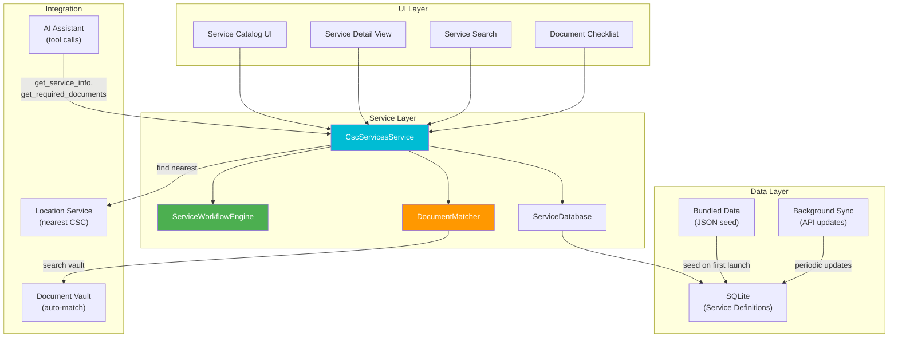
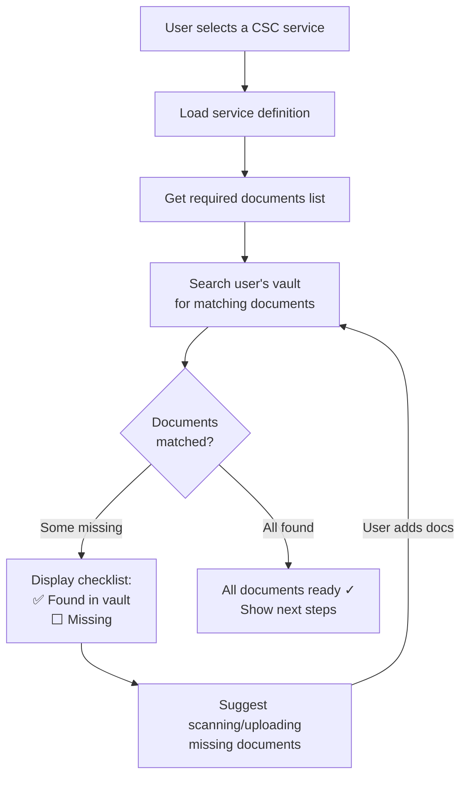
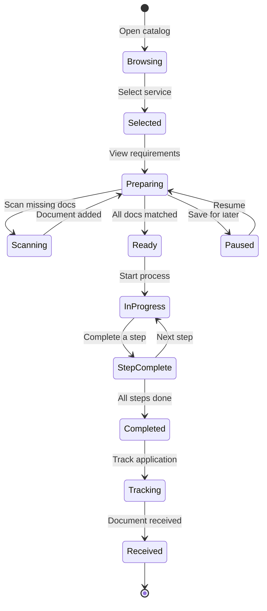
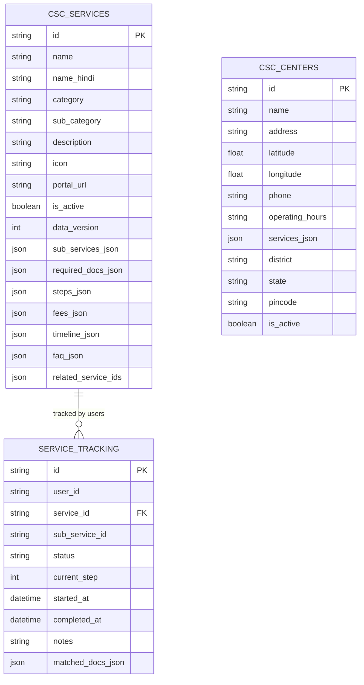
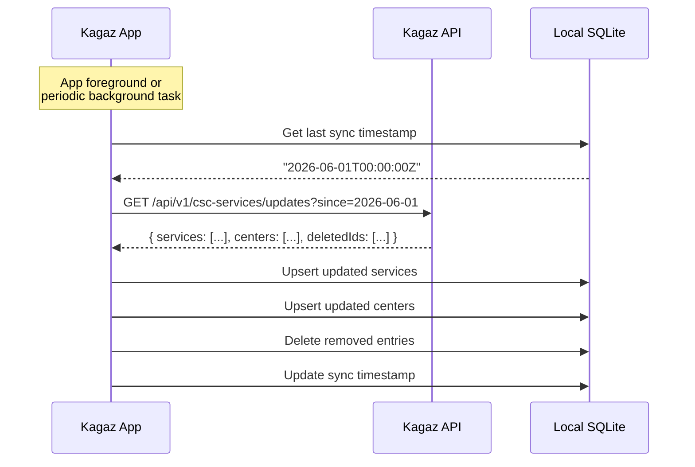

# 07 — CSC Services Module Architecture

> **Module**: `@kagaz/csc-services`
> **Version**: 3.0.0 (V3 Feature)
> **Status**: Draft
> **Last Updated**: 2026-06-10

---

## 1. Overview

The CSC Services module is Kagaz's knowledge base for **Common Service Centre (CSC)** services across India. It provides a comprehensive, searchable catalog of government, financial, educational, and health services — each with required documents, step-by-step processes, fees, and timelines. The module integrates deeply with the AI Assistant and the document vault to help users prepare for and complete CSC services with the right documents ready.

> [!IMPORTANT]
> This is a **V3 feature**. The service catalog data is bundled with the app and periodically updated via background sync. The module works offline after initial data sync.

---

## 2. Architecture Overview



---

## 3. Service Catalog

### 3.1 Government Services

#### 3.1.1 Identity Documents

| Service | Sub-Services | Required Documents | Est. Fee | Timeline |
|---|---|---|---|---|
| **PAN Card** | New PAN, Correction, Reprint, e-PAN | Aadhaar, DOB proof, Photo, Signature | ₹107 (new), ₹107 (correction) | 15–20 days |
| **Aadhaar** | New Enrollment, Update (address/name/mobile/DOB), PVC Aadhaar Card | DOB proof, Address proof, Photo | Free (update), ₹50 (PVC) | 15–90 days |
| **Voter ID (EPIC)** | New Registration, Correction, Duplicate | Aadhaar, Address proof, Photo, Age proof | Free | 30–45 days |
| **Passport** | Fresh (Normal/Tatkal), Renewal, Re-issue | Aadhaar, PAN, Birth cert, Address proof, Old passport (renewal) | ₹1,500 (normal), ₹3,500 (tatkal) | 30 days (normal), 7 days (tatkal) |
| **Driving License** | Learner's License, Permanent DL, Renewal, International DL | Aadhaar, Address proof, Age proof, Medical cert (40+), Photos | ₹200–₹1,000 | 7–30 days |

#### 3.1.2 Household Documents

| Service | Sub-Services | Required Documents | Est. Fee | Timeline |
|---|---|---|---|---|
| **Ration Card** | New, Update (add/remove member), Surrender | Aadhaar (all members), Income cert, Address proof, Gas connection proof | Free – ₹50 | 30–60 days |
| **Birth Certificate** | New Registration, Duplicate | Hospital record, Parent's Aadhaar, Marriage cert | ₹10–₹50 | 7–15 days |
| **Death Certificate** | New Registration, Duplicate | Hospital record, Deceased's Aadhaar, Applicant's Aadhaar | ₹10–₹50 | 7–15 days |
| **Marriage Certificate** | New Registration | Aadhaar (both), Photos (joint + individual), Wedding photos, Witness Aadhaar | ₹50–₹100 | 15–30 days |

#### 3.1.3 State Certificates

| Service | Sub-Services | Required Documents | Est. Fee | Timeline |
|---|---|---|---|---|
| **Income Certificate** | New, Renewal | Aadhaar, Ration Card, Salary slip/Self-declaration, Bank statement | ₹10–₹50 | 7–15 days |
| **Caste Certificate** | New (SC/ST/OBC) | Aadhaar, Father's caste cert, School leaving cert, Affidavit | ₹10–₹50 | 15–30 days |
| **Domicile Certificate** | New | Aadhaar, Ration Card, Birth cert, School cert, Electricity bill | ₹10–₹50 | 15–30 days |
| **E-Shram Card** | New Registration | Aadhaar, Bank passbook, Mobile number | Free | Instant – 7 days |

### 3.2 Financial Services

| Service | Sub-Services | Required Documents | Est. Fee | Timeline |
|---|---|---|---|---|
| **PM Kisan** | New Registration, Aadhaar Seeding, Status Check | Aadhaar, Bank passbook, Land records, Khasra/Khatauni | Free | 30–60 days |
| **PM Fasal Bima Yojana** | New Application, Claim | Aadhaar, Bank passbook, Land records, Sowing cert, Crop photo | Varies by crop | Season-based |
| **PM Ujjwala Yojana** | New LPG Connection, Refill | Aadhaar, BPL card/Ration card, Bank passbook | Free (connection), market rate (refill) | 15–30 days |
| **Atal Pension Yojana** | New Registration | Aadhaar, Bank passbook, Mobile number | ₹42–₹1,454/month (age-based) | Instant enrollment |
| **PM Shram Yogi Maan-dhan** | New Registration | Aadhaar, Bank passbook, Mobile number | ₹55–₹200/month (age-based) | Instant enrollment |
| **DigiPay (AEPS)** | Cash Withdrawal, Balance Inquiry, Fund Transfer | Aadhaar, Bank-linked Aadhaar | Service charges vary | Instant |
| **CIBIL Registration** | Credit Score Check | PAN, Aadhaar, Name, DOB, Mobile, Email | ₹25–₹100 | Instant |
| **FASTag** | New FASTag, Recharge | Vehicle RC, Aadhaar/PAN, Bank passbook/KYC | ₹500 (deposit + fee) | 7 days delivery |

### 3.3 Education Services

| Service | Sub-Services | Required Documents | Est. Fee | Timeline |
|---|---|---|---|---|
| **PMGDISHA** | Digital Literacy Training | Aadhaar, Mobile number | Free | 20 hours course |
| **Scholarship Forms** | Pre-matric, Post-matric, Merit-cum-Means | Aadhaar, Marksheets, Income cert, Caste cert, Bank passbook | Free (application) | Varies by scheme |
| **NIOS Enrollment** | Secondary (10th), Sr. Secondary (12th) | Aadhaar, Previous marksheet, Transfer cert, Photos | ₹2,500–₹5,000 | Admission cycle |
| **IGNOU Enrollment** | Various Programs | Aadhaar, Marksheets, Category cert (if applicable), Photos | Program-specific | Admission cycle |
| **Competitive Exam Applications** | SSC, Railway, Banking, State PSC | Aadhaar, Marksheets, Category cert, Photos, Signature | Exam-specific (₹100–₹500) | Application window |

### 3.4 Health Services

| Service | Sub-Services | Required Documents | Est. Fee | Timeline |
|---|---|---|---|---|
| **Ayushman Bharat (PM-JAY)** | New Card, Renewal, Hospital Empanelment Check | Aadhaar, Ration Card, SECC data, Mobile number | Free | 7–15 days |
| **Telemedicine** | Doctor Consultation (eSanjeevani) | Aadhaar, Health ID (ABHA), Symptoms description | Free | Instant (queue-based) |
| **Jan Aushadhi** | Medicine Information, Nearest Store | Prescription, Aadhaar (optional) | Discounted medicine rates | N/A |

### 3.5 Other Services

| Service | Sub-Services | Required Documents | Est. Fee | Timeline |
|---|---|---|---|---|
| **Tele-Law** | Legal Consultation | Aadhaar, Case details, Relevant documents | Free (for eligible) | Scheduled slots |
| **Swachh Bharat IHHL** | Toilet Construction Subsidy | Aadhaar, BPL card, Bank passbook, Photo of site | ₹12,000 subsidy | 30–90 days |
| **FSSAI Registration** | New Food Business License, Renewal | Aadhaar, PAN, Business proof, Photo, Address proof | ₹100 (registration), ₹2,000+ (license) | 7–60 days |
| **Soil Health Card** | New Card, Testing | Aadhaar, Land details, GPS location of farm | Free | 15–30 days |
| **Digital Signature Certificate** | Class 2, Class 3 DSC | Aadhaar, PAN, Photo, Address proof, Organization proof (if applicable) | ₹500–₹2,500 | 1–3 days |

---

## 4. Service Workflow Engine

### 4.1 Service Definition Data Model

```typescript
interface CscService {
  /** Unique service identifier */
  id: string;
  /** Display name */
  name: string;
  /** Localized names */
  nameHindi: string;
  /** Category */
  category: ServiceCategory;
  /** Sub-category */
  subCategory: string;
  /** Description */
  description: string;
  descriptionHindi: string;
  /** Icon identifier */
  icon: string;
  /** Sub-services available */
  subServices: SubService[];
  /** Required documents */
  requiredDocuments: RequiredDocument[];
  /** Step-by-step process */
  steps: ProcessStep[];
  /** Fee structure */
  fees: FeeStructure;
  /** Processing timeline */
  timeline: Timeline;
  /** Common issues and solutions */
  faq: FAQ[];
  /** Related services */
  relatedServiceIds: string[];
  /** Online portal URL (if applicable) */
  portalUrl?: string;
  /** Last updated */
  lastUpdated: Date;
  /** Version of this data */
  dataVersion: number;
  /** Whether this service is active */
  isActive: boolean;
}

type ServiceCategory =
  | 'government'
  | 'financial'
  | 'education'
  | 'health'
  | 'legal'
  | 'agriculture'
  | 'business'
  | 'other';
```

### 4.2 Sub-Service Model

```typescript
interface SubService {
  id: string;
  name: string;
  nameHindi: string;
  description: string;
  /** Additional documents specific to this sub-service */
  additionalDocuments: RequiredDocument[];
  /** Fee override (if different from parent) */
  fee?: FeeStructure;
  /** Timeline override */
  timeline?: Timeline;
  /** Steps override or additional steps */
  additionalSteps?: ProcessStep[];
}
```

### 4.3 Required Documents Model

```typescript
interface RequiredDocument {
  /** Document type identifier */
  type: DocumentType;
  /** Display name */
  name: string;
  nameHindi: string;
  /** Whether this document is mandatory */
  mandatory: boolean;
  /** Alternative documents accepted */
  alternatives: AlternativeDocument[];
  /** Specific requirements (e.g., "self-attested copy") */
  notes: string;
  notesHindi: string;
  /** Number of copies needed */
  copies: number;
  /** Whether original is needed or photocopy is OK */
  originalRequired: boolean;
  /** Kagaz document tags that match this requirement */
  matchingTags: string[];
}

interface AlternativeDocument {
  type: DocumentType;
  name: string;
  nameHindi: string;
  notes: string;
}

type DocumentType =
  | 'aadhaar'
  | 'pan'
  | 'voter_id'
  | 'passport'
  | 'driving_license'
  | 'ration_card'
  | 'birth_certificate'
  | 'death_certificate'
  | 'marriage_certificate'
  | 'income_certificate'
  | 'caste_certificate'
  | 'domicile_certificate'
  | 'bank_passbook'
  | 'marksheet'
  | 'transfer_certificate'
  | 'photo'
  | 'signature'
  | 'address_proof'
  | 'age_proof'
  | 'land_records'
  | 'vehicle_rc'
  | 'medical_certificate'
  | 'affidavit'
  | 'school_leaving_certificate'
  | 'salary_slip'
  | 'electricity_bill'
  | 'gas_connection'
  | 'bpl_card'
  | 'prescription'
  | 'other';
```

### 4.4 Process Steps Model

```typescript
interface ProcessStep {
  /** Step number (1-indexed) */
  stepNumber: number;
  /** Title */
  title: string;
  titleHindi: string;
  /** Detailed description */
  description: string;
  descriptionHindi: string;
  /** Type of step */
  type: StepType;
  /** Duration estimate for this step */
  estimatedDuration?: string;
  /** Documents needed at this specific step */
  documentsNeeded?: string[];
  /** URL to open (for online steps) */
  url?: string;
  /** Tips for this step */
  tips?: string[];
}

type StepType =
  | 'online'          // Done on a website/portal
  | 'visit_csc'       // Visit a CSC center
  | 'document_prep'   // Prepare/gather documents
  | 'payment'         // Make a payment
  | 'verification'    // Biometric/document verification
  | 'waiting'         // Wait for processing
  | 'collection';     // Collect the output document
```

### 4.5 Fee & Timeline Models

```typescript
interface FeeStructure {
  /** Base fee in INR */
  baseFee: number;
  /** Whether fee varies by state/category */
  varies: boolean;
  /** Fee breakdown */
  breakdown?: {
    component: string;
    amount: number;
    notes?: string;
  }[];
  /** Payment modes accepted */
  paymentModes: ('cash' | 'upi' | 'debit_card' | 'net_banking')[];
  /** CSC operator commission (included in fee) */
  cscCommission?: number;
  /** Free for specific categories */
  freeFor?: string[];
}

interface Timeline {
  /** Minimum processing days */
  minDays: number;
  /** Maximum processing days */
  maxDays: number;
  /** Display string (e.g., "15–30 days") */
  displayText: string;
  displayTextHindi: string;
  /** Factors that affect timeline */
  factors?: string[];
}
```

### 4.6 FAQ Model

```typescript
interface FAQ {
  question: string;
  questionHindi: string;
  answer: string;
  answerHindi: string;
  /** Common issue category */
  category: 'eligibility' | 'documents' | 'process' | 'fees' | 'timeline' | 'troubleshooting';
}
```

---

## 5. Workflow Engine

### 5.1 Document Checklist Flow



### 5.2 Document Matching Logic

```typescript
class DocumentMatcher {
  /**
   * Match required documents against the user's vault.
   * Uses tags, document names, and file metadata for matching.
   */
  async matchDocuments(
    required: RequiredDocument[],
    vaultDocuments: VaultDocument[]
  ): Promise<MatchResult[]> {
    return required.map(req => {
      // Try exact tag match first
      const tagMatch = vaultDocuments.find(doc =>
        doc.tags.some(tag => req.matchingTags.includes(tag))
      );

      if (tagMatch) {
        return { required: req, status: 'found', matchedDocument: tagMatch, confidence: 1.0 };
      }

      // Try fuzzy name match
      const nameMatch = vaultDocuments.find(doc =>
        this.fuzzyMatch(doc.name, req.name) > 0.7
      );

      if (nameMatch) {
        return { required: req, status: 'probable', matchedDocument: nameMatch, confidence: 0.7 };
      }

      // Check alternatives
      for (const alt of req.alternatives) {
        const altMatch = vaultDocuments.find(doc =>
          doc.tags.some(tag => tag === alt.type) ||
          this.fuzzyMatch(doc.name, alt.name) > 0.7
        );
        if (altMatch) {
          return { required: req, status: 'alternative', matchedDocument: altMatch, alternative: alt, confidence: 0.8 };
        }
      }

      return { required: req, status: 'missing', matchedDocument: null, confidence: 0 };
    });
  }
}

interface MatchResult {
  required: RequiredDocument;
  status: 'found' | 'probable' | 'alternative' | 'missing';
  matchedDocument: VaultDocument | null;
  alternative?: AlternativeDocument;
  confidence: number;
}
```

### 5.3 Service Workflow State Machine



---

## 6. AI Integration

### 6.1 AI Tool Implementations

The CSC Services module provides three tools to the AI Assistant:

```typescript
class CscServicesToolProvider implements ToolProvider {
  constructor(private cscService: CscServicesService) {}

  getTools(): ToolDefinition[] {
    return [
      /* get_service_info, get_required_documents, get_nearest_csc */
    ];
  }

  async execute(toolName: string, args: Record<string, unknown>): Promise<ToolResult> {
    switch (toolName) {
      case 'get_service_info':
        return this.getServiceInfo(args.service_name as string);
      case 'get_required_documents':
        return this.getRequiredDocuments(args.service_name as string);
      case 'get_nearest_csc':
        return this.getNearestCsc(args.latitude as number, args.longitude as number);
      default:
        return { success: false, error: `Unknown tool: ${toolName}` };
    }
  }

  private async getServiceInfo(serviceName: string): Promise<ToolResult> {
    const service = await this.cscService.searchServices(serviceName);
    if (!service.length) {
      return { success: false, error: `No service found matching "${serviceName}"` };
    }
    const svc = service[0];
    return {
      success: true,
      data: {
        name: svc.name,
        category: svc.category,
        description: svc.description,
        fees: svc.fees,
        timeline: svc.timeline.displayText,
        steps: svc.steps.map(s => s.title),
        subServices: svc.subServices.map(s => s.name),
      },
    };
  }

  private async getRequiredDocuments(serviceName: string): Promise<ToolResult> {
    const service = await this.cscService.searchServices(serviceName);
    if (!service.length) {
      return { success: false, error: `No service found matching "${serviceName}"` };
    }
    const docs = service[0].requiredDocuments;
    const matchResults = await this.cscService.matchVaultDocuments(docs);
    return {
      success: true,
      data: {
        serviceName: service[0].name,
        documents: matchResults.map(m => ({
          name: m.required.name,
          mandatory: m.required.mandatory,
          status: m.status,
          matchedDocument: m.matchedDocument?.name ?? null,
          alternatives: m.required.alternatives.map(a => a.name),
          notes: m.required.notes,
        })),
      },
    };
  }

  private async getNearestCsc(lat: number, lng: number): Promise<ToolResult> {
    const centers = await this.cscService.findNearestCsc(lat, lng, 5);
    return {
      success: true,
      data: centers.map(c => ({
        name: c.name,
        address: c.address,
        distance: c.distanceKm,
        phone: c.phone,
        operatingHours: c.operatingHours,
        services: c.availableServices,
      })),
    };
  }
}
```

### 6.2 AI Conversation Examples

**Example 1 — Service Inquiry**:
```
User: "PAN card ke liye kya kya chahiye?"
AI: [calls get_required_documents('PAN Card')]
AI: "PAN card banvane ke liye aapko ye documents chahiye:
     ✅ Aadhaar Card — aapke vault mein hai
     ⬜ Passport size photo — missing
     ⬜ Signature scan — missing
     
     Fee: ₹107
     Time: 15–20 days
     
     Kya aap abhi photo scan karna chahte hain? 📸"
```

**Example 2 — Nearest CSC**:
```
User: "Nearest CSC center kahan hai?"
AI: [calls get_nearest_csc with user's location]
AI: "Aapke paas 3 CSC centers hain:
     1. 📍 Rajesh Digital Seva — 0.8 km (Sector 5, Main Road)
        📞 9876543210 | 🕐 9 AM – 6 PM
     2. 📍 Sita CSC Point — 1.2 km (Bus Stand Road)
        📞 9876543211 | 🕐 10 AM – 7 PM
     3. 📍 Jan Seva Kendra — 2.1 km (Village Chowk)
        📞 9876543212 | 🕐 9 AM – 5 PM"
```

---

## 7. Database Schema

### 7.1 SQLite Tables

```sql
-- Service catalog
CREATE TABLE IF NOT EXISTS csc_services (
  id              TEXT PRIMARY KEY,
  name            TEXT NOT NULL,
  name_hindi      TEXT NOT NULL,
  category        TEXT NOT NULL,
  sub_category    TEXT,
  description     TEXT NOT NULL,
  description_hindi TEXT NOT NULL,
  icon            TEXT,
  portal_url      TEXT,
  is_active       BOOLEAN NOT NULL DEFAULT 1,
  data_version    INTEGER NOT NULL DEFAULT 1,
  last_updated    TEXT NOT NULL DEFAULT (datetime('now')),
  
  -- Full data as JSON (for complex nested structures)
  sub_services_json    TEXT NOT NULL DEFAULT '[]',
  required_docs_json   TEXT NOT NULL DEFAULT '[]',
  steps_json           TEXT NOT NULL DEFAULT '[]',
  fees_json            TEXT NOT NULL DEFAULT '{}',
  timeline_json        TEXT NOT NULL DEFAULT '{}',
  faq_json             TEXT NOT NULL DEFAULT '[]',
  related_service_ids  TEXT NOT NULL DEFAULT '[]'
);

-- Full-text search index
CREATE VIRTUAL TABLE IF NOT EXISTS csc_services_fts USING fts5(
  name, name_hindi, description, description_hindi, category, sub_category,
  content='csc_services',
  content_rowid='rowid'
);

-- CSC center locations
CREATE TABLE IF NOT EXISTS csc_centers (
  id              TEXT PRIMARY KEY,
  name            TEXT NOT NULL,
  address         TEXT NOT NULL,
  latitude        REAL NOT NULL,
  longitude       REAL NOT NULL,
  phone           TEXT,
  operating_hours TEXT,
  services_json   TEXT NOT NULL DEFAULT '[]',
  district        TEXT,
  state           TEXT NOT NULL,
  pincode         TEXT,
  is_active       BOOLEAN NOT NULL DEFAULT 1
);

-- User's service tracking
CREATE TABLE IF NOT EXISTS service_tracking (
  id              TEXT PRIMARY KEY,
  user_id         TEXT NOT NULL,
  service_id      TEXT NOT NULL REFERENCES csc_services(id),
  sub_service_id  TEXT,
  status          TEXT NOT NULL DEFAULT 'preparing',
  current_step    INTEGER NOT NULL DEFAULT 0,
  started_at      TEXT NOT NULL DEFAULT (datetime('now')),
  completed_at    TEXT,
  notes           TEXT,
  matched_docs_json TEXT NOT NULL DEFAULT '[]',
  
  FOREIGN KEY (service_id) REFERENCES csc_services(id)
);

-- Spatial index for nearest CSC queries
CREATE INDEX idx_csc_centers_location ON csc_centers(latitude, longitude);
CREATE INDEX idx_csc_centers_state ON csc_centers(state);
CREATE INDEX idx_services_category ON csc_services(category);
CREATE INDEX idx_tracking_user ON service_tracking(user_id, status);
```

### 7.2 ER Diagram



---

## 8. CscServicesService API

```typescript
interface CscServicesService {
  // ── Catalog ───────────────────────────────────────────
  /** Get all service categories with counts */
  getCategories(): Promise<ServiceCategoryInfo[]>;
  /** List services in a category */
  listServices(category: ServiceCategory): Promise<CscServiceSummary[]>;
  /** Get full service details */
  getService(serviceId: string): Promise<CscService>;
  /** Search services by name/keyword (supports Hindi) */
  searchServices(query: string): Promise<CscService[]>;

  // ── Document Matching ─────────────────────────────────
  /** Match required documents against user's vault */
  matchVaultDocuments(required: RequiredDocument[]): Promise<MatchResult[]>;
  /** Get a document preparation checklist for a service */
  getChecklist(serviceId: string): Promise<ChecklistItem[]>;

  // ── CSC Centers ───────────────────────────────────────
  /** Find nearest CSC centers */
  findNearestCsc(lat: number, lng: number, limit?: number): Promise<CscCenter[]>;
  /** Search CSC centers by district/pincode */
  searchCscCenters(query: string): Promise<CscCenter[]>;

  // ── Tracking ──────────────────────────────────────────
  /** Start tracking a service application */
  startTracking(serviceId: string, subServiceId?: string): Promise<string>;
  /** Update tracking progress */
  updateTracking(trackingId: string, step: number, notes?: string): Promise<void>;
  /** Get all tracked services */
  getTrackedServices(): Promise<TrackedService[]>;
  /** Mark a service as completed */
  completeTracking(trackingId: string): Promise<void>;

  // ── Data Sync ─────────────────────────────────────────
  /** Sync service catalog from server */
  syncCatalog(): Promise<SyncResult>;
  /** Get last sync timestamp */
  getLastSyncTime(): Promise<Date | null>;
}
```

### Supporting Types

```typescript
interface ServiceCategoryInfo {
  category: ServiceCategory;
  displayName: string;
  displayNameHindi: string;
  icon: string;
  serviceCount: number;
}

interface CscServiceSummary {
  id: string;
  name: string;
  nameHindi: string;
  icon: string;
  baseFee: number;
  timelineText: string;
}

interface CscCenter {
  id: string;
  name: string;
  address: string;
  latitude: number;
  longitude: number;
  distanceKm: number;
  phone: string;
  operatingHours: string;
  availableServices: string[];
  district: string;
  state: string;
  pincode: string;
}

interface ChecklistItem {
  document: RequiredDocument;
  status: 'found' | 'probable' | 'alternative' | 'missing';
  matchedDocument?: { id: string; name: string };
  actionRequired: string;
  actionRequiredHindi: string;
}

interface TrackedService {
  trackingId: string;
  service: CscServiceSummary;
  subService?: string;
  status: 'preparing' | 'in_progress' | 'waiting' | 'completed';
  currentStep: number;
  totalSteps: number;
  startedAt: Date;
  completedAt?: Date;
  notes?: string;
}

interface SyncResult {
  servicesUpdated: number;
  centersUpdated: number;
  timestamp: Date;
}
```

---

## 9. Data Seeding & Sync

### 9.1 Initial Data Bundle

On first launch, the app seeds the SQLite database from a bundled JSON file:

```typescript
async function seedServiceData(): Promise<void> {
  const response = await fetch('/assets/data/csc-services-seed.json');
  const data: CscService[] = await response.json();

  const db = await getDatabase();
  await db.transaction(async (tx) => {
    for (const service of data) {
      await tx.run(`
        INSERT OR REPLACE INTO csc_services 
        (id, name, name_hindi, category, sub_category, description, description_hindi, 
         icon, portal_url, is_active, data_version,
         sub_services_json, required_docs_json, steps_json, fees_json, timeline_json, faq_json, related_service_ids)
        VALUES (?, ?, ?, ?, ?, ?, ?, ?, ?, ?, ?, ?, ?, ?, ?, ?, ?, ?)
      `, [
        service.id, service.name, service.nameHindi, service.category, service.subCategory,
        service.description, service.descriptionHindi, service.icon, service.portalUrl,
        service.isActive, service.dataVersion,
        JSON.stringify(service.subServices), JSON.stringify(service.requiredDocuments),
        JSON.stringify(service.steps), JSON.stringify(service.fees),
        JSON.stringify(service.timeline), JSON.stringify(service.faq),
        JSON.stringify(service.relatedServiceIds),
      ]);
    }
  });
}
```

### 9.2 Background Sync

Periodic updates from the Kagaz API:



---

## 10. UI Components

### 10.1 Service Catalog Screen

```
┌──────────────────────────────────┐
│  🔍 Search CSC services...       │
├──────────────────────────────────┤
│                                  │
│  📋 Categories                   │
│                                  │
│  🏛️ Government Services    (15) │
│  💰 Financial Services     (8)  │
│  🎓 Education Services     (4)  │
│  🏥 Health Services        (3)  │
│  📜 Other Services         (5)  │
│                                  │
│  ── Recently Viewed ──           │
│  📄 PAN Card                     │
│  📄 Aadhaar Update               │
│                                  │
│  ── My Tracked Applications ──   │
│  🟡 Passport (Step 3/5)         │
│  🟢 E-Shram Card (Completed)    │
│                                  │
└──────────────────────────────────┘
```

### 10.2 Service Detail Screen

```
┌──────────────────────────────────┐
│  ← PAN Card                     │
├──────────────────────────────────┤
│                                  │
│  New PAN | Correction | Reprint  │
│  ───────────────────────────────│
│                                  │
│  💰 Fee: ₹107                   │
│  ⏱️ Timeline: 15–20 days        │
│                                  │
│  📋 Required Documents           │
│  ✅ Aadhaar Card (in vault)     │
│  ⬜ Passport Photo (missing)    │
│  ⬜ Signature Scan (missing)    │
│                                  │
│  📌 Steps                        │
│  1. Prepare documents            │
│  2. Visit CSC or apply online    │
│  3. Pay fee                      │
│  4. Biometric verification       │
│  5. Wait for delivery            │
│                                  │
│  [📷 Scan Missing Docs]         │
│  [🚀 Start Application]         │
│                                  │
│  ❓ Common Questions             │
│  ▸ Who is eligible?              │
│  ▸ How to track status?          │
│  ▸ What if details are wrong?    │
│                                  │
└──────────────────────────────────┘
```

---

## 11. Performance Considerations

| Concern | Mitigation |
|---|---|
| Catalog load time | Full-text search via FTS5, instant results |
| Nearest CSC query | Spatial index on lat/lng, Haversine distance |
| Data bundle size | Compressed JSON seed (~200 KB), lazy image loading |
| Sync bandwidth | Delta updates only (changes since last sync) |
| Hindi text search | FTS5 with ICU tokenizer for proper Hindi word segmentation |

---

## 12. Future Enhancements

| Feature | Version | Notes |
|---|---|---|
| Application status tracking | V3.1 | Real-time status from government portals |
| Service ratings/reviews | V3.1 | User ratings for CSC centers |
| Appointment booking | V3.2 | Book CSC center visits in advance |
| Document templates | V3.2 | Pre-filled application forms |
| Regional language support | V3.2 | Tamil, Telugu, Bengali, Marathi, etc. |
| Service comparison | V3.3 | Compare normal vs. tatkal, different agencies |
| Community tips | V3.3 | User-contributed tips and experiences |
| Government API integration | V4 | Direct integration with DigiLocker, UMANG |
