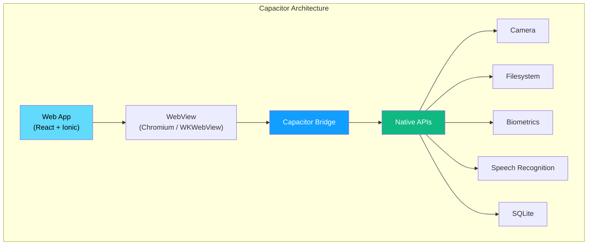
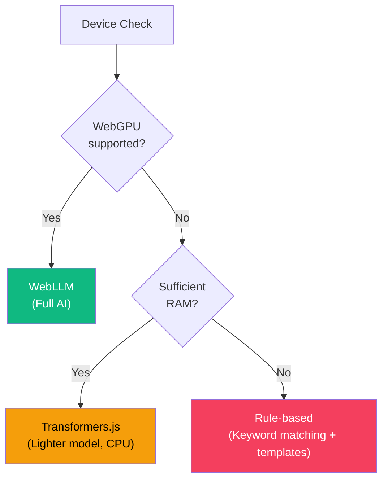
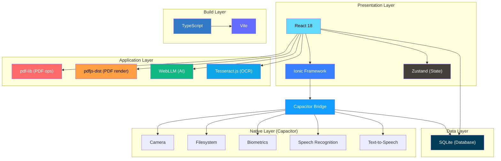

# Kagaz — Tech Stack Decisions

> Architecture Decision Records (ADRs) documenting every major technology choice in Kagaz. Each decision includes context, alternatives considered, rationale, and consequences.

---

## Table of Contents

- [Decision Summary](#decision-summary)
- [ADR-001: React as UI Framework](#adr-001-react-as-ui-framework)
- [ADR-002: Ionic Framework for Mobile UI](#adr-002-ionic-framework-for-mobile-ui)
- [ADR-003: Capacitor as Native Runtime](#adr-003-capacitor-as-native-runtime)
- [ADR-004: pdf-lib as Primary PDF Library](#adr-004-pdf-lib-as-primary-pdf-library)
- [ADR-005: pdfjs-dist for PDF Rendering](#adr-005-pdfjs-dist-for-pdf-rendering)
- [ADR-006: WebLLM for On-Device AI](#adr-006-webllm-for-on-device-ai)
- [ADR-007: SQLite as Primary Database](#adr-007-sqlite-as-primary-database)
- [ADR-008: Zustand for State Management](#adr-008-zustand-for-state-management)
- [ADR-009: Vite as Build Tool](#adr-009-vite-as-build-tool)
- [ADR-010: TypeScript as Language](#adr-010-typescript-as-language)
- [ADR-011: Tesseract.js for OCR](#adr-011-tesseractjs-for-ocr)
- [ADR-012: Native Capacitor Plugins for STT/TTS](#adr-012-native-capacitor-plugins-for-stttts)
- [ADR-013: Pino for Structured Logging](#adr-013-pino-for-structured-logging)
- [ADR-014: Biometric Auth Plugin Selection](#adr-014-biometric-auth-plugin-selection)
- [ADR-015: pnpm Workspaces + Turborepo Monorepo](#adr-015-pnpm-workspaces--turborepo-monorepo)
- [ADR-016: Image Engine & Document Scanner (offline, permissive-only)](#adr-016-image-engine--document-scanner-offline-permissive-only)
- [ADR-017: Offline CSP & no runtime-fetched WASM/models](#adr-017-offline-csp--no-runtime-fetched-wasmmodels)
- [ADR-018: Document Scanner — Google ML Kit (via Play Services)](#adr-018-document-scanner--google-ml-kit-via-play-services)
- [Dependency Version Policy](#dependency-version-policy)

---

## Decision Summary

| # | Decision | Chosen | Primary Alternative | Status |
|---|---|---|---|---|
| 001 | UI Framework | **React** | Vue, Angular, Svelte | ✅ Accepted |
| 002 | Mobile UI Library | **Ionic Framework** | Material UI, Ant Design Mobile | ✅ Accepted |
| 003 | Native Runtime | **Capacitor** | React Native, Flutter | ✅ Accepted |
| 004 | PDF Manipulation | **pdf-lib** | jsPDF, PDFKit | ✅ Accepted |
| 005 | PDF Rendering | **pdfjs-dist** | Custom renderer, PDF.js viewer | ✅ Accepted |
| 006 | On-Device AI | **WebLLM** | Transformers.js, Cloud API | ✅ Accepted |
| 007 | Local Database | **SQLite** | IndexedDB, PouchDB | ✅ Accepted |
| 008 | State Management | **Zustand** | Redux, MobX, Jotai | ✅ Accepted |
| 009 | Build Tool | **Vite** | Webpack, Parcel, esbuild | ✅ Accepted |
| 010 | Language | **TypeScript** | JavaScript | ✅ Accepted |
| 011 | OCR Engine | **Tesseract.js** | Google Vision, AWS Textract | ✅ Accepted |
| 012 | Speech I/O | **Native Capacitor Plugins** | Web Speech API | ✅ Accepted |
| 013 | Structured Logging | **pino** (+ pino-pretty in dev) | tslog, consola, loglevel | ✅ Accepted |
| 014 | Biometric Auth | **@aparajita/capacitor-biometric-auth** | capacitor-native-biometric | ✅ Accepted |
| 015 | Repo Structure | **pnpm workspaces + Turborepo** | Nx, single package | ✅ Accepted |
| 016 | Image conversion / Doc scanner | **Canvas (native)** / ~~jscanify + OpenCV.js~~ | heic-to, ML Kit scanner | ✅ Accepted (F-8) · scanner → ADR-018 |
| 017 | OpenCV scanner CSP | `wasm-unsafe-eval` weakening | — | ⚠️ Moot (scanner → ML Kit, ADR-018) |
| 018 | Document Scanner | **Google ML Kit** (`@capacitor-mlkit/document-scanner`, native/Play Services) | jscanify + OpenCV.js (ADR-016) | ✅ Accepted |

---

## ADR-001: React as UI Framework

| Field | Detail |
|---|---|
| **Status** | ✅ Accepted |
| **Date** | 2026-06-07 |
| **Decision** | Use **React 18+** as the primary UI framework. |

### Context

Kagaz needs a component-based UI framework to build a complex, interactive mobile application with features like chat interfaces, document viewers, file upload zones, and real-time operation status cards. The framework must integrate well with the chosen mobile runtime (Capacitor) and have strong ecosystem support.

### Options Considered

| Criterion | React | Vue 3 | Angular | Svelte |
|---|---|---|---|---|
| **Ecosystem size** | ⭐⭐⭐ Largest | ⭐⭐ Large | ⭐⭐ Large | ⭐ Growing |
| **Ionic integration** | ⭐⭐⭐ First-class | ⭐⭐⭐ First-class | ⭐⭐⭐ First-class | ⭐ Community |
| **Talent availability** | ⭐⭐⭐ Highest | ⭐⭐ Good | ⭐⭐ Good | ⭐ Limited |
| **Bundle size** | ⭐⭐ ~42KB | ⭐⭐ ~33KB | ⭐ ~143KB | ⭐⭐⭐ ~7KB |
| **TypeScript support** | ⭐⭐⭐ Excellent | ⭐⭐⭐ Excellent | ⭐⭐⭐ Built-in | ⭐⭐ Good |
| **WebLLM compatibility** | ⭐⭐⭐ Proven | ⭐⭐ Possible | ⭐⭐ Possible | ⭐ Untested |
| **Learning curve** | ⭐⭐ Moderate | ⭐⭐⭐ Gentle | ⭐ Steep | ⭐⭐⭐ Gentle |
| **Concurrent features** | ⭐⭐⭐ React 18 | ⭐ None | ⭐ None | ⭐ None |

### Decision Rationale

1. **Ionic + Capacitor ecosystem** has first-class React support with `@ionic/react`, enabling native-feeling mobile UI components out of the box.
2. **Largest ecosystem** means more libraries, tutorials, and community solutions for complex features (PDF viewer integration, chat UI, voice input).
3. **WebLLM** (our AI runtime) has proven React integration patterns and examples.
4. **React 18 concurrent features** (Suspense, transitions, streaming) are critical for smooth UX during heavy operations like PDF rendering and AI inference.
5. **Talent pool** — if the team grows, React developers are the easiest to hire in India.

### Consequences

| Positive | Negative |
|---|---|
| Massive library ecosystem | JSX learning curve for new developers |
| Well-documented Ionic integration | Slightly larger bundle than Svelte |
| React DevTools for debugging | Need to manage re-renders carefully |
| Concurrent rendering for smooth UX | More boilerplate than Vue for simple components |

---

## ADR-002: Ionic Framework for Mobile UI

| Field | Detail |
|---|---|
| **Status** | ✅ Accepted |
| **Date** | 2026-06-07 |
| **Decision** | Use **Ionic Framework 7+** with `@ionic/react` for mobile-optimized UI components. |

### Context

Kagaz is a mobile-first application targeting Android (primary) and iOS (secondary). The UI must feel native on both platforms — platform-specific animations, gestures (swipe, pull-to-refresh), and navigation patterns (bottom tabs, drawers, action sheets). Building all of this from scratch would be prohibitively expensive.

### Options Considered

| Criterion | Ionic Framework | Material UI (MUI) | Ant Design Mobile | Custom Components |
|---|---|---|---|---|
| **Mobile-native feel** | ⭐⭐⭐ Platform-adaptive | ⭐⭐ Material only | ⭐⭐ Ant style | ⭐ Manual work |
| **Capacitor integration** | ⭐⭐⭐ Same team | ⭐ None | ⭐ None | ⭐ Manual |
| **iOS + Android adaptive** | ⭐⭐⭐ Automatic | ⭐ Manual | ⭐ Manual | ⭐ Manual |
| **Mobile gestures** | ⭐⭐⭐ Built-in | ⭐ Limited | ⭐⭐ Some | ⭐ Manual |
| **Component coverage** | ⭐⭐⭐ 50+ | ⭐⭐⭐ 50+ | ⭐⭐⭐ 50+ | ⭐ From scratch |
| **Dark mode** | ⭐⭐⭐ Built-in | ⭐⭐ Manual theme | ⭐⭐ Manual theme | ⭐ Manual |
| **Bundle size** | ⭐⭐ ~80KB | ⭐ ~100KB+ | ⭐⭐ ~80KB | ⭐⭐⭐ Minimal |
| **Accessibility** | ⭐⭐ Good | ⭐⭐⭐ Excellent | ⭐⭐ Good | ⭐ Manual |

### Decision Rationale

1. **Capacitor integration** is seamless — Ionic and Capacitor are built by the same team (Ionic Inc.), ensuring perfect compatibility.
2. **Platform-adaptive rendering** — the same component renders with iOS styling on iPhone and Material styling on Android, automatically.
3. **Built-in mobile patterns** — IonTabs, IonNavigation, IonActionSheet, IonPullToRefresh, IonSlides, IonVirtualScroll all work out of the box.
4. **Dark mode** support is built into every Ionic component via CSS variables that align with our design token strategy.
5. **Proven at scale** — apps like Sworkit, MarketWatch, and NHS have been built with Ionic.

### Consequences

| Positive | Negative |
|---|---|
| Native-quality mobile UX with minimal effort | Ionic styling may need overriding for custom design |
| Platform-adaptive components | Adds ~80KB to bundle |
| Built-in dark mode, a11y, RTL support | Some components may not match exact Figma specs |
| Same team as Capacitor = seamless integration | Web-only testing differs from native behavior |

---

## ADR-003: Capacitor as Native Runtime

| Field | Detail |
|---|---|
| **Status** | ✅ Accepted |
| **Date** | 2026-06-07 |
| **Decision** | Use **Capacitor 5+** as the native runtime bridge instead of React Native or Flutter. |

### Context

Kagaz requires access to native device capabilities: camera, filesystem, biometric authentication, speech recognition, and local database (SQLite). The app must run on Android (primary) and iOS (secondary) while maintaining a single codebase.

### Options Considered

| Criterion | Capacitor | React Native | Flutter |
|---|---|---|---|
| **Web tech stack** | ⭐⭐⭐ Standard Web (HTML/CSS/JS) | ⭐⭐ React but not web | ⭐ Dart — entirely different |
| **Code reuse** | ⭐⭐⭐ 100% web code + native plugins | ⭐⭐ ~85% shared | ⭐⭐ ~90% shared |
| **React ecosystem** | ⭐⭐⭐ Full access | ⭐⭐ Different React (Native) | ⭐ Not React |
| **Native access** | ⭐⭐⭐ Plugin system | ⭐⭐⭐ Native modules | ⭐⭐⭐ Platform channels |
| **PWA support** | ⭐⭐⭐ Runs as PWA too | ⭐ No PWA | ⭐ Limited web |
| **Learning curve** | ⭐⭐⭐ Web devs need no new skills | ⭐⭐ React-ish but different | ⭐ Learn Dart + Flutter |
| **WebLLM support** | ⭐⭐⭐ WebView = Web APIs | ⭐ No WebView | ⭐ No WebView |
| **pdf-lib / pdfjs** | ⭐⭐⭐ Runs in WebView natively | ⭐ Needs bridge | ⭐ Needs bridge |
| **Performance** | ⭐⭐ Good (WebView) | ⭐⭐⭐ Native rendering | ⭐⭐⭐ Compiled to native |
| **App size** | ⭐⭐ ~8–15MB | ⭐⭐ ~15–25MB | ⭐⭐ ~10–20MB |

### Decision Rationale

1. **WebLLM requires a browser runtime** — it uses WebGPU/WebAssembly which only runs in a WebView. React Native and Flutter don't have WebViews as their primary rendering surface, making WebLLM integration extremely complex.
2. **pdf-lib and pdfjs-dist are JavaScript libraries** designed for web browsers. In Capacitor's WebView, they run natively. In React Native or Flutter, they'd require custom bridges or would need to be replaced entirely.
3. **Single codebase** — the same React code runs as a mobile app (Capacitor), a PWA, or a desktop app (Electron). No framework-specific abstractions needed.
4. **Web developer productivity** — the team can use standard web dev tools (Chrome DevTools, Vite HMR) for 90% of development.
5. **Ionic Framework synergy** — Capacitor + Ionic is the officially supported stack.

### Consequences

| Positive | Negative |
|---|---|
| WebLLM, pdf-lib, pdfjs work natively | WebView performance ceiling for heavy UI |
| 100% web code reuse | No native UI components (Ionic compensates) |
| Standard web dev tools and workflow | WebView startup time adds ~200–500ms |
| PWA fallback for low-end devices | Some native APIs need Capacitor plugin wrappers |
| Smaller learning curve for web developers | Heavy animation performance lower than React Native |



---

## ADR-004: pdf-lib as Primary PDF Library

| Field | Detail |
|---|---|
| **Status** | ✅ Accepted |
| **Date** | 2026-06-07 |
| **Decision** | Use **pdf-lib** as the primary library for all PDF manipulation operations (merge, split, compress, create, encrypt). |

### Context

Kagaz's core feature set revolves around PDF operations: merging multiple PDFs, splitting pages, compressing files, converting images to PDF, and adding password protection. The library must work client-side (in the browser/WebView) without any server dependency, as Kagaz is offline-first.

### Options Considered

| Criterion | pdf-lib | jsPDF | PDFKit | PDF-LIB (libpdf) |
|---|---|---|---|---|
| **Modify existing PDFs** | ⭐⭐⭐ Yes — core feature | ⭐ Very limited | ⭐ No (create only) | ⭐⭐ Some support |
| **Create new PDFs** | ⭐⭐⭐ Yes | ⭐⭐⭐ Yes — core feature | ⭐⭐⭐ Yes — core feature | ⭐⭐ Yes |
| **Merge PDFs** | ⭐⭐⭐ copyPages API | ⭐ Manual workaround | ⭐ Not supported | ⭐⭐ Supported |
| **Split PDFs** | ⭐⭐⭐ Page extraction | ⭐ Not supported | ⭐ Not supported | ⭐⭐ Supported |
| **Encrypt / Decrypt** | ⭐⭐ Basic encryption | ⭐ Not supported | ⭐ Not supported | ⭐ Limited |
| **Browser-compatible** | ⭐⭐⭐ Pure JS, no deps | ⭐⭐⭐ Pure JS | ⭐⭐ Needs polyfills | ⭐⭐ WASM-based |
| **TypeScript support** | ⭐⭐⭐ Written in TS | ⭐⭐ Type defs | ⭐⭐ Type defs | ⭐ Limited |
| **Bundle size** | ⭐⭐ ~300KB | ⭐⭐⭐ ~100KB | ⭐⭐ ~250KB | ⭐ ~500KB+ |
| **Maintenance** | ⭐⭐ Active | ⭐⭐ Active | ⭐⭐ Active | ⭐ Less active |
| **Form filling** | ⭐⭐⭐ Supported | ⭐ Not supported | ⭐ Not supported | ⭐ Limited |

### Decision Rationale

1. **Only library that can both read AND modify existing PDFs** — jsPDF and PDFKit can only create new PDFs from scratch. pdf-lib can load existing PDFs, extract pages, copy pages between documents, and modify metadata.
2. **Merge and split** are Kagaz's most-used operations. pdf-lib's `copyPages` API makes merging PDFs trivial and memory-efficient.
3. **Zero dependencies** — pdf-lib is a pure TypeScript library with no native dependencies, perfect for running in a WebView.
4. **Encryption support** — pdf-lib supports adding user and owner passwords to PDFs, which is needed for the "Encrypt PDF" feature.
5. **Form filling** — pdf-lib can fill interactive PDF form fields, enabling the V3 "AI auto-fill" feature.

### Consequences

| Positive | Negative |
|---|---|
| Full PDF manipulation in the browser | ~300KB bundle size (acceptable for mobile) |
| Zero native dependencies | Image compression within PDFs requires additional work |
| TypeScript-first API | Some advanced PDF features not supported (digital signatures) |
| Active OSS community | Encryption support is basic (no certificate-based) |

### Usage Pattern

```typescript
import { PDFDocument } from 'pdf-lib';

// Merge PDFs
async function mergePDFs(pdfBuffers: ArrayBuffer[]): Promise<Uint8Array> {
  const merged = await PDFDocument.create();
  for (const buffer of pdfBuffers) {
    const pdf = await PDFDocument.load(buffer);
    const pages = await merged.copyPages(pdf, pdf.getPageIndices());
    pages.forEach(page => merged.addPage(page));
  }
  return merged.save();
}
```

---

## ADR-005: pdfjs-dist for PDF Rendering

| Field | Detail |
|---|---|
| **Status** | ✅ Accepted |
| **Date** | 2026-06-07 |
| **Decision** | Use **pdfjs-dist** (Mozilla's PDF.js) for rendering and viewing PDF documents within the app. |

### Context

Kagaz needs to display PDF documents to users — for previewing, reviewing before operations, and general document viewing. The rendering library must support page-by-page rendering, zoom, scroll, and be compatible with the WebView runtime. Note: pdf-lib handles *manipulation*, pdfjs-dist handles *rendering*. They serve complementary purposes.

### Options Considered

| Criterion | pdfjs-dist | pdf-lib (render) | Native WebView (iframe) | React-PDF |
|---|---|---|---|---|
| **Rendering quality** | ⭐⭐⭐ Excellent | ⭐ Not a renderer | ⭐⭐ Depends on OS | ⭐⭐⭐ Uses pdfjs |
| **Page-by-page render** | ⭐⭐⭐ Core feature | — | ⭐ Full doc only | ⭐⭐⭐ Wrapper |
| **Text selection** | ⭐⭐⭐ Text layer | — | ⭐⭐ OS-dependent | ⭐⭐⭐ Wrapper |
| **Search within PDF** | ⭐⭐⭐ Built-in | — | ⭐ Not available | ⭐⭐ Limited |
| **Annotation support** | ⭐⭐ Basic | — | ⭐ None | ⭐⭐ Basic |
| **Performance** | ⭐⭐ Good (Web Worker) | — | ⭐⭐⭐ Native | ⭐⭐ Same as pdfjs |
| **Customizability** | ⭐⭐⭐ Full control | — | ⭐ No control | ⭐⭐ React wrapper |
| **Battle-tested** | ⭐⭐⭐ Firefox built-in | — | ⭐⭐ Varies | ⭐⭐ Popular |

### Decision Rationale

1. **Battle-tested at scale** — pdfjs-dist is the rendering engine behind Firefox's built-in PDF viewer. It handles edge cases, corrupted PDFs, and complex layouts that other solutions cannot.
2. **Web Worker support** — PDF rendering is CPU-intensive. pdfjs-dist offloads parsing and rendering to a Web Worker, keeping the main thread free for UI interactions.
3. **Text layer** — renders a selectable text layer on top of the canvas, enabling text selection, copy, and search — critical for document viewing.
4. **Thumbnail generation** — we can render individual pages to small canvases for document thumbnail generation.
5. **Complementary to pdf-lib** — pdf-lib handles read/write operations on PDF structure. pdfjs-dist handles pixel-level rendering. Together, they cover all PDF needs.

### Consequences

| Positive | Negative |
|---|---|
| Production-proven rendering engine | ~400KB+ bundle (with worker) |
| Web Worker offloading for performance | Complex API — lower-level than wrappers |
| Text selection and search built-in | Need custom UI for viewer controls |
| Thumbnail generation capability | Memory-intensive for large PDFs |

---

## ADR-006: WebLLM for On-Device AI

| Field | Detail |
|---|---|
| **Status** | ✅ Accepted |
| **Date** | 2026-06-07 |
| **Decision** | Use **WebLLM** for running LLM inference on-device for the AI chatbot, instead of cloud APIs or Transformers.js. |

### Context

Kagaz's AI assistant processes user requests for document operations (e.g., "merge my Aadhaar and PAN card into one PDF"). The AI must understand natural language, support tool-calling (function invocation), and — critically — run **entirely on the user's device** for privacy. Users should never have to send their document metadata or queries to a cloud server.

### Options Considered

| Criterion | WebLLM | Transformers.js | Cloud API (OpenAI/Gemini) | Ollama (local) |
|---|---|---|---|---|
| **Privacy** | ⭐⭐⭐ Fully on-device | ⭐⭐⭐ Fully on-device | ⭐ Cloud-based | ⭐⭐⭐ Local |
| **Model quality** | ⭐⭐⭐ Full LLMs (Llama, Phi) | ⭐⭐ Smaller models only | ⭐⭐⭐ Best models | ⭐⭐⭐ Full LLMs |
| **Tool calling** | ⭐⭐⭐ Native support | ⭐ Manual implementation | ⭐⭐⭐ Native support | ⭐⭐ Supported |
| **Chat interface** | ⭐⭐⭐ OpenAI-compatible API | ⭐ Low-level pipeline | ⭐⭐⭐ API-native | ⭐⭐⭐ API-compatible |
| **WebGPU acceleration** | ⭐⭐⭐ Yes | ⭐ WASM only | — | — |
| **Offline support** | ⭐⭐⭐ After initial download | ⭐⭐⭐ After download | ⭐ Requires internet | ⭐⭐⭐ Fully offline |
| **Mobile compatibility** | ⭐⭐ Android (WebGPU support) | ⭐⭐⭐ Broader support | ⭐⭐⭐ Any device | ⭐ Not mobile-friendly |
| **Model size** | ⭐⭐ 1–4GB | ⭐⭐⭐ <500MB | ⭐⭐⭐ N/A | ⭐ 4GB+ |
| **Inference speed** | ⭐⭐ GPU-accelerated | ⭐ CPU-only (slow) | ⭐⭐⭐ Fastest | ⭐⭐ Good on desktop |

### Decision Rationale

1. **Privacy is non-negotiable** — Kagaz's "Fear 5" value proposition is "Your documents never leave your phone. Period." Cloud APIs would violate this promise.
2. **Tool-calling support** — WebLLM provides an OpenAI-compatible chat completions API with native function/tool calling. This is essential for the AI to invoke document operations (merge, split, convert) programmatically.
3. **WebGPU acceleration** — WebLLM leverages WebGPU for GPU-accelerated inference, making it significantly faster than Transformers.js (which runs on CPU via WASM).
4. **Model quality** — WebLLM can run models like Llama 3.2 (1B/3B), Phi-3.5 Mini, and Qwen2.5 which are far more capable for chat and reasoning than the smaller models Transformers.js supports.
5. **Offline after download** — the model is downloaded once and cached. All subsequent inference is fully offline.

### Consequences

| Positive | Negative |
|---|---|
| Complete data privacy — zero server calls | Initial model download is large (1–4GB) |
| GPU-accelerated inference via WebGPU | WebGPU not yet supported on all devices |
| OpenAI-compatible API = familiar patterns | Memory-intensive (needs 2–4GB RAM for inference) |
| Native tool calling for document operations | Slower than cloud APIs (but fast enough for chat) |
| Offline after initial download | First-time setup experience needs careful UX |

### Fallback Strategy



---

## ADR-007: SQLite as Primary Database

| Field | Detail |
|---|---|
| **Status** | ✅ Accepted |
| **Date** | 2026-06-07 |
| **Decision** | Use **SQLite** (via `@capacitor-community/sqlite`) as the primary local database instead of IndexedDB. |

### Context

Kagaz needs to store document metadata (names, paths, tags, folders, OCR text, thumbnails), chat history, settings, and operation logs. The database must be fast, reliable, support complex queries, and work offline. Data includes structured metadata and full-text search content.

### Options Considered

| Criterion | SQLite | IndexedDB | PouchDB | Realm |
|---|---|---|---|---|
| **Query language** | ⭐⭐⭐ Full SQL | ⭐ Cursor-based API | ⭐⭐ Mango queries | ⭐⭐ Realm queries |
| **Full-text search** | ⭐⭐⭐ FTS5 extension | ⭐ Manual implementation | ⭐ Plugin required | ⭐⭐ Built-in |
| **Complex queries** | ⭐⭐⭐ JOINs, subqueries, CTEs | ⭐ Very limited | ⭐ Limited | ⭐⭐ Good |
| **Performance** | ⭐⭐⭐ Excellent | ⭐⭐ Good | ⭐⭐ Good | ⭐⭐⭐ Excellent |
| **Data integrity** | ⭐⭐⭐ ACID transactions | ⭐⭐ Transactions | ⭐⭐ Eventual consistency | ⭐⭐⭐ ACID |
| **Reliability** | ⭐⭐⭐ 20+ years proven | ⭐⭐ Browser-dependent | ⭐⭐ Depends on backend | ⭐⭐⭐ Proven |
| **Storage limits** | ⭐⭐⭐ Filesystem-limited | ⭐⭐ Browser quota (~50MB+) | ⭐⭐ Same as IndexedDB | ⭐⭐⭐ Filesystem |
| **Capacitor support** | ⭐⭐⭐ Official community plugin | ⭐⭐⭐ Web API (built-in) | ⭐⭐ Works in WebView | ⭐ Needs native module |
| **Cloud sync ready** | ⭐⭐ With custom sync | ⭐ Manual | ⭐⭐⭐ CouchDB sync | ⭐⭐ Realm Sync |

### Decision Rationale

1. **Full-text search (FTS5)** — SQLite's FTS5 extension enables blazing-fast full-text search across document names, tags, OCR-extracted text, and folder names. This is critical for Kagaz's search feature.
2. **Complex queries** — document management requires complex queries: "show me all PDFs in the 'Certificates' folder tagged with 'education', sorted by date, that contain the word 'university'." SQL handles this trivially. IndexedDB would require multiple cursor iterations and manual filtering.
3. **ACID transactions** — operations like "move 5 documents to a new folder" must be atomic. SQLite's transaction support ensures data consistency.
4. **Proven reliability** — SQLite is the most widely deployed database in the world (every smartphone has it). It's used by iOS, Android, Chrome, Firefox, and every major mobile app.
5. **No storage limits** — unlike IndexedDB (browser quota), SQLite stores data on the native filesystem with no artificial limits.

### Consequences

| Positive | Negative |
|---|---|
| Full SQL for complex queries | Requires Capacitor plugin (not pure web) |
| FTS5 for blazing full-text search | Not available in pure web/PWA mode |
| ACID transactions for data integrity | Slightly more setup than IndexedDB |
| No storage quota limitations | SQL schema migrations need management |
| Battle-proven reliability | Not a document database (but we don't need one) |

### Schema Preview

```sql
CREATE TABLE documents (
  id TEXT PRIMARY KEY,
  name TEXT NOT NULL,
  type TEXT NOT NULL, -- 'pdf', 'image'
  mime_type TEXT,
  size INTEGER,
  folder_id TEXT REFERENCES folders(id),
  file_path TEXT NOT NULL,
  thumbnail_path TEXT,
  created_at INTEGER NOT NULL,
  updated_at INTEGER NOT NULL
);

CREATE TABLE folders (
  id TEXT PRIMARY KEY,
  name TEXT NOT NULL,
  parent_id TEXT REFERENCES folders(id),
  color TEXT,
  created_at INTEGER NOT NULL
);

CREATE TABLE tags (
  id TEXT PRIMARY KEY,
  name TEXT NOT NULL UNIQUE
);

CREATE TABLE document_tags (
  document_id TEXT REFERENCES documents(id) ON DELETE CASCADE,
  tag_id TEXT REFERENCES tags(id) ON DELETE CASCADE,
  PRIMARY KEY (document_id, tag_id)
);

-- Full-text search
CREATE VIRTUAL TABLE documents_fts USING fts5(
  name, ocr_text, content=documents, content_rowid=rowid
);
```

---

## ADR-008: Zustand for State Management

| Field | Detail |
|---|---|
| **Status** | ✅ Accepted |
| **Date** | 2026-06-07 |
| **Decision** | Use **Zustand** for global state management instead of Redux, MobX, or Jotai. |

### Context

Kagaz needs to manage several categories of global state: current documents list, active filters, chat messages, ongoing operations, user settings, theme, language, and UI state (modals, drawers). The state management solution must be lightweight (mobile bundle budget), intuitive, TypeScript-friendly, and integrate well with React 18 concurrent features.

### Options Considered

| Criterion | Zustand | Redux Toolkit | MobX | Jotai |
|---|---|---|---|---|
| **Bundle size** | ⭐⭐⭐ ~1.2KB | ⭐ ~12KB | ⭐⭐ ~16KB | ⭐⭐⭐ ~3KB |
| **Boilerplate** | ⭐⭐⭐ Minimal | ⭐⭐ Moderate (RTK) | ⭐⭐⭐ Minimal | ⭐⭐⭐ Minimal |
| **TypeScript** | ⭐⭐⭐ Excellent | ⭐⭐⭐ Excellent | ⭐⭐ Good | ⭐⭐⭐ Excellent |
| **DevTools** | ⭐⭐ Redux DevTools compatible | ⭐⭐⭐ Best DevTools | ⭐⭐ MobX tools | ⭐⭐ Jotai DevTools |
| **Learning curve** | ⭐⭐⭐ Very easy | ⭐⭐ Moderate | ⭐⭐ Moderate | ⭐⭐⭐ Easy |
| **Middleware** | ⭐⭐⭐ persist, devtools, immer | ⭐⭐⭐ Full ecosystem | ⭐⭐ Reactions, computed | ⭐⭐ Atoms, derived |
| **Persist support** | ⭐⭐⭐ Built-in middleware | ⭐⭐ redux-persist | ⭐ Manual | ⭐⭐ atomWithStorage |
| **React 18 compat** | ⭐⭐⭐ useSyncExternalStore | ⭐⭐⭐ useSyncExternalStore | ⭐⭐ Proxies | ⭐⭐⭐ Suspense-ready |
| **Use outside React** | ⭐⭐⭐ getState() anywhere | ⭐⭐⭐ store.getState() | ⭐⭐ Yes | ⭐ React-only |

### Decision Rationale

1. **Tiny bundle size (1.2KB)** — on a mobile app where every KB matters, Zustand is 10x smaller than Redux Toolkit.
2. **Minimal boilerplate** — no actions, reducers, action creators, or providers. Just a store with state and functions.
3. **Built-in persist middleware** — Zustand's persist middleware integrates directly with our SQLite adapter for persisting settings and chat history.
4. **Accessible outside React** — Zustand stores can be read/written from non-React code (e.g., Capacitor plugin callbacks, Web Worker messages), which is essential for AI tool-calling responses and background operations.
5. **Redux DevTools compatible** — despite being minimal, Zustand supports Redux DevTools for debugging in development.

### Consequences

| Positive | Negative |
|---|---|
| 1.2KB bundle — smallest of all options | Smaller community than Redux |
| Zero boilerplate — fastest development | No built-in middleware ecosystem (less than Redux) |
| Works outside React components | Less opinionated — team needs conventions |
| Built-in persist middleware | No native computed/derived values (use selectors) |
| Redux DevTools support | — |

### Usage Pattern

```typescript
import { create } from 'zustand';
import { persist } from 'zustand/middleware';

interface DocumentStore {
  documents: Document[];
  filters: FilterOptions;
  viewMode: 'grid' | 'list';
  setDocuments: (docs: Document[]) => void;
  setViewMode: (mode: 'grid' | 'list') => void;
  setFilters: (filters: FilterOptions) => void;
}

export const useDocumentStore = create<DocumentStore>()(
  persist(
    (set) => ({
      documents: [],
      filters: {},
      viewMode: 'grid',
      setDocuments: (docs) => set({ documents: docs }),
      setViewMode: (mode) => set({ viewMode: mode }),
      setFilters: (filters) => set({ filters }),
    }),
    { name: 'document-store' }
  )
);
```

---

## ADR-009: Vite as Build Tool

| Field | Detail |
|---|---|
| **Status** | ✅ Accepted |
| **Date** | 2026-06-07 |
| **Decision** | Use **Vite 5+** as the build tool and development server instead of Webpack or other bundlers. |

### Context

Kagaz's development experience needs to be fast — hot module replacement (HMR) on file save, fast cold starts, and optimized production builds. The build tool must handle TypeScript, CSS, Web Workers (for pdfjs-dist and WebLLM), and large library imports efficiently.

### Options Considered

| Criterion | Vite | Webpack 5 | Parcel 2 | esbuild (raw) |
|---|---|---|---|---|
| **Dev server startup** | ⭐⭐⭐ <300ms | ⭐ 5–30s | ⭐⭐ 1–5s | ⭐⭐⭐ <100ms |
| **HMR speed** | ⭐⭐⭐ Instant | ⭐ 1–5s | ⭐⭐ Fast | ⭐⭐⭐ Instant |
| **Production build** | ⭐⭐⭐ Rollup (optimized) | ⭐⭐⭐ Highly configurable | ⭐⭐ Good | ⭐⭐ Good but limited |
| **TypeScript** | ⭐⭐⭐ Built-in | ⭐⭐ ts-loader/babel | ⭐⭐⭐ Built-in | ⭐⭐⭐ Built-in |
| **Web Worker support** | ⭐⭐⭐ Native import | ⭐⭐ worker-loader | ⭐⭐ Supported | ⭐ Manual |
| **Plugin ecosystem** | ⭐⭐ Growing fast | ⭐⭐⭐ Largest | ⭐ Limited | ⭐ Minimal |
| **Config complexity** | ⭐⭐⭐ Minimal | ⭐ Complex | ⭐⭐⭐ Zero-config | ⭐⭐ Minimal |
| **Ionic/Capacitor** | ⭐⭐⭐ Official template | ⭐⭐⭐ Mature support | ⭐⭐ Works | ⭐ Manual setup |
| **Code splitting** | ⭐⭐⭐ Automatic | ⭐⭐⭐ Highly configurable | ⭐⭐⭐ Automatic | ⭐ Manual |
| **CSS Modules** | ⭐⭐⭐ Built-in | ⭐⭐ css-loader | ⭐⭐⭐ Built-in | ⭐ Limited |

### Decision Rationale

1. **Developer experience** — Vite's near-instant dev server startup and HMR make development significantly more productive than Webpack's multi-second rebuild times.
2. **Official Ionic template** — `ionic start myApp react --type=vite` scaffolds a Vite-based project out of the box.
3. **Native Web Worker support** — `import Worker from './worker?worker'` syntax makes integrating pdfjs-dist's PDF worker and WebLLM's inference worker trivial.
4. **Rollup for production** — Vite uses Rollup under the hood for production builds, providing excellent tree-shaking, code splitting, and minification.
5. **TypeScript support** — zero-config TypeScript compilation with esbuild-powered transforms (20–30x faster than tsc).

### Consequences

| Positive | Negative |
|---|---|
| Sub-second dev server startup | Smaller plugin ecosystem than Webpack |
| Instant HMR for fast iteration | Some Webpack-specific plugins need alternatives |
| Zero-config TypeScript | Rollup-based production builds can differ from dev |
| Native Web Worker imports | Less battle-tested for very large apps |
| Official Ionic support | — |

---

## ADR-010: TypeScript as Language

| Field | Detail |
|---|---|
| **Status** | ✅ Accepted |
| **Date** | 2026-06-07 |
| **Decision** | Use **TypeScript 5+** as the primary development language for the entire codebase. |

### Context

Kagaz is a complex application with multiple subsystems: document management, PDF operations, AI chat with tool calling, file system access, database operations, and state management. Type safety becomes increasingly critical as the codebase grows, especially for the AI tool-calling interface where function signatures must be precisely defined.

### Options Considered

| Criterion | TypeScript | JavaScript (ES2022+) |
|---|---|---|
| **Type safety** | ⭐⭐⭐ Compile-time error detection | ⭐ Runtime errors only |
| **IDE support** | ⭐⭐⭐ Full IntelliSense, refactoring | ⭐⭐ Limited inference |
| **Refactoring** | ⭐⭐⭐ Safe, automated | ⭐ Manual, error-prone |
| **Documentation** | ⭐⭐⭐ Types ARE documentation | ⭐ JSDoc or nothing |
| **Learning curve** | ⭐⭐ Additional TS concepts | ⭐⭐⭐ Already known |
| **Build complexity** | ⭐⭐ Compilation step needed | ⭐⭐⭐ No compilation |
| **Bundle size** | ⭐⭐⭐ Types stripped at build | ⭐⭐⭐ No difference |
| **Library support** | ⭐⭐⭐ Most libs have types | ⭐⭐⭐ No issues |

### Decision Rationale

1. **AI tool-calling type safety** — the AI's function calling interface requires precise parameter and return type definitions. TypeScript ensures these contracts are enforced at compile time, preventing runtime errors in AI-triggered operations.
2. **pdf-lib is written in TypeScript** — working with pdf-lib in TypeScript provides full IntelliSense for its complex API.
3. **Refactoring confidence** — as Kagaz grows through V1/V2/V3, major refactors (adding cloud sync, sharing, services) need type-safe guarantees.
4. **Self-documenting** — TypeScript interfaces serve as living documentation for component props, database schemas, and API contracts.

### Consequences

| Positive | Negative |
|---|---|
| Compile-time bug prevention | Additional learning curve for JS-only devs |
| Full IDE IntelliSense and autocomplete | Compilation step (mitigated by Vite's fast transforms) |
| Types serve as documentation | Some type gymnastics for complex generics |
| Safe refactoring across versions | Occasional type-dependency installation needed |

---

## ADR-011: Tesseract.js for OCR

| Field | Detail |
|---|---|
| **Status** | ✅ Accepted |
| **Date** | 2026-06-07 |
| **Decision** | Use **Tesseract.js** for on-device Optical Character Recognition (OCR) instead of cloud-based services. |

### Context

Kagaz needs to extract text from scanned documents and images for full-text search indexing and (in V3) AI-powered form auto-filling. The OCR must support English and Hindi text, work offline, and keep document data on-device for privacy.

### Options Considered

| Criterion | Tesseract.js | Google Cloud Vision | AWS Textract | Apple Vision / ML Kit |
|---|---|---|---|---|
| **Privacy** | ⭐⭐⭐ Fully on-device | ⭐ Cloud-based | ⭐ Cloud-based | ⭐⭐⭐ On-device |
| **Offline support** | ⭐⭐⭐ After model download | ⭐ Requires internet | ⭐ Requires internet | ⭐⭐⭐ Built-in |
| **Cost** | ⭐⭐⭐ Free (OSS) | ⭐ Pay per request | ⭐ Pay per request | ⭐⭐⭐ Free |
| **Hindi support** | ⭐⭐ Good (traineddata) | ⭐⭐⭐ Excellent | ⭐⭐⭐ Excellent | ⭐⭐ Moderate |
| **Accuracy** | ⭐⭐ Good for clear text | ⭐⭐⭐ Excellent | ⭐⭐⭐ Best | ⭐⭐ Good |
| **Web/Capacitor compat** | ⭐⭐⭐ Pure JS/WASM | ⭐ REST API | ⭐ REST API | ⭐ Native only |
| **Layout analysis** | ⭐⭐ Basic | ⭐⭐⭐ Advanced | ⭐⭐⭐ Best (tables, forms) | ⭐⭐ Good |

### Decision Rationale

1. **Privacy-first** — consistent with our "documents never leave your phone" principle. Cloud OCR services would require uploading document images to third-party servers.
2. **Offline support** — OCR works after a one-time language model download (~15MB per language). Essential for users in areas with poor connectivity.
3. **Zero cost** — no per-request fees. Important for an app targeting cost-sensitive users in India.
4. **Multi-language** — Tesseract supports Hindi (Devanagari script) and English out of the box. Additional languages can be added by downloading traineddata files.
5. **Web Worker support** — Tesseract.js runs in a Web Worker, keeping the main thread free during OCR processing.

### Consequences

| Positive | Negative |
|---|---|
| Fully on-device, privacy-preserving | Lower accuracy than cloud services |
| Free — no per-request costs | ~15MB model download per language |
| Offline after model download | Slow on low-end devices (~5–15s per page) |
| Hindi + English support | Poor with handwriting (V2: explore alternatives) |
| Web Worker for non-blocking execution | Requires image pre-processing for best results |

---

## ADR-012: Native Capacitor Plugins for STT/TTS

| Field | Detail |
|---|---|
| **Status** | ✅ Accepted |
| **Date** | 2026-06-07 |
| **Decision** | Use **native Capacitor plugins** for Speech-to-Text (STT) and Text-to-Speech (TTS) instead of the Web Speech API. |

### Context

Kagaz's AI chatbot supports voice input (hold-to-speak) and plans to support voice responses. Speech recognition must work reliably on Android and iOS, support Hindi and English, and provide a smooth user experience with real-time feedback.

### Options Considered

| Criterion | Native Capacitor Plugins | Web Speech API |
|---|---|---|
| **Android reliability** | ⭐⭐⭐ Uses native Google Speech | ⭐ Inconsistent across browsers/WebViews |
| **iOS reliability** | ⭐⭐⭐ Uses native Apple Speech | ⭐⭐ Safari-only, WebView issues |
| **Hindi support** | ⭐⭐⭐ Full native support | ⭐ Limited — depends on browser |
| **Offline STT** | ⭐⭐ Android supports offline models | ⭐ Not supported |
| **Real-time feedback** | ⭐⭐⭐ Native interim results | ⭐⭐ Depends on implementation |
| **Permissions** | ⭐⭐⭐ Native permission flow | ⭐ Browser permission (inconsistent in WebView) |
| **WebView compatibility** | ⭐⭐⭐ Bypasses WebView entirely | ⭐ Often broken in app WebViews |
| **Audio quality** | ⭐⭐⭐ Direct hardware access | ⭐⭐ Through browser media stack |
| **Background noise** | ⭐⭐⭐ Native noise cancellation | ⭐ Limited |
| **Setup effort** | ⭐⭐ Plugin installation | ⭐⭐⭐ Zero setup (API exists) |

### Decision Rationale

1. **WebView reliability** — the Web Speech API is notoriously unreliable in embedded WebViews (which Capacitor uses). It often doesn't work at all on Android WebViews and has intermittent issues in iOS WKWebView. Native plugins bypass the WebView entirely by calling OS-level speech APIs.
2. **Hindi language support** — native Android Speech Recognition (Google) and iOS Speech Framework (Apple) have excellent Hindi support. The Web Speech API's Hindi support varies dramatically by browser and device.
3. **Permission handling** — native plugins integrate with the OS permission system, providing a smooth "Allow microphone access" flow. Web Speech API permissions in WebViews are often confusing or non-functional.
4. **Offline potential** — Android's native speech recognition supports downloading offline language models, enabling voice input without internet.
5. **Real-time interim results** — native APIs provide real-time word-by-word transcription feedback, critical for the "Listening..." UI state.

### Recommended Plugins

| Function | Plugin | Platform |
|---|---|---|
| **Speech-to-Text** | `@capacitor-community/speech-recognition` | Android + iOS |
| **Text-to-Speech** | `@capacitor-community/text-to-speech` | Android + iOS |

### Consequences

| Positive | Negative |
|---|---|
| Reliable across all devices | Requires separate plugin per platform |
| Excellent Hindi support | Not available in web/PWA mode |
| Native permission flows | Plugin maintenance dependency |
| Offline STT on Android | Slightly different API per platform |
| Real-time transcription feedback | — |

### Fallback Strategy

For web/PWA deployment (future), fall back to Web Speech API where available:

```typescript
async function startListening(): Promise<string> {
  if (Capacitor.isNativePlatform()) {
    // Use native plugin
    return NativeSpeechRecognition.start({ language: 'hi-IN' });
  } else if ('webkitSpeechRecognition' in window) {
    // Fallback to Web Speech API
    return WebSpeechRecognition.start({ language: 'hi-IN' });
  } else {
    throw new Error('Speech recognition not supported');
  }
}
```

---

## Architecture Overview

The complete tech stack working together:



---

## ADR-013: Pino for Structured Logging

| Field | Detail |
|---|---|
| **Status** | ✅ Accepted |
| **Date** | 2026-06-10 |
| **Decision** | Use **pino** for all application logging (browser + workers + V2 Node backend), with **pino-pretty** for colored dev output (devDependency only). |

### Context

Kagaz needs structured, privacy-safe, local-only logging ([14-observability-logging.md](14-observability-logging.md)): diagnostic ring buffer in SQLite, hash-chained audit logs, strict redaction, and zero remote telemetry in V1.

### Alternatives Considered

| Option | Verdict |
|---|---|
| **pino** | ✅ Structured JSON natively, ~7 KB browser mode, child loggers, built-in `redact`, `transmit` hook for custom sinks, identical API on Node for V2 backend |
| **tslog** | Good TS ergonomics, but weaker redaction story and no single idiom across browser + Node at scale |
| **consola** | Pretty output, but string-first (structure bolted on) — wrong default for audit-grade logging |
| **loglevel** | Tiny but unstructured; we'd rebuild schema, redaction, and sinks by hand |
| **console.* + custom wrapper** | No redaction guarantees; banned by lint (`no-console`) anyway |

### Consequences

- One logging API everywhere; redaction is centralized and unit-testable.
- `pino-pretty` must never reach production bundles (verify in `pnpm build:analyze`).
- Custom SQLite sink and worker relay are our code — specified in [14-observability-logging.md](14-observability-logging.md).

---

## ADR-014: Biometric Auth Plugin Selection

| Field | Detail |
|---|---|
| **Status** | ✅ Accepted |
| **Date** | 2026-06-10 |
| **Decision** | Use **@aparajita/capacitor-biometric-auth** for biometric prompts, paired with **capacitor-secure-storage-plugin** for key storage. |

### Context

Earlier drafts referenced `@capacitor/biometrics`, which **does not exist on npm** (no official Capacitor biometrics plugin). F-16 (biometric lock) and the security architecture ([10](10-security-architecture.md) §3.1, §3.4) require a maintained plugin.

### Alternatives Considered

| Option | Verdict |
|---|---|
| **@aparajita/capacitor-biometric-auth** | ✅ Actively maintained, Capacitor 7/8 support, clean prompt-only API (auth result, no key handling — correct separation: keys live in secure storage) |
| **capacitor-native-biometric** | Bundles credential storage with biometrics (mixes concerns); maintenance has been intermittent |
| **Roll our own plugin** | Unjustified maintenance burden for a solved problem |

### Consequences

- Biometric **authentication** (prompt) and **secret storage** (Keychain/Keystore) are two separate plugins — matches [10-security-architecture.md](10-security-architecture.md) §3.4 design.
- Auto-lock on background uses `@capacitor/app` lifecycle events.

---

## ADR-015: pnpm Workspaces + Turborepo Monorepo

| Field | Detail |
|---|---|
| **Status** | ✅ Accepted |
| **Date** | 2026-06-10 |
| **Decision** | Structure the repo as a **pnpm workspace** with **Turborepo** task orchestration: `apps/kagaz` (consumer app), `apps/docs` (Starlight docs site), `apps/kagaz-operator` (V4), `packages/@kagaz/*` (shared code). |

### Context

The portfolio doc ([13-app-portfolio.md](13-app-portfolio.md)) defines two apps sharing design tokens, UI components, the agent kit, and the PDF engine. The design system already assumes a `packages/ui` workspace. Parallel development by multiple agents/teams ([docs/guides/parallel-development.md](../guides/parallel-development.md)) needs per-package task boundaries and cached builds.

### Layout

```
apps/
├── kagaz/            # Consumer app (V1–V3) — all docs' `src/` paths mean apps/kagaz/src/
├── kagaz-operator/   # V4 operator app (created when V4 starts)
└── docs/             # Astro Starlight documentation site
packages/             # @kagaz/* shared packages — see packages/README.md
scripts/              # Workspace-wide tooling (agent:lint, agent:sitemap)
```

### Alternatives Considered

| Option | Verdict |
|---|---|
| **pnpm workspaces + Turborepo** | ✅ pnpm is already mandated; Turbo adds cached, dependency-ordered task runs with near-zero config |
| **Nx** | More powerful generators/graph, but heavier mental model and config surface for a small team |
| **Single package** | Simplest today, but guarantees a painful split when V4 starts and contradicts the design-system's package assumption |

### Consequences

- One lockfile, one `node_modules` strategy, root-level lint/format; per-app builds and tests run via `turbo run <task>` with caching.
- **Path convention:** architecture docs (`01`–`07`) describe module trees under `src/` — that always means `apps/kagaz/src/`. Do not rewrite historical docs; new docs should use full paths.
- Shared code is extracted into `packages/` only when actually shared (rules in [packages/README.md](../../packages/README.md)) — no speculative packages.

---

## ADR-016: Image Engine & Document Scanner (offline, permissive-only)

| Field | Detail |
|---|---|
| **Status** | ✅ Accepted (image conversion, F-8) · ⚠️ **Scanner portion SUPERSEDED by [ADR-018](#adr-018-document-scanner--google-ml-kit-via-play-services) (2026-07-10)** |
| **Date** | 2026-06-12 |
| **Decision** | **Image conversion (F-8):** convert among JPEG/PNG/WebP with the **native Canvas / OffscreenCanvas API** — zero bundle, on-device. **Do not bundle any JS HEIC decoder.** ~~**Document scanner (F-2):** edge detection + perspective correction via **jscanify** (MIT) on **OpenCV.js**…~~ **← reversed; see ADR-018.** The scanner now uses Google's ML Kit Document Scanner (native, via Play Services). |

> **⚠️ 2026-07-10 — the scanner half of this ADR is superseded by [ADR-018](#adr-018-document-scanner--google-ml-kit-via-play-services).** The "why not native ML Kit" rejection below rested on an **incorrect premise**: verification of `@capacitor-mlkit/document-scanner@8.1.0` shows its Android manifest declares **no `INTERNET` and no `CAMERA` permission** — Google Play Services hosts the scan UI and fetches the model out-of-process, so adopting it does **not** add a network permission to our app. The real trade-off (Play-Services dependency + one-time model download, Android-only) is weighed in ADR-018. The image-conversion (F-8) decision stands unchanged.

### Context

Lane C needs image format conversion (F-8) and a document scanner (F-2,
edge detection + perspective correction). Two hard constraints dominate
the choice: V1 is **100% offline with zero network permission** (SEC
§3.5, the privacy policy), and dependencies must be **permissive-licensed
only** (MIT/Apache-2.0/BSD/ISC — copyleft is forbidden because the app
ships proprietary/`UNLICENSED`).

### HEIC: why no decoder is bundled

The image-engine spec (04) originally named **`heic-to`**. On review,
`heic-to`, `heic2any`, and the underlying `libheif-js` are **all
LGPL-3.0** — every JS HEIC decoder wraps libheif, which is LGPL. Bundling
any of them into a statically-linked app violates the permissive-only
policy. There is no permissive pure-JS HEIC decoder.

Resolution: HEIC is decoded by the **OS natively at camera capture** —
`@capacitor/camera` returns JPEG, so HEIC never reaches the WebView as
HEIC. Imported `.heic` files (file picker) are stored as-is (F-1's
existing behavior); converting those would need a small **native**
Capacitor decoder (ImageIO on iOS, `BitmapFactory` on Android 28+),
tracked as a follow-up — still no bundled LGPL code.

### Scanner: why not native ML Kit

| Option | Verdict |
|---|---|
| **jscanify + OpenCV.js** (WASM, WebView) | ✅ Fully offline, permissive (MIT + Apache-2.0), cross-platform, no native maintenance. ~8 MB WASM, **lazy-loaded only on the scanner screen** (off the initial-load budget, [PERF]). Self-hosted, never from a CDN. |
| **@capacitor-mlkit/document-scanner** / Cap-go (Google ML Kit) | ❌ Downloads its model via **Google Play Services at runtime** → needs INTERNET permission + Play Services. Breaks the zero-network offline guarantee and the privacy policy. |
| **iOS VisionKit + jscanify (Android)** | ⚠️ Both offline, best per-platform UX, but two code paths — more complexity/testing than the win justifies for V1. |

### Consequences

- **F-8 adds no runtime dependency** — native Canvas only. Conversion logic
  is injected (`ImageEngineDeps`) so it stays unit-testable (jsdom has no
  canvas); the canvas path is device-verified.
- ~~**F-2** will add `jscanify` + `@techstark/opencv-js`…~~ **Reversed by ADR-018:** F-2 uses ML Kit's native scanner instead — no `jscanify`/`opencv-js` dependency, no ~8 MB WASM, no CSP weakening (cf. ADR-017).
- **Supersedes** two statements in [04-image-engine-module.md](04-image-engine-module.md):
  the `heic-to` library choice (§2) and the §14 note listing "document
  edge detection" as V2 (F-2 ships it in V1). That doc is corrected to
  point here.

---

## ADR-017: Offline CSP & no runtime-fetched WASM/models

| Field | Detail |
|---|---|
| **Status** | ✅ Accepted |
| **Date** | 2026-06-14 |
| **Decision** | The V1 Content-Security-Policy stays **strict**: no `unsafe-eval`, no `wasm-unsafe-eval`, `connect-src 'self'`. A media library is **rejected** if it (a) needs an eval-class CSP relaxation for a WASM/Emscripten/Go runtime, or (b) fetches a worker/WASM/model from a CDN at runtime. Assets must be bundled/self-hosted; heavy engines run natively instead. |

### Context

This app handles Aadhaar/PAN-grade PII and is offline-first with zero
network permission. Two recurring library behaviours violate that posture:
runtime CDN fetches (a "works on my machine" library silently fails on the
zero-network device) and WASM runtimes that demand `wasm-unsafe-eval`,
which materially weakens the CSP on a PII app.

### Evidence that drove it

- **F-5 compression** dropped **`@quicktoolsone/pdf-compress`**: it loads a
  pdfjs worker + Go WASM from jsdelivr by default → fails offline
  (see [03-pdf-engine-module.md](03-pdf-engine-module.md)).
- **F-2 scanner (OpenCV.js)** required `wasm-unsafe-eval` — the CSP
  weakening this ADR exists to avoid. Combined with ADR-018's finding that
  the native ML Kit scanner needs **no** WebView runtime at all, this
  reversed the scanner engine choice (jscanify/OpenCV.js → ML Kit).

### Consequences

- Before adding any PDF/image/CV/OCR/AI library, grep its `dist/` for
  `workerSrc|jsdelivr|wasmUrl|GlobalWorkerOptions` and check its CSP needs
  (the checklist in [CLAUDE.md](../../CLAUDE.md) and
  [device-verification.md](../guides/device-verification.md)).
- Prefer **native** engines (Capacitor plugins) for heavy media work that
  would otherwise need an eval-class CSP.

---

## ADR-018: Document Scanner — Google ML Kit (via Play Services)

| Field | Detail |
|---|---|
| **Status** | ✅ Accepted |
| **Date** | 2026-07-10 |
| **Supersedes** | The **scanner half** of [ADR-016](#adr-016-image-engine--document-scanner-offline-permissive-only) (jscanify + OpenCV.js). Image conversion (F-8) in ADR-016 is unchanged. |
| **Decision** | **Document scanner (F-2):** use **Google ML Kit Document Scanner** via **`@capacitor-mlkit/document-scanner`** (Apache-2.0). Play Services hosts a full-screen native scan flow (auto edge detection, perspective correction, filters, ML page-cleaning, multi-page, JPEG/PDF output); we import the returned image URIs through the existing vault pipeline. **Android-only**; scanning is hidden where unsupported. |

### Context

ADR-016 chose jscanify + OpenCV.js to keep scanning 100% offline and
permissive-licensed. In practice that path carried real costs: ~8 MB of
lazy WASM, a **CSP weakening** to allow `wasm-unsafe-eval` on a PII app
(ADR-017), a hand-built camera + draggable-corner review UI,
and cross-platform WASM maintenance — all to approximate UX that the OS
already provides. ADR-016 rejected ML Kit for a reason that **verification
disproved**: the plugin adds no `INTERNET`/`CAMERA` permission to our app.

### Verification (per the media-library rules in CLAUDE.md)

- **Permissions/network:** `@capacitor-mlkit/document-scanner@8.1.0`'s
  Android manifest declares **no permissions** (only `minSdk 24`). Google
  Play Services renders the scan UI in its own process and downloads the
  scanner model itself → **our app keeps its zero-`INTERNET`, zero-`CAMERA`
  manifest**.
- **License:** Apache-2.0 (plugin) over `play-services-mlkit-document-scanner`
  — permissive, allowed.
- **No WebView runtime deps:** no WASM, no CDN fetch, no CSP change — the
  scanner runs natively, entirely outside the WebView.

### Trade-offs accepted

| Gain | Cost |
|---|---|
| Best-in-class native UX (auto-capture, edge detect, filters, ML cleanup, multi-page, PDF) | **Requires Google Play Services** on the device |
| No ~8 MB WASM in our bundle; no CSP weakening (ADR-017 moot for the scanner) | **One-time model download** via Play Services (the "one-time internet" for this feature only) |
| No app camera/network permission; less attack surface | **Android-only** (no iOS/web scanner path in V1) |
| Deletes the geometry + corner-review + engine-seam code we'd have to maintain | Devices without Play Services (rare, de-Googled) can't scan |

### Consequences

- The rest of V1 stays 100% offline with no network permission; **the
  scanner is the single, documented feature that needs Play Services + a
  one-time download** (see [10-security §3.5](10-security-architecture.md)).
  It **degrades gracefully**: the Scan entry is hidden when unsupported.
- F-2 slice-1's OpenCV-oriented seam is removed as stale code:
  `scan-geometry.ts`, the `ScannerEngine` interface + JS-warp path, and the
  `Quad`/`Point`/`ScanResult` geometry types (ML Kit returns finished
  images, so none of it runs).
- Scanned pages import through the existing vault upload pipeline as
  `IncomingFile`s with `source: 'scanner'`.

---

## Dependency Version Policy

> Adopted 2026-06-10. Exact versions live in `package.json`; this policy governs how they move.

- **Pin known-compatible majors** for the framework spine (React, Ionic, Capacitor, Vite, Vitest, TypeScript); upgrade majors deliberately, with an ADR note if the choice itself changes.
- **Known constraint:** `@ionic/react-router` requires **react-router v5** — do not bump `react-router-dom` to v6/v7 while Ionic's router wrapper is in use (Ionic's stack navigation/transitions depend on it).
- **Known risk:** `pdf-lib` (ADR-004) has had no release since 2021. It remains the best pure-JS manipulation library; if it blocks us, evaluate the maintained fork `@cantoo/pdf-lib` before replacing the engine.
- `pnpm audit` runs in CI; security patches are applied immediately, majors monthly.
- Node baseline: **≥ 22 LTS** (18 is end-of-life since April 2025).
- **ESLint 10 compat (2026-06-10):** `eslint-plugin-react` and `eslint-plugin-jsx-a11y` still call context APIs removed in ESLint 10 (`context.getFilename()` → `context.filename`), so both are wrapped with `fixupConfigRules` from **@eslint/compat** in `eslint.config.js`. Remove the wrappers when upstream ships ESLint-10 support (track [jsx-eslint/eslint-plugin-react#3977](https://github.com/jsx-eslint/eslint-plugin-react/issues/3977)). `import-x` resolves TS paths via **eslint-import-resolver-typescript** (`resolver-next` interface). Note: `@eslint/js` versions independently of `eslint` itself (10.0.x vs 10.4.x) — don't "sync" them.
- **TypeScript strategy (2026-06-10):** use **TypeScript 6.0.x** (the JS-based bridge release aligned with 7.0's behavior) as the source of truth — it is the newest version `typescript-eslint` supports (peer `<6.1.0`). The Go-native **TypeScript 7 / tsgo** (≈10× faster, beta since 2026-04, stable expected ~July 2026) is installed as `@typescript/native-preview` with `pnpm type-check:native` for fast local feedback. Build speed is unaffected either way — Vite transpiles with esbuild; `tsc` only type-checks. **Switch `type-check` to TS 7** when (a) 7.0 is stable and (b) typescript-eslint's type-checked linting supports it; until then `tsc --noEmit` (6.0.x) gates CI and tsgo is advisory.

---

*Last updated: 2026-06-10 · Kagaz Architecture Decision Records v1.1*
