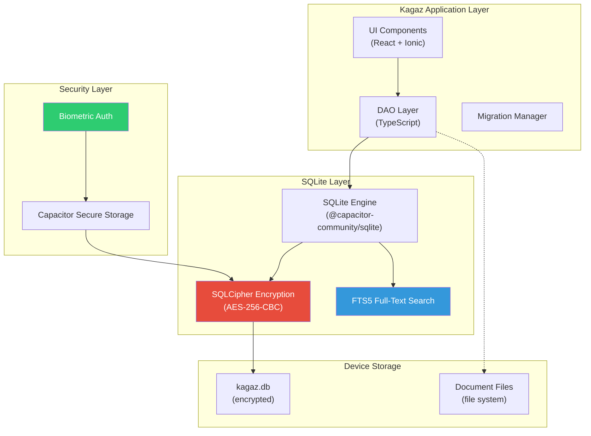
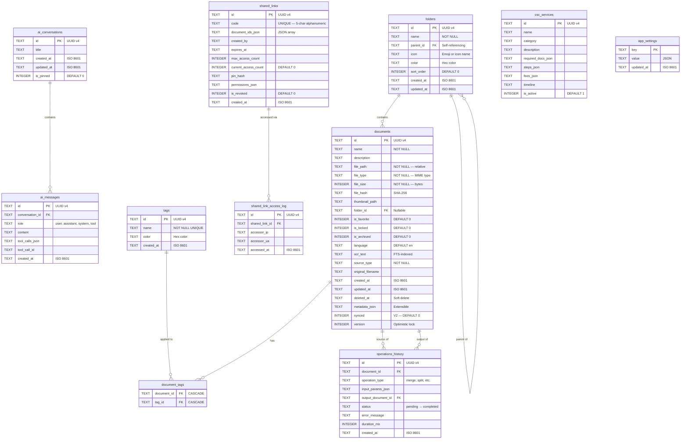
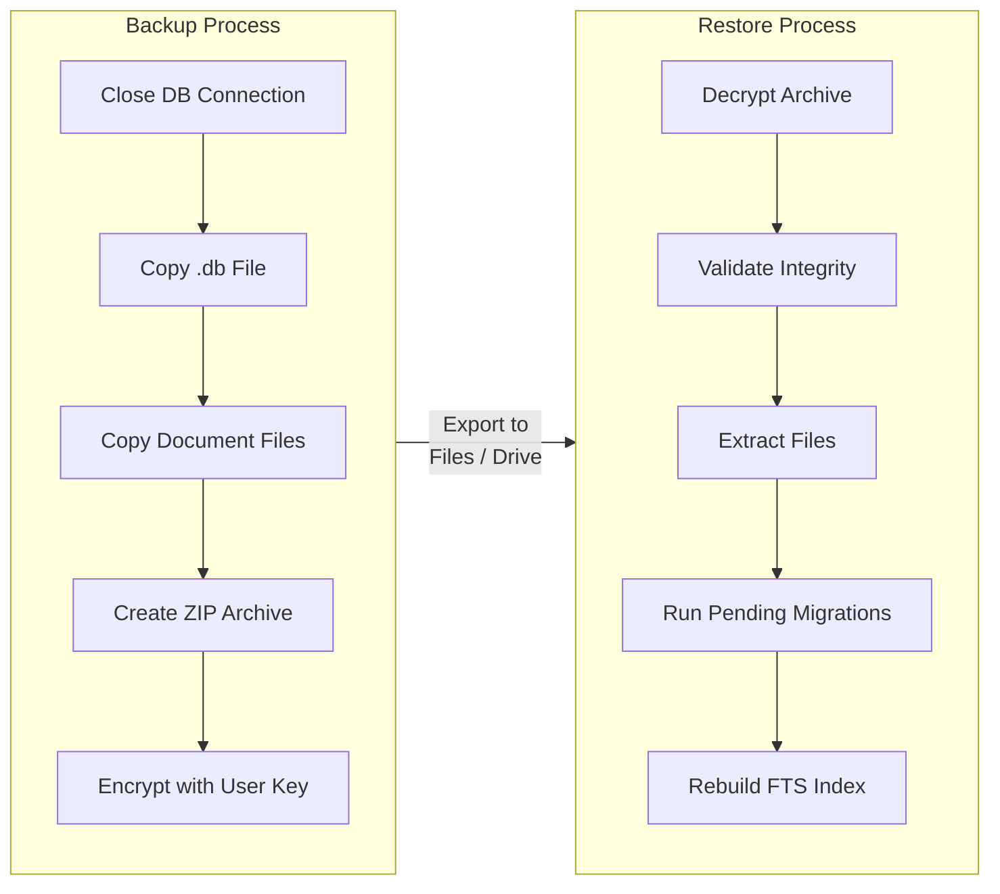

# 09 — Database Design

> **Project:** Kagaz
> **Database Engine:** SQLite (via `@capacitor-community/sqlite`)
> **Encryption:** SQLCipher
> **Last Updated:** 2026-07-18

---

## Table of Contents

- [1. Why SQLite](#1-why-sqlite)
- [2. Database Architecture Overview](#2-database-architecture-overview)
- [3. Entity-Relationship Diagram](#3-entity-relationship-diagram)
- [4. Table Definitions](#4-table-definitions)
  - [4.1 documents](#41-documents)
  - [4.2 folders](#42-folders)
  - [4.3 tags](#43-tags)
  - [4.4 document_tags (Junction)](#44-document_tags-junction)
  - [4.5 operations_history](#45-operations_history)
  - [4.6 ai_conversations](#46-ai_conversations)
  - [4.7 ai_messages](#47-ai_messages)
  - [4.8 shared_links (V2)](#48-shared_links-v2)
  - [4.9 shared_link_access_log (V2)](#49-shared_link_access_log-v2)
  - [4.10 csc_services (V3)](#410-csc_services-v3)
  - [4.11 app_settings](#411-app_settings)
  - [4.12 quick_reference_entries (F-84, migration 005)](#412-quick_reference_entries-f-84-migration-005)
- [5. Indexes](#5-indexes)
- [6. Full-Text Search (FTS)](#6-full-text-search-fts)
- [7. Migration Strategy](#7-migration-strategy)
- [8. Data Access Object (DAO) Pattern](#8-data-access-object-dao-pattern)
- [9. Common Query Examples](#9-common-query-examples)
- [10. Backup & Restore Strategy](#10-backup--restore-strategy)
- [11. Future: PostgreSQL Migration (V2)](#11-future-postgresql-migration-v2)

---

## 1. Why SQLite

| Criterion | SQLite | Alternatives (IndexedDB, LocalStorage) |
|---|---|---|
| **Relational model** | ✅ True relational DB with JOINs, subqueries, CTEs | ❌ Key-value / document stores |
| **Complex queries** | ✅ Full SQL support including window functions | ❌ Limited querying capability |
| **Encryption** | ✅ SQLCipher — AES-256-CBC full-database encryption | ❌ No built-in encryption |
| **Biometric lock** | ✅ Encryption key gated behind biometric auth | ❌ Not natively supported |
| **Full-text search** | ✅ FTS5 built-in | ❌ Manual implementation required |
| **Reliability** | ✅ Billions of deployments, ACID-compliant | ⚠️ Browser-dependent |
| **Performance** | ✅ Sub-millisecond reads for typical queries | ⚠️ Varies widely |
| **Data integrity** | ✅ Foreign keys, constraints, triggers | ❌ App-level enforcement only |
| **Migration path** | ✅ SQL ↔ PostgreSQL for cloud sync (V2) | ❌ Complete rewrite needed |

> [!IMPORTANT]
> SQLCipher encrypts the **entire database file** at rest. The decryption key is stored in the device's secure enclave (via Capacitor Secure Storage) and can be gated behind biometric authentication, ensuring that even if the device is compromised, document metadata and AI conversation history remain protected.

---

## 2. Database Architecture Overview



---

## 3. Entity-Relationship Diagram



---

## 4. Table Definitions

### 4.1 `documents`

The central table — every document imported, scanned, or generated lives here.

| Column | Type | Constraints | Description |
|---|---|---|---|
| `id` | TEXT | `PRIMARY KEY` | UUID v4 — globally unique identifier |
| `name` | TEXT | `NOT NULL` | Display name shown in the vault UI |
| `description` | TEXT | | Optional user-provided description |
| `file_path` | TEXT | `NOT NULL` | Relative path to the file on device storage |
| `file_type` | TEXT | `NOT NULL` | MIME type (`application/pdf`, `image/jpeg`, etc.) |
| `file_size` | INTEGER | `NOT NULL` | File size in bytes |
| `file_hash` | TEXT | | SHA-256 hash for integrity verification |
| `thumbnail_path` | TEXT | | Path to auto-generated thumbnail image |
| `folder_id` | TEXT | `REFERENCES folders(id)` | Parent folder (NULL = root level) |
| `is_favorite` | INTEGER | `DEFAULT 0` | Boolean flag — starred/favorited |
| `is_locked` | INTEGER | `DEFAULT 0` | Requires biometric authentication to view |
| `is_archived` | INTEGER | `DEFAULT 0` | Soft archive — hidden from default views |
| `language` | TEXT | `DEFAULT 'en'` | Primary language of the document content |
| `ocr_text` | TEXT | | Extracted text (OCR) — indexed for full-text search |
| `source_type` | TEXT | `NOT NULL` | Origin: `'camera'`, `'scanner'`, `'gallery'`, `'file_picker'`, `'ai_generated'` |
| `original_filename` | TEXT | | Original file name before import/rename |
| `created_at` | TEXT | `NOT NULL` | ISO 8601 timestamp |
| `updated_at` | TEXT | `NOT NULL` | ISO 8601 timestamp |
| `deleted_at` | TEXT | | Soft-delete timestamp (NULL = active) |
| `metadata_json` | TEXT | | Extensible JSON blob for future metadata |
| `synced` | INTEGER | `DEFAULT 0` | V2: cloud sync status (0 = unsynced, 1 = synced) |
| `version` | INTEGER | `DEFAULT 1` | Optimistic concurrency control version |

**DDL:**

```sql
CREATE TABLE documents (
    id             TEXT PRIMARY KEY,
    name           TEXT NOT NULL,
    description    TEXT,
    file_path      TEXT NOT NULL,
    file_type      TEXT NOT NULL,
    file_size      INTEGER NOT NULL,
    file_hash      TEXT,
    thumbnail_path TEXT,
    folder_id      TEXT REFERENCES folders(id) ON DELETE SET NULL,
    is_favorite    INTEGER DEFAULT 0,
    is_locked      INTEGER DEFAULT 0,
    is_archived    INTEGER DEFAULT 0,
    language       TEXT DEFAULT 'en',
    ocr_text       TEXT,
    source_type    TEXT NOT NULL CHECK (source_type IN (
        'camera', 'scanner', 'gallery', 'file_picker', 'ai_generated'
    )),
    original_filename TEXT,
    created_at     TEXT NOT NULL,
    updated_at     TEXT NOT NULL,
    deleted_at     TEXT,
    metadata_json  TEXT,
    synced         INTEGER DEFAULT 0,
    version        INTEGER DEFAULT 1
);
```

---

### 4.2 `folders`

Hierarchical folder structure with self-referencing parent relationship.

| Column | Type | Constraints | Description |
|---|---|---|---|
| `id` | TEXT | `PRIMARY KEY` | UUID v4 |
| `name` | TEXT | `NOT NULL` | Folder display name |
| `parent_id` | TEXT | `REFERENCES folders(id)` | Parent folder (NULL = root level) |
| `icon` | TEXT | | Emoji or icon identifier |
| `color` | TEXT | | Hex color code (e.g., `#3498db`) |
| `sort_order` | INTEGER | `DEFAULT 0` | Display order within parent |
| `created_at` | TEXT | `NOT NULL` | ISO 8601 timestamp |
| `updated_at` | TEXT | `NOT NULL` | ISO 8601 timestamp |

**DDL:**

```sql
CREATE TABLE folders (
    id         TEXT PRIMARY KEY,
    name       TEXT NOT NULL,
    parent_id  TEXT REFERENCES folders(id) ON DELETE CASCADE,
    icon       TEXT,
    color      TEXT,
    sort_order INTEGER DEFAULT 0,
    created_at TEXT NOT NULL,
    updated_at TEXT NOT NULL
);
```

---

### 4.3 `tags`

User-defined labels that can be attached to any document.

| Column | Type | Constraints | Description |
|---|---|---|---|
| `id` | TEXT | `PRIMARY KEY` | UUID v4 |
| `name` | TEXT | `NOT NULL UNIQUE` | Tag label (case-insensitive enforced at app level) |
| `color` | TEXT | | Hex color for visual distinction |
| `created_at` | TEXT | `NOT NULL` | ISO 8601 timestamp |

**DDL:**

```sql
CREATE TABLE tags (
    id         TEXT PRIMARY KEY,
    name       TEXT NOT NULL UNIQUE,
    color      TEXT,
    created_at TEXT NOT NULL
);
```

---

### 4.4 `document_tags` (Junction)

Many-to-many relationship between documents and tags.

| Column | Type | Constraints |
|---|---|---|
| `document_id` | TEXT | `REFERENCES documents(id) ON DELETE CASCADE` |
| `tag_id` | TEXT | `REFERENCES tags(id) ON DELETE CASCADE` |
| | | `PRIMARY KEY (document_id, tag_id)` |

**DDL:**

```sql
CREATE TABLE document_tags (
    document_id TEXT NOT NULL REFERENCES documents(id) ON DELETE CASCADE,
    tag_id      TEXT NOT NULL REFERENCES tags(id) ON DELETE CASCADE,
    PRIMARY KEY (document_id, tag_id)
);
```

---

### 4.5 `operations_history`

Audit trail for every document operation (merge, split, compress, OCR, etc.).

| Column | Type | Constraints | Description |
|---|---|---|---|
| `id` | TEXT | `PRIMARY KEY` | UUID v4 |
| `document_id` | TEXT | `REFERENCES documents(id)` | Source document |
| `operation_type` | TEXT | `NOT NULL` | `'merge'`, `'split'`, `'compress'`, `'convert'`, `'encrypt'`, `'ocr'`, `'watermark'`, etc. |
| `input_params_json` | TEXT | | JSON of operation parameters |
| `output_document_id` | TEXT | `REFERENCES documents(id)` | Resulting document (if any) |
| `status` | TEXT | `NOT NULL DEFAULT 'pending'` | `'pending'`, `'processing'`, `'completed'`, `'failed'` |
| `error_message` | TEXT | | Error details if status = `'failed'` |
| `duration_ms` | INTEGER | | Operation duration in milliseconds |
| `created_at` | TEXT | `NOT NULL` | ISO 8601 timestamp |

**DDL:**

```sql
CREATE TABLE operations_history (
    id                  TEXT PRIMARY KEY,
    document_id         TEXT REFERENCES documents(id) ON DELETE SET NULL,
    operation_type      TEXT NOT NULL CHECK (operation_type IN (
        'merge', 'split', 'compress', 'convert', 'encrypt',
        'decrypt', 'ocr', 'watermark', 'annotate', 'resize'
    )),
    input_params_json   TEXT,
    output_document_id  TEXT REFERENCES documents(id) ON DELETE SET NULL,
    status              TEXT NOT NULL DEFAULT 'pending' CHECK (status IN (
        'pending', 'processing', 'completed', 'failed'
    )),
    error_message       TEXT,
    duration_ms         INTEGER,
    created_at          TEXT NOT NULL
);
```

---

### 4.6 `ai_conversations`

Stores AI chatbot conversation sessions.

| Column | Type | Constraints | Description |
|---|---|---|---|
| `id` | TEXT | `PRIMARY KEY` | UUID v4 |
| `title` | TEXT | | Auto-generated or user-edited title |
| `created_at` | TEXT | `NOT NULL` | ISO 8601 timestamp |
| `updated_at` | TEXT | `NOT NULL` | ISO 8601 timestamp |
| `is_pinned` | INTEGER | `DEFAULT 0` | Pin conversation to top |

**DDL:**

```sql
CREATE TABLE ai_conversations (
    id         TEXT PRIMARY KEY,
    title      TEXT,
    created_at TEXT NOT NULL,
    updated_at TEXT NOT NULL,
    is_pinned  INTEGER DEFAULT 0
);
```

---

### 4.7 `ai_messages`

Individual messages within an AI conversation, following the OpenAI-compatible message format.

| Column | Type | Constraints | Description |
|---|---|---|---|
| `id` | TEXT | `PRIMARY KEY` | UUID v4 |
| `conversation_id` | TEXT | `REFERENCES ai_conversations(id) ON DELETE CASCADE` | Parent conversation |
| `role` | TEXT | `NOT NULL` | `'user'`, `'assistant'`, `'system'`, `'tool'` |
| `content` | TEXT | | Message text content |
| `tool_calls_json` | TEXT | | JSON array of tool calls (when role = `'assistant'`) |
| `tool_call_id` | TEXT | | ID of the tool call being responded to (when role = `'tool'`) |
| `created_at` | TEXT | `NOT NULL` | ISO 8601 timestamp |

**DDL:**

```sql
CREATE TABLE ai_messages (
    id              TEXT PRIMARY KEY,
    conversation_id TEXT NOT NULL REFERENCES ai_conversations(id) ON DELETE CASCADE,
    role            TEXT NOT NULL CHECK (role IN ('user', 'assistant', 'system', 'tool')),
    content         TEXT,
    tool_calls_json TEXT,
    tool_call_id    TEXT,
    created_at      TEXT NOT NULL
);
```

---

### 4.8 `shared_links` (V2)

Secure document sharing via short alphanumeric codes.

| Column | Type | Constraints | Description |
|---|---|---|---|
| `id` | TEXT | `PRIMARY KEY` | UUID v4 |
| `code` | TEXT | `NOT NULL UNIQUE` | 5-digit alphanumeric share code |
| `document_ids_json` | TEXT | `NOT NULL` | JSON array of document IDs |
| `created_by` | TEXT | | User identifier |
| `expires_at` | TEXT | | Expiry timestamp (NULL = no expiry) |
| `max_access_count` | INTEGER | | Maximum allowed accesses (NULL = unlimited) |
| `current_access_count` | INTEGER | `DEFAULT 0` | Number of times accessed |
| `pin_hash` | TEXT | | Optional bcrypt hash of PIN for protection |
| `permissions_json` | TEXT | | JSON: `{"view": true, "download": true, "print": false}` |
| `is_revoked` | INTEGER | `DEFAULT 0` | Manually revoked by user |
| `created_at` | TEXT | `NOT NULL` | ISO 8601 timestamp |

**DDL:**

```sql
CREATE TABLE shared_links (
    id                   TEXT PRIMARY KEY,
    code                 TEXT NOT NULL UNIQUE,
    document_ids_json    TEXT NOT NULL,
    created_by           TEXT,
    expires_at           TEXT,
    max_access_count     INTEGER,
    current_access_count INTEGER DEFAULT 0,
    pin_hash             TEXT,
    permissions_json     TEXT,
    is_revoked           INTEGER DEFAULT 0,
    created_at           TEXT NOT NULL
);
```

---

### 4.9 `shared_link_access_log` (V2)

Audit log for every access to a shared link.

| Column | Type | Constraints | Description |
|---|---|---|---|
| `id` | TEXT | `PRIMARY KEY` | UUID v4 |
| `shared_link_id` | TEXT | `REFERENCES shared_links(id) ON DELETE CASCADE` | Parent shared link |
| `accessor_ip` | TEXT | | IP address of accessor |
| `accessor_ua` | TEXT | | User-Agent string |
| `accessed_at` | TEXT | `NOT NULL` | ISO 8601 timestamp |

**DDL:**

```sql
CREATE TABLE shared_link_access_log (
    id             TEXT PRIMARY KEY,
    shared_link_id TEXT NOT NULL REFERENCES shared_links(id) ON DELETE CASCADE,
    accessor_ip    TEXT,
    accessor_ua    TEXT,
    accessed_at    TEXT NOT NULL
);
```

---

### 4.10 `csc_services` (V3)

Catalog of Common Service Centre (CSC) services and their requirements.

| Column | Type | Constraints | Description |
|---|---|---|---|
| `id` | TEXT | `PRIMARY KEY` | UUID v4 |
| `name` | TEXT | `NOT NULL` | Service name |
| `category` | TEXT | `NOT NULL` | `'government'`, `'financial'`, `'education'`, `'health'`, `'utility'` |
| `description` | TEXT | | Service description |
| `required_docs_json` | TEXT | | JSON array of required document types |
| `steps_json` | TEXT | | JSON array of process steps |
| `fees_json` | TEXT | | JSON: `{"government_fee": 100, "service_charge": 50}` |
| `timeline` | TEXT | | Expected processing time (e.g., "7-15 business days") |
| `is_active` | INTEGER | `DEFAULT 1` | Service availability flag |

**DDL:**

```sql
CREATE TABLE csc_services (
    id                 TEXT PRIMARY KEY,
    name               TEXT NOT NULL,
    category           TEXT NOT NULL CHECK (category IN (
        'government', 'financial', 'education', 'health', 'utility'
    )),
    description        TEXT,
    required_docs_json TEXT,
    steps_json         TEXT,
    fees_json          TEXT,
    timeline           TEXT,
    is_active          INTEGER DEFAULT 1
);
```

---

### 4.11 `app_settings`

Key-value store for application preferences and configuration.

| Column | Type | Constraints | Description |
|---|---|---|---|
| `key` | TEXT | `PRIMARY KEY` | Setting identifier (e.g., `'theme'`, `'language'`, `'auto_backup'`) |
| `value` | TEXT | | JSON-encoded value |
| `updated_at` | TEXT | `NOT NULL` | ISO 8601 timestamp |

**DDL:**

```sql
CREATE TABLE app_settings (
    key        TEXT PRIMARY KEY,
    value      TEXT,
    updated_at TEXT NOT NULL
);
```

---

### 4.12 `quick_reference_entries` (F-84, migration 005)

A personal key-value vault — see
[02-document-vault-module.md](02-document-vault-module.md#quick-reference-f-84)
for the full feature spec. `label` is always user-typed free text; the schema
deliberately has **no `label_type`/`value_type` column** — see
[10-security-architecture.md](10-security-architecture.md) §3.6 for why that's
a compliance decision, not an oversight. Tags reuse the existing
`document_tags`-style junction, scoped to this table instead.

| Column | Type | Constraints | Description |
|---|---|---|---|
| `id` | TEXT | `PRIMARY KEY` | UUID v4 |
| `label` | TEXT | `NOT NULL` | User-typed name, e.g. `"PAN No"` |
| `value` | TEXT | `NOT NULL` | The stored value; masked in the UI, never in the DB |
| `linked_document_id` | TEXT | `REFERENCES documents(id) ON DELETE SET NULL` | Provenance; null = standalone entry |
| `created_at` | TEXT | `NOT NULL` | ISO 8601 timestamp |
| `updated_at` | TEXT | `NOT NULL` | ISO 8601 timestamp |

**DDL:**

```sql
CREATE TABLE quick_reference_entries (
    id                 TEXT PRIMARY KEY,
    label              TEXT NOT NULL,
    value              TEXT NOT NULL,
    linked_document_id TEXT REFERENCES documents(id) ON DELETE SET NULL,
    created_at         TEXT NOT NULL,
    updated_at         TEXT NOT NULL
);

CREATE TABLE quick_reference_tags (
    entry_id TEXT NOT NULL REFERENCES quick_reference_entries(id) ON DELETE CASCADE,
    tag_id   TEXT NOT NULL REFERENCES tags(id) ON DELETE CASCADE,
    PRIMARY KEY (entry_id, tag_id)
);
```

---

## 5. Indexes

Indexes are critical for query performance, especially on the `documents` table which will be the most frequently queried.

```sql
-- Documents: frequently filtered/sorted columns
CREATE INDEX idx_documents_folder_id   ON documents(folder_id);
CREATE INDEX idx_documents_file_type   ON documents(file_type);
CREATE INDEX idx_documents_is_favorite ON documents(is_favorite) WHERE is_favorite = 1;
CREATE INDEX idx_documents_created_at  ON documents(created_at DESC);
CREATE INDEX idx_documents_deleted_at  ON documents(deleted_at) WHERE deleted_at IS NOT NULL;
CREATE INDEX idx_documents_source_type ON documents(source_type);
CREATE INDEX idx_documents_synced      ON documents(synced) WHERE synced = 0;

-- Folders: parent hierarchy traversal
CREATE INDEX idx_folders_parent_id ON folders(parent_id);

-- Document tags: reverse lookup
CREATE INDEX idx_document_tags_tag_id ON document_tags(tag_id);

-- Operations: lookup by document and status
CREATE INDEX idx_operations_document_id ON operations_history(document_id);
CREATE INDEX idx_operations_status       ON operations_history(status) WHERE status != 'completed';

-- AI messages: conversation lookup
CREATE INDEX idx_ai_messages_conversation ON ai_messages(conversation_id, created_at);

-- Shared links: code lookup
CREATE INDEX idx_shared_links_code ON shared_links(code);
CREATE INDEX idx_shared_links_expires ON shared_links(expires_at) WHERE expires_at IS NOT NULL;

-- Access log: shared link lookup
CREATE INDEX idx_access_log_shared_link ON shared_link_access_log(shared_link_id);

-- Quick Reference (F-84): provenance lookup + tag reverse lookup
CREATE INDEX idx_quick_reference_linked_document ON quick_reference_entries(linked_document_id);
CREATE INDEX idx_quick_reference_tags_tag_id ON quick_reference_tags(tag_id);
```

> [!TIP]
> Partial indexes (using `WHERE`) are used where appropriate to keep the index small and focused. For example, `idx_documents_is_favorite` only indexes favorited documents, which are typically a small subset.

---

## 6. Full-Text Search (FTS)

Kagaz uses SQLite's **FTS5** extension for fast, fuzzy document search across names, descriptions, and OCR-extracted text.

### FTS5 Virtual Table

```sql
-- Create the FTS5 virtual table
CREATE VIRTUAL TABLE documents_fts USING fts5(
    name,
    description,
    ocr_text,
    content='documents',
    content_rowid='rowid',
    tokenize='unicode61 remove_diacritics 2'
);
```

### Keeping FTS in Sync

FTS tables must be manually synchronized with the source table via triggers:

```sql
-- Trigger: After INSERT
CREATE TRIGGER documents_fts_insert AFTER INSERT ON documents BEGIN
    INSERT INTO documents_fts(rowid, name, description, ocr_text)
    VALUES (new.rowid, new.name, new.description, new.ocr_text);
END;

-- Trigger: After UPDATE
CREATE TRIGGER documents_fts_update AFTER UPDATE ON documents BEGIN
    INSERT INTO documents_fts(documents_fts, rowid, name, description, ocr_text)
    VALUES ('delete', old.rowid, old.name, old.description, old.ocr_text);
    INSERT INTO documents_fts(rowid, name, description, ocr_text)
    VALUES (new.rowid, new.name, new.description, new.ocr_text);
END;

-- Trigger: After DELETE
CREATE TRIGGER documents_fts_delete AFTER DELETE ON documents BEGIN
    INSERT INTO documents_fts(documents_fts, rowid, name, description, ocr_text)
    VALUES ('delete', old.rowid, old.name, old.description, old.ocr_text);
END;
```

### FTS Query Examples

```sql
-- Simple search
SELECT d.*
FROM documents d
JOIN documents_fts fts ON d.rowid = fts.rowid
WHERE documents_fts MATCH 'passport'
  AND d.deleted_at IS NULL
ORDER BY rank;

-- Search with highlighting
SELECT d.id, d.name,
    highlight(documents_fts, 0, '<mark>', '</mark>') AS highlighted_name,
    snippet(documents_fts, 2, '<mark>', '</mark>', '...', 32) AS ocr_snippet
FROM documents d
JOIN documents_fts fts ON d.rowid = fts.rowid
WHERE documents_fts MATCH 'aadhaar card'
  AND d.deleted_at IS NULL
ORDER BY rank
LIMIT 20;

-- Prefix search (autocomplete)
SELECT d.id, d.name
FROM documents d
JOIN documents_fts fts ON d.rowid = fts.rowid
WHERE documents_fts MATCH 'pan*'
  AND d.deleted_at IS NULL
ORDER BY rank
LIMIT 10;
```

> [!NOTE]
> The `unicode61` tokenizer with `remove_diacritics` is chosen to support searching across Hindi (Devanagari) and English text. For more advanced multilingual search, consider a custom tokenizer in future iterations.

---

## 7. Migration Strategy

Kagaz uses **versioned, incremental migrations** managed by a custom migration runner compatible with `@capacitor-community/sqlite`.

### Migration File Structure

```
src/core/database/
├── database.service.ts        # Database initialization & connection
├── migration-runner.ts        # Executes migrations in order
├── migrations/
│   ├── 001_initial_schema.ts
│   ├── 002_add_fts.ts
│   ├── 003_add_shared_links.ts
│   ├── 004_add_csc_services.ts
│   └── index.ts               # Migration registry
└── dao/
    ├── document.dao.ts
    ├── folder.dao.ts
    ├── tag.dao.ts
    ├── ai-conversation.dao.ts
    ├── operation.dao.ts
    ├── settings.dao.ts
    └── index.ts
```

### Migration Table

```sql
CREATE TABLE IF NOT EXISTS _migrations (
    version    INTEGER PRIMARY KEY,
    name       TEXT NOT NULL,
    applied_at TEXT NOT NULL
);
```

### Migration Runner (Pseudocode)

```typescript
interface Migration {
  version: number;
  name: string;
  up: (db: SQLiteDBConnection) => Promise<void>;
  down: (db: SQLiteDBConnection) => Promise<void>;
}

async function runMigrations(db: SQLiteDBConnection, migrations: Migration[]) {
  // Get current version
  const current = await db.query('SELECT MAX(version) as v FROM _migrations');
  const currentVersion = current.values?.[0]?.v ?? 0;

  // Run pending migrations in order
  const pending = migrations
    .filter(m => m.version > currentVersion)
    .sort((a, b) => a.version - b.version);

  for (const migration of pending) {
    await db.execute('BEGIN TRANSACTION');
    try {
      await migration.up(db);
      await db.execute(
        `INSERT INTO _migrations (version, name, applied_at) VALUES (?, ?, ?)`,
        [migration.version, migration.name, new Date().toISOString()]
      );
      await db.execute('COMMIT');
      console.log(`✅ Migration ${migration.version}: ${migration.name}`);
    } catch (error) {
      await db.execute('ROLLBACK');
      throw new Error(`Migration ${migration.version} failed: ${error}`);
    }
  }
}
```

### Migration Best Practices

| Rule | Rationale |
|---|---|
| Migrations are **immutable** once shipped | Users already have the old schema applied |
| Always include `up` and `down` | Enables rollback during development |
| Wrap each migration in a **transaction** | Ensures atomicity — partial migrations corrupt state |
| Use `IF NOT EXISTS` / `IF EXISTS` | Makes migrations idempotent where possible |
| Test migrations on a **copy** of production data | Catch edge cases before release |

---

## 8. Data Access Object (DAO) Pattern

All database access goes through typed DAO classes. This provides:

- **Type safety** — TypeScript interfaces for all rows
- **Encapsulation** — SQL is never written in UI components
- **Testability** — DAOs can be mocked for unit tests
- **Consistency** — Timestamp management, soft-delete logic, version bumping handled in one place

### Example: DocumentDAO

```typescript
// types/document.ts
export interface Document {
  id: string;
  name: string;
  description?: string;
  filePath: string;
  fileType: string;
  fileSize: number;
  fileHash?: string;
  thumbnailPath?: string;
  folderId?: string;
  isFavorite: boolean;
  isLocked: boolean;
  isArchived: boolean;
  language: string;
  ocrText?: string;
  sourceType: 'camera' | 'scanner' | 'gallery' | 'file_picker' | 'ai_generated';
  originalFilename?: string;
  createdAt: string;
  updatedAt: string;
  deletedAt?: string;
  metadataJson?: string;
  synced: boolean;
  version: number;
}

// dao/document.dao.ts
export class DocumentDAO {
  constructor(private db: SQLiteDBConnection) {}

  async findById(id: string): Promise<Document | null> {
    const result = await this.db.query(
      'SELECT * FROM documents WHERE id = ? AND deleted_at IS NULL', [id]
    );
    return result.values?.[0] ? this.mapRow(result.values[0]) : null;
  }

  async findByFolder(folderId: string | null): Promise<Document[]> {
    const sql = folderId
      ? 'SELECT * FROM documents WHERE folder_id = ? AND deleted_at IS NULL ORDER BY created_at DESC'
      : 'SELECT * FROM documents WHERE folder_id IS NULL AND deleted_at IS NULL ORDER BY created_at DESC';
    const result = await this.db.query(sql, folderId ? [folderId] : []);
    return (result.values ?? []).map(this.mapRow);
  }

  async create(doc: Omit<Document, 'createdAt' | 'updatedAt' | 'version'>): Promise<Document> {
    const now = new Date().toISOString();
    await this.db.run(
      `INSERT INTO documents (id, name, description, file_path, file_type, file_size,
        file_hash, thumbnail_path, folder_id, is_favorite, is_locked, is_archived,
        language, ocr_text, source_type, original_filename, created_at, updated_at,
        metadata_json, synced, version)
       VALUES (?, ?, ?, ?, ?, ?, ?, ?, ?, ?, ?, ?, ?, ?, ?, ?, ?, ?, ?, 0, 1)`,
      [doc.id, doc.name, doc.description ?? null, doc.filePath, doc.fileType,
       doc.fileSize, doc.fileHash ?? null, doc.thumbnailPath ?? null,
       doc.folderId ?? null, doc.isFavorite ? 1 : 0, doc.isLocked ? 1 : 0,
       doc.isArchived ? 1 : 0, doc.language, doc.ocrText ?? null,
       doc.sourceType, doc.originalFilename ?? null, now, now,
       doc.metadataJson ?? null]
    );
    return this.findById(doc.id) as Promise<Document>;
  }

  async softDelete(id: string): Promise<void> {
    const now = new Date().toISOString();
    await this.db.run(
      'UPDATE documents SET deleted_at = ?, updated_at = ?, version = version + 1 WHERE id = ?',
      [now, now, id]
    );
  }

  async search(query: string, limit = 20): Promise<Document[]> {
    const result = await this.db.query(
      `SELECT d.* FROM documents d
       JOIN documents_fts fts ON d.rowid = fts.rowid
       WHERE documents_fts MATCH ?
         AND d.deleted_at IS NULL
       ORDER BY rank
       LIMIT ?`,
      [query, limit]
    );
    return (result.values ?? []).map(this.mapRow);
  }

  private mapRow(row: any): Document {
    return {
      ...row,
      isFavorite: !!row.is_favorite,
      isLocked: !!row.is_locked,
      isArchived: !!row.is_archived,
      synced: !!row.synced,
      filePath: row.file_path,
      fileType: row.file_type,
      fileSize: row.file_size,
      fileHash: row.file_hash,
      thumbnailPath: row.thumbnail_path,
      folderId: row.folder_id,
      ocrText: row.ocr_text,
      sourceType: row.source_type,
      originalFilename: row.original_filename,
      createdAt: row.created_at,
      updatedAt: row.updated_at,
      deletedAt: row.deleted_at,
      metadataJson: row.metadata_json,
    };
  }
}
```

---

## 9. Common Query Examples

### List Documents with Tags

```sql
SELECT d.*, GROUP_CONCAT(t.name, ', ') AS tag_names
FROM documents d
LEFT JOIN document_tags dt ON d.id = dt.document_id
LEFT JOIN tags t ON dt.tag_id = t.id
WHERE d.deleted_at IS NULL
  AND d.folder_id = ?
GROUP BY d.id
ORDER BY d.created_at DESC;
```

### Get Folder Tree (Recursive CTE)

```sql
WITH RECURSIVE folder_tree AS (
    SELECT id, name, parent_id, 0 AS depth, name AS path
    FROM folders
    WHERE parent_id IS NULL

    UNION ALL

    SELECT f.id, f.name, f.parent_id, ft.depth + 1, ft.path || '/' || f.name
    FROM folders f
    JOIN folder_tree ft ON f.parent_id = ft.id
)
SELECT * FROM folder_tree ORDER BY path;
```

### Recent Documents

```sql
SELECT d.*, f.name AS folder_name
FROM documents d
LEFT JOIN folders f ON d.folder_id = f.id
WHERE d.deleted_at IS NULL
  AND d.is_archived = 0
ORDER BY d.updated_at DESC
LIMIT 20;
```

### Documents by Tag

```sql
SELECT d.*
FROM documents d
JOIN document_tags dt ON d.id = dt.document_id
JOIN tags t ON dt.tag_id = t.id
WHERE t.name = 'important'
  AND d.deleted_at IS NULL
ORDER BY d.created_at DESC;
```

### Duplicate Detection (by Hash)

```sql
SELECT file_hash, COUNT(*) AS count, GROUP_CONCAT(name, ', ') AS names
FROM documents
WHERE file_hash IS NOT NULL
  AND deleted_at IS NULL
GROUP BY file_hash
HAVING COUNT(*) > 1;
```

### Storage Usage by File Type

```sql
SELECT file_type,
    COUNT(*) AS doc_count,
    SUM(file_size) AS total_bytes,
    ROUND(SUM(file_size) / 1024.0 / 1024.0, 2) AS total_mb
FROM documents
WHERE deleted_at IS NULL
GROUP BY file_type
ORDER BY total_bytes DESC;
```

### AI Conversation with Messages

```sql
SELECT c.id, c.title, c.is_pinned,
    m.role, m.content, m.created_at AS message_time
FROM ai_conversations c
JOIN ai_messages m ON c.id = m.conversation_id
WHERE c.id = ?
ORDER BY m.created_at ASC;
```

### Pending Operations

```sql
SELECT oh.*, d.name AS document_name
FROM operations_history oh
LEFT JOIN documents d ON oh.document_id = d.id
WHERE oh.status IN ('pending', 'processing')
ORDER BY oh.created_at ASC;
```

---

## 10. Backup & Restore Strategy

> **As shipped (F-31), this section's diagram/table below describe the
> original design; the real implementation
> (`modules/settings/services/backup.service.ts`) is narrower: a
> manifest-based ZIP of `documents` + `folders` only (not a raw `.db` file
> copy, and — a pre-existing gap this note surfaces, not one introduced by
> F-84 — `document_tags` isn't in the manifest either). **F-84 needs an
> explicit hook**: `BackupManifest` gains a `quickReferenceEntries` field and
> `createBackup` fetches them alongside documents/folders, or Quick Reference
> data silently isn't covered by "Export encrypted backup." Track this as a
> required implementation step for F-84, not an automatic consequence of
> adding the table.

### Backup Approach



### Backup Contents

| Component | Included | Notes |
|---|---|---|
| `kagaz.db` (encrypted) | ✅ | Full database including FTS |
| Document files | ✅ | All files referenced by `file_path` |
| Thumbnails | ❌ | Regenerated on restore (saves space) |
| App settings | ✅ | Included in database |
| Encryption key | ❌ | Stored separately in secure storage |

### Backup Implementation

```typescript
async function createBackup(): Promise<string> {
  // 1. Checkpoint WAL to ensure consistency
  await db.execute('PRAGMA wal_checkpoint(TRUNCATE)');

  // 2. Close connection
  await db.close();

  // 3. Copy database file
  const dbBackupPath = await Filesystem.copy({
    from: DB_PATH,
    to: `backups/kagaz_${Date.now()}.db`,
    directory: Directory.Data,
  });

  // 4. Copy all document files
  const docs = await documentDAO.findAll();
  for (const doc of docs) {
    await Filesystem.copy({
      from: doc.filePath,
      to: `backups/files/${doc.filePath}`,
      directory: Directory.Data,
    });
  }

  // 5. Create manifest
  const manifest = {
    version: CURRENT_MIGRATION_VERSION,
    createdAt: new Date().toISOString(),
    documentCount: docs.length,
    appVersion: APP_VERSION,
  };

  // 6. ZIP and encrypt
  return await zipAndEncrypt(BACKUP_DIR, userEncryptionKey);
}
```

### Automatic Backup Schedule

| Trigger | Action |
|---|---|
| Every 24 hours (if app opened) | Incremental backup to local storage |
| Before destructive operations | Snapshot backup |
| Manual "Export" action | Full backup to user-chosen location |
| Before app update | Automatic safety backup |

---

## 11. Future: PostgreSQL Migration (V2)

When cloud sync is introduced in V2, the SQL-based schema makes migration straightforward:

| SQLite | PostgreSQL | Notes |
|---|---|---|
| `TEXT` for UUIDs | `UUID` native type | Use `gen_random_uuid()` |
| `INTEGER` for booleans | `BOOLEAN` native type | Direct mapping |
| `TEXT` for timestamps | `TIMESTAMPTZ` | Parse ISO 8601 |
| `TEXT` for JSON | `JSONB` | Enables JSON queries |
| FTS5 | `tsvector` + GIN index | More powerful FTS |
| SQLCipher | TLS + column encryption | Different security model |

> [!NOTE]
> The `synced` column on the `documents` table is a forward-looking field. In V2, a sync engine will track which documents have been uploaded to the cloud, enabling conflict resolution and offline-first synchronization.

---

*This document defines the complete data layer for Kagaz. All schema changes must go through the migration system. Direct database manipulation outside of DAOs is prohibited.*

---

## Migration 007 — chat message parts (2026-10-31)

`ai_messages.parts_json TEXT NULL` stores structured pieces of a message that plain `content` cannot: documents the user attached, result cards for documents a tool created, assistant forms (GenUI) and the answers to them. `ai_conversations.active_skills TEXT NULL` remembers which tool groups were loaded. Both are nullable and additive (existing rows stay plain text). Parts are validated with zod on read — a corrupt row degrades to a plain message. Chat content: encrypted DB only, never logged.
