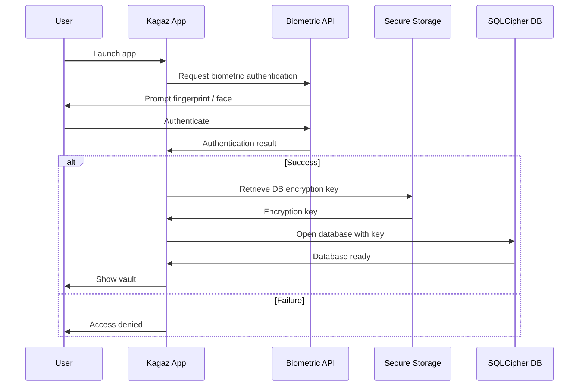
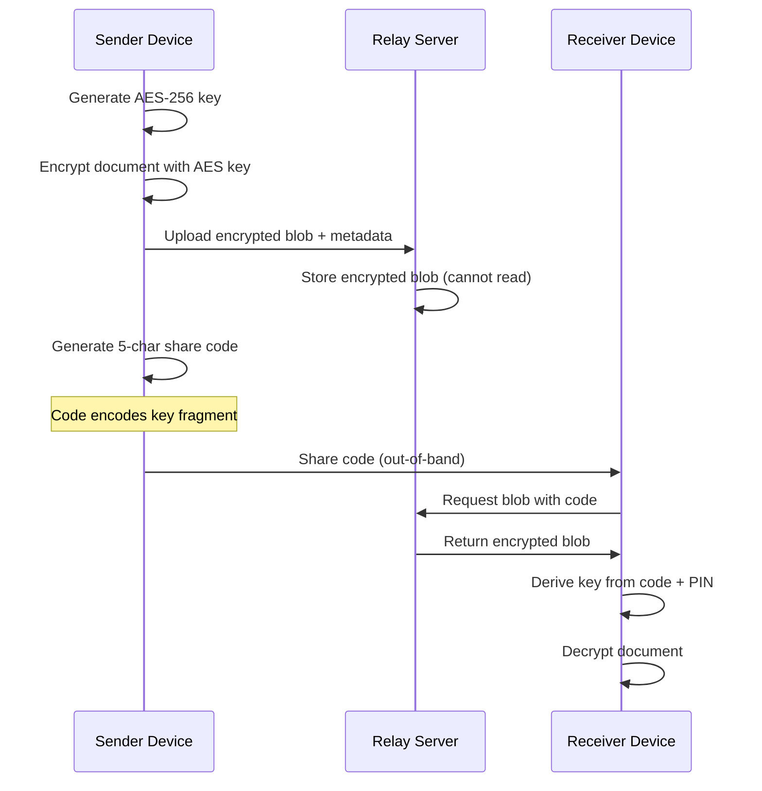
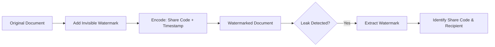
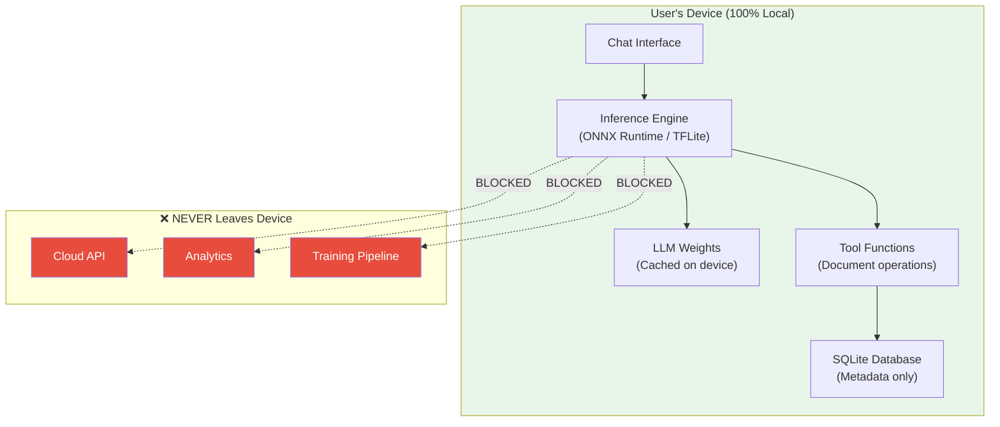
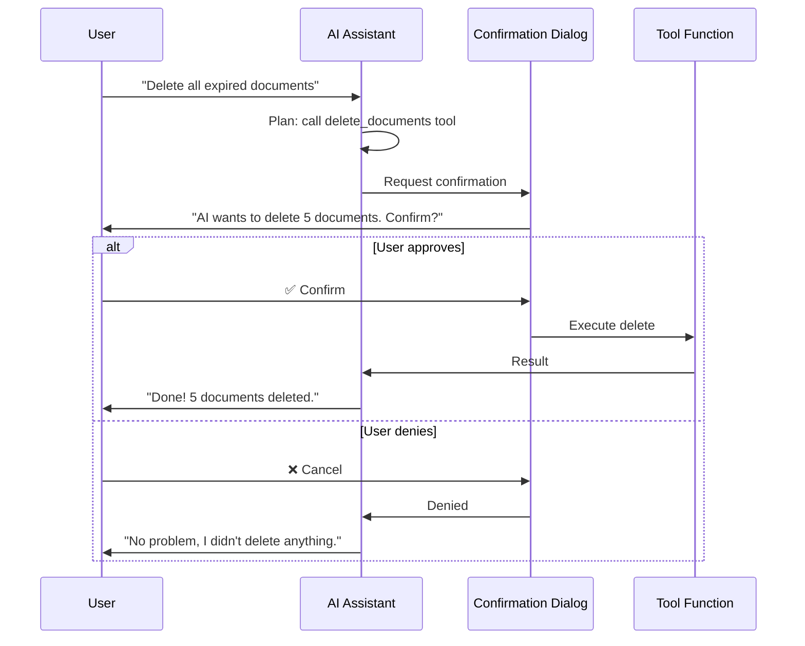
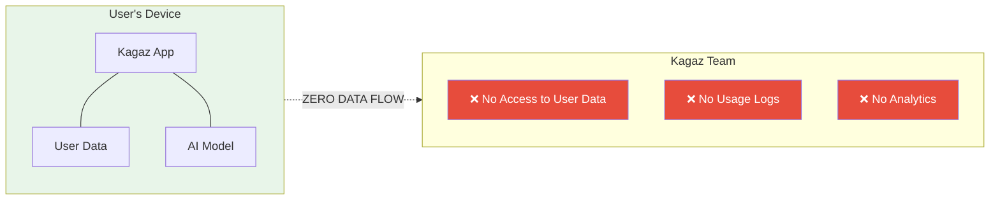
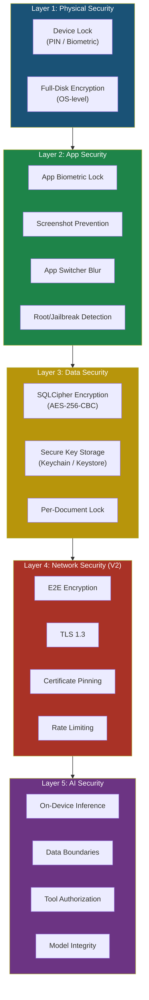

# 10 — Security Architecture

> **Project:** Kagaz
> **Classification:** Security-Critical
> **Last Updated:** 2026-07-21

---

## Table of Contents

- [1. Security Philosophy](#1-security-philosophy)
- [2. Threat Model](#2-threat-model)
- [3. Local Security (V1)](#3-local-security-v1)
  - [3.1 Biometric Authentication](#31-biometric-authentication)
  - [3.2 Database Encryption (SQLCipher)](#32-database-encryption-sqlcipher)
  - [3.3 File System Security](#33-file-system-security)
  - [3.4 Secure Key Storage](#34-secure-key-storage)
  - [3.5 Offline-Only Guarantee](#35-offline-only-guarantee)
  - [3.6 Quick Reference Access Control (F-84)](#36-quick-reference-access-control-f-84)
- [4. Sharing Security (V2)](#4-sharing-security-v2)
  - [4.1 End-to-End Encryption](#41-end-to-end-encryption)
  - [4.2 Access Controls](#42-access-controls)
  - [4.3 Anti-Abuse Protections](#43-anti-abuse-protections)
  - [4.4 Audit Logging](#44-audit-logging)
  - [4.5 Consent & Revocation](#45-consent--revocation)
- [5. AI Security](#5-ai-security)
  - [5.1 On-Device Model Execution](#51-on-device-model-execution)
  - [5.2 Data Boundary Enforcement](#52-data-boundary-enforcement)
  - [5.3 Tool Call Authorization](#53-tool-call-authorization)
  - [5.4 Model Integrity](#54-model-integrity)
- [6. Privacy Principles](#6-privacy-principles)
- [7. Security Architecture Diagram](#7-security-architecture-diagram)
- [8. Security Checklist by Version](#8-security-checklist-by-version)
- [9. Incident Response](#9-incident-response)

---

## 1. Security Philosophy

Kagaz follows a **zero-trust, offline-first, privacy-by-design** philosophy. The core principles are:

| Principle | Implementation |
|---|---|
| **Zero Knowledge** | We never see, access, or process user data |
| **Defense in Depth** | Multiple layers — biometric, encryption, sandboxing |
| **Least Privilege** | AI and features only access what they need |
| **Data Sovereignty** | Users own 100% of their data, always |
| **Transparency** | Users know exactly what's stored and where |
| **No Telemetry** | Zero analytics, tracking, or usage reporting |

> [!IMPORTANT]
> In V1, Kagaz is a **100% offline application**. No data ever leaves the user's device. There are no servers, no APIs, no analytics endpoints. This is the strongest possible privacy guarantee.

---

## 2. Threat Model

### Assets to Protect

| Asset | Sensitivity | Location |
|---|---|---|
| Personal documents (Aadhaar, PAN, etc.) | 🔴 Critical | Device file system |
| Document metadata & OCR text | 🟠 High | SQLite database |
| AI conversation history | 🟡 Medium | SQLite database |
| App settings & preferences | 🟢 Low | SQLite database |
| Database encryption key | 🔴 Critical | Secure enclave / Keychain |

### Threat Actors & Mitigations

| Threat | Attack Vector | Mitigation |
|---|---|---|
| **Device theft** | Physical access to unlocked device | App-level biometric lock, auto-lock on background |
| **Malicious app** | Reads Kagaz's data directory | App sandbox, SQLCipher encryption at rest |
| **Shoulder surfing** | Viewing sensitive docs on screen | Per-document biometric lock, blur on app switch |
| **Data extraction** | ADB/USB debugging, rooted device | Encrypted database, root detection warning |
| **Brute-force (V2)** | Guessing share codes | Rate limiting, account lockout, PIN protection |
| **Man-in-the-middle (V2)** | Intercepting shared docs | End-to-end encryption, certificate pinning |
| **AI data leakage** | Model exfiltrating data | 100% on-device model, no network access |
| **Backup exposure** | Unencrypted backup files | Encrypted backup archives with user key |

---

## 3. Local Security (V1)

### 3.1 Biometric Authentication



#### App-Level Lock

| Feature | Behavior |
|---|---|
| **Lock trigger** | App goes to background, device locked, or manual lock |
| **Auth method** | Device biometric (fingerprint / face) via Capacitor plugin |
| **Fallback** | Device PIN/pattern (managed by OS) |
| **Auto-lock timeout** | Configurable: Immediate / 30s / 1min / 5min |
| **Failed attempts** | Handled by OS biometric system (typically 5 attempts → cooldown) |

#### Per-Document Lock

For documents marked as `is_locked = 1`:

- Viewing the document requires a **separate biometric prompt**
- Thumbnail is blurred in the document list
- Document content is not included in search results
- Per-document lock is independent of app-level lock

> [!TIP]
> Per-document biometric lock is ideal for highly sensitive documents like Aadhaar cards, financial statements, or medical records. Users can share their phone for casual use while keeping sensitive docs protected.

---

### 3.2 Database Encryption (SQLCipher)

| Parameter | Value |
|---|---|
| **Algorithm** | AES-256-CBC |
| **KDF** | PBKDF2-HMAC-SHA512 |
| **KDF iterations** | 256,000 (default in SQLCipher 4.x) |
| **Page size** | 4096 bytes |
| **HMAC** | SHA-512 per page (integrity verification) |
| **Key source** | Random 256-bit key stored in Secure Storage |

```typescript
// Database initialization with encryption
import { CapacitorSQLite } from '@capacitor-community/sqlite';

async function initializeDatabase() {
  // Retrieve or generate encryption key
  const encryptionKey = await getOrCreateEncryptionKey();

  // Open encrypted database
  const db = await CapacitorSQLite.createConnection({
    database: 'kagaz',
    encrypted: true,
    mode: 'encryption',
    version: 1,
    secret: encryptionKey,
  });

  await db.open();
  return db;
}
```

> [!CAUTION]
> The database encryption key must **never** be hardcoded, logged, or stored in plain text. It lives exclusively in the device's secure enclave (Keychain on iOS, Android Keystore on Android).

---

### 3.3 File System Security

| Layer | Protection |
|---|---|
| **OS Sandbox** | App data directory inaccessible to other apps (iOS/Android) |
| **Device encryption** | Full-disk encryption (enabled by default on modern devices) |
| **File paths** | Relative paths stored in DB — no absolute path leakage |
| **Temp files** | Cleaned up after operations (merge, compress, etc.) |
| **Screenshot prevention** | `FLAG_SECURE` on Android / screen capture prevention on iOS |
| **App switcher blur** | Document content blurred in app switcher / recent apps |

### File Storage Layout

```
[App Data Directory]/
├── documents/
│   ├── {uuid}.pdf
│   ├── {uuid}.jpg
│   └── ...
├── thumbnails/
│   ├── {uuid}_thumb.jpg
│   └── ...
├── temp/                    ← Cleaned on app launch
│   └── ...
└── backups/
    └── kagaz_backup_{timestamp}.enc
```

---

### 3.4 Secure Key Storage

Kagaz uses **Capacitor Secure Storage** (backed by platform-native secure storage) for all sensitive values:

| Platform | Backend | Security Level |
|---|---|---|
| **iOS** | Keychain Services | Hardware-backed Secure Enclave |
| **Android** | Android Keystore + EncryptedSharedPreferences | Hardware-backed (TEE/StrongBox) |

#### Stored Secrets

| Key | Purpose | Generated When |
|---|---|---|
| `db_encryption_key` | SQLCipher database encryption | First app launch |
| `backup_encryption_key` | Backup archive encryption | First backup creation |
| `biometric_enabled` | Flag for biometric auth state | User enables biometrics |

```typescript
import { SecureStoragePlugin } from 'capacitor-secure-storage-plugin';

// Store a key
await SecureStoragePlugin.set({
  key: 'db_encryption_key',
  value: generatedKey,
});

// Retrieve a key (after biometric auth)
const { value } = await SecureStoragePlugin.get({
  key: 'db_encryption_key',
});
```

---

### 3.5 Offline-Only Guarantee

In V1, Kagaz enforces a strict **no-network** policy:

| Measure | Details |
|---|---|
| **No HTTP calls** | No API endpoints, no REST/GraphQL clients |
| **No analytics SDKs** | No Firebase, no Mixpanel, no Sentry |
| **No crash reporting** | Errors logged locally only |
| **No remote config** | All configuration is bundled and local |
| **No push notifications** | No FCM/APNs integration |
| **No HTTP calls in app code** | No API endpoints, no REST/GraphQL clients; the only `fetch()` reads local `blob:`/`capacitor:` URLs (F-19 audit) |
| **Network permissions** | ⚠️ `INTERNET` + `ACCESS_NETWORK_STATE` **are present in the release manifest**, merged transitively by the Play-Services ML Kit scanner (ADR-018). The app's own code makes no network calls; the permission exists only so Play Services can perform the one-time scanner model download. `CAMERA` is **not** requested. See the note below. |
| **CSP headers** | Content Security Policy blocks all outbound connections from the WebView |

> [!NOTE]
> Users can verify the app makes no network calls of its own by using it in airplane mode — every feature except the (first-run) scanner works identically with no connection.

> [!IMPORTANT]
> **Network-permission reality (corrected 2026-07-11).** An earlier revision claimed the app ships with **no `INTERNET` permission**. Building and inspecting the **release** APK (`aapt dump permissions`) disproved that: the document scanner (F-2, [ADR-018](08-tech-stack-decisions.md#adr-018-document-scanner--google-ml-kit-via-play-services)) depends on `play-services-mlkit-document-scanner`, whose transitive Play-Services libraries declare `INTERNET` + `ACCESS_NETWORK_STATE`, and the manifest merger folds them into our app manifest. The **plugin's own** manifest declares no permissions (that part of the ADR-018 verification was right) — but the **merged** result carries them.
> **Accepted, not stripped** (decision 2026-07-11): the permission is real but the app never uses it — it makes no HTTP calls (F-19 audit), ships no analytics/CDN, and the CSP blocks WebView egress. It exists solely so Play Services can fetch the scanner model once. Stripping it via `tools:node="remove"` was considered and rejected (risk to the Play-Services download path). **Consequence:** the "zero network permission, airplane-mode-provable" claim is downgraded to **"the app makes no network calls of its own; the `INTERNET` permission is present only for the Play-Services scanner model download."** This must be reflected in the Play **data-safety** declaration (G1-6) and the privacy policy. On devices without Play Services, scanning is unavailable; everything else is 100% offline.

---

### 3.6 Quick Reference Access Control (F-84)

Quick Reference ([02-document-vault-module.md](02-document-vault-module.md#quick-reference-f-84))
stores user-labelled values — potentially government ID numbers, bank
details, or credentials-adjacent text — so it gets its own, deliberately
narrow, threat-model note beyond the general document posture:

| Control | Behavior |
|---|---|
| **Screen-level biometric gate** | Opening the Quick Reference screen requires a fresh biometric/device-credential prompt, reusing `biometric.service` (the same call F-16's app lock and per-document lock make) — no separate auth stack. **On by default, user-toggleable** (2026-07-21 follow-up): unlike F-16's app lock (opt-in), this gate ships enabled because Quick Reference is the highest-sensitivity screen in the app (§3.6.1) — but it's a Settings → Security switch (`quick-reference-lock.store.ts`, `kagaz:lock:quick-reference`), not a hardcoded requirement, since the per-visit prompt is real friction for a phone the user already keeps locked. Turning it off doesn't require a biometric proof first (unlike enabling F-16's app lock) because there's no lockout risk to guard against — the page already skips the gate gracefully when no biometric/credential is enrolled, so disabling only ever *reduces* friction, never denies access. |
| **Mask by default** | Values render as `•••• <last 4 chars>` until explicitly revealed per-entry; reveal state is not persisted (resets on screen re-entry). |
| **No structured PII typing** | The schema has no `label_type`/`value_type` column (§3.6.1 below) — the app never knows or asserts "this value is an Aadhaar number." |
| **Clipboard auto-clear** | Every copy action clears the clipboard ~30s later if it still holds exactly what was copied (`core/clipboard`'s new `autoClearMs` option) — bounds how long a sensitive value sits somewhere a keyboard app's clipboard history could surface it. |
| **No `agentAction` on unlock** | Same rule as F-16's own lock/unlock — the biometric prompt itself is never in the Action Registry, so a voice command or AI tool call cannot open the screen; only the already-unlocked copy actions are agent-actionable, mirroring F-68's posture. |
| **Redaction** | `label`/`value` are added to the `redactRecord` denylist ([14-observability-logging.md](14-observability-logging.md)) — never appear in the pino diagnostic stream, same as OCR text and document content. |
| **Backup** | Included in F-31's encrypted export via an explicit manifest hook (§10 of [09-database-design.md](09-database-design.md#10-backup--restore-strategy) — not automatic just because the table exists). |

#### 3.6.1 Why no Aadhaar-specific schema (UIDAI alignment)

[docs/indian-compliance-checklist.md](../indian-compliance-checklist.md) §4
directs avoiding on-device storage of Aadhaar numbers "unless explicitly
authorized... and for limited lawful purposes." Kagaz already stores Aadhaar
document images and their OCR'd text (the core vault use case) — Quick
Reference's incremental risk is narrower but real: a **labelled, structured**
field is easier to bulk-extract from a compromised device than the same
digits inside a photo or an OCR text blob. The mitigation is architectural,
not a UIDAI carve-out: `label` is opaque user-typed text everywhere in the
schema and code — there is no code path, migration, or query that filters,
validates, or specially handles a value because its label looks like
"Aadhaar." From the app's own point of view, "PAN No: ABCDE1234F" and
"Wi-Fi password: correcthorsebatterystaple" are the identical data shape.
This keeps Quick Reference in the same category as a generic encrypted notes
feature (broadly accepted, on-device, user's own data, never transmitted)
rather than a purpose-built "government ID database" (the pattern UIDAI
guidance actually targets).

---

## 4. Sharing Security (V2)

> [!WARNING]
> V2 sharing features introduce network connectivity. This section describes the security measures that **must** be implemented before any data leaves the device.

### 4.1 End-to-End Encryption



| Component | Encryption |
|---|---|
| **Document payload** | AES-256-GCM (authenticated encryption) |
| **Key exchange** | Share code encodes key material; optional PIN adds entropy |
| **Transport** | TLS 1.3 with certificate pinning |
| **Server** | Zero-knowledge — stores only encrypted blobs |

---

### 4.2 Access Controls

| Control | Implementation |
|---|---|
| **Time-limited access (TTL)** | `expires_at` timestamp in `shared_links` table; server rejects after expiry |
| **Access count limits** | `max_access_count` — link deactivated when `current_access_count` reaches limit |
| **PIN protection** | Optional 4–8 digit PIN; bcrypt-hashed; required before decryption |
| **Permission granularity** | Per-link permissions: `{view: true, download: true, print: false}` |
| **Watermarking** | Invisible watermark embedded with receiver identifier for leak tracing |

### Watermarking Strategy



- Watermarks are **invisible** (steganographic for images, metadata-based for PDFs)
- Each shared copy has a **unique watermark** tied to the share code
- If a document leaks, the watermark reveals which share link was compromised

---

### 4.3 Anti-Abuse Protections

| Protection | Details |
|---|---|
| **Rate limiting** | Max 5 code attempts per IP per 15 minutes |
| **Exponential backoff** | After 3 failed attempts: 30s, 60s, 120s delays |
| **CAPTCHA** | After 3 failed PIN entries |
| **IP blocking** | Temporary ban after 10 failed attempts in 1 hour |
| **Code entropy** | 5-char alphanumeric = 36⁵ = ~60 million combinations |
| **Code expiry** | Share codes auto-expire after configurable TTL |

### Brute-Force Resistance Analysis

```
Share code: 5 alphanumeric characters (a-z, 0-9)
Combinations: 36^5 = 60,466,176
Rate limit: 5 attempts / 15 min = 20 attempts / hour

Time to brute-force: 60,466,176 / 20 = 3,023,308 hours ≈ 345 years

With PIN (4 digits): 60,466,176 × 10,000 = 604,661,760,000
Time: Effectively impossible within any practical timeframe
```

---

### 4.4 Audit Logging

Every access to a shared link is logged in `shared_link_access_log`:

| Logged Data | Purpose |
|---|---|
| **Accessor IP** | Geographic identification |
| **User-Agent** | Device/browser identification |
| **Timestamp** | Temporal analysis |
| **Access result** | Success / failure / expired / revoked |

The sender can view the full access history for any shared link, enabling them to:
- See who accessed their documents and when
- Detect suspicious access patterns
- Make informed decisions about revocation

---

### 4.5 Consent & Revocation

| Feature | Behavior |
|---|---|
| **Explicit consent** | User must confirm before any document is shared |
| **Granular selection** | User selects exactly which documents to include |
| **Real-time revocation** | Sender can revoke a share link at any time |
| **Instant effect** | Revocation takes effect immediately — server deletes encrypted blob |
| **Notification** | Sender notified when shared docs are accessed |
| **Audit trail** | Full history preserved even after revocation |

---

## 5. AI Security

### 5.1 On-Device Model Execution



| Property | Guarantee |
|---|---|
| **Model location** | 100% on-device — no cloud API calls |
| **Inference** | Runs locally via ONNX Runtime or TFLite |
| **Data sent to servers** | None — zero bytes |
| **Model updates** | Downloaded as app update, verified with checksum |

---

### 5.2 Data Boundary Enforcement

The AI assistant operates under strict data access boundaries:

| Data Type | AI Can Access? | Mechanism |
|---|---|---|
| Document **metadata** (name, type, size, tags, dates) | ✅ Yes | Via tool calls to DocumentDAO |
| Document **content** (actual file bytes, OCR text) | ❌ No | Not exposed as a tool |
| Document **thumbnails** | ❌ No | Not exposed as a tool |
| Folder structure | ✅ Yes | Via tool calls to FolderDAO |
| AI conversation history | ✅ Yes | Own conversation context |
| App settings | ✅ Yes | Read-only via SettingsDAO |
| Encryption keys | ❌ No | Not accessible from DAO layer |
| File system paths | ❌ No | Only relative paths via metadata |

> [!IMPORTANT]
> The AI assistant can help organize, search, and manage documents using metadata, but it **cannot read the actual content** of any document. This is an architectural boundary, not just a policy — the tool functions simply don't provide content access.

---

### 5.3 Tool Call Authorization

AI tool calls are categorized by risk level:

| Risk Level | Examples | Authorization Required |
|---|---|---|
| 🟢 **Read** | Search docs, list folders, get metadata | None — automatic |
| 🟡 **Modify** | Rename doc, move to folder, add tag, merge/split/compress/watermark/convert a document | None — automatic |
| 🔴 **Destructive** | Delete doc, clear conversations | **User confirmation required** |

**Reclassified 2026-07-25** (F-14 document-ops tool rollout): merge/split moved from 🔴 to 🟡, joined by compress/watermark/convert. The `requiresConfirmation` policy actually implemented in code (`packages/agent-kit/src/define-action.ts`) is "true ONLY for actions without undo" — and every one of these operations, as actually built (`apps/kagaz/src/modules/pdf-engine/hooks/usePdfEngine.ts`), **creates a brand-new vault document and never mutates or removes the source**. The original table entry predated that implementation and assumed an in-place edit. Full undo is just deleting the new document; nothing about the source document ever changes. Encrypt/decrypt (password handling through the model's context) and any future in-place-mutation tool remain candidates for 🔴 and are deliberately **not** included in this AI tool-calling pass.

### Confirmation Flow



---

### 5.4 Model Integrity

| Measure | Implementation |
|---|---|
| **Checksum verification** | SHA-256 hash checked against known-good value before loading |
| **Signed model files** | Model weights signed with app's certificate |
| **No runtime modification** | Model weights are read-only |
| **Version pinning** | Specific model version tied to app version |
| **Integrity check on launch** | Hash verification on every cold start |

```typescript
async function verifyModelIntegrity(modelPath: string): Promise<boolean> {
  const expectedHash = BUNDLED_MODEL_HASHES[modelPath];
  const actualHash = await computeSHA256(modelPath);

  if (actualHash !== expectedHash) {
    console.error('Model integrity check failed!');
    await deleteCorruptedModel(modelPath);
    return false;
  }
  return true;
}
```

---

## 6. Privacy Principles

### Zero-Knowledge Architecture



### Privacy Commitments

| Principle | Description | Implementation |
|---|---|---|
| **Zero knowledge** | We never see, access, or process user data | No servers in V1; E2E encryption in V2 |
| **No server-side processing (V1)** | All processing happens on device | Offline architecture, no API calls |
| **User data ownership** | Users own 100% of their data at all times | Data stored only on user's device |
| **Export all data** | Users can export everything they've stored | Full backup export to ZIP/encrypted archive |
| **Delete all data** | Complete data erasure on request | One-tap: delete database + all files + secure storage |
| **Transparency** | Clear documentation of what's stored and where | In-app "Data & Privacy" section |
| **No tracking** | Zero analytics, telemetry, or usage reporting | No analytics SDKs, no tracking pixels |
| **No advertising** | No ad networks, no user profiling | No ad SDKs integrated |
| **Minimal permissions** | Only request permissions that are strictly needed | Camera, storage — no location, contacts, etc. |

### Data Erasure Procedure

When a user chooses "Delete All Data":

```typescript
async function eraseAllData(): Promise<void> {
  // 1. Close database connection
  await db.close();

  // 2. Delete the encrypted database file
  await Filesystem.deleteFile({ path: 'kagaz.db', directory: Directory.Data });

  // 3. Delete all document files
  await Filesystem.rmdir({
    path: 'documents',
    directory: Directory.Data,
    recursive: true,
  });

  // 4. Delete all thumbnails
  await Filesystem.rmdir({
    path: 'thumbnails',
    directory: Directory.Data,
    recursive: true,
  });

  // 5. Delete all backups
  await Filesystem.rmdir({
    path: 'backups',
    directory: Directory.Data,
    recursive: true,
  });

  // 6. Clear secure storage (encryption keys)
  await SecureStoragePlugin.clear();

  // 7. Clear any in-memory caches
  clearAllCaches();

  // 8. Reset app to first-launch state
  navigateToOnboarding();
}
```

> [!CAUTION]
> Data erasure is **irreversible**. The app must present a multi-step confirmation (type "DELETE" to confirm) before executing this procedure. Consider prompting the user to create a backup first.

---

## 7. Security Architecture Diagram



---

## 8. Security Checklist by Version

### V1 — Local Security

> **Status audited 2026-07-14 (G1-2).** All P0 + P1 items verified against the code; only the P2 root/jailbreak warning remains (out of V1 P0 scope). See per-item evidence below.

| # | Item | Status | Priority |
|---|---|---|---|
| 1 | App-level biometric authentication | ✅ F-16 (`auth` module: LockGate/LockScreen, `@aparajita/capacitor-biometric-auth`) | P0 |
| 2 | SQLCipher database encryption | ✅ `db_encryption_key` in platform secure storage; DB opened encrypted (§3.2) | P0 |
| 3 | Secure key storage (Keychain/Keystore) | ✅ `capacitor-secure-storage-plugin` (iOS Keychain / Android Keystore); keys never logged | P0 |
| 4 | Per-document biometric lock | ✅ F-16 (§3.1 per-doc lock enforced at viewer entry) | P0 |
| 5 | Screenshot prevention | ✅ `FLAG_SECURE` in `MainActivity.onCreate` (device-verified) | P1 |
| 6 | App switcher content blur | ✅ `FLAG_SECURE` blanks the recents preview (device-verified) | P1 |
| 7 | Temp file cleanup | ✅ `infrastructure/filesystem/temp-cleanup.ts` (clears `temp/` on launch) | P1 |
| 8 | No network permissions | ⚠️ **No app-initiated network**; release APK carries `INTERNET`+`ACCESS_NETWORK_STATE` transitively from the Play-Services ML Kit scanner (ADR-018) — never used by app code. See §3.5. | P0 |
| 9 | No analytics SDKs | ✅ Zero analytics/crash/telemetry deps (F-19 audit; `pnpm ls` clean) | P0 |
| 10 | Root/jailbreak detection (warning) | 🔲 Deferred (P2 — not a V1 P0 gate) | P2 |
| 11 | Encrypted backup export | ✅ F-31 (AES-256-GCM `KGBK` container, distinct `backup_encryption_key`) | P1 |
| 12 | Full data erasure | ✅ Settings → Delete all data (`DeleteAllDataDialog` + wipe) | P1 |
| 13 | CSP headers blocking outbound | ✅ `index.html` strict CSP: `default-src 'self'; connect-src 'self'; object-src 'none'; form-action 'none'` (§3.5) | P0 |

> **Addendum (2026-07-18, not part of the 2026-07-14 audit above — re-run
> that audit to fold this in once F-84 ships):** Quick Reference (F-84) adds
> its own access-control surface — screen-level biometric gate, mask-by-default,
> clipboard auto-clear, no structured PII schema. Full detail in §3.6. Treat
> as P0 (same tier as per-document lock, item 4) once implemented.

### V2 — Sharing Security

| # | Item | Status | Priority |
|---|---|---|---|
| 14 | End-to-end encryption for shares | 🔲 | P0 |
| 15 | TLS 1.3 with certificate pinning | 🔲 | P0 |
| 16 | Time-limited access (TTL) | 🔲 | P0 |
| 17 | Access count limits | 🔲 | P1 |
| 18 | PIN-protected shares | 🔲 | P1 |
| 19 | Watermarking for leak prevention | 🔲 | P2 |
| 20 | Rate limiting (anti-brute-force) | 🔲 | P0 |
| 21 | Audit logging | 🔲 | P1 |
| 22 | Real-time revocation | 🔲 | P0 |
| 23 | CAPTCHA after failed attempts | 🔲 | P1 |

### AI Security (All Versions)

| # | Item | Status | Priority |
|---|---|---|---|
| 24 | On-device model execution only | 🔲 | P0 |
| 25 | Metadata-only access (no content) | 🔲 | P0 |
| 26 | User confirmation for destructive ops | 🔲 | P0 |
| 27 | No conversation data sent externally | 🔲 | P0 |
| 28 | Model checksum verification | 🔲 | P1 |
| 29 | Signed model weights | 🔲 | P2 |

---

### Dependency audit posture (CI `pnpm audit --audit-level high`)

`pnpm-workspace.yaml` pins/ignores a small set of advisories, each assessed —
**none is exploitable in the shipped, offline V1 app** (apps/kagaz):

| Advisory(s) | Package | Assessment | Action |
|---|---|---|---|
| SSRF (prerendered error page) | `astro` (apps/docs → Starlight) | Docs site only, not shipped in the app; static output (no SSR server). | **Overridden** to a patched `>=6.4.6`. |
| TLS-bypass / WS-DoS / request-routing | `undici` (vitest → jsdom, dev/test) | Test-runtime only; never shipped and never makes a real network request. Cannot bump — `jsdom@29` imports undici internals removed in the patched 7.28 line. | **Ignored** (documented). |
| Prototype-pollution + ReDoS | `xlsx` (SheetJS, F-42) | Both are in the **parsing** path; F-42 only **generates** `.xlsx` from the user's own vault data (no untrusted-spreadsheet parsing), lazy-loaded and offline. No npm fix: SheetJS ships `>0.18.5` only via its own CDN (off-limits under ADR-017). | **Ignored** (documented); re-evaluate if a parse/import path is ever added. |
| Path-traversal / hardlink / symlink (7 GHSAs) | `tar` (pdfjs-dist → optional `canvas` peer → `@mapbox/node-pre-gyp`) | `canvas` is pdfjs-dist's optional **Node-side** rendering peer — this app renders PDFs only in the WebView, never on Node; its native build is denied (`allowBuilds.canvas: false`), so the `tar` extraction the advisories are in never runs. | **Ignored** (documented); re-evaluate if pdfjs-dist's `canvas` peer is ever exercised. |

Revisit at each release and when V2 adds network surfaces.

## 9. Incident Response

### If a Security Vulnerability Is Discovered

| Step | Action | Responsible |
|---|---|---|
| 1 | **Identify** — Assess scope and severity | Security Lead |
| 2 | **Contain** — Disable affected feature if possible (via app update) | Dev Team |
| 3 | **Notify** — Inform affected users (if data exposure possible) | Product Lead |
| 4 | **Fix** — Develop and test patch | Dev Team |
| 5 | **Release** — Push emergency app update | Release Manager |
| 6 | **Post-mortem** — Document root cause and prevention measures | All |

### Severity Classification

| Severity | Definition | Response Time |
|---|---|---|
| **Critical** | User data exposure or bypass of encryption | < 24 hours |
| **High** | Authentication bypass, privilege escalation | < 48 hours |
| **Medium** | Information disclosure (metadata only) | < 1 week |
| **Low** | UI-level issues, non-sensitive info leak | Next release cycle |

---

*Security is not a feature — it's a foundation. Every architectural decision in Kagaz prioritizes user privacy and data protection above convenience or development speed.*
