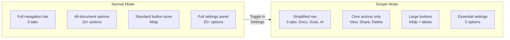

# 11 — Accessibility (a11y)

> **Project:** Kagaz
> **Standard:** WCAG 2.1 Level AA
> **Last Updated:** 2026-06-07

---

## Table of Contents

- [1. Accessibility Vision](#1-accessibility-vision)
- [2. WCAG 2.1 AA Compliance](#2-wcag-21-aa-compliance)
  - [2.1 Perceivable](#21-perceivable)
  - [2.2 Operable](#22-operable)
  - [2.3 Understandable](#23-understandable)
  - [2.4 Robust](#24-robust)
- [3. Kagaz Accessibility Features](#3-docvault-accessibility-features)
- [4. Implementation Guidelines](#4-implementation-guidelines)
- [5. Component Accessibility Patterns](#5-component-accessibility-patterns)
- [6. Testing Strategy](#6-testing-strategy)
- [7. Accessibility Checklist](#7-accessibility-checklist)

---

## 1. Accessibility Vision

Kagaz serves users across India — including those in rural areas with varying levels of digital literacy, seniors, and users with disabilities. Accessibility is not an afterthought; it is a **core design requirement**.

### Target Users

| User Group | Needs | Kagaz Response |
|---|---|---|
| **Visually impaired** | Screen reader support, high contrast | ARIA labels, contrast compliance, TalkBack/VoiceOver tested |
| **Motor impaired** | Large touch targets, minimal precision needed | 48×48dp targets, simple gestures, no time limits |
| **Cognitively impaired** | Simple language, consistent patterns | 8th-grade reading level, "Simple Mode" |
| **Seniors** | Larger text, clearer UI, fewer options | Adjustable font size, Simple Mode, voice interaction |
| **Low-literacy users** | Icon-first UI, voice interaction | Visual cues, AI voice assistant, multilingual support |
| **Users with slow devices** | Reduced animations, efficient rendering | Reduced motion option, progressive loading |

---

## 2. WCAG 2.1 AA Compliance

### 2.1 Perceivable

Information and UI components must be presentable in ways users can perceive.

#### 2.1.1 Text Alternatives (1.1)

| Requirement | Implementation |
|---|---|
| All images have `alt` text | `` |
| Decorative images marked as such | `` |
| Icons have accessible labels | `<IonIcon aria-label="Delete document" />` |
| Document thumbnails | Alt text: `"Thumbnail preview of {document name}"` |
| AI assistant avatar | Alt text: `"Kagaz AI Assistant"` |

#### 2.1.2 Color Independence (1.4.1)

Color is **never** the sole means of conveying information:

| Scenario | ❌ Color Only | ✅ Color + Alternative |
|---|---|---|
| Favorite documents | Red heart icon | Red heart + "Favorite" label + filled vs outline |
| Operation status | Green/Red dot | Colored dot + text label ("Completed" / "Failed") |
| Tag colors | Colored chip only | Color + tag name text |
| Form errors | Red border | Red border + error icon + error message text |
| Locked documents | Blue lock icon | Lock icon + "Locked" badge + tooltip |

#### 2.1.3 Contrast Ratios (1.4.3, 1.4.6)

| Element | Minimum Ratio | Kagaz Target |
|---|---|---|
| Normal text (< 18px / < 14px bold) | 4.5:1 | **5:1** |
| Large text (≥ 18px / ≥ 14px bold) | 3:1 | **4:1** |
| UI components & graphics | 3:1 | **3.5:1** |
| Focus indicators | 3:1 | **3.5:1** |

```css
/* Kagaz color tokens with contrast-safe values */
:root {
  /* Text colors — all meet 4.5:1 on white background */
  --text-primary: #1a1a2e;       /* 15.4:1 on white */
  --text-secondary: #4a4a6a;     /* 7.2:1 on white  */
  --text-tertiary: #6b6b8a;      /* 4.6:1 on white  */

  /* Interactive colors — all meet 3:1 on white */
  --color-primary: #1565c0;      /* 5.8:1 on white  */
  --color-error: #c62828;        /* 5.5:1 on white  */
  --color-success: #2e7d32;      /* 4.9:1 on white  */

  /* Focus ring */
  --focus-ring: 0 0 0 3px rgba(21, 101, 192, 0.5);
}
```

#### 2.1.4 Text Resizing (1.4.4)

| Requirement | Implementation |
|---|---|
| Text resizable to **200%** without loss | All text uses `rem` / `em` units, never `px` for font sizes |
| No horizontal scrolling at 200% | Responsive layout with flex/grid, `max-width` constraints |
| No content clipping | `overflow: visible` or scrollable containers |
| System font size respected | App reads and applies system accessibility font scale |

#### 2.1.5 Captions for Voice Output (1.2)

| Feature | Implementation |
|---|---|
| AI voice responses | On-screen text displayed simultaneously with audio |
| Voice commands | Visual echo of recognized speech |
| Audio notifications | Accompanied by visual/haptic notification |

---

### 2.2 Operable

UI components and navigation must be operable by all users.

#### 2.2.1 Keyboard Accessibility (2.1)

| Requirement | Implementation |
|---|---|
| All functionality keyboard accessible | Tab navigation through all interactive elements |
| No keyboard traps | `Escape` key always closes modals/overlays |
| Visible focus indicators | 3px solid ring with 3.5:1 contrast |
| Logical tab order | DOM order matches visual order |
| Skip links | "Skip to main content" link on every page |

```css
/* Focus indicator styles */
*:focus-visible {
  outline: 3px solid var(--color-primary);
  outline-offset: 2px;
  border-radius: 4px;
}

/* Remove focus for mouse users, keep for keyboard */
*:focus:not(:focus-visible) {
  outline: none;
}
```

#### 2.2.2 Touch Targets (2.5.5)

| Requirement | Kagaz Standard |
|---|---|
| **Minimum touch target** | **48 × 48 dp** (density-independent pixels) |
| **Recommended touch target** | **56 × 56 dp** for primary actions |
| **Spacing between targets** | Minimum **8dp** gap |
| **Simple Mode targets** | **64 × 64 dp** with 12dp gap |

```css
/* Ensure minimum touch target size */
.touchable {
  min-width: 48px;
  min-height: 48px;
  padding: 12px;
}

.touchable--primary {
  min-width: 56px;
  min-height: 56px;
}

/* Simple mode overrides */
.simple-mode .touchable {
  min-width: 64px;
  min-height: 64px;
  padding: 16px;
  font-size: 1.25rem;
}
```

#### 2.2.3 No Time Limits (2.2.1)

| Scenario | Policy |
|---|---|
| Document scanning | No timeout — user proceeds at their own pace |
| AI responses | No "typing" animation timeout |
| Form submission | No auto-expiry on unsaved forms |
| Session timeout | No session timeout (offline app) |
| Share link creation | No time pressure during creation flow |

#### 2.2.4 Focus Management (2.4.3)

| Scenario | Focus Behavior |
|---|---|
| Modal opens | Focus moves to modal title or first interactive element |
| Modal closes | Focus returns to the element that triggered the modal |
| Page navigation | Focus moves to page title (`<h1>`) |
| Toast notification | `aria-live="polite"` — doesn't steal focus |
| Error appears | Focus moves to first error field |
| Item deleted | Focus moves to next item in list (or previous if last) |

---

### 2.3 Understandable

Information and UI operation must be understandable.

#### 2.3.1 Reading Level (3.1.5)

| Requirement | Implementation |
|---|---|
| **Target reading level** | 8th grade (Flesch-Kincaid Grade 8) |
| **No jargon** | "Choose a document" not "Select an artifact" |
| **Short sentences** | Maximum 20 words per sentence in UI copy |
| **Action-oriented labels** | "Save", "Delete", "Share" — clear verbs |
| **Multilingual** | Same clarity standards in Hindi translations |

**Examples:**

| ❌ Complex | ✅ Simple |
|---|---|
| "Initiate document digitization process" | "Scan a document" |
| "Authenticate to access protected resources" | "Use fingerprint to unlock" |
| "Configure OCR parameters" | "Set up text recognition" |
| "The operation was terminated due to insufficient storage" | "Not enough space. Free up storage and try again." |

#### 2.3.2 Consistent Navigation (3.2.3)

| Pattern | Consistency Rule |
|---|---|
| **Bottom navigation** | Always present, same order, same icons |
| **Back button** | Always top-left, always goes back one step |
| **FAB (Floating Action Button)** | Always bottom-right, always primary action |
| **Search** | Always top of page, same behavior |
| **Settings** | Always accessible from profile/menu |

#### 2.3.3 Error Handling (3.3)

| Requirement | Implementation |
|---|---|
| **Error identification** | Errors clearly marked with icon + red text |
| **Error description** | Plain-language explanation of what went wrong |
| **Error suggestion** | Actionable suggestion for how to fix |
| **Error prevention** | Confirmation dialogs for destructive actions |
| **Input validation** | Real-time validation with helpful messages |

```tsx
// Example: Accessible error message
<div role="alert" aria-live="assertive">
  <IonIcon icon={alertCircle} aria-hidden="true" />
  <span className="error-message">
    File is too large. Maximum size is 25 MB.
    Try compressing the document first.
  </span>
</div>
```

#### 2.3.4 Labels & Instructions (3.3.2)

| Requirement | Implementation |
|---|---|
| All form inputs have visible labels | `<label>` associated via `htmlFor` / `id` |
| Placeholder text is supplementary | Never replaces labels |
| Required fields marked | Visual asterisk + `aria-required="true"` |
| Help text provided | `aria-describedby` linking input to help text |

---

### 2.4 Robust

Content must be robust enough to be interpreted by assistive technologies.

#### 2.4.1 Semantic HTML (4.1.1)

| Element | Usage |
|---|---|
| `<header>` | Page headers |
| `<nav>` | Navigation menus |
| `<main>` | Primary content area |
| `<article>` | Document cards |
| `<section>` | Grouped content areas |
| `<aside>` | Supplementary panels |
| `<button>` | Clickable actions (never `<div onClick>`) |
| `<a>` | Navigation links |
| Headings (`h1`–`h6`) | Hierarchical structure, never skipping levels |

#### 2.4.2 ARIA Attributes (4.1.2)

| Scenario | ARIA Usage |
|---|---|
| Loading states | `aria-busy="true"` on container |
| Expandable sections | `aria-expanded="true/false"` |
| Live regions | `aria-live="polite"` for status updates |
| Modals | `role="dialog"`, `aria-modal="true"`, `aria-labelledby` |
| Tabs | `role="tablist"`, `role="tab"`, `role="tabpanel"` |
| Custom dropdowns | `role="listbox"`, `role="option"`, `aria-selected` |
| Progress indicators | `role="progressbar"`, `aria-valuenow`, `aria-valuemin`, `aria-valuemax` |
| Toggle switches | `role="switch"`, `aria-checked` |

> [!TIP]
> **ARIA first rule**: Don't use ARIA if a native HTML element provides the same semantics. Use `<button>` instead of `<div role="button">`. Use `<input type="checkbox">` instead of `<span role="checkbox">`.

#### 2.4.3 Screen Reader Testing (4.1)

| Platform | Screen Reader | Testing Priority |
|---|---|---|
| **Android** | TalkBack | 🔴 Primary (largest user base) |
| **iOS** | VoiceOver | 🔴 Primary |
| **Web (dev)** | NVDA (Windows) / VoiceOver (macOS) | 🟡 Development testing |

#### 2.4.4 System Settings Compatibility

| System Setting | Kagaz Behavior |
|---|---|
| **System font size** (small → largest) | App scales all text proportionally |
| **Bold text** | App respects system bold text setting |
| **High contrast mode** | App applies high-contrast theme |
| **Reduced motion** | All animations disabled, transitions instant |
| **Dark mode** | Full dark theme with maintained contrast |
| **Color inversion** | UI remains usable with inverted colors |

---

## 3. Kagaz Accessibility Features

Beyond WCAG compliance, Kagaz includes purpose-built accessibility features:

### Feature Matrix

| Feature | Description | Target Users | Version |
|---|---|---|---|
| **Font Size Adjustment** | In-app slider: Small → Default → Large → Extra Large | Seniors, low vision | V1 |
| **High Contrast Mode** | Enhanced contrast theme beyond system settings | Low vision | V1 |
| **Reduced Motion** | Disables all animations and transitions | Vestibular disorders, motion sensitivity | V1 |
| **Voice-First Interaction** | AI assistant as primary interface for all operations | Low literacy, motor impaired, seniors | V1 |
| **Simple Mode** | Fewer options, bigger buttons, simplified navigation | Seniors, low digital literacy | V1 |
| **RTL Layout Support** | Right-to-left layout preparation for Urdu | RTL language users | V2 |

### Simple Mode



**Simple Mode changes:**

| Aspect | Normal Mode | Simple Mode |
|---|---|---|
| Navigation tabs | 5 (Vault, Scan, AI, Tools, Settings) | 3 (Documents, Scan, Help) |
| Document actions | 10+ context actions | 4 (View, Share, Delete, Info) |
| Button size | 48dp | 64dp with text labels |
| Font size | System default | 1.25× system default |
| Animations | Standard | Disabled |
| AI interaction | Text + voice | Voice-first with large response text |
| Sorting/filtering | Multiple options | By date only |
| Batch operations | Available | Hidden |

### Voice-First Interaction

The AI assistant enables voice-based interaction for all major operations:

| Task | Voice Command Example |
|---|---|
| Search | "Find my Aadhaar card" |
| Organize | "Move this to the Government folder" |
| Scan | "Scan a new document" |
| Info | "When does my passport expire?" |
| Delete | "Delete the oldest document in Trash" |

> [!NOTE]
> Voice interaction is powered by the on-device AI assistant. Speech-to-text (STT) and text-to-speech (TTS) are available in Hindi and English.

---

## 4. Implementation Guidelines

### Component Development Rules

```typescript
// ✅ GOOD: Accessible button component
const DocumentAction: React.FC<{
  label: string;
  icon: string;
  onClick: () => void;
  destructive?: boolean;
}> = ({ label, icon, onClick, destructive }) => (
  <button
    className="document-action"
    onClick={onClick}
    aria-label={label}
    role="button"
    style={{ minWidth: 48, minHeight: 48 }}
  >
    <IonIcon icon={icon} aria-hidden="true" />
    <span className="action-label">{label}</span>
  </button>
);

// ❌ BAD: Inaccessible interaction
const DocumentAction = ({ icon, onClick }) => (
  <div onClick={onClick} style={{ padding: 4 }}>
    
  </div>
);
```

### Accessibility Code Review Checklist

For every PR, verify:

1. ☐ All interactive elements are `<button>` or `<a>`, never `<div onClick>`
2. ☐ All images have meaningful `alt` text or `alt=""`
3. ☐ All form inputs have associated `<label>` elements
4. ☐ Touch targets are minimum 48 × 48dp
5. ☐ Color is not the only indicator of state
6. ☐ Focus management is correct for modals/navigation
7. ☐ `aria-live` used for dynamic content updates
8. ☐ Heading hierarchy is correct (`h1` → `h2` → `h3`, no skips)
9. ☐ Text uses `rem`/`em`, not `px`
10. ☐ Component works with 200% text zoom

---

## 5. Component Accessibility Patterns

### Document Card

```tsx
<article
  role="article"
  aria-label={`Document: ${doc.name}, ${doc.fileType}, ${formatSize(doc.fileSize)}`}
  className="document-card"
>
  
  <div className="card-content">
    <h3>{doc.name}</h3>
    <p className="card-meta" aria-label={`Size: ${formatSize(doc.fileSize)}, Created: ${formatDate(doc.createdAt)}`}>
      {formatSize(doc.fileSize)} • {formatDate(doc.createdAt)}
    </p>
    {doc.isLocked && (
      <span className="badge" aria-label="This document is locked">
        <IonIcon icon={lockClosed} aria-hidden="true" />
        Locked
      </span>
    )}
  </div>
  <button
    aria-label={`More options for ${doc.name}`}
    className="card-menu-trigger"
  >
    <IonIcon icon={ellipsisVertical} aria-hidden="true" />
  </button>
</article>
```

### Modal Dialog

```tsx
<div
  role="dialog"
  aria-modal="true"
  aria-labelledby="modal-title"
  aria-describedby="modal-description"
  className="modal-overlay"
  onKeyDown={(e) => e.key === 'Escape' && onClose()}
>
  <div className="modal-content" ref={modalRef}>
    <h2 id="modal-title">Delete Document</h2>
    <p id="modal-description">
      Are you sure you want to delete "{doc.name}"? This action cannot be undone.
    </p>
    <div className="modal-actions">
      <button onClick={onClose} autoFocus>Cancel</button>
      <button onClick={onDelete} className="destructive">
        Delete
      </button>
    </div>
  </div>
</div>
```

### Live Status Region

```tsx
{/* Announce status changes to screen readers */}
<div
  role="status"
  aria-live="polite"
  aria-atomic="true"
  className="sr-only"
>
  {statusMessage}
</div>

{/* Announce urgent errors immediately */}
<div
  role="alert"
  aria-live="assertive"
  className="sr-only"
>
  {errorMessage}
</div>
```

---

## 6. Testing Strategy

### Automated Testing

| Tool | Purpose | Integration |
|---|---|---|
| **axe-core** | Automated WCAG rule checking | Unit tests + CI/CD |
| **jest-axe** | Accessibility assertions in Jest | Component tests |
| **Lighthouse** | Accessibility audit scoring | CI/CD pipeline |
| **eslint-plugin-jsx-a11y** | Lint rules for JSX accessibility | IDE + pre-commit |

```typescript
// Example: jest-axe test
import { axe, toHaveNoViolations } from 'jest-axe';

expect.extend(toHaveNoViolations);

test('DocumentCard has no accessibility violations', async () => {
  const { container } = render(<DocumentCard doc={mockDocument} />);
  const results = await axe(container);
  expect(results).toHaveNoViolations();
});
```

### Manual Testing Protocol

| Test | Frequency | Tester |
|---|---|---|
| **TalkBack walkthrough** (Android) | Every sprint | QA team |
| **VoiceOver walkthrough** (iOS) | Every sprint | QA team |
| **Keyboard-only navigation** | Every PR with UI changes | Developer |
| **200% text zoom** | Every sprint | QA team |
| **High contrast mode** | Every sprint | QA team |
| **Reduced motion** | Every sprint | QA team |
| **Simple Mode** | Every sprint | QA team |
| **User testing with disabled users** | Quarterly | UX Research |

### Screen Reader Test Script

1. Open Kagaz → Verify app title is announced
2. Navigate bottom tabs → Verify each tab label is announced
3. Open document list → Verify document name, type, and size are announced
4. Open document actions → Verify action labels are announced
5. Open AI assistant → Verify chat messages are announced as they arrive
6. Use search → Verify results count is announced
7. Open/close modal → Verify focus management
8. Navigate with swipe gestures → Verify logical reading order

---

## 7. Accessibility Checklist

### Per-Component Checklist

| # | Check | WCAG | Priority |
|---|---|---|---|
| 1 | Has meaningful `alt` text or `aria-label` | 1.1.1 | P0 |
| 2 | Meets contrast ratios (4.5:1 normal, 3:1 large) | 1.4.3 | P0 |
| 3 | Color is not sole indicator | 1.4.1 | P0 |
| 4 | Text uses relative units (`rem`/`em`) | 1.4.4 | P0 |
| 5 | Touch target ≥ 48 × 48dp | 2.5.5 | P0 |
| 6 | Keyboard navigable | 2.1.1 | P0 |
| 7 | Visible focus indicator | 2.4.7 | P0 |
| 8 | Correct heading hierarchy | 1.3.1 | P1 |
| 9 | Form inputs have labels | 3.3.2 | P0 |
| 10 | Error messages are descriptive | 3.3.1 | P1 |
| 11 | Uses semantic HTML | 4.1.1 | P1 |
| 12 | ARIA used correctly (or not at all) | 4.1.2 | P1 |
| 13 | Works at 200% zoom | 1.4.4 | P1 |
| 14 | No time-dependent interactions | 2.2.1 | P1 |
| 15 | Focus managed on open/close | 2.4.3 | P1 |

---

*Accessibility is a continuous effort, not a one-time checklist. Every feature in Kagaz must be usable by every user, regardless of ability.*
