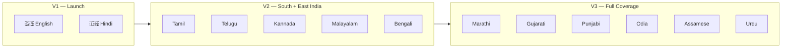
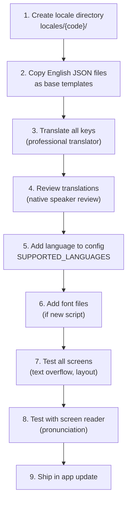

# 12 — Internationalization & Multilingual Support (i18n)

> **Project:** Kagaz
> **Framework:** react-i18next
> **Default Language:** English (en)
> **Last Updated:** 2026-06-07

---

## Table of Contents

- [1. Multilingual Vision](#1-multilingual-vision)
- [2. Language Support Roadmap](#2-language-support-roadmap)
- [3. Implementation Architecture](#3-implementation-architecture)
  - [3.1 Technology Stack](#31-technology-stack)
  - [3.2 Translation File Structure](#32-translation-file-structure)
  - [3.3 i18n Configuration](#33-i18n-configuration)
  - [3.4 Type-Safe Translations](#34-type-safe-translations)
- [4. Translation Namespaces](#4-translation-namespaces)
- [5. Formatting & Localization](#5-formatting--localization)
- [6. RTL Layout Support](#6-rtl-layout-support)
- [7. Font Strategy](#7-font-strategy)
- [8. Multilingual Document Handling](#8-multilingual-document-handling)
- [9. AI Multilingual Capabilities](#9-ai-multilingual-capabilities)
- [10. Voice: STT & TTS](#10-voice-stt--tts)
- [11. Translation Workflow](#11-translation-workflow)
- [12. Quality Assurance](#12-quality-assurance)

---

## 1. Multilingual Vision

India has **22 official languages** and hundreds of dialects. Kagaz is designed to be accessible to users regardless of their primary language. The multilingual strategy follows a phased approach — starting with Hindi and English, then expanding to major regional languages.



---

## 2. Language Support Roadmap

### V1 — Launch Languages

| Language | Code | Script | Direction | Status |
|---|---|---|---|---|
| English | `en` | Latin | LTR | ✅ Default |
| Hindi (हिन्दी) | `hi` | Devanagari | LTR | ✅ V1 |

### V2 — Regional Expansion

| Language | Code | Script | Direction | Speakers (M) |
|---|---|---|---|---|
| Tamil (தமிழ்) | `ta` | Tamil | LTR | ~78M |
| Telugu (తెలుగు) | `te` | Telugu | LTR | ~83M |
| Kannada (ಕನ್ನಡ) | `kn` | Kannada | LTR | ~44M |
| Malayalam (മലയാളം) | `ml` | Malayalam | LTR | ~38M |
| Bengali (বাংলা) | `bn` | Bengali | LTR | ~100M |

### V3 — Full Indian Language Coverage

| Language | Code | Script | Direction | Speakers (M) |
|---|---|---|---|---|
| Marathi (मराठी) | `mr` | Devanagari | LTR | ~83M |
| Gujarati (ગુજરાતી) | `gu` | Gujarati | LTR | ~56M |
| Punjabi (ਪੰਜਾਬੀ) | `pa` | Gurmukhi | LTR | ~51M |
| Odia (ଓଡ଼ିଆ) | `or` | Odia | LTR | ~38M |
| Assamese (অসমীয়া) | `as` | Bengali | LTR | ~15M |
| Urdu (اردو) | `ur` | Nastaliq | **RTL** | ~69M |

> [!IMPORTANT]
> Urdu is the only **RTL** (right-to-left) language in the roadmap. RTL layout support must be prepared in V1/V2 architecture to avoid costly retrofitting.

---

## 3. Implementation Architecture

### 3.1 Technology Stack

| Component | Technology | Purpose |
|---|---|---|
| **Translation framework** | `react-i18next` | React integration for i18next |
| **Core engine** | `i18next` | Translation resolution, interpolation, pluralization |
| **Language detection** | `i18next-browser-languagedetector` | Auto-detect from device settings |
| **Backend** | `i18next-resources-to-backend` | Lazy-load translation files |
| **Date/time formatting** | `Intl.DateTimeFormat` | Native browser/device API |
| **Number formatting** | `Intl.NumberFormat` | Native browser/device API |
| **Font rendering** | Google Noto Sans family | Universal script coverage |

### 3.2 Translation File Structure

```
src/core/i18n/
├── config.ts                    # i18n initialization & configuration
├── types.ts                     # Type-safe translation keys
├── utils.ts                     # Formatting helpers
├── locales/
│   ├── en/                      # English (default)
│   │   ├── common.json          # Shared: buttons, labels, errors
│   │   ├── documents.json       # Document vault screens
│   │   ├── ai-assistant.json    # AI chat interface
│   │   ├── settings.json        # Settings & preferences
│   │   ├── scanner.json         # Scan & capture screens
│   │   ├── tools.json           # Document tools (merge, split, etc.)
│   │   ├── sharing.json         # V2: Sharing features
│   │   └── csc-services.json    # V3: CSC service catalog
│   ├── hi/                      # Hindi (हिन्दी)
│   │   ├── common.json
│   │   ├── documents.json
│   │   ├── ai-assistant.json
│   │   ├── settings.json
│   │   ├── scanner.json
│   │   ├── tools.json
│   │   ├── sharing.json
│   │   └── csc-services.json
│   ├── ta/                      # Tamil (V2)
│   │   └── ...
│   ├── te/                      # Telugu (V2)
│   │   └── ...
│   └── ur/                      # Urdu (V3 — RTL)
│       └── ...
└── hooks/
    ├── useTranslation.ts        # Typed useTranslation hook
    └── useLocale.ts             # Current locale info & formatters
```

### 3.3 i18n Configuration

```typescript
// src/core/i18n/config.ts
import i18n from 'i18next';
import { initReactI18next } from 'react-i18next';
import LanguageDetector from 'i18next-browser-languagedetector';
import resourcesToBackend from 'i18next-resources-to-backend';

const SUPPORTED_LANGUAGES = ['en', 'hi'] as const;
const DEFAULT_LANGUAGE = 'en';
const NAMESPACES = [
  'common',
  'documents',
  'ai-assistant',
  'settings',
  'scanner',
  'tools',
  'sharing',
  'csc-services',
] as const;

i18n
  // Lazy-load translation files
  .use(
    resourcesToBackend(
      (language: string, namespace: string) =>
        import(`./locales/${language}/${namespace}.json`)
    )
  )
  // Auto-detect user language from device settings
  .use(LanguageDetector)
  // React integration
  .use(initReactI18next)
  .init({
    // Supported languages
    supportedLngs: SUPPORTED_LANGUAGES,
    fallbackLng: DEFAULT_LANGUAGE,

    // Namespaces
    ns: NAMESPACES,
    defaultNS: 'common',

    // Detection priority
    detection: {
      order: ['localStorage', 'navigator'],
      caches: ['localStorage'],
    },

    // Interpolation (React handles escaping)
    interpolation: {
      escapeValue: false,
    },

    // Return key if translation is missing (dev mode)
    returnNull: false,
    returnEmptyString: false,

    // Debug mode in development
    debug: process.env.NODE_ENV === 'development',
  });

export default i18n;
export { SUPPORTED_LANGUAGES, DEFAULT_LANGUAGE, NAMESPACES };
```

### 3.4 Type-Safe Translations

```typescript
// src/core/i18n/types.ts
import type en_common from './locales/en/common.json';
import type en_documents from './locales/en/documents.json';
import type en_aiAssistant from './locales/en/ai-assistant.json';
import type en_settings from './locales/en/settings.json';
import type en_scanner from './locales/en/scanner.json';
import type en_tools from './locales/en/tools.json';

// Type-safe namespace map
export interface TranslationResources {
  common: typeof en_common;
  documents: typeof en_documents;
  'ai-assistant': typeof en_aiAssistant;
  settings: typeof en_settings;
  scanner: typeof en_scanner;
  tools: typeof en_tools;
}

// Augment i18next types for autocomplete
declare module 'i18next' {
  interface CustomTypeOptions {
    defaultNS: 'common';
    resources: TranslationResources;
  }
}
```

**Usage in components:**

```tsx
import { useTranslation } from 'react-i18next';

const DocumentList: React.FC = () => {
  const { t } = useTranslation('documents');

  return (
    <div>
      <h1>{t('title')}</h1>                              {/* "My Documents" */}
      <p>{t('empty_state.message')}</p>                   {/* "No documents yet" */}
      <button>{t('actions.scan', { ns: 'common' })}</button>  {/* "Scan" */}
    </div>
  );
};
```

---

## 4. Translation Namespaces

### Namespace Breakdown

| Namespace | Scope | Key Count (est.) |
|---|---|---|
| `common` | Buttons, labels, errors, shared UI text | ~100 keys |
| `documents` | Document list, detail, preview, management | ~80 keys |
| `ai-assistant` | Chat interface, suggestions, tool descriptions | ~60 keys |
| `settings` | All settings screens, preferences | ~50 keys |
| `scanner` | Camera, scan, crop, enhance screens | ~40 keys |
| `tools` | Merge, split, compress, convert, watermark | ~50 keys |
| `sharing` | Share link creation, access, revocation (V2) | ~40 keys |
| `csc-services` | CSC service catalog, applications (V3) | ~60 keys |

### Sample Translation Files

#### `common.json` (English)

```json
{
  "app_name": "Kagaz",
  "buttons": {
    "save": "Save",
    "cancel": "Cancel",
    "delete": "Delete",
    "share": "Share",
    "back": "Back",
    "done": "Done",
    "retry": "Try Again",
    "confirm": "Confirm",
    "close": "Close"
  },
  "labels": {
    "search": "Search documents...",
    "loading": "Loading...",
    "no_results": "No results found",
    "favorites": "Favorites",
    "recent": "Recent",
    "all_documents": "All Documents"
  },
  "errors": {
    "generic": "Something went wrong. Please try again.",
    "no_storage": "Not enough storage space. Free up space and try again.",
    "file_too_large": "File is too large. Maximum size is {{maxSize}} MB.",
    "unsupported_format": "This file format is not supported.",
    "biometric_failed": "Authentication failed. Please try again."
  },
  "confirmations": {
    "delete_title": "Delete Document?",
    "delete_message": "\"{{name}}\" will be permanently deleted. This cannot be undone.",
    "delete_confirm": "Delete"
  },
  "time": {
    "just_now": "Just now",
    "minutes_ago": "{{count}} minute ago",
    "minutes_ago_plural": "{{count}} minutes ago",
    "hours_ago": "{{count}} hour ago",
    "hours_ago_plural": "{{count}} hours ago",
    "today": "Today",
    "yesterday": "Yesterday"
  }
}
```

#### `common.json` (Hindi)

```json
{
  "app_name": "Kagaz",
  "buttons": {
    "save": "सहेजें",
    "cancel": "रद्द करें",
    "delete": "हटाएं",
    "share": "साझा करें",
    "back": "वापस",
    "done": "पूर्ण",
    "retry": "फिर से प्रयास करें",
    "confirm": "पुष्टि करें",
    "close": "बंद करें"
  },
  "labels": {
    "search": "दस्तावेज़ खोजें...",
    "loading": "लोड हो रहा है...",
    "no_results": "कोई परिणाम नहीं मिला",
    "favorites": "पसंदीदा",
    "recent": "हाल के",
    "all_documents": "सभी दस्तावेज़"
  },
  "errors": {
    "generic": "कुछ गलत हो गया। कृपया फिर से प्रयास करें।",
    "no_storage": "पर्याप्त स्टोरेज नहीं है। जगह खाली करें और फिर से प्रयास करें।",
    "file_too_large": "फ़ाइल बहुत बड़ी है। अधिकतम आकार {{maxSize}} MB है।",
    "unsupported_format": "यह फ़ाइल प्रारूप समर्थित नहीं है।",
    "biometric_failed": "प्रमाणीकरण विफल। कृपया फिर से प्रयास करें।"
  },
  "confirmations": {
    "delete_title": "दस्तावेज़ हटाएं?",
    "delete_message": "\"{{name}}\" स्थायी रूप से हटा दिया जाएगा। यह पूर्ववत नहीं किया जा सकता।",
    "delete_confirm": "हटाएं"
  },
  "time": {
    "just_now": "अभी",
    "minutes_ago": "{{count}} मिनट पहले",
    "minutes_ago_plural": "{{count}} मिनट पहले",
    "hours_ago": "{{count}} घंटा पहले",
    "hours_ago_plural": "{{count}} घंटे पहले",
    "today": "आज",
    "yesterday": "कल"
  }
}
```

---

## 5. Formatting & Localization

All date, number, and currency formatting uses the native **Intl API** for locale-aware output.

### Date & Time Formatting

```typescript
// src/core/i18n/utils.ts

export function formatDate(date: string | Date, locale: string): string {
  return new Intl.DateTimeFormat(locale, {
    year: 'numeric',
    month: 'long',
    day: 'numeric',
  }).format(new Date(date));
}

export function formatDateTime(date: string | Date, locale: string): string {
  return new Intl.DateTimeFormat(locale, {
    year: 'numeric',
    month: 'short',
    day: 'numeric',
    hour: '2-digit',
    minute: '2-digit',
  }).format(new Date(date));
}

export function formatRelativeTime(date: string | Date, locale: string): string {
  const rtf = new Intl.RelativeTimeFormat(locale, { numeric: 'auto' });
  const diff = Date.now() - new Date(date).getTime();
  const minutes = Math.floor(diff / 60000);

  if (minutes < 1) return rtf.format(0, 'minute');       // "now" / "अभी"
  if (minutes < 60) return rtf.format(-minutes, 'minute');  // "5 minutes ago"
  const hours = Math.floor(minutes / 60);
  if (hours < 24) return rtf.format(-hours, 'hour');      // "3 hours ago"
  const days = Math.floor(hours / 24);
  return rtf.format(-days, 'day');                         // "2 days ago"
}
```

### Number & File Size Formatting

```typescript
export function formatNumber(value: number, locale: string): string {
  return new Intl.NumberFormat(locale).format(value);
}

export function formatFileSize(bytes: number, locale: string): string {
  const units = ['B', 'KB', 'MB', 'GB'];
  let size = bytes;
  let unitIndex = 0;

  while (size >= 1024 && unitIndex < units.length - 1) {
    size /= 1024;
    unitIndex++;
  }

  return `${new Intl.NumberFormat(locale, {
    maximumFractionDigits: 1,
  }).format(size)} ${units[unitIndex]}`;
}

export function formatCurrency(amount: number, locale: string): string {
  return new Intl.NumberFormat(locale, {
    style: 'currency',
    currency: 'INR',
  }).format(amount);
}
```

### Formatting Examples by Locale

| Format | English (`en-IN`) | Hindi (`hi-IN`) |
|---|---|---|
| Date | June 7, 2026 | 7 जून 2026 |
| Number | 1,25,000 | 1,25,000 |
| File size | 2.5 MB | 2.5 MB |
| Currency | ₹1,500.00 | ₹1,500.00 |
| Relative time | 3 hours ago | 3 घंटे पहले |

---

## 6. RTL Layout Support

While Urdu (RTL) support is planned for V3, the architecture must be **RTL-ready** from V1 to avoid costly retrofitting.

### RTL Preparation Strategy

| Aspect | LTR (Default) | RTL (Urdu) | Implementation |
|---|---|---|---|
| Text direction | Left → Right | Right → Left | `dir="rtl"` on `<html>` |
| Layout flow | Flex start = left | Flex start = right | CSS logical properties |
| Icons | Arrow → | Arrow ← | Mirrored via CSS `transform` |
| Navigation | Swipe right = back | Swipe left = back | Gesture handler config |
| Text alignment | Left-aligned | Right-aligned | `text-align: start` |

### CSS Logical Properties

```css
/* ❌ Physical properties (breaks in RTL) */
.card {
  margin-left: 16px;
  padding-right: 8px;
  text-align: left;
  border-left: 2px solid blue;
}

/* ✅ Logical properties (works in LTR and RTL) */
.card {
  margin-inline-start: 16px;
  padding-inline-end: 8px;
  text-align: start;
  border-inline-start: 2px solid blue;
}
```

### Logical Property Reference

| Physical (Don't Use) | Logical (Use Instead) |
|---|---|
| `margin-left` | `margin-inline-start` |
| `margin-right` | `margin-inline-end` |
| `padding-left` | `padding-inline-start` |
| `padding-right` | `padding-inline-end` |
| `text-align: left` | `text-align: start` |
| `text-align: right` | `text-align: end` |
| `border-left` | `border-inline-start` |
| `left: 0` | `inset-inline-start: 0` |
| `float: left` | `float: inline-start` |

> [!TIP]
> Adopt CSS logical properties from day one. Even if RTL languages are planned for V3, using logical properties has **zero** performance cost and prevents the need for a full CSS audit later.

---

## 7. Font Strategy

### Noto Sans — Universal Indian Script Support

Kagaz uses the **Google Noto Sans** family, which provides consistent, high-quality rendering across all Indian scripts.

| Script | Font | Languages |
|---|---|---|
| Latin | Noto Sans | English |
| Devanagari | Noto Sans Devanagari | Hindi, Marathi |
| Tamil | Noto Sans Tamil | Tamil |
| Telugu | Noto Sans Telugu | Telugu |
| Kannada | Noto Sans Kannada | Kannada |
| Malayalam | Noto Sans Malayalam | Malayalam |
| Bengali | Noto Sans Bengali | Bengali, Assamese |
| Gujarati | Noto Sans Gujarati | Gujarati |
| Gurmukhi | Noto Sans Gurmukhi | Punjabi |
| Odia | Noto Sans Odia | Odia |
| Arabic (Nastaliq) | Noto Nastaliq Urdu | Urdu |

### Font Loading Strategy

```css
/* Base font stack */
:root {
  --font-family: 'Noto Sans', 'Noto Sans Devanagari', system-ui, sans-serif;
}

/* Lazy-load script-specific fonts only when needed */
@font-face {
  font-family: 'Noto Sans Devanagari';
  src: url('/fonts/NotoSansDevanagari-Regular.woff2') format('woff2');
  font-weight: 400;
  font-display: swap;
  unicode-range: U+0900-097F, U+1CD0-1CF9, U+200C-200D, U+20A8, U+20B9, U+25CC, U+A8E0-A8F7;
}

@font-face {
  font-family: 'Noto Sans Devanagari';
  src: url('/fonts/NotoSansDevanagari-Bold.woff2') format('woff2');
  font-weight: 700;
  font-display: swap;
  unicode-range: U+0900-097F, U+1CD0-1CF9, U+200C-200D, U+20A8, U+20B9, U+25CC, U+A8E0-A8F7;
}
```

> [!NOTE]
> Using `unicode-range` in `@font-face` ensures that script-specific fonts are downloaded **only when characters from that script appear on screen**. This keeps the initial bundle small while supporting all languages.

---

## 8. Multilingual Document Handling

### Document Names in Any Language

Users can create document names in **any language**. The database stores Unicode text natively.

```typescript
// These are all valid document names
const documents = [
  { name: 'Aadhaar Card' },           // English
  { name: 'आधार कार्ड' },               // Hindi
  { name: 'আধার কার্ড' },               // Bengali
  { name: 'ஆதார் அட்டை' },              // Tamil
  { name: 'آدھار کارڈ' },               // Urdu
];
```

### Cross-Language Search

Search must work across all languages. The FTS5 `unicode61` tokenizer handles this:

```sql
-- English search finds English names
SELECT * FROM documents_fts WHERE documents_fts MATCH 'aadhaar';

-- Hindi search finds Hindi names
SELECT * FROM documents_fts WHERE documents_fts MATCH 'आधार';

-- Both appear in results for a broad search
```

### Transliteration Support (Future)

For V2+, transliteration enables searching in one script to find documents named in another:

| Search Input (English) | Finds (Hindi) | Mechanism |
|---|---|---|
| "aadhaar" | "आधार कार्ड" | Transliteration mapping |
| "pan card" | "पैन कार्ड" | Transliteration + keyword mapping |
| "driving license" | "ड्राइविंग लाइसेंस" | Bilingual synonym mapping |

```typescript
// Future: Transliteration helper
function transliterate(input: string, fromScript: string, toScript: string): string {
  // Uses a transliteration library (e.g., sanscript.js)
  return sanscript.t(input, fromScript, toScript);
}

// Search with transliteration fallback
async function searchDocuments(query: string, locale: string): Promise<Document[]> {
  // Direct search
  let results = await documentDAO.search(query);

  // If few results and query is in Latin script, try transliteration
  if (results.length < 3 && /^[a-zA-Z\s]+$/.test(query)) {
    const transliterated = transliterate(query, 'itrans', 'devanagari');
    const additionalResults = await documentDAO.search(transliterated);
    results = [...results, ...additionalResults];
  }

  return deduplicateById(results);
}
```

---

## 9. AI Multilingual Capabilities

### Language Detection & Response

The AI assistant detects the user's language and responds accordingly:

| User Input | AI Response Language | Behavior |
|---|---|---|
| English message | English | Direct response |
| Hindi message | Hindi | Response in Hindi |
| Mixed (Hinglish) | Hindi + English | Code-switched response |
| Other language | App language setting | Fallback to user's configured language |

### Code-Switching Support

Many Indian users naturally mix Hindi and English ("Hinglish"). The AI understands and responds in kind:

```
User:  "Mera Aadhaar card kahan hai?"
AI:    "Aapka Aadhaar card 'Government Documents' folder mein hai.
        Last updated 3 din pehle."
```

### AI System Prompt (Language Awareness)

```typescript
const systemPrompt = `You are Kagaz AI, a helpful document management assistant.
Respond in the same language the user writes in.
If the user mixes Hindi and English, respond in the same mixed style.
Use simple, clear language at an 8th-grade reading level.
Current UI language: ${currentLocale}
User's preferred language: ${userLanguagePreference}`;
```

---

## 10. Voice: STT & TTS

### Speech-to-Text (STT)

| Feature | V1 Support |
|---|---|
| **English STT** | ✅ Via Web Speech API / device native |
| **Hindi STT** | ✅ Via Web Speech API / device native |
| **Code-switched input** | ⚠️ Best-effort (depends on device STT engine) |
| **Continuous listening** | ❌ Tap-to-speak only (privacy) |

### Text-to-Speech (TTS)

| Feature | V1 Support |
|---|---|
| **English TTS** | ✅ Native device voices |
| **Hindi TTS** | ✅ Native device voices |
| **Speed control** | ✅ Configurable in settings |
| **Voice selection** | ✅ System voice list |

### Implementation

```typescript
// Speech-to-text (Web Speech API)
function startListening(language: string): Promise<string> {
  return new Promise((resolve, reject) => {
    const recognition = new (window.SpeechRecognition ||
      window.webkitSpeechRecognition)();
    recognition.lang = language; // 'en-IN' or 'hi-IN'
    recognition.interimResults = false;
    recognition.maxAlternatives = 1;

    recognition.onresult = (event) => {
      resolve(event.results[0][0].transcript);
    };
    recognition.onerror = (event) => reject(event.error);
    recognition.start();
  });
}

// Text-to-speech
function speak(text: string, language: string): void {
  const utterance = new SpeechSynthesisUtterance(text);
  utterance.lang = language; // 'en-IN' or 'hi-IN'
  utterance.rate = getUserTTSSpeed(); // 0.5 – 2.0
  speechSynthesis.speak(utterance);
}
```

---

## 11. Translation Workflow

### Adding a New Language



### Translation Key Conventions

| Convention | Example | Rule |
|---|---|---|
| **Dot notation** | `errors.file_too_large` | Use dots for hierarchy |
| **Snake case** | `no_results_found` | Lowercase with underscores |
| **Interpolation** | `{{count}} documents` | Double curly braces |
| **Pluralization** | `_one`, `_other` suffixes | i18next plural format |
| **Context** | `document_delete`, `folder_delete` | Prefix with domain |
| **Max key depth** | 3 levels | `section.group.key` |

### Translation Review Checklist

| # | Check | Details |
|---|---|---|
| 1 | All keys translated | No missing translations |
| 2 | No English leftovers | No untranslated strings |
| 3 | Interpolation variables intact | `{{count}}` not translated |
| 4 | Text fits UI | No overflow or clipping |
| 5 | Grammar correct | Native speaker verified |
| 6 | Consistent terminology | Same term for same concept |
| 7 | Cultural appropriateness | No offensive/insensitive content |
| 8 | Plural forms correct | All plural rules covered |

---

## 12. Quality Assurance

### Automated Checks

```typescript
// CI/CD: Check all languages have the same keys as English
import en_common from './locales/en/common.json';
import hi_common from './locales/hi/common.json';

function getKeys(obj: any, prefix = ''): string[] {
  return Object.entries(obj).flatMap(([key, value]) =>
    typeof value === 'object'
      ? getKeys(value, `${prefix}${key}.`)
      : [`${prefix}${key}`]
  );
}

test('Hindi common.json has all English keys', () => {
  const enKeys = getKeys(en_common);
  const hiKeys = getKeys(hi_common);
  const missing = enKeys.filter(k => !hiKeys.includes(k));
  expect(missing).toEqual([]);
});
```

### Visual Testing

| Test | Method | Frequency |
|---|---|---|
| **Text overflow** | Screenshot comparison across languages | Every PR |
| **Layout shift** | Verify no layout breaks with longer Hindi text | Every PR |
| **Font rendering** | Verify Devanagari renders correctly on all devices | Per release |
| **RTL layout** | Verify mirrored layout with Urdu (V3) | Per release |

### Pseudolocalization (Development)

During development, use pseudolocalization to detect i18n issues early:

```typescript
// Pseudo-locale for development testing
// "Save" → "[Šåvé!!!]" (longer text + special chars)
const pseudoLocalize = (text: string): string => {
  const map: Record<string, string> = {
    a: 'å', e: 'é', i: 'ï', o: 'ö', u: 'ü',
    A: 'Å', E: 'É', I: 'Ï', O: 'Ö', U: 'Ü',
  };
  const replaced = text.replace(/[aeiouAEIOU]/g, c => map[c] || c);
  return `[${replaced}!!!]`; // Brackets show missing translations, !!! adds length
};
```

> [!TIP]
> Pseudolocalization makes i18n issues **visually obvious** during development:
> - **Brackets** `[...]` show where hardcoded strings exist (no brackets = not translated)
> - **Extra characters** `!!!` simulate languages with longer text (catches overflow)
> - **Accents** `åéïöü` catch character encoding issues

---

*Kagaz's multilingual support is designed to serve every Indian language speaker with the same quality experience. Start with English and Hindi, but build the foundation for all 22 official languages from day one.*
