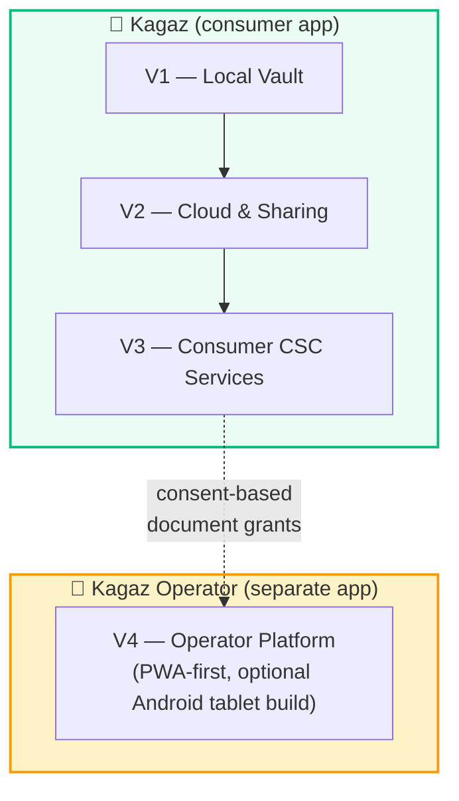
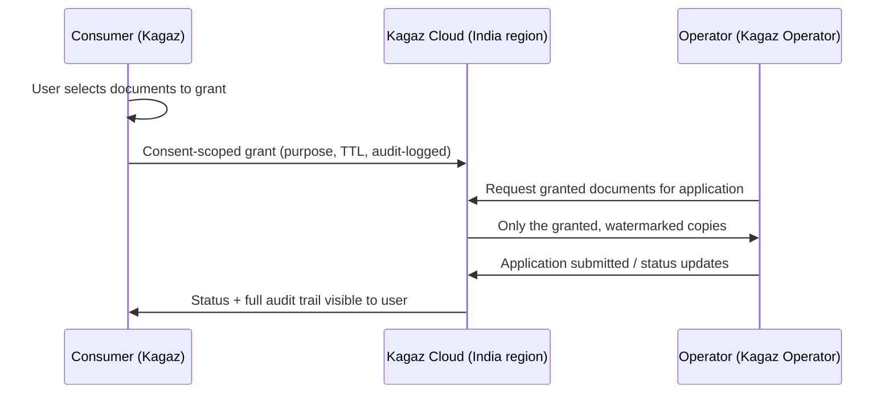

# 13 — App Portfolio

> **Project:** Kagaz
> **Purpose:** Defines the product portfolio — which apps exist, why the operator platform is a separate app, and what code they share.
> **Last Updated:** 2026-06-10

---

## Table of Contents

- [1. Portfolio Overview](#1-portfolio-overview)
- [2. The Two Apps](#2-the-two-apps)
- [3. Why Kagaz Operator Is a Separate App](#3-why-kagaz-operator-is-a-separate-app)
- [4. Shared Packages](#4-shared-packages)
- [5. Version Mapping](#5-version-mapping)
- [6. Data Boundaries Between Apps](#6-data-boundaries-between-apps)

---

## 1. Portfolio Overview

| App | Audience | Platforms | Revenue |
|---|---|---|---|
| **Kagaz** | Citizens (students, professionals, seniors, rural users) | Android (primary), iOS, PWA | Free + Premium ₹99/mo |
| **Kagaz Operator** | CSC operators / service agents | PWA (desktop/tablet first), optional Android tablet build | Subscription ₹499/mo |

---

## 2. The Two Apps

### Kagaz (consumer)

The privacy-first vault and services app described throughout `docs/architecture/00`–`12`. Offline-first, on-device AI, personal documents only.

### Kagaz Operator

The professional tool for CSC operators (V4 scope in [feature-priorities.md](../business-model/feature-priorities.md) §V4): operator KYC onboarding, dashboard, customer management with consent-based document grants, service processing workflows, subscription billing, GST invoicing, bulk processing, analytics.

---

## 3. Why Kagaz Operator Is a Separate App

| Concern | If it were a mode inside Kagaz | As a separate app |
|---|---|---|
| **Audience & UX** | Consumer phone UI carries desk-job CRM screens; Simple Mode users see operator clutter | Tablet/desktop-first workflows; consumer app stays minimal |
| **Trust & data boundary** | One binary handles *my* documents and *other people's* documents — blurred mental model, larger attack surface | Hard separation: operator app only ever sees **granted** documents, never the consumer vault |
| **Privacy posture** | Consumer app's "no data collected" story is diluted by operator telemetry/billing needs | Consumer privacy claims stay clean; operator app has its own policy |
| **Bundle size & perf budgets** | CRM + analytics + billing code threatens the < 500KB consumer budget | Each app meets its own budget |
| **Release cadence** | Operator features (GST rules, billing) force consumer releases | Independent release trains |
| **Store positioning** | One confusing listing | Two clear listings with targeted ASO |

> [!IMPORTANT]
> Consumer V3 ships only consumer-side counterparts (rating an operator, granting documents, tracking own applications). Anything an *operator* does lives in V4 — never add operator workflows to the consumer app.

---

## 4. Shared Packages

Shared code is extracted into workspace packages rather than copied:

| Package | Contents | Used by |
|---|---|---|
| `@kagaz/design-tokens` | Token CSS, density modes, themes ([design-tokens.md](../design-system/design-tokens.md)) | Both |
| `@kagaz/ui` | Design-system component implementations | Both |
| `@kagaz/agent-kit` | `defineAction`, `definePage`, `useAgentProps` ([agent-interface.md](../design-system/agent-interface.md)) | Both |
| `@kagaz/agent-test` | Action-Registry-driven E2E harness | Both |
| `@kagaz/pdf-engine` | PDF operations (workers) | Both |
| `@kagaz/core` | Utils, types, i18n plumbing | Both |

App-specific modules (vault, ai-assistant, csc-services / CRM, billing) stay inside their app and are **never** shared.

---

## 5. Version Mapping

| Version | App | Theme | Priority source |
|---|---|---|---|
| V1 | Kagaz | Local-first vault | [feature-priorities.md](../business-model/feature-priorities.md) §V1 (F-1…F-34) |
| V2 | Kagaz | Cloud & sharing | §V2 (F-45…F-63) |
| V3 | Kagaz | Consumer CSC services | §V3 (F-69…F-82) |
| V4 | Kagaz Operator | Operator platform | §V4 (F-90…F-104) |

---

## 6. Data Boundaries Between Apps

- Grants are **purpose-specific, time-limited, revocable**, and consent-logged per [code/code-standards-and-quality.md](../../code/code-standards-and-quality.md) — same machinery as V2 sharing ([06-sharing-module.md](06-sharing-module.md), [10-security-architecture.md](10-security-architecture.md) §4.5).
- Operator KYC (Aadhaar + PAN verification) follows UIDAI rules — verification only, **no raw Aadhaar storage** ([indian-compliance-checklist.md](../indian-compliance-checklist.md)).
- The operator app never receives vault-wide access, encryption keys, or un-granted metadata.

---

*Document maintained by the Kagaz Architecture Team*
