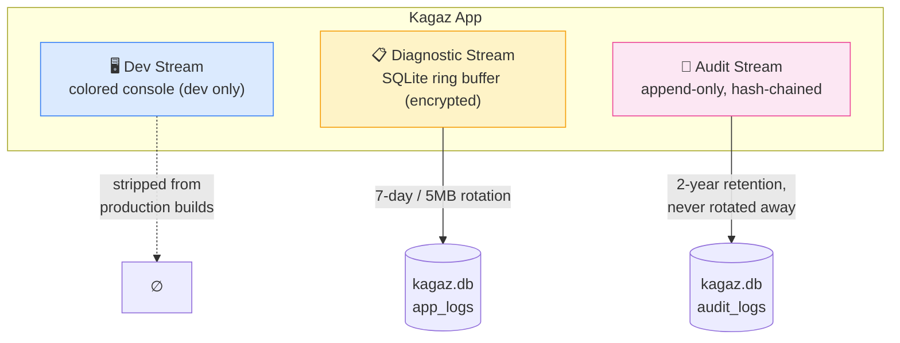

# 14 — Observability & Logging

> **Project:** Kagaz
> **Classification:** Security-Critical (logs can leak PII if done wrong)
> **Last Updated:** 2026-07-18

---

## Table of Contents

- [1. Logging Philosophy](#1-logging-philosophy)
- [2. The Three Log Streams](#2-the-three-log-streams)
- [3. Library Choice: Pino](#3-library-choice-pino)
- [4. Log Record Schema](#4-log-record-schema)
- [5. Sinks & Retention](#5-sinks--retention)
- [6. Audit & Consent Logs (hash-chained)](#6-audit--consent-logs-hash-chained)
- [7. Redaction — What Must NEVER Be Logged](#7-redaction--what-must-never-be-logged)
- [8. Developer Experience (colored, pretty, dev-only)](#8-developer-experience-colored-pretty-dev-only)
- [9. Web Worker Logging](#9-web-worker-logging)
- [10. Crash & Error Capture Without Telemetry](#10-crash--error-capture-without-telemetry)
- [11. Server-Side Logging (V2+)](#11-server-side-logging-v2)
- [12. Checklist](#12-checklist)

---

## 1. Logging Philosophy

| Principle | Meaning |
|---|---|
| **Logs never leave the device (V1)** | No Sentry, no Crashlytics, no remote log shipping — [10-security-architecture.md](10-security-architecture.md) §3.5 |
| **Structured, not strings** | Every log is a JSON object with a stable schema — greppable, filterable, machine-readable |
| **Privacy by default** | Redaction denylist enforced in the logger itself, not left to call-site discipline |
| **Audit logs are evidence** | Consent/audit records are tamper-evident (hash-chained) and retained per [code/code-standards-and-quality.md](../../code/code-standards-and-quality.md) |
| **Logs cost bytes and I/O** | Ring-buffer + level gating; logging must never blow the perf budget |

---

## 2. The Three Log Streams



| Stream | Purpose | Sink | Retention |
|---|---|---|---|
| **Dev** | Developer debugging | Colored console via `pino-pretty` | Dev builds only — compiled out of prod |
| **Diagnostic** | Errors, warnings, op timings on user devices | `app_logs` table (inside SQLCipher DB) | 7 days or 5 MB ring buffer, whichever first |
| **Audit** | Consent records, security events, destructive ops, share access | `audit_logs` table, append-only | 2 years (configurable per data category) |

---

## 3. Library Choice: Pino

See **ADR-013** in [08-tech-stack-decisions.md](08-tech-stack-decisions.md). Summary: `pino` — structured JSON natively, ~7 KB in browser mode, child loggers, first-class redaction, `pino-pretty` for colored dev output, same API on the V2 Node backend (one logging idiom across the whole codebase).

```typescript
// src/core/logging/logger.ts
import pino from 'pino';

export const rootLogger = pino({
  level: import.meta.env.DEV ? 'debug' : 'info',
  browser: {
    asObject: true,                      // structured records, not strings
    transmit: {
      level: 'info',
      send: (_level, logEvent) => diagnosticSink.write(logEvent), // SQLite ring buffer
    },
  },
  redact: { paths: REDACT_PATHS, censor: '[REDACTED]' },
  base: { app: 'kagaz', v: APP_VERSION },
  timestamp: pino.stdTimeFunctions.isoTime,
});

// One child logger per module — module name is mandatory context
export const log = (module: ModuleName) => rootLogger.child({ module });
```

```typescript
// Usage — always event-name first, context object second
const logger = log('pdf-engine');
logger.info({ event: 'pdf.merge.start', opId, fileCount: files.length });
logger.error({ event: 'pdf.merge.failed', opId, err }, 'merge failed');
```

---

## 4. Log Record Schema

Every record (all streams) has this shape:

| Field | Type | Required | Notes |
|---|---|---|---|
| `time` | ISO 8601 string | ✅ | UTC |
| `level` | `debug \| info \| warn \| error \| fatal` | ✅ | |
| `app`, `v` | string | ✅ | App id + version (from `base`) |
| `module` | string | ✅ | Child-logger module name (matches commit scopes) |
| `event` | string | ✅ | Dot-namespaced: `vault.upload.success`, `ai.tool.confirmed`, `auth.biometric.failed` |
| `opId` | UUID | for operations | Correlates multi-step flows (the client-side "request id") |
| `durationMs` | number | for timings | |
| `err` | serialized Error | for errors | `type`, `message`, `stack` — stack only in diagnostic stream |
| …context | JSON | optional | Must survive the redaction denylist (§7) |

> [!IMPORTANT]
> `event` names are part of the observable API: the agent interface telemetry ([design-system/agent-interface.md](../design-system/agent-interface.md)) uses the same Action Registry names. An action `vault.delete` logs `event: "vault.delete"` — one naming scheme everywhere.

---

## 5. Sinks & Retention

### `app_logs` (diagnostic ring buffer)

```sql
CREATE TABLE app_logs (
  id INTEGER PRIMARY KEY AUTOINCREMENT,
  time TEXT NOT NULL,            -- ISO 8601
  level INTEGER NOT NULL,        -- pino numeric level
  module TEXT NOT NULL,
  event TEXT NOT NULL,
  record TEXT NOT NULL           -- full JSON (post-redaction)
);
CREATE INDEX idx_app_logs_time ON app_logs(time);
```

- Writes are batched (flush every 2 s or 50 records) off the UI thread — never synchronous per-log I/O.
- On app launch: delete rows older than 7 days; if table > 5 MB, delete oldest beyond the cap.
- Lives inside the SQLCipher database → encrypted at rest like everything else.

### Levels policy

| Level | Prod? | Use for |
|---|---|---|
| `debug` | ❌ dev only | Anything — but still redacted, habits matter |
| `info` | ✅ | Operation lifecycle (`*.start`/`*.success`), navigation, settings changes |
| `warn` | ✅ | Recoverable problems (retry succeeded, quota near limit, model fallback) |
| `error` | ✅ | Failed operations, caught exceptions |
| `fatal` | ✅ | Crash-adjacent: DB won't open, model integrity failure |

---

## 6. Audit & Consent Logs (hash-chained)

Audit records are **legal evidence** ([code/code-standards-and-quality.md](../../code/code-standards-and-quality.md) §2: consent logs; [10-security-architecture.md](10-security-architecture.md) §4.4: share access logs). They get a dedicated, tamper-evident store:

```sql
CREATE TABLE audit_logs (
  seq INTEGER PRIMARY KEY AUTOINCREMENT,   -- strictly increasing, no gaps
  time TEXT NOT NULL,                      -- ISO 8601
  actor TEXT NOT NULL,                     -- 'user' | 'ai-assistant' | 'system'
  action TEXT NOT NULL,                    -- e.g. consent.granted, share.created, doc.deleted, erasure.executed
  scope TEXT,                              -- purpose / document ids / share id (NEVER content)
  request_id TEXT,                         -- correlates to server logs in V2+
  ua TEXT,                                 -- client/user-agent string
  record_hash TEXT NOT NULL,               -- SHA-256(prev_hash || canonical_json(this record minus hashes))
  prev_hash TEXT NOT NULL                  -- record_hash of seq-1; genesis = SHA-256(install_id)
);
```

- **Hash chain**: each record's `record_hash` covers the previous record's hash → any deletion or edit breaks the chain and is detectable. This satisfies the integrity-verification convention (SHA-256 manifests) in [docs/compliance/index.md](../compliance/index.md).
- **Append-only**: no UPDATE/DELETE statements exist in the DAO. Retention expiry (default 2 years) archives to an encrypted export before pruning, and the prune itself is an audited action.
- **What gets audited**: consent grant/withdrawal · share create/revoke/access · AI destructive-tool confirmations (approved *and* denied) · biometric enable/disable · data export · full erasure · operator document grants (V4).
- Audit logs are included in encrypted backups (F-31/F-45) and in the user's "export all my data" bundle — they are the user's data too (DPDP access right).

---

## 7. Redaction — What Must NEVER Be Logged

Enforced centrally via pino `redact` paths **and** a serializer denylist — not by convention:

| Never log | Why |
|---|---|
| Encryption keys, passwords, PINs, share-code secrets | [10](10-security-architecture.md) §3.4 — keys live in secure storage only |
| Document content, file bytes, OCR text, thumbnails | Same boundary as the AI ([10](10-security-architecture.md) §5.2) |
| Aadhaar numbers, PAN, biometric data | UIDAI rules — [indian-compliance-checklist.md](../indian-compliance-checklist.md) |
| Quick Reference labels/values (F-84) | Same PII posture as OCR text/document content — [10](10-security-architecture.md) §3.6. Best practice: never pass them into a log context object at all (log the entry `id` only); the `quickReferenceLabel`/`quickReferenceValue` denylist entries are defense-in-depth, not the primary control — bare `label`/`value` are deliberately **not** denylisted (too generic, would blanket-redact unrelated legitimate fields like a sort label or a settings value elsewhere in the app). |
| Absolute file paths | Only relative paths ([10](10-security-architecture.md) §3.3) |
| Full user names / phone / email in diagnostic logs | Diagnostic stream is for *system* behavior; identity belongs only in audit records that require it |
| AI conversation text | Log `event` + token counts + tool names, never message content |

```typescript
export const REDACT_PATHS = [
  'password', '*.password', 'pin', '*.pin', 'secret', '*.secret',
  'key', '*.key', 'token', '*.token', 'ocrText', '*.ocrText',
  'content', '*.content', 'aadhaar', '*.aadhaar', 'pan', '*.pan',
  'messages', '*.messages', 'filePathAbsolute', '*.filePathAbsolute',
  'quickReferenceLabel', '*.quickReferenceLabel', // F-84
  'quickReferenceValue', '*.quickReferenceValue', // F-84
];
```

> [!CAUTION]
> A log line that leaks PII is a **data breach** under the DPDP Act, even if it never leaves the device wrongly — because diagnostic exports (§10) and backups carry it. Treat redaction-list updates as security changes (review against [10-security-architecture.md](10-security-architecture.md)).

---

## 8. Developer Experience (colored, pretty, dev-only)

- `pnpm dev` pipes through **`pino-pretty`**: colored levels, aligned columns, human timestamps.
- Browser dev builds use `pino`'s console mapping — records appear as expandable objects in DevTools, colored per level.
- Production builds **must not** ship `pino-pretty` (devDependency) and strip `debug` calls (`vite-plugin` define / dead-code elimination on `import.meta.env.DEV`).
- An in-app hidden **Log Viewer** screen (Settings → About → tap version 7×) renders the `app_logs` ring buffer with level filters — this is how testers report bugs without any telemetry.

---

## 9. Web Worker Logging

Workers never write to SQLite directly (single-writer rule). Each worker creates a pino instance whose transmit posts records to the main thread; the main-thread sink batches them into `app_logs` with the worker's `module` tag and the operation's `opId` so a merge that spans UI → worker → UI reads as one correlated trace.

---

## 10. Crash & Error Capture Without Telemetry

| Mechanism | Behavior |
|---|---|
| React error boundaries | Log `fatal` with component stack → friendly recovery UI |
| `window.onerror` / `unhandledrejection` | Log `fatal`, flush ring buffer immediately |
| Native crash (WebView dies) | On next launch, detect unclean shutdown flag → log `app.crash.detected` |
| **User-initiated diagnostics export** | Settings → "Export diagnostic logs": user explicitly shares a redacted JSON of `app_logs` (via OS share sheet). This is the **only** way logs leave the device, and it is the user's action, not ours. |

---

## 11. Server-Side Logging (V2+)

Same pino, JSON-to-stdout, **India-region** log storage only ([code/code-standards-and-quality.md](../../code/code-standards-and-quality.md) §3):

- `request_id` middleware on every request; clients send their `opId` so traces correlate end-to-end.
- Access logs for share links per [10-security-architecture.md](10-security-architecture.md) §4.4 (IP, UA, timestamp, result) — these are audit-class, hash-chained server-side too.
- Server never logs decrypted payloads — it never *has* them (zero-knowledge design).
- Log retention & access control documented in [docs/compliance/index.md](../compliance/index.md) before V2 launch; CERT-In incident reporting pulls from these logs ([10](10-security-architecture.md) §9).

---

## 12. Checklist

| # | Item | Priority |
|---|---|---|
| 1 | `src/core/logging/` with rootLogger, module child loggers, redaction list | P0 |
| 2 | SQLite `app_logs` ring-buffer sink (batched, off-UI-thread) | P0 |
| 3 | `audit_logs` hash-chained DAO (append-only, genesis record on install) | P0 |
| 4 | Redaction unit tests (assert denylisted fields never serialize) | P0 |
| 5 | pino-pretty dev pipeline + prod stripping verified in bundle analysis | P1 |
| 6 | Worker → main-thread log relay with `opId` correlation | P1 |
| 7 | In-app Log Viewer + "Export diagnostic logs" (user-initiated) | P1 |
| 8 | Crash detection flag + boundary/fatal handlers | P1 |
| 9 | Audit retention archival job (encrypted export before prune) | P2 |

---

*Document maintained by the Kagaz Architecture Team*
