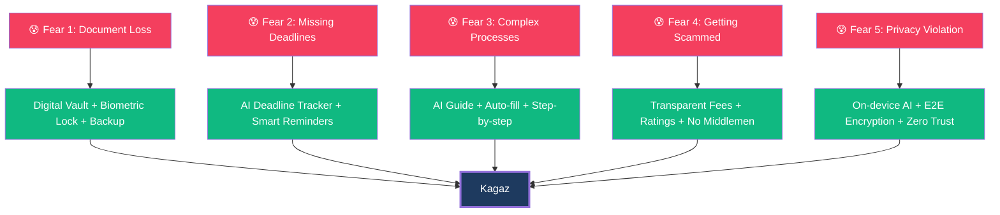
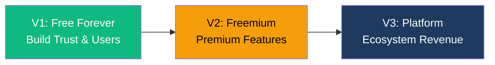
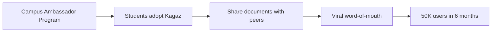
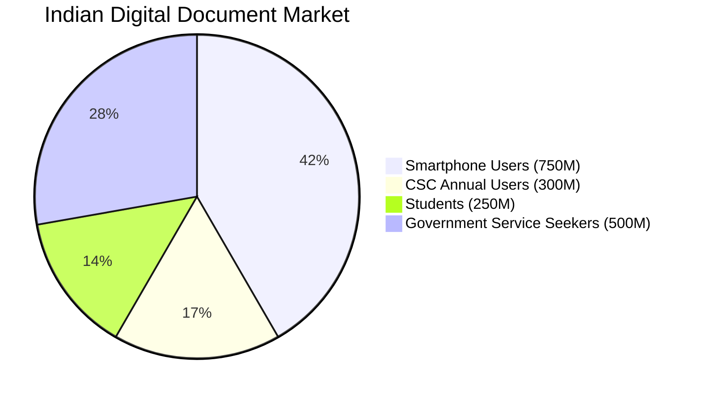
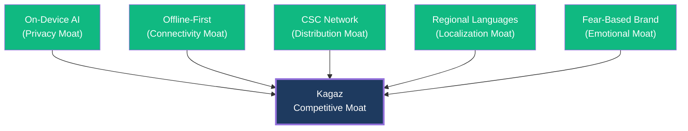

# Kagaz — Business Strategy

> **Mission:** Empower every Indian citizen to securely own, organize, and utilize their documents — without fear of loss, fraud, or confusion.

---

## Table of Contents

- [Value Proposition: "Fear is Our Strategy"](#value-proposition-fear-is-our-strategy)
- [Revenue Model](#revenue-model)
- [Growth Strategy](#growth-strategy)
- [Market Size & Opportunity](#market-size--opportunity)
- [Competitive Landscape](#competitive-landscape)

---

## Value Proposition: "Fear is Our Strategy"

Kagaz's core positioning is built on **five real fears** that hundreds of millions of Indians experience daily. Each fear maps directly to a product capability and a marketing hook.

---

### Fear 1: Document Loss

> *"What if my Aadhaar card gets destroyed in a flood? What if someone steals my PAN card?"*

| Dimension | Detail |
|---|---|
| **Pain** | Physical documents get damaged (water, fire, termites), lost during moves, or stolen. Replacing government documents takes weeks/months of bureaucratic effort. |
| **Target Audience** | Students, migrant workers, rural families, anyone who has ever lost a critical document. |
| **Solution** | **Digital vault** with biometric protection (fingerprint/face). High-quality document scanning with edge detection. All data stored locally with optional encrypted cloud backup. |
| **Marketing Hook** | **"Your Aadhaar is safe. Even if your phone isn't."** |
| **Emotional Trigger** | Relief, security, peace of mind |

**Key Features:**
- Camera scanner with auto-edge detection and enhancement
- Biometric lock (fingerprint / face ID) on every app launch
- Folder organization with tags and smart categorization
- Offline-first: all documents available without internet
- Cloud backup with end-to-end encryption (V2)

---

### Fear 2: Missing Deadlines

> *"I missed the scholarship deadline because I didn't know about it. My passport renewal expired."*

| Dimension | Detail |
|---|---|
| **Pain** | Scholarship applications, exam registrations, government scheme enrollments, license renewals — all have deadlines. Missing them means missed opportunities, sometimes life-changing ones. |
| **Target Audience** | College students, job seekers, parents of school-age children, senior citizens with pension renewals. |
| **Solution** | AI assistant that **knows all major government deadlines** relevant to the user's profile. Proactive reminders pushed to the user. Contextual suggestions: "Your PAN card expires in 30 days — renew now." |
| **Marketing Hook** | **"Never miss a scholarship deadline again."** |
| **Emotional Trigger** | Anxiety → Confidence |

**Key Features (V2/V3):**
- AI-powered deadline database for major government schemes
- Personalized reminders based on user's document profile
- Quick-action links: reminder → relevant service → guided application
- Calendar integration for deadline tracking

---

### Fear 3: Complex Processes

> *"I need a PAN card but I don't even know which form to fill. The process is so confusing."*

| Dimension | Detail |
|---|---|
| **Pain** | Government processes are labyrinthine. Different agencies need different documents in different formats. Forms are complex, instructions are in legal jargon, and one wrong field means starting over. |
| **Target Audience** | First-time applicants, non-English speakers, elderly citizens, anyone navigating bureaucracy alone. |
| **Solution** | AI guide that explains every process step-by-step in the user's language. Auto-suggests required documents from the vault. Pre-fills forms using OCR data from stored documents. |
| **Marketing Hook** | **"PAN card in 10 minutes. AI handles the confusion."** |
| **Emotional Trigger** | Overwhelm → Empowerment |

**Key Features (V3):**
- Service catalog with 100+ government services
- Step-by-step guided flows with progress tracking
- Document checklist with auto-detection from vault
- AI-powered form auto-fill using OCR data
- Multilingual support (Hindi + English, expanding to more)

---

### Fear 4: Getting Scammed

> *"The guy at the cyber café charged me ₹500 for a ₹100 service. I had no idea what the real fee was."*

| Dimension | Detail |
|---|---|
| **Pain** | Local CSC operators and cyber cafés often overcharge. No transparency on actual government fees vs service charges. Users don't understand what they're paying for or whether the service was actually submitted. |
| **Target Audience** | Rural users, low-income families, first-time government service users. |
| **Solution** | Complete **fee transparency** — show the exact government fee, the service fee, and the total. Process visibility so users can track their application. Operator ratings and reviews. |
| **Marketing Hook** | **"See the real government fees. No hidden charges."** |
| **Emotional Trigger** | Distrust → Trust |

**Key Features (V3):**
- Transparent fee breakdown: Government fee + Platform fee = Total
- Real-time application tracking with status updates
- CSC operator profiles with ratings and reviews
- Receipt generation for every transaction
- Dispute resolution mechanism

---

### Fear 5: Privacy Concerns

> *"I had to give my Aadhaar card to a random shop to get a photocopy. Who knows what they'll do with it?"*

| Dimension | Detail |
|---|---|
| **Pain** | Indians routinely hand over their most sensitive identity documents (Aadhaar, PAN, voter ID) to unknown third parties for photocopying, scanning, or service applications. Identity theft and document misuse are growing concerns. |
| **Target Audience** | Privacy-conscious users, urban professionals, anyone who has been asked to hand over documents to strangers. |
| **Solution** | **Self-service** document management with AI guidance. On-device AI processing — documents never leave the phone. End-to-end encryption for any data that does leave the device. Zero-trust architecture. |
| **Marketing Hook** | **"Your documents never leave your phone. Period."** |
| **Emotional Trigger** | Vulnerability → Control |

**Key Features:**
- **On-device AI** (WebLLM) — no cloud processing for chat
- **On-device PDF operations** — merge, split, compress all happen locally
- **On-device OCR** — text extraction without server upload
- **Biometric lock** — unauthorized access prevention
- **Encrypted sharing** with TTL and access codes (V2)
- **No analytics on document content** — ever

---

## Revenue Model

### Phased Monetization Strategy

### V1 — Free Forever (Foundation)

**Goal:** User acquisition and trust building. Zero monetization.

| Feature | Cost to User |
|---|---|
| Document scanning & storage | Free |
| PDF operations (merge, split, compress, convert) | Free |
| AI chatbot (on-device) | Free |
| Document organization (folders, tags) | Free |
| Biometric security | Free |
| Offline usage | Free |

**Rationale:** V1 features are the hook. They solve real problems at zero cost, building the trust needed for paid features later.

---

### V2 — Freemium Model

| Tier | Price | Features |
|---|---|---|
| **Free** | ₹0 / forever | All V1 features + basic sharing (limited TTL) |
| **Premium** | ₹99/month or ₹799/year | Cloud backup (10 GB), advanced sharing (custom TTL, access codes, view limits), priority AI responses, document expiry alerts, custom folder themes |
| **Premium Plus** | ₹199/month or ₹1,499/year | Cloud backup (50 GB), team folders (family sharing), API access, advanced OCR (handwriting recognition), priority support |

**Projected Conversion Rate:** 3–5% free-to-paid (industry benchmark for utility apps in India)

---

### V3 — Platform Revenue

| Stream | Model | Projected Revenue |
|---|---|---|
| **CSC Operator License** | ₹499/month per operator | 650,000+ CSCs → massive potential TAM |
| **Government Integration Fees** | ₹5–25 per transaction | Per-service fee for verified government service submissions |
| **Enterprise Plans** | ₹999–4,999/month per org | Bulk document management for schools, hospitals, companies |
| **Service Marketplace** | 5–10% commission | Connecting users with verified service providers |
| **Data Insights (Anonymized)** | Custom pricing | Aggregated, anonymized usage trends for government planning |

> **Privacy Commitment:** Kagaz will **never** sell individual user data or document contents. Anonymized insights are opt-in and aggregated at scale.

---

### Revenue Projections (Conservative)

| Metric | Year 1 (V1) | Year 2 (V2) | Year 3 (V3) |
|---|---|---|---|
| Total Users | 100K | 1M | 5M |
| Premium Subscribers | 0 | 40K (4%) | 200K (4%) |
| CSC Operators | 0 | 0 | 10K |
| Monthly Revenue | ₹0 | ₹39.6L | ₹2.5Cr |
| Annual Revenue | ₹0 | ₹4.75Cr | ₹30Cr |

---

## Growth Strategy

### Phase 1: College Campus Blitz (Months 1–6)

| Tactic | Detail |
|---|---|
| **Campus Ambassadors** | Recruit student leaders at top 100 colleges. ₹500/month stipend + free premium. |
| **Why Students** | Tech-savvy, heavy document users (marksheets, certificates, IDs), high sharing behavior. |
| **Activation Events** | "Scan your marksheet in 10 seconds" demo at campus fests. |
| **Referral Program** | Share Kagaz → both users get 1 month premium free. |
| **Target** | 50,000 users in 6 months. |

### Phase 2: WhatsApp Viral Engine (Months 3–12)

| Tactic | Detail |
|---|---|
| **Sharing Hook** | "I shared my PAN card securely via Kagaz" — message includes Kagaz branding. |
| **WhatsApp Integration** | Share encrypted document links via WhatsApp. Receiver must install Kagaz to view. |
| **Organic SEO** | "How to scan documents with phone" — Hindi + English content marketing. |
| **YouTube Tutorials** | 60-second tutorials in Hindi: "How to merge PDFs for free." |
| **Target** | 200,000+ organic installs via sharing. |

### Phase 3: CSC Network Penetration (Months 12–18)

| Tactic | Detail |
|---|---|
| **CSC Operator Outreach** | Partner with CSC e-Governance Services India Ltd. |
| **Operator Value Prop** | Kagaz replaces 5+ tools CSC operators currently use. One app for scanning, PDF ops, document management, and service delivery. |
| **Network Effect** | 650,000+ CSCs across India, each serving 500–5,000 people/month. |
| **Government Relations** | Position Kagaz as a Digital India initiative enabler. |
| **Target** | 10,000 CSC operators onboarded in Year 3. |

### Phase 4: Regional Language Expansion (Months 6–24)

| Language | Priority | Population Reach |
|---|---|---|
| Hindi | V1 (launch) | 600M+ speakers |
| English | V1 (launch) | 125M+ speakers |
| Tamil | V2 | 75M+ speakers |
| Telugu | V2 | 80M+ speakers |
| Bengali | V2 | 100M+ speakers |
| Marathi | V3 | 85M+ speakers |
| Gujarati | V3 | 55M+ speakers |
| Kannada | V3 | 45M+ speakers |

**Strategy:** Each new language unlocks a regional market. AI chatbot supports multilingual conversations via WebLLM. UI translations via community + professional translators.

---

## Market Size & Opportunity

### Total Addressable Market (TAM)

| Segment | Size | Relevance |
|---|---|---|
| **India's Population** | 1.4 billion | World's largest by population |
| **Smartphone Users** | 750 million+ | Growing 50M+/year, especially in Tier 2/3 cities |
| **Internet Users** | 800 million+ | 5G rollout accelerating mobile data adoption |
| **CSC Users** | 300 million+ annually | Active government service seekers |
| **Students** | 250 million+ | In schools, colleges, and competitive exam preparation |
| **Government Document Services** | Massive TAM | Every citizen needs at minimum: Aadhaar, PAN, Voter ID, Ration Card |

### Serviceable Addressable Market (SAM)

| Segment | Size | Rationale |
|---|---|---|
| Smartphone users who manage documents | ~200M | Users who actively scan, share, or organize documents |
| Students with smartphones | ~100M | Document-heavy use case (certificates, marksheets, IDs) |
| CSC operators | ~650K | Professional document handlers |
| Small businesses | ~10M | Invoice, receipt, and document management |

### Serviceable Obtainable Market (SOM) — 3-Year Target

| Year | Target Users | Market Share |
|---|---|---|
| Year 1 | 100K | 0.05% of SAM |
| Year 2 | 1M | 0.5% of SAM |
| Year 3 | 5M | 2.5% of SAM |

---

## Competitive Landscape

### Direct Competitors

| Competitor | Strengths | Weaknesses | Kagaz Advantage |
|---|---|---|---|
| **DigiLocker** | Government-backed, free, verified documents | No PDF operations, poor UX, limited features, no AI | AI assistant, PDF tools, offline-first, better UX |
| **CamScanner** | Popular scanner, good edge detection | Privacy concerns (Chinese), no document vault, ads-heavy | Indian-made, privacy-first, full vault + AI |
| **Adobe Scan** | Excellent OCR, Adobe ecosystem | Expensive premium, no AI assistant, no Indian focus | Free PDF ops, AI-powered, India-focused |
| **Google Drive** | Free storage, reliable | Not document-focused, no scanning, no PDF operations | Purpose-built for documents, AI operations |
| **iLovePDF** | Good PDF tools | Web-only, no vault, no mobile-first, no AI | Mobile-first, offline, AI integration |

### Competitive Moat

1. **Privacy Moat:** On-device AI means document data never leaves the phone. No competitor offers this.
2. **Connectivity Moat:** Offline-first architecture works in areas with poor connectivity — critical for Tier 2/3 India.
3. **Distribution Moat:** CSC network partnership gives access to 300M+ service seekers annually.
4. **Localization Moat:** Native Hindi support from V1; expanding to 8+ languages.
5. **Emotional Moat:** Brand built on trust and security, not features. Hard to replicate emotional positioning.

---

*Last updated: 2026-06-07 · Kagaz Business Strategy v1.0*
