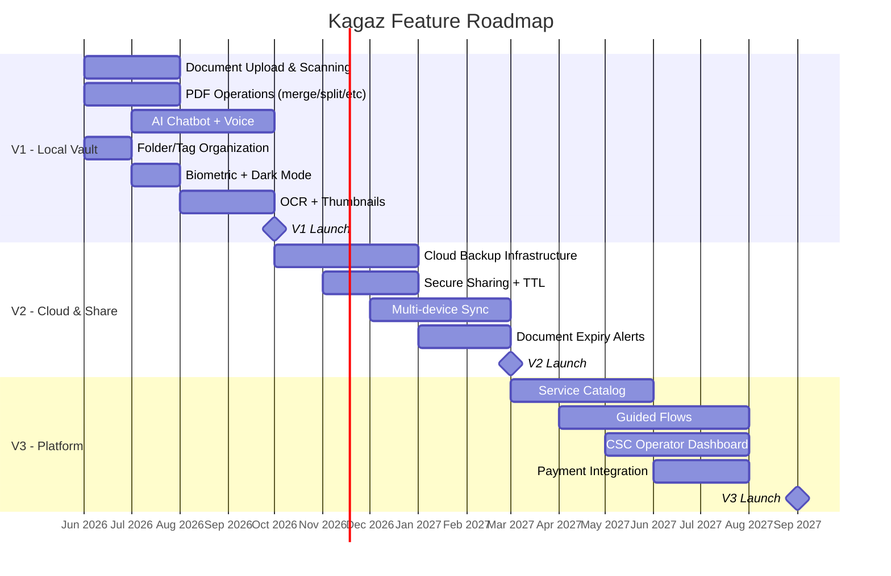

# Kagaz — Feature Priority Matrix

> Feature prioritization using the **MoSCoW method** (Must, Should, Could, Won't) across all three release versions. Each feature includes effort estimation, dependencies, and user impact rating.

---

## Table of Contents

- [Priority Legend](#priority-legend)
- [V1 — Local-First Document Vault](#v1--local-first-document-vault)
- [V2 — Cloud & Sharing](#v2--cloud--sharing)
- [V3 — Consumer CSC Services](#v3--consumer-csc-services)
- [V4 — Operator Platform (separate app)](#v4--operator-platform-separate-app)
- [Cross-Version Feature Roadmap](#cross-version-feature-roadmap)

---

## Priority Legend

| Priority | Meaning | Implication |
|---|---|---|
| 🔴 **Must Have** | Critical for launch. Without these, the product is not viable. | Cannot ship without these. Non-negotiable. |
| 🟡 **Should Have** | Important but not blocking. Strong user value. | Include if time permits. Aim for launch, accept delay. |
| 🔵 **Could Have** | Nice to have. Enhances UX but not essential. | Only if team capacity allows. First to cut. |
| ⚪ **Won't Have** | Explicitly deferred. Not in this version scope. | Do not build. Planned for future version. |

| Effort | T-Shirt Size |
|---|---|
| 🟢 S | 1–3 days |
| 🟡 M | 3–7 days |
| 🔴 L | 1–3 weeks |
| ⚫ XL | 3+ weeks |

| Impact | User Impact |
|---|---|
| ⭐⭐⭐ | Core value — users came for this |
| ⭐⭐ | Significant enhancement to UX |
| ⭐ | Quality of life improvement |

---

## V1 — Local-First Document Vault

> **Theme:** "Your documents, secured and organized, entirely on your device."
>
> **Release Target:** MVP launch. Focus on core document management + AI assistant.

---

### 🔴 V1 Must Have

These features define the core product. Without any one of them, Kagaz does not deliver its value proposition.

| # | Feature | Description | Effort | Impact | Dependencies |
|---|---|---|---|---|---|
| 1 | **Document Upload** | Upload documents via camera, gallery, or file picker. Support PDF, JPG, PNG, HEIC, WEBP. | 🟡 M | ⭐⭐⭐ | Capacitor Camera/Filesystem plugins |
| 2 | **Document Scanning** | Camera-based scanner with auto-edge detection, perspective correction, and crop adjustment. | 🔴 L | ⭐⭐⭐ | Google ML Kit Document Scanner (native, Play Services; ADR-018) |
| 3 | **PDF Merge** | Combine multiple PDF files into a single document. Select order, preview result. | 🟡 M | ⭐⭐⭐ | pdf-lib |
| 4 | **PDF Split** | Extract specific pages from a PDF into a new document. Page range selection UI. | 🟡 M | ⭐⭐⭐ | pdf-lib |
| 5 | **PDF Compress** | Reduce PDF file size by compressing images and removing metadata. Compression level options. | 🟡 M | ⭐⭐⭐ | pdf-lib, image compression |
| 6 | **PDF to Image Conversion** | Convert PDF pages to JPG/PNG images. Page selection, quality options. | 🟡 M | ⭐⭐ | pdfjs-dist (render) + Canvas API |
| 7 | **Image to PDF Conversion** | Convert one or more images into a single PDF document. | 🟡 M | ⭐⭐⭐ | pdf-lib |
| 8 | **Image Format Conversion** | Convert between JPG, PNG, WEBP formats. Quality/size control. | 🟢 S | ⭐⭐ | Canvas API |
| 9 | **Folder Organization** | Create, rename, delete, and color-code folders. Move documents between folders. | 🟡 M | ⭐⭐⭐ | SQLite |
| 10 | **Tags / Labels** | Add custom tags to documents for cross-folder organization. | 🟢 S | ⭐⭐ | SQLite |
| 11 | **Full-Text Search** | Search documents by name, tags, folder, type. Fast local search. | 🟡 M | ⭐⭐⭐ | SQLite FTS5 |
| 12 | **Filters** | Filter documents by type (PDF, Image), date range, size, tags, folder. | 🟢 S | ⭐⭐ | — |
| 13 | **AI Chatbot** | On-device AI assistant using WebLLM. Understands natural language commands for document operations. | ⚫ XL | ⭐⭐⭐ | WebLLM, tool-calling framework |
| 14 | **AI Tool Calling** | AI can invoke document operations (merge, split, convert, etc.) through function calls. | 🔴 L | ⭐⭐⭐ | AI Chatbot, all PDF operations |
| 15 | **Voice Input** | Hold-to-speak voice input for the AI chatbot. Speech-to-text via native STT. | 🟡 M | ⭐⭐⭐ | Capacitor Speech Recognition plugin |
| 16 | **Biometric Lock** | App-level fingerprint/face ID authentication. Auto-lock on background. | 🟡 M | ⭐⭐⭐ | Capacitor Biometrics plugin |
| 17 | **Multilingual UI** | Hindi and English interface. Language toggle in settings. All strings externalized. | 🟡 M | ⭐⭐⭐ | i18n framework (react-i18next) |
| 18 | **Dark Mode** | Full dark mode with automatic system detection and manual toggle. | 🟡 M | ⭐⭐ | Design tokens (dark variants) |
| 19 | **Offline-First Architecture** | All features work without internet. Data stored locally in SQLite. | 🔴 L | ⭐⭐⭐ | SQLite, Capacitor Filesystem |

---

### 🟡 V1 Should Have

Important features that significantly enhance the experience. Target for launch but acceptable to ship in a fast-follow update.

| # | Feature | Description | Effort | Impact | Dependencies |
|---|---|---|---|---|---|
| 20 | **OCR Text Extraction** | Extract text from scanned documents and images. Store extracted text for search. | 🔴 L | ⭐⭐ | tesseract.js |
| 21 | **PDF Encryption** | Add password protection to PDF files. | 🟢 S | ⭐⭐ | pdf-lib |
| 22 | **PDF Decryption** | Remove password from password-protected PDFs (with correct password). | 🟢 S | ⭐⭐ | pdf-lib |
| 23 | **AI Screen Navigation** | AI assistant can navigate the user to specific app screens via tool calls. | 🟡 M | ⭐⭐ | AI Tool Calling, React Router |
| 24 | **Document Thumbnails** | Generate and cache visual thumbnails for all documents. | 🟡 M | ⭐⭐ | pdfjs-dist (for PDF), Canvas API |
| 25 | **Bulk Operations** | Select multiple documents and apply operations (delete, move, tag, merge). | 🟡 M | ⭐⭐ | Multi-select UI, existing operations |
| 26 | **Storage Statistics** | Dashboard showing total storage used, breakdown by type, largest files. | 🟢 S | ⭐ | SQLite aggregation |
| 27 | **Onboarding Tutorial** | First-launch walkthrough explaining key features (3–5 screens). | 🟡 M | ⭐⭐ | Swiper/carousel component |

---

### 🔵 V1 Could Have

Nice-to-have features that polish the experience. First to be cut if timeline is tight.

| # | Feature | Description | Effort | Impact | Dependencies |
|---|---|---|---|---|---|
| 28 | **PDF Form Filling** | Fill in interactive PDF form fields within the app. | 🔴 L | ⭐ | pdf-lib (limited form support) |
| 29 | **Image Filters/Enhancement** | Apply brightness, contrast, sharpness, and B&W filters to images. | 🟡 M | ⭐ | Canvas API / CSS filters |
| 30 | **Document Templates** | Pre-built templates for common document types (ID card holder, certificate folder). | 🟢 S | ⭐ | Folder/tag system |
| 31 | **Export/Backup to Local** | Export all documents as a ZIP file to device downloads or external storage. | 🟡 M | ⭐⭐ | Capacitor Filesystem, JSZip |
| 32 | **Recent Documents** | Quick-access list of recently viewed/edited documents on home screen. | 🟢 S | ⭐ | SQLite (timestamp tracking) |
| 33 | **Favorites** | Star/bookmark documents for quick access. | 🟢 S | ⭐ | SQLite |
| 34 | **Sort Options** | Sort documents by name, date, size, type in ascending/descending order. | 🟢 S | ⭐ | — |
| F-84 | **Quick Reference** | A personal key-value vault for numbers users copy often (Aadhaar/PAN/mobile/account/IFSC/emails/URLs, user-named), optionally linked to a source document. Template suggestions, mask-by-default, biometric-gated, multi-select bulk copy. Added 2026-07-18 — see [02-document-vault-module.md](../architecture/02-document-vault-module.md) §Quick Reference. | 🟡 M | ⭐⭐ | SQLite, biometric auth (F-16) |
| F-85 | **Resize & Compress for Forms** | Resize an image to exact target dimensions (with an aspect-ratio-lock toggle) and iteratively compress to a target file-size range — the two-constraints-at-once shape Indian government portals (SSC/UPSC/passport/university uploads) commonly require for photo/signature fields. Added 2026-07-18 — see [04-image-engine-module.md](../architecture/04-image-engine-module.md) §9. | 🟢 S | ⭐⭐ | Canvas API |

> **F-84/F-85 numbering note:** items above use the checklist's actual `F-` numbers, not the sequential `#` numbering in this table's original scope (`#1`–`#34` = `F-1`–`F-34`; the many V1-extra features shipped since, `F-35`–`F-83`, were never backfilled into this table — `DEVELOPMENT-CHECKLIST.md` is the current source of truth for the full V1 feature list and their status). `F-84`/`F-85` use the next free ID gap.

---

### ⚪ V1 Won't Have (Deferred)

Explicitly out of scope for V1. These are planned for future versions.

| # | Feature | Deferred To | Reason |
|---|---|---|---|
| 35 | Cloud Sync | V2 | Requires backend infrastructure. V1 is offline-first. |
| 36 | Document Sharing | V2 | Needs cloud backend for link generation and access control. |
| 37 | Collaborative Folders | V2 | Requires multi-user architecture. |
| 38 | CSC Service Integration | V3 | Needs government API partnerships. |
| 39 | Payment Processing | V3 | Requires payment gateway integration and compliance. |
| 40 | Document Expiry Alerts | V2 | Needs AI understanding of document types and expiry dates. |
| 41 | Multi-device Sync | V2 | Requires cloud infrastructure. |
| 42 | Service Catalog | V3 | Requires government service database. |
| 43 | Guided Flows | V3 | Requires service catalog and form builder. |
| 44 | Operator Dashboard | V3 | Requires CSC operator onboarding infrastructure. |

---

## V2 — Cloud & Sharing

> **Theme:** "Share securely. Sync seamlessly. Never lose a document again."
>
> **Release Target:** 4–6 months after V1 launch. Focus on cloud infrastructure and sharing.

---

### 🔴 V2 Must Have

| # | Feature | Description | Effort | Impact |
|---|---|---|---|---|
| 45 | **Cloud Backup** | Encrypted cloud backup of all documents. Auto-sync when online. | ⚫ XL | ⭐⭐⭐ |
| 46 | **Secure Document Sharing** | Generate encrypted share links with TTL (time-to-live). | 🔴 L | ⭐⭐⭐ |
| 47 | **Access Codes** | Optional PIN for shared document access. | 🟡 M | ⭐⭐ |
| 48 | **Share Link Management** | View active shares, revoke links, see view counts. | 🟡 M | ⭐⭐ |
| 49 | **User Authentication** | Sign up / sign in (phone OTP + optional email). | 🔴 L | ⭐⭐⭐ |
| 50 | **Multi-Device Sync** | Seamless sync across multiple devices via cloud. | ⚫ XL | ⭐⭐⭐ |
| 51 | **Document Expiry Alerts** | AI detects document types and notifies before expiry. | 🔴 L | ⭐⭐ |

---

### 🟡 V2 Should Have

| # | Feature | Description | Effort | Impact |
|---|---|---|---|---|
| 52 | **Share Permissions** | View-only vs View+Download permissions on shared links. | 🟡 M | ⭐⭐ |
| 53 | **Max View Limits** | Limit the number of times a share link can be viewed. | 🟢 S | ⭐ |
| 54 | **Family Sharing / Team Folders** | Shared folders between family members or team. | 🔴 L | ⭐⭐ |
| 55 | **Advanced OCR** | Handwriting recognition, multi-language OCR (Hindi + English). | 🔴 L | ⭐⭐ |
| 56 | **Push Notifications** | Deadline reminders, share access alerts, sync completion. | 🟡 M | ⭐⭐ |
| 57 | **Trash / Recycle Bin** | Soft-delete with 30-day recovery. | 🟡 M | ⭐⭐ |
| 58 | **Version History** | Track document modifications, revert to previous versions. | 🔴 L | ⭐⭐ |

---

### 🔵 V2 Could Have

| # | Feature | Description | Effort | Impact |
|---|---|---|---|---|
| 59 | **WhatsApp Share Integration** | Direct share to WhatsApp with Kagaz branding. | 🟡 M | ⭐⭐ |
| 60 | **Document Watermarking** | Add "COPY" or custom watermark to shared documents. | 🟡 M | ⭐ |
| 61 | **QR Code Sharing** | Generate QR codes for document sharing (in-person). | 🟢 S | ⭐ |
| 62 | **Email Document** | Send document as attachment via email from within app. | 🟢 S | ⭐ |
| 63 | **Premium Themes** | Additional UI themes for premium subscribers. | 🟢 S | ⭐ |

---

### ⚪ V2 Won't Have (Deferred)

| # | Feature | Deferred To | Reason |
|---|---|---|---|
| 64 | CSC Service Integration | V3 | Requires government API partnerships |
| 65 | Payment Processing | V3 | Compliance and gateway setup needed |
| 66 | Service Catalog | V3 | Needs service database and partnerships |
| 67 | Operator Dashboard | V3 | Depends on CSC partnerships |
| 68 | AI Form Auto-fill | V3 | Requires service-specific form templates |

---

## V3 — Consumer CSC Services

> **Theme:** "From vault to platform. Every government service, one app."
>
> **App:** Kagaz (consumer). **Release Target:** 6–12 months after V2.
>
> Scope: consumer-facing CSC features only. Operator dashboards, customer management, bulk processing, and operator analytics are **V4** in the separate Kagaz Operator app — see [architecture/13-app-portfolio.md](../architecture/13-app-portfolio.md).

---

### 🔴 V3 Must Have

| # | Feature | Description | Effort | Impact |
|---|---|---|---|---|
| 69 | **Service Catalog** | Browsable catalog of 50+ government services with requirements and fees. | ⚫ XL | ⭐⭐⭐ |
| 70 | **Guided Application Flows** | Step-by-step wizard for each service with document checklist. | ⚫ XL | ⭐⭐⭐ |
| 71 | **Fee Transparency** | Clear breakdown: Government fee + Platform fee = Total. | 🟡 M | ⭐⭐⭐ |
| 72 | **My Application Tracking** | The user tracks their *own* application status in real time. (Not for tracking other people's customers — that's V4.) | 🔴 L | ⭐⭐⭐ |
| 73 | **Payment Integration** | Integrate UPI, cards, and net banking for service payments. | 🔴 L | ⭐⭐⭐ |

---

### 🟡 V3 Should Have

| # | Feature | Description | Effort | Impact |
|---|---|---|---|---|
| 74 | **AI Form Auto-fill** | Pre-fill application forms using OCR data from stored documents. | 🔴 L | ⭐⭐⭐ |
| 75 | **Nearest CSC Locator** | Map-based CSC finder for services requiring in-person visits. | 🟡 M | ⭐⭐ |
| 76 | **Operator Ratings (consumer-side)** | Users rate the CSC operators they visited. Ratings feed the CSC Locator. *Operator-side response and dispute live in V4.* | 🟡 M | ⭐⭐ |
| 77 | **Receipt Generation** | Digital receipts for the user's own transactions. | 🟡 M | ⭐⭐ |
| 78 | **Additional Language Support** | Tamil, Telugu, Bengali, Marathi, Gujarati, Kannada. | 🔴 L | ⭐⭐⭐ |
| 79 | **Smart Document Suggestions** | AI suggests which documents to upload based on planned services. | 🟡 M | ⭐⭐ |

---

### 🔵 V3 Could Have

| # | Feature | Description | Effort | Impact |
|---|---|---|---|---|
| 80 | **DigiLocker Integration** | Import verified documents from DigiLocker API. | 🔴 L | ⭐⭐ |
| 81 | **Referral Rewards** | Earn credits for referring new users. | 🟡 M | ⭐ |
| 82 | **Community Tips** | User-contributed tips for services. | 🟡 M | ⭐ |

---

### ⚪ V3 Won't Have (deferred to V4 or later)

| # | Feature | Deferred To | Reason |
|---|---|---|---|
| 83 | CSC Operator Dashboard | **V4** (separate app) | Different audience, different UX. See app portfolio doc. |
| 84 | Customer management (CRM) for operators | **V4** | Belongs to the operator app. |
| 85 | Bulk service processing | **V4** | Operator workflow, not consumer. |
| 86 | Operator analytics dashboard | **V4** | Operator workflow. |
| 87 | Dispute resolution workflow | **V4** | Needs operator-side counterparty. |
| 88 | Blockchain verification | Future | Interesting but premature. |
| 89 | Physical Document Delivery | Out of scope | Digital-first platform. |

---

## V4 — Operator Platform (separate app)

> **Theme:** "Run your CSC business from one screen."
>
> **App:** **Kagaz Operator** (new — PWA-first, optional Android tablet build). **Release Target:** 6–9 months after V3.
>
> See [architecture/13-app-portfolio.md](../architecture/13-app-portfolio.md) for why this is a separate app and not a mode toggle inside Kagaz.

---

### 🔴 V4 Must Have

| # | Feature | Description | Effort | Impact |
|---|---|---|---|---|
| 90 | **Operator Onboarding & KYC** | Verify operator identity (Aadhaar + PAN), bank details, GST (optional), business address. Required before activation. | 🔴 L | ⭐⭐⭐ |
| 91 | **Operator Dashboard** | Tablet/desktop home: today's queue, in-progress applications, revenue, alerts. | ⚫ XL | ⭐⭐⭐ |
| 92 | **Customer Management (CRM)** | Customer list per operator: contact info, document grants (with consumer consent), application history. | 🔴 L | ⭐⭐⭐ |
| 93 | **Service Processing Workflow** | Operator-side counterpart to V3 service flows: accept an application from a customer's vault grant, fill, submit, track. | ⚫ XL | ⭐⭐⭐ |
| 94 | **Operator Subscription Billing** | ₹499/month, auto-renew, grace period, dunning. | 🔴 L | ⭐⭐⭐ |
| 95 | **GST-Compliant Receipts & Invoicing** | Auto-generated GST invoices for each service rendered; monthly statements. | 🟡 M | ⭐⭐⭐ |

---

### 🟡 V4 Should Have

| # | Feature | Description | Effort | Impact |
|---|---|---|---|---|
| 96 | **Bulk Processing** | Process the same service type for many customers in parallel (e.g., 20 Ayushman cards in a sitting). | 🔴 L | ⭐⭐⭐ |
| 97 | **Operator Analytics Dashboard** | Services delivered, revenue, average completion time, top services, customer ratings. | 🔴 L | ⭐⭐ |
| 98 | **Dispute Resolution Workflow** | Receive consumer complaints, respond, propose resolution, escalate. | 🟡 M | ⭐⭐ |
| 99 | **Operator Ratings Response** | Operators reply to consumer ratings (the rating UX lives in V3 Kagaz). | 🟢 S | ⭐⭐ |
| 100 | **Training & Certification Modules** | Operator-side learning content; certification quizzes. | 🟡 M | ⭐⭐ |

---

### 🔵 V4 Could Have

| # | Feature | Description | Effort | Impact |
|---|---|---|---|---|
| 101 | **Sub-agent Hierarchy** | A CSC operator can add field agents with limited permissions. | 🔴 L | ⭐⭐ |
| 102 | **Local-language Operator UI** | Operator UI in Hindi/regional languages (operators often more literate in regional). | 🟡 M | ⭐⭐ |
| 103 | **Operator Marketplace Profile** | Public-facing profile shown in V3 CSC Locator: photo, certifications, services, ratings. | 🟡 M | ⭐⭐ |
| 104 | **WhatsApp Customer Outreach** | One-tap to send a doc-request link to a customer via WhatsApp. | 🟢 S | ⭐⭐ |

---

### ⚪ V4 Won't Have (future)

| # | Feature | Reason |
|---|---|---|
| 105 | Operator-to-operator chat | Out of scope; not core to the operator workflow. |
| 106 | Operator-issued loans / fintech | Regulated; separate product. |
| 107 | White-label operator apps | Enterprise tier (custom contracts). |

---

## Cross-Version Feature Roadmap

> [!NOTE]
> Dates below are **aspirational planning targets**, not commitments. Real progress is tracked exclusively in [DEVELOPMENT-CHECKLIST.md](../../DEVELOPMENT-CHECKLIST.md) (status + commit hashes); this document owns scope and priority only. When dates drift, update this chart rather than letting the two files disagree.

---

### Feature Count Summary

| Version | 🔴 Must | 🟡 Should | 🔵 Could | ⚪ Won't | Total Scoped |
|---|---|---|---|---|---|
| **V1** | 19 | 8 | 7 | 10 | 34 (excl. Won't) |
| **V2** | 7 | 7 | 5 | 5 | 19 (excl. Won't) |
| **V3** | 6 | 6 | 5 | 4 | 17 (excl. Won't) |
| **Total** | **32** | **21** | **17** | **19** | **70** |

---

*Last updated: 2026-06-10 · Kagaz Feature Priorities v1.1*
