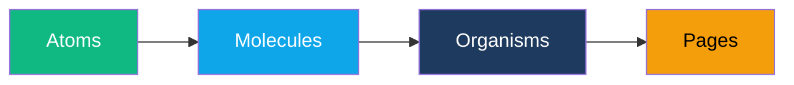
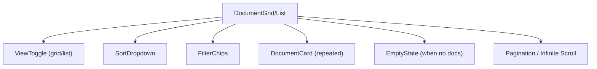
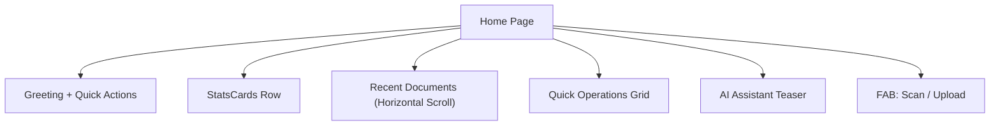
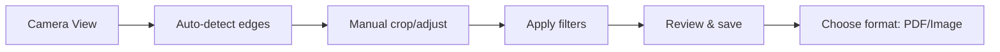
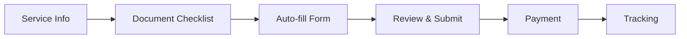

# Kagaz — Component Library

> A complete catalog of every UI component in Kagaz, organized by atomic design methodology. Each component includes its purpose, props, variants, states, and accessibility requirements.

---

## Table of Contents

- [Design Principles](#design-principles)
- [Atoms](#atoms)
- [Molecules](#molecules)
- [Organisms](#organisms)
- [Pages](#pages)

---

## Design Principles



The 8 governing principles live in **[design-principles.md](./design-principles.md)**. The short version:

1. **Mobile-first:** Design for the smallest viewport, then enhance.
2. **Offline-ready:** Every component must handle offline state gracefully.
3. **Bilingual:** All text-bearing components support Hindi and English.
4. **Accessible:** WCAG AA compliant out of the box.
5. **Themeable:** All components respect light/dark mode via design tokens.
6. **One primary action per screen.**
7. **Icon + label, always.**
8. **AI-agent operable** — every component exposes the data-agent-* contract (see [agent-interface.md](./agent-interface.md)).

Related: [interaction-patterns.md](./interaction-patterns.md) · [page-skill-template.md](./page-skill-template.md)

---

## Agent Interface — cross-cutting requirements

> Every component in this library MUST satisfy the agent contract. The contract is short; the full spec is in [agent-interface.md](./agent-interface.md).

### What every component must expose

| Attribute | Required | Provided by |
|---|---|---|
| `data-agent-id` | Yes | Caller passes via `agentId` prop or `useAgentProps` |
| `data-agent-state` | When the component has dynamic state (loading/error/disabled/etc.) | Component derives from its own props |
| `data-agent-action` | When the component triggers a registered action | Caller passes via `agentAction` |
| `data-agent-role` | When the component is the primary action on a screen | Caller passes |
| `data-agent-value` | For form inputs | Component reflects current value |

### The standard prop set

Every interactive component accepts:

```ts
type AgentProps = {
  /** Stable dot-separated id. Module-prefixed. */
  agentId?: string;
  /** Registered action id this element invokes when activated. */
  agentAction?: string;
  /** Role override (e.g., 'primary-action' for the screen's main CTA). */
  agentRole?: 'primary-action' | 'secondary-action' | 'destructive' | 'navigation';
};
```

These propagate to `data-agent-*` attributes on the rendered DOM root.

### Per-component agent surface

Below, each component lists its **Agent surface** — the id format, the state values it emits, and the actions it typically wires to. This is the contract the AI assistant relies on.

---

## Atoms

Atoms are the smallest, indivisible UI building blocks.

---

### Button

**Purpose:** Triggers an action or navigates the user.

| Prop | Type | Default | Description |
|---|---|---|---|
| `variant` | `'primary' \| 'secondary' \| 'ghost' \| 'danger' \| 'icon-only'` | `'primary'` | Visual style variant |
| `size` | `'sm' \| 'md' \| 'lg'` | `'md'` | Button size |
| `disabled` | `boolean` | `false` | Disables the button |
| `loading` | `boolean` | `false` | Shows spinner, disables interaction |
| `icon` | `ReactNode` | — | Optional leading icon |
| `iconOnly` | `boolean` | `false` | Renders icon-only circular button |
| `fullWidth` | `boolean` | `false` | Stretches to fill container |
| `onClick` | `() => void` | — | Click handler |

**Variants:**

| Variant | Background | Text | Border | Use Case |
|---|---|---|---|---|
| `primary` | `--color-primary` | White | None | Main actions: Save, Upload, Confirm |
| `secondary` | Transparent | `--color-primary` | `--color-primary` | Cancel, Back, secondary actions |
| `ghost` | Transparent | `--text-secondary` | None | Toolbar actions, inline actions |
| `danger` | `--color-danger` | White | None | Delete, Remove, destructive actions |
| `icon-only` | Transparent | `--text-primary` | None | Toolbar icons, close buttons |

**States:** Default → Hover → Active/Pressed → Focused → Disabled → Loading

**Accessibility:**
- Minimum touch target: 48×48px
- `aria-disabled="true"` when disabled (not just `disabled` attribute for links)
- `aria-label` required for `icon-only` variant
- `aria-busy="true"` when loading
- Focus ring via `:focus-visible`

**Agent surface:**
- `data-agent-id`: required, format `{module}.{surface}.{name}-btn`
- `data-agent-state`: derives from props → `loading`, `disabled`, `idle`
- `data-agent-action`: caller's registered action id
- `data-agent-role`: `primary-action` when this is the screen's FAB / main CTA

---

### Input

**Purpose:** Accepts text or numeric input from the user.

| Prop | Type | Default | Description |
|---|---|---|---|
| `type` | `'text' \| 'search' \| 'password' \| 'number' \| 'email' \| 'tel'` | `'text'` | HTML input type |
| `label` | `string` | — | Visible label text |
| `placeholder` | `string` | — | Placeholder text |
| `value` | `string` | — | Controlled value |
| `error` | `string` | — | Error message (renders below input) |
| `helperText` | `string` | — | Helper text (renders below input) |
| `disabled` | `boolean` | `false` | Disables the input |
| `leadingIcon` | `ReactNode` | — | Icon before input text |
| `trailingIcon` | `ReactNode` | — | Icon after input text (e.g., clear, eye toggle) |
| `onChange` | `(value: string) => void` | — | Change handler |

**States:** Default → Focused → Filled → Error → Disabled

**Accessibility:**
- Always associate `<label>` with input via `htmlFor`/`id`
- Error messages linked via `aria-describedby`
- `aria-invalid="true"` when in error state
- Password toggle uses `aria-label="Show password"` / `"Hide password"`

**Agent surface:**
- `data-agent-id`: required, format `{module}.{form}.{field-name}`
- `data-agent-state`: `pristine` | `dirty` | `autofilled` | `valid` | `error` | `submitting`
- `data-agent-value`: reflects current value (omitted for `type="password"`)
- `data-agent-action`: `form.fillField` (set automatically when wrapped in `<Form>`)

---

### Checkbox

**Purpose:** Allows selection of one or more options from a set.

| Prop | Type | Default | Description |
|---|---|---|---|
| `checked` | `boolean` | `false` | Checked state |
| `indeterminate` | `boolean` | `false` | Partially checked (parent of mixed children) |
| `label` | `string` | — | Visible label |
| `disabled` | `boolean` | `false` | Disables the checkbox |
| `onChange` | `(checked: boolean) => void` | — | Change handler |

**Accessibility:**
- 48×48px touch target (use padding around the 20px checkbox)
- `aria-checked="mixed"` for indeterminate state
- Label is always visible — never use checkbox without a label

---

### Radio

**Purpose:** Allows selection of exactly one option from a set.

| Prop | Type | Default | Description |
|---|---|---|---|
| `value` | `string` | — | Radio value |
| `label` | `string` | — | Visible label |
| `checked` | `boolean` | `false` | Selected state |
| `disabled` | `boolean` | `false` | Disables the radio |
| `name` | `string` | — | Radio group name |

**Accessibility:**
- Wrap group in `role="radiogroup"` with `aria-labelledby`
- Arrow keys navigate within group

---

### Toggle

**Purpose:** Binary on/off switch for settings.

| Prop | Type | Default | Description |
|---|---|---|---|
| `enabled` | `boolean` | `false` | Toggle state |
| `label` | `string` | — | Describes what is being toggled |
| `disabled` | `boolean` | `false` | Disables the toggle |
| `onChange` | `(enabled: boolean) => void` | — | Change handler |

**Accessibility:**
- Uses `role="switch"` with `aria-checked`
- Label must be visible or provided via `aria-label`

---

### Badge

**Purpose:** Displays a short status indicator or count.

| Prop | Type | Default | Description |
|---|---|---|---|
| `variant` | `'default' \| 'success' \| 'warning' \| 'danger' \| 'info'` | `'default'` | Color variant |
| `size` | `'sm' \| 'md'` | `'md'` | Badge size |
| `children` | `ReactNode` | — | Badge content (text or number) |
| `dot` | `boolean` | `false` | Renders as a small dot indicator |

**Usage:** Document type labels (PDF, JPG), status indicators (Uploaded, Processing), notification counts.

---

### Tag / Chip

**Purpose:** Represents a category, filter, or attribute that can be applied or removed.

| Prop | Type | Default | Description |
|---|---|---|---|
| `label` | `string` | — | Tag text |
| `removable` | `boolean` | `false` | Shows remove (×) button |
| `color` | `string` | — | Optional custom background color |
| `selected` | `boolean` | `false` | Selected/active state |
| `onRemove` | `() => void` | — | Remove handler |
| `onClick` | `() => void` | — | Click handler (for filter tags) |

**Accessibility:**
- Removable tags: `aria-label="Remove [tag name]"` on the × button
- Selectable tags: use `aria-pressed` for toggle behavior

---

### Avatar

**Purpose:** Represents a user or document owner.

| Prop | Type | Default | Description |
|---|---|---|---|
| `src` | `string` | — | Image URL |
| `name` | `string` | — | User name (used for initials fallback) |
| `size` | `'sm'(32) \| 'md'(40) \| 'lg'(56)` | `'md'` | Avatar size |
| `status` | `'online' \| 'offline' \| 'busy'` | — | Optional status dot |

**Fallback chain:** Image → Initials (first letter of first + last name) → Default user icon

---

### Icon

**Purpose:** Renders an icon from the Lucide React icon library.

| Prop | Type | Default | Description |
|---|---|---|---|
| `name` | `LucideIconName` | — | Icon identifier |
| `size` | `16 \| 20 \| 24 \| 32 \| 48` | `24` | Icon size in pixels |
| `color` | `string` | `'currentColor'` | Icon color |
| `strokeWidth` | `number` | `1.5` | Stroke width |
| `aria-label` | `string` | — | Required when icon is standalone/interactive |

---

### Spinner / Loader

**Purpose:** Indicates a loading or processing state.

| Prop | Type | Default | Description |
|---|---|---|---|
| `size` | `'sm'(16) \| 'md'(24) \| 'lg'(40)` | `'md'` | Spinner size |
| `color` | `string` | `'--color-primary'` | Spinner color |
| `label` | `string` | `'Loading...'` | Screen reader label |

**Accessibility:**
- `role="status"` with `aria-label`
- Wrapped in `aria-live="polite"` region

---

### Progress Bar

**Purpose:** Shows completion progress of an operation (upload, compression, etc.).

| Prop | Type | Default | Description |
|---|---|---|---|
| `value` | `number` | `0` | Current progress (0–100) |
| `max` | `number` | `100` | Maximum value |
| `variant` | `'default' \| 'success' \| 'danger'` | `'default'` | Color variant |
| `size` | `'sm'(4px) \| 'md'(8px)` | `'md'` | Bar height |
| `showLabel` | `boolean` | `false` | Shows percentage text |
| `indeterminate` | `boolean` | `false` | Animating indeterminate bar |

**Accessibility:**
- Uses `role="progressbar"` with `aria-valuenow`, `aria-valuemin`, `aria-valuemax`
- `aria-label` describes the operation (e.g., "Uploading document")

---

## Molecules

Molecules combine atoms into functional, reusable units.

---

### DocumentCard

**Purpose:** Displays a single document in grid or list view with key metadata and actions.

```
┌─────────────────────────────┐
│  ┌───────────────────────┐  │
│  │                       │  │
│  │     Thumbnail /       │  │
│  │     File Type Icon    │  │
│  │                       │  │
│  └───────────────────────┘  │
│  📄 Aadhaar Card.pdf        │
│  PDF · 2.4 MB · Jun 5       │
│  [Badge: PDF]    [⋮ Menu]   │
└─────────────────────────────┘
```

| Prop | Type | Description |
|---|---|---|
| `document` | `Document` | Document object with metadata |
| `viewMode` | `'grid' \| 'list'` | Layout variant |
| `selected` | `boolean` | Multi-select state |
| `onPress` | `() => void` | Opens document detail/preview |
| `onLongPress` | `() => void` | Enters selection mode |
| `onMenuAction` | `(action: string) => void` | Context menu actions (rename, delete, move, share) |

**Agent surface:**
- `data-agent-id`: `vault.list.item-{documentId}` (stable per document, never index-based)
- `data-agent-state`: `idle` | `selected` | `loading` (thumbnail) | `error` (thumbnail)
- `data-agent-action`: `vault.openDocument`
- Swipe-revealed actions also registered: `vault.deleteDocument`, `vault.shareDocument`

**States:** Default → Hover → Selected → Loading thumbnail → Error thumbnail

**Accessibility:**
- `role="article"` with `aria-labelledby` pointing to document name
- Context menu uses `role="menu"` with `role="menuitem"` children
- Long-press alternative: "Select" option in context menu for keyboard/screen reader users

---

### FolderCard

**Purpose:** Represents a folder in the document organizer.

| Prop | Type | Description |
|---|---|---|
| `folder` | `Folder` | Folder object (name, color, documentCount) |
| `onPress` | `() => void` | Navigates into the folder |
| `onLongPress` | `() => void` | Opens folder options (rename, delete, change color) |

```
┌─────────────────────┐
│   📁                │
│   Certificates      │
│   12 documents      │
└─────────────────────┘
```

---

### SearchBar

**Purpose:** Full-text search across documents with filter capabilities.

| Prop | Type | Description |
|---|---|---|
| `value` | `string` | Current search query |
| `onSearch` | `(query: string) => void` | Search handler |
| `filters` | `FilterOptions` | Active filters (type, date range, tags) |
| `onFilterChange` | `(filters: FilterOptions) => void` | Filter change handler |
| `showVoice` | `boolean` | Whether to show voice input button |
| `onVoice` | `() => void` | Voice search handler |

**Composition:** `Input (search)` + `Button (filter icon)` + `VoiceButton` + `FilterDropdown`

**Accessibility:**
- Input has `role="searchbox"` with `aria-label="Search documents"`
- Filter dropdown triggered by explicit button, not auto-opening
- Search results announced via `aria-live="polite"` region

**Agent surface:**
- `data-agent-id`: `{module}.{page}.search`
- `data-agent-state`: `pristine` | `dirty` | `loading` (search in flight)
- `data-agent-value`: current query
- `data-agent-action`: `{module}.searchDocuments`

---

### FileUploadZone

**Purpose:** Area for uploading documents via drag-and-drop or file picker.

| Prop | Type | Description |
|---|---|---|
| `accept` | `string[]` | Accepted MIME types |
| `maxSize` | `number` | Maximum file size in bytes |
| `multiple` | `boolean` | Allow multiple file selection |
| `onUpload` | `(files: File[]) => void` | Upload handler |
| `uploading` | `boolean` | Upload in progress state |
| `progress` | `number` | Upload progress (0–100) |

**States:**
1. **Default:** Dashed border, upload icon, "Drag files here or tap to select"
2. **Drag over:** Border highlighted (primary color), background tinted
3. **Uploading:** Progress bar, file name, cancel button
4. **Success:** Green check, file thumbnail
5. **Error:** Error message, retry button

**Accessibility:**
- Drag zone has `role="button"` and is keyboard-activatable
- File input is visually hidden but accessible
- Progress announced via `aria-live="polite"`

**Agent surface:**
- `data-agent-id`: `vault.upload-zone`
- `data-agent-state`: `idle` | `dragover` | `uploading` | `success` | `error`
- `data-agent-action`: `vault.uploadDocument`
- Files programmatically droppable via `agent.invoke('vault.uploadDocument', { files })`

---

### OperationCard

**Purpose:** Displays the status of an AI-triggered document operation (merge, compress, convert, etc.).

| Prop | Type | Description |
|---|---|---|
| `operation` | `Operation` | Operation metadata (type, status, input files, output) |
| `status` | `'pending' \| 'running' \| 'success' \| 'error'` | Current operation status |
| `progress` | `number` | Progress percentage |
| `onRetry` | `() => void` | Retry failed operation |
| `onViewResult` | `() => void` | View operation output |

```
┌──────────────────────────────────────┐
│ 🔄 Merging PDFs                     │
│ ████████████░░░░░░░░  60%           │
│ Aadhaar.pdf + PAN.pdf → Combined... │
│                          [Cancel]    │
└──────────────────────────────────────┘
```

---

### Form / Field / FieldGroup

**Purpose:** The agent-fillable form contract. Renders labeled inputs with validation, autofill, and an agent-driven fill protocol.

| Prop | Type | Description |
|---|---|---|
| `agentId` | `string` | Form's stable id (e.g., `csc.panCard.applyForm`) |
| `schema` | `ZodSchema` | Validation schema; also drives agent JSON-schema |
| `initialValues` | `object` | Pre-populated values |
| `autofillSources` | `string[]` | Vault doc tags allowed for OCR autofill (e.g., `vault.aadhaar`) |
| `onSubmit` | `(values) => Promise<void>` | Submission handler |

**Built-in agent actions** (registered automatically when the form mounts):

| Action | Behavior |
|---|---|
| `form.fillField` | Set a single field's value |
| `form.fillFromDocument` | Run OCR + field mapping, propose values |
| `form.validate` | Run schema, return per-field errors |
| `form.next` / `form.previous` | Step navigation (for multi-step forms) |
| `form.submit` | Submit (requires no fields in error / autofilled-unacked state) |

**Field states** (exposed via `data-agent-state` on each input):

`pristine` → `dirty` → `valid` / `error` ; or `autofilled` → user-ack → `valid`.

**Accessibility:**
- Every field has an associated `<label>`.
- Required fields marked with the word "Required", not just `*`.
- Errors render below the field and announce via `aria-describedby`.

**Agent surface:**
- `data-agent-id`: the form's id (e.g., `csc.panCard.applyForm`)
- `data-agent-state`: `idle` | `submitting` | `error`
- Each child `Field` has its own `data-agent-id`: `{formId}.{fieldName}`
- See [agent-interface.md § Form-filling protocol](./agent-interface.md#form-filling-protocol)

---

### ChatMessage

**Purpose:** Renders a single message in the AI chat conversation.

| Prop | Type | Description |
|---|---|---|
| `message` | `ChatMessage` | Message object (role, content, toolResults, timestamp) |
| `isStreaming` | `boolean` | Whether the message is being streamed |

**Sub-variants:**
- **User message:** Right-aligned, primary background, white text
- **AI text response:** Left-aligned, surface-2 background
- **Tool invocation:** Collapsible card showing tool name + parameters
- **Tool result:** Embedded OperationCard showing result
- **Loading/Thinking:** Animated dots or "Thinking..." indicator

**Accessibility:**
- Messages in `role="log"` container with `aria-live="polite"`
- Tool results announced separately
- Streaming messages use `aria-busy="true"` until complete

---

### VoiceButton

**Purpose:** Hold-to-speak button for voice input to the AI chatbot.

| Prop | Type | Description |
|---|---|---|
| `onStart` | `() => void` | Start recording |
| `onStop` | `(transcript: string) => void` | Stop recording and return transcript |
| `isListening` | `boolean` | Active listening state |
| `disabled` | `boolean` | Disabled state |

**States:**
1. **Default:** Microphone icon, secondary background
2. **Listening:** Pulsing waveform animation, primary background, "Listening…" label
3. **Processing:** Spinner, "Processing…" label
4. **Error:** Error state with retry option

**Accessibility:**
- `aria-label="Hold to speak"` in default state
- `aria-label="Listening... release to stop"` when active
- Keyboard activation via `Space` key (press-and-hold)

**Agent surface:**
- `data-agent-id`: `ai.voice-button` (or `{page}.search.voice` when embedded in a SearchBar)
- `data-agent-state`: `idle` | `listening` | `processing` | `error`
- `data-agent-action`: `ai.startVoice` / `ai.stopVoice`

---

### EmptyState

**Purpose:** Displayed when a section has no content (no documents, no search results, etc.).

| Prop | Type | Description |
|---|---|---|
| `illustration` | `ReactNode` | SVG illustration or Lottie animation |
| `title` | `string` | Main message (e.g., "No documents yet") |
| `description` | `string` | Helper text (e.g., "Upload your first document to get started") |
| `action` | `{ label: string; onClick: () => void }` | Optional CTA button |

---

### StatsCard

**Purpose:** Shows a single metric on the dashboard (total documents, storage used, etc.).

| Prop | Type | Description |
|---|---|---|
| `icon` | `ReactNode` | Metric icon |
| `value` | `string \| number` | Metric value (e.g., "42", "1.2 GB") |
| `label` | `string` | Metric description (e.g., "Documents", "Storage Used") |
| `trend` | `'up' \| 'down' \| 'neutral'` | Optional trend indicator |
| `trendValue` | `string` | Optional trend delta (e.g., "+5 this week") |

---

## Organisms

Organisms are complex components composed of multiple molecules.

---

### DocumentGrid / DocumentList

**Purpose:** Displays the user's document collection with view toggle, sorting, and filtering.



| Prop | Type | Description |
|---|---|---|
| `documents` | `Document[]` | Array of documents to display |
| `viewMode` | `'grid' \| 'list'` | Current view mode |
| `sortBy` | `'name' \| 'date' \| 'size' \| 'type'` | Sort field |
| `sortOrder` | `'asc' \| 'desc'` | Sort direction |
| `filters` | `FilterOptions` | Active filters |
| `selectionMode` | `boolean` | Multi-select mode active |
| `selectedIds` | `string[]` | Currently selected document IDs |

**Accessibility:**
- Grid uses `role="grid"` with `aria-rowcount` and `aria-colcount`
- List uses `role="list"` with `role="listitem"` children
- Sort and filter changes announced via `aria-live`

---

### FolderBrowser

**Purpose:** Navigate the folder hierarchy with breadcrumb trail.

| Prop | Type | Description |
|---|---|---|
| `currentFolder` | `Folder \| null` | Current folder (null = root) |
| `folders` | `Folder[]` | Subfolders in current location |
| `documents` | `Document[]` | Documents in current folder |
| `breadcrumbs` | `BreadcrumbItem[]` | Path from root to current folder |
| `onNavigate` | `(folderId: string) => void` | Folder navigation handler |

**Composition:** `Breadcrumb` + `FolderCard[]` + `DocumentGrid`

---

### ChatPanel

**Purpose:** Full AI assistant chat interface with message history, input, voice, and tool results.

```
┌──────────────────────────────────────┐
│ 🤖 Kagaz AI                  [×] │
├──────────────────────────────────────┤
│                                      │
│  ┌─────────────────────────────┐     │
│  │ AI: How can I help you      │     │
│  │ with your documents today?  │     │
│  └─────────────────────────────┘     │
│                                      │
│       ┌───────────────────────┐      │
│       │ User: Merge my        │      │
│       │ Aadhaar and PAN cards │      │
│       └───────────────────────┘      │
│                                      │
│  ┌─────────────────────────────┐     │
│  │ 🔄 Merging PDFs... 60%     │     │
│  └─────────────────────────────┘     │
│                                      │
├──────────────────────────────────────┤
│ [💬 Type a message...    ] [🎤] [➤] │
└──────────────────────────────────────┘
```

| Prop | Type | Description |
|---|---|---|
| `messages` | `ChatMessage[]` | Message history |
| `onSend` | `(message: string) => void` | Send text message |
| `onVoice` | `(transcript: string) => void` | Voice input handler |
| `isProcessing` | `boolean` | AI is thinking/responding |
| `isOpen` | `boolean` | Panel visibility (for drawer mode) |
| `onClose` | `() => void` | Close panel |

**Accessibility:**
- Container has `role="log"` with `aria-label="Chat with AI assistant"`
- New messages announced via `aria-live="polite"`
- Input area labeled "Type a message to the AI assistant"

---

### OperationsToolbar

**Purpose:** Toolbar providing quick access to document operations (merge, split, convert, compress, etc.).

| Prop | Type | Description |
|---|---|---|
| `selectedDocuments` | `Document[]` | Currently selected documents |
| `onOperation` | `(type: OperationType, docs: Document[]) => void` | Operation trigger |
| `availableOps` | `OperationType[]` | Operations available for selected documents |

**Operations:**
| Icon | Operation | Min Selection | Accepted Types |
|---|---|---|---|
| 🔗 | Merge PDFs | 2+ | PDF only |
| ✂️ | Split PDF | 1 | PDF only |
| 📐 | Compress PDF | 1+ | PDF only |
| 🔄 | Convert to PDF | 1+ | Images |
| 🖼️ | Convert to Image | 1+ | PDF only |
| 🔒 | Encrypt PDF | 1+ | PDF only |
| 🔓 | Decrypt PDF | 1+ | Encrypted PDF |
| 📝 | Extract Text (OCR) | 1+ | PDF, Images |

---

### DocumentPreview

**Purpose:** Full-screen preview of a document (PDF viewer, image viewer) with action toolbar.

| Prop | Type | Description |
|---|---|---|
| `document` | `Document` | Document to preview |
| `onClose` | `() => void` | Close preview |
| `onEdit` | `() => void` | Open edit/operations |
| `onShare` | `() => void` | Share document (V2) |

**Sub-components:**
- **PDF Viewer:** Renders PDF pages using pdfjs-dist, supports zoom/pan/page navigation
- **Image Viewer:** Renders images with pinch-to-zoom
- **Toolbar:** Page indicator, zoom controls, rotate, download, share, operations menu

---

### NavigationDrawer

**Purpose:** Side navigation menu with folder tree, quick links, and settings access.

| Prop | Type | Description |
|---|---|---|
| `isOpen` | `boolean` | Drawer visibility |
| `onClose` | `() => void` | Close drawer |
| `folders` | `Folder[]` | User's folder tree |
| `currentPath` | `string` | Currently active path |

**Sections:**
1. User profile summary (avatar + name)
2. Quick links: Home, All Documents, Recent, Favorites, Trash
3. Folder tree
4. Storage usage bar
5. Settings link
6. App version info

---

### BottomTabBar

**Purpose:** Primary navigation on mobile devices.

| Tab | Icon | Label | Target |
|---|---|---|---|
| 1 | `Home` | Home | Dashboard |
| 2 | `FileText` | Documents | Document grid/list |
| 3 | `MessageSquare` | AI Assistant | Chat panel (full screen) |
| 4 | `Settings` | Settings | Settings page |

**Accessibility:**
- Uses `role="tablist"` with `role="tab"` children
- Active tab: `aria-selected="true"`
- `aria-label="Main navigation"`

---

### ShareDialog

**Purpose:** Configure and create a secure document sharing link (V2).

| Prop | Type | Description |
|---|---|---|
| `document` | `Document` | Document to share |
| `onShare` | `(config: ShareConfig) => ShareLink` | Generate share link |
| `onRevoke` | `(linkId: string) => void` | Revoke existing link |

**Configuration Options:**
- **TTL (Time to Live):** 1 hour, 24 hours, 7 days, 30 days, custom
- **Access Code:** Optional PIN for additional security
- **Permissions:** View only, View + Download
- **Max Views:** Limit number of times the link can be opened

---

## Pages

Pages are full-screen compositions of organisms and molecules.

---

### Home / Dashboard

**Purpose:** Landing page after authentication. Provides an overview of the user's vault.



**Sections:**
1. **Greeting:** "Good morning, Rahul" with current date
2. **Stats Row:** Total docs, Storage used, Recent uploads, Pending operations
3. **Quick Actions:** Scan, Upload, Merge PDFs, AI Chat
4. **Recent Documents:** Horizontally scrollable DocumentCards (last 10)
5. **FAB:** Floating action button for scan/upload (bottom-right)

---

### Documents

**Purpose:** Full document management view with search, filters, sort, and view toggle.

**Composition:** `SearchBar` + `FilterChips` + `ViewToggle` + `SortDropdown` + `DocumentGrid/List`

**Features:**
- Toggle between grid and list views
- Filter by type (PDF, Image, All), date range, tags, folder
- Sort by name, date added, date modified, size, type
- Multi-select mode for bulk operations
- Pull-to-refresh on mobile
- Infinite scroll / pagination

---

### Document Detail

**Purpose:** Detailed view of a single document with metadata, preview, and actions.

**Sections:**
1. **Preview area:** Full document preview (PDF/Image viewer)
2. **Metadata panel:** Name, type, size, created date, modified date, tags, folder
3. **Actions:** Rename, Move, Delete, Share (V2), Export
4. **Operations:** Quick access to relevant operations (compress, convert, OCR)
5. **History:** Activity log (created, modified, shared — V2)

---

### Folder View

**Purpose:** Contents of a specific folder with breadcrumb navigation.

**Composition:** `Breadcrumb` + `FolderBrowser` + `DocumentGrid/List` + `FAB (add doc to folder)`

---

### Scanner

**Purpose:** Camera-based document scanner with edge detection and cropping.

**Flow:**



**Features:**
- Live camera feed with auto-edge detection overlay
- Manual corner-drag adjustment
- Filters: Original, Enhanced, Grayscale, B&W
- Multi-page scanning (add more pages)
- Flash toggle, grid overlay
- Save as PDF or Image

---

### AI Assistant

**Purpose:** Full-screen chat interface for the AI assistant.

**Composition:** Full-screen `ChatPanel` with expanded features

**Features:**
- Persistent message history
- Suggested prompts for new users
- Tool result cards embedded in conversation
- Voice input (hold-to-speak)
- Quick action chips: "Merge PDFs", "Scan document", "Find my Aadhaar"
- Context-aware: AI knows about user's documents

---

### PDF Operations

**Purpose:** Dedicated page for batch PDF operations outside of AI chat.

**Sections:**
1. **Operation selector:** Grid of operation cards (Merge, Split, Compress, Convert, Encrypt, Decrypt, OCR)
2. **File selector:** Pick documents from vault or upload new
3. **Configuration:** Operation-specific settings (pages to extract, compression level, output format)
4. **Preview:** Before/after preview where applicable
5. **Execute & Result:** Progress bar → result preview → save to vault

---

### Settings

**Purpose:** App configuration and user preferences.

**Sections:**

| Section | Items |
|---|---|
| **Profile** | Name, avatar, language preference |
| **Security** | Biometric lock toggle, auto-lock timeout, PIN/password change |
| **Appearance** | Theme (Light / Dark / System), font size adjustment |
| **Storage** | Storage usage breakdown, clear cache, export/backup |
| **AI Assistant** | Model selection, voice language, chat history management |
| **Language** | App language (English / Hindi), document OCR language |
| **Notifications** | Deadline reminders (V2), sharing notifications (V2) |
| **About** | Version, licenses, privacy policy, feedback link |

---

### Share Management (V2)

**Purpose:** Manage all active shared links and received documents.

**Tabs:**
1. **Shared by me:** List of active share links with TTL countdown, view count, revoke action
2. **Shared with me:** Documents received via share links

---

### Service Catalog (V3)

**Purpose:** Browse and initiate government services (CSC integration).

**Sections:**
1. **Search bar** with category filters
2. **Popular services** carousel
3. **Categories:** Identity, Finance, Education, Property, Health, etc.
4. **Service cards:** Name, description, required documents, estimated time, fee

---

### Service Detail / Guided Flow (V3)

**Purpose:** Step-by-step guided flow for completing a government service application.

**Flow:**



**Features:**
- AI-assisted form filling from document OCR data
- Document checklist with auto-detection from vault
- Fee transparency (government fee vs service fee)
- Real-time application tracking
- Nearest CSC locator (if in-person visit needed)

---

## Component Status Tracker

| Component | Design | Dev | Tests | A11y | Status |
|---|---|---|---|---|---|
| Button | 🟡 | ⬜ | ⬜ | ⬜ | In Design |
| Input | 🟡 | ⬜ | ⬜ | ⬜ | In Design |
| Checkbox | 🟡 | ⬜ | ⬜ | ⬜ | In Design |
| Radio | 🟡 | ⬜ | ⬜ | ⬜ | In Design |
| Toggle | 🟡 | ⬜ | ⬜ | ⬜ | In Design |
| Badge | 🟡 | ⬜ | ⬜ | ⬜ | In Design |
| Tag/Chip | 🟡 | ⬜ | ⬜ | ⬜ | In Design |
| Avatar | 🟡 | ⬜ | ⬜ | ⬜ | In Design |
| Icon | 🟡 | ⬜ | ⬜ | ⬜ | In Design |
| Spinner | 🟡 | ⬜ | ⬜ | ⬜ | In Design |
| Progress Bar | 🟡 | ⬜ | ⬜ | ⬜ | In Design |
| DocumentCard | 🟡 | ⬜ | ⬜ | ⬜ | In Design |
| FolderCard | 🟡 | ⬜ | ⬜ | ⬜ | In Design |
| SearchBar | 🟡 | ⬜ | ⬜ | ⬜ | In Design |
| FileUploadZone | 🟡 | ⬜ | ⬜ | ⬜ | In Design |
| OperationCard | 🟡 | ⬜ | ⬜ | ⬜ | In Design |
| ChatMessage | 🟡 | ⬜ | ⬜ | ⬜ | In Design |
| VoiceButton | 🟡 | ⬜ | ⬜ | ⬜ | In Design |
| EmptyState | 🟡 | ⬜ | ⬜ | ⬜ | In Design |
| StatsCard | 🟡 | ⬜ | ⬜ | ⬜ | In Design |
| DocumentGrid | 🟡 | ⬜ | ⬜ | ⬜ | In Design |
| ChatPanel | 🟡 | ⬜ | ⬜ | ⬜ | In Design |
| OperationsToolbar | 🟡 | ⬜ | ⬜ | ⬜ | In Design |
| DocumentPreview | 🟡 | ⬜ | ⬜ | ⬜ | In Design |
| NavigationDrawer | 🟡 | ⬜ | ⬜ | ⬜ | In Design |
| BottomTabBar | 🟡 | ⬜ | ⬜ | ⬜ | In Design |
| ShareDialog | 🟡 | ⬜ | ⬜ | ⬜ | In Design |

> **Legend:** ⬜ Not started · 🟡 In progress · 🟢 Complete

---

*Last updated: 2026-06-07 · Kagaz Component Library v1.0*
