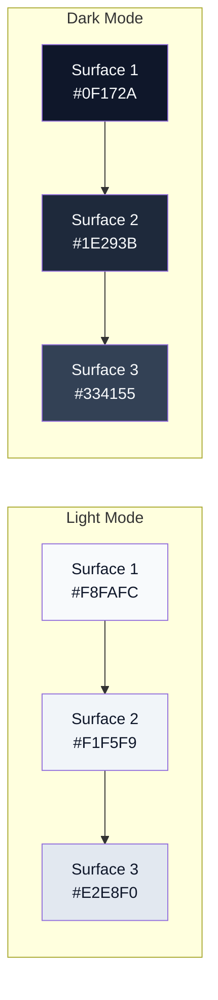
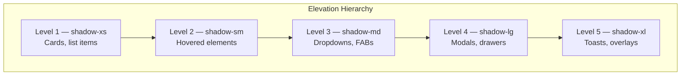
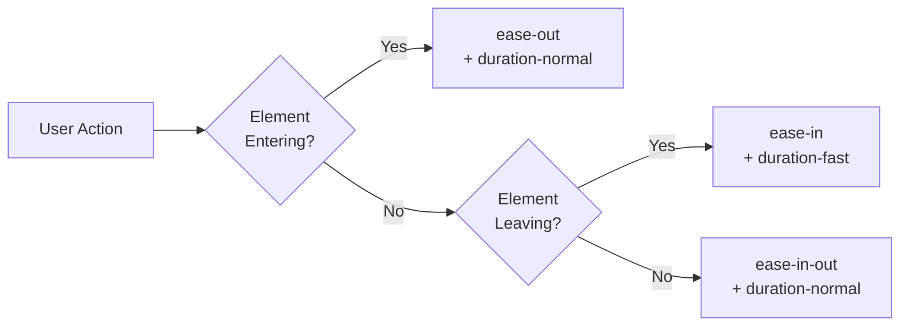

# Kagaz — Design Tokens

> A comprehensive design token reference for Kagaz's visual language. All values defined here are the **single source of truth** for colors, typography, spacing, elevation, motion, and accessibility across platforms.

---

## Table of Contents

- [Color Palette](#color-palette)
- [Brand Gradient](#brand-gradient)
- [App Icon](#app-icon)
- [Splash Screen](#splash-screen)
- [Typography](#typography)
- [Spacing](#spacing)
- [Border Radius](#border-radius)
- [Shadows / Elevation](#shadows--elevation)
- [Motion / Animation](#motion--animation)
- [Breakpoints](#breakpoints)
- [Iconography](#iconography)
- [Accessibility](#accessibility)
- [Density tokens](#density-tokens)
- [Simple Mode overrides](#simple-mode-overrides)
- [Agent surface tokens](#agent-surface-tokens)

---

## Color Palette

### Brand Colors

| Token | Hex | RGB | Purpose |
|---|---|---|---|
| `--color-primary` | `#1E3A5F` | `30, 58, 95` | Trust, Security — primary actions, headers, navigation |
| `--color-primary-light` | `#2D5486` | `45, 84, 134` | Primary hover states |
| `--color-primary-dark` | `#142842` | `20, 40, 66` | Primary active/pressed states |
| `--color-secondary` | `#F59E0B` | `245, 158, 11` | Accessibility, Warmth — highlights, CTAs, badges |
| `--color-secondary-light` | `#FBBF24` | `251, 191, 36` | Secondary hover states |
| `--color-secondary-dark` | `#D97706` | `217, 119, 6` | Secondary active/pressed states |

### Semantic Colors

| Token | Hex | Purpose | Usage |
|---|---|---|---|
| `--color-accent` | `#10B981` | Success, Growth | Confirmations, uploads complete, active states |
| `--color-accent-light` | `#34D399` | Success hover | Lighter success backgrounds |
| `--color-danger` | `#F43F5E` | Destructive actions | Delete, remove, error states |
| `--color-danger-light` | `#FB7185` | Danger hover | Error backgrounds, soft alerts |
| `--color-warning` | `#FB923C` | Caution | Expiring documents, quota warnings |
| `--color-warning-light` | `#FDBA74` | Warning hover | Warning backgrounds |
| `--color-info` | `#0EA5E9` | Informational | Tips, AI suggestions, help text |
| `--color-info-light` | `#38BDF8` | Info hover | Info backgrounds |

---

## Brand Gradient

> **Added 2026-07-21** ("Gradient Premium" direction, user-selected from a
> set of options). A signature gradient reserved for a **deliberately
> small set of high-impact spots** — primary CTA buttons, the upload FAB,
> the in-progress ProgressBar fill, the app icon, and the splash screen.
> **This is additive, not a replacement for `--color-primary`** — the navy
> "trust and security" palette above stays exactly as it was for
> structural UI (borders, focus rings, secondary-button outlines, body
> text emphasis). The design goal is a premium, modern accent (Stripe/
> Linear-like) without turning every screen into a light show, and without
> touching the muted, WCAG-AA-validated palette that gives this
> government-ID vault its trustworthy tone everywhere else.

| Token | Hex | Purpose |
|---|---|---|
| `--color-brand-start` | `#4F46E5` (indigo-600) | Gradient start stop |
| `--color-brand-mid` | `#7C3AED` (violet-600) | Gradient middle stop |
| `--color-brand-end` | `#A21CAF` (fuchsia-700) | Gradient end stop |
| `--gradient-brand` | `linear-gradient(135deg, ...)` | The composed gradient — use this, not the individual stops, everywhere except SVG sources (which need literal stop colors) |
| `--shadow-glow-brand` | `0 0 20px rgba(124, 58, 237, 0.35)` | Resting glow on gradient surfaces |
| `--shadow-glow-brand-lg` | `0 0 36px rgba(124, 58, 237, 0.45)` | Hover/emphasis glow |

### Contrast validation (WCAG 2.1 AA)

Every consumer of `--gradient-brand` renders white text (`--text-on-primary`)
on top of it — `.kg-btn--primary`, the upload FAB. Each stop, **and the
interpolated visual midpoint**, was checked against white
(relative-luminance method, `(L1+0.05)/(L2+0.05)`) before being chosen:

| Point | Hex | Contrast vs. white | AA (≥4.5:1)? |
|---|---|---|---|
| Start (`--color-brand-start`) | `#4F46E5` | 6.29:1 | ✅ |
| Mid (`--color-brand-mid`) | `#7C3AED` | 5.70:1 | ✅ |
| End (`--color-brand-end`) | `#A21CAF` | 6.32:1 | ✅ |
| Interpolated midpoint (start↔end, no explicit stop) | ≈`#7852CA` | 6.78:1 | ✅ |

An earlier candidate mid-stop, `#8B5CF6` (violet-500, one shade lighter),
measured **4.23:1 — below AA** and was rejected for exactly that reason;
`#7C3AED` (violet-600) was chosen instead. **Simple Mode** (density
tokens, below) sets `--shadow-glow-brand`/`-lg` to `none`, matching how it
already suppresses `--shadow-default` — glow is visual flourish, not
information, so Simple Mode's reduced-complexity posture drops it exactly
like any other shadow.

### Where it's used (and, as importantly, where it isn't)

| Surface | Uses the gradient? |
|---|---|
| Primary buttons (`.kg-btn--primary`), upload FAB | ✅ background + glow shadow |
| ProgressBar, default variant (in-progress) | ✅ fill + animated shimmer sweep |
| ProgressBar, success/danger variants | ❌ stays flat `--color-accent`/`--color-danger` — those signal a specific state, not brand identity |
| App icon, splash screen | ✅ background |
| Everything else — surfaces, text, borders, secondary/ghost/danger buttons, focus rings | ❌ unchanged navy/neutral system |

---

## App Icon

> **Added 2026-07-18**, replacing the default Capacitor/Ionic placeholder
> icon (the app previously shipped with the framework's generic starter
> icon on every platform — no icon design had ever been done). Marketing/
> brand *guidelines* live outside this design-system folder per the
> [README](README.md#whats-intentionally-not-here), but the icon itself is
> built entirely from tokens already defined above, so its rationale is
> documented here rather than starting a separate brand doc for one asset.

**Concept:** a folded-corner page — the *kagaz* ("paper") the app
manages — with a security badge overlaid on its corner, combining the
app's two core ideas (document vault + privacy) into one shape. A
heading bar + three body lines suggest written content without needing
literal text, so the mark reads the same in every locale.

**Colors — token-only, no new hex values invented:**

> **Updated 2026-07-21** — the background moved from the flat navy/emerald
> pairing to `--gradient-brand` (see [Brand Gradient](#brand-gradient)
> above) as part of the "Gradient Premium" direction; the mark itself
> (page/badge/lines) is unchanged in shape, only the heading line's color
> moved from navy to `--color-brand-mid` for continuity with the new
> background.

| Element | Token | Hex |
|---|---|---|
| Background gradient | `--gradient-brand` (start→mid→end) | `#4F46E5` → `#7C3AED` → `#A21CAF` |
| Page | white | `#FFFFFF` |
| Folded-corner flap / body text lines | a neutral between `--surface-3` and `--border-default` | `#C7D2DE` |
| Heading line | `--color-brand-mid` | `#7C3AED` |
| Security badge | `--color-accent` (unchanged — success stays semantic green even against the new background, see the "where it isn't" table above) | `#10B981` |

**Safe zone:** the mark is centered within roughly the middle 66% of the
1024×1024 source canvas (Android's adaptive-icon safe zone — content
outside it can be clipped by circle/squircle/rounded-square OEM launcher
masks). Verified device-side on `Pixel6_API34`: legible at both the home
-screen size and the ~48dp app-drawer size, with no clipping in the round
icon variant.

**Source files:** `apps/kagaz/assets/icon-background.svg`,
`icon-foreground.svg` (Android adaptive-icon layers), and `icon-only.svg`
(flat composite, used for iOS/legacy Android/PWA). Regenerate every
platform's icon set from these sources after an edit:

```bash
pnpm --filter kagaz exec capacitor-assets generate --android \
  --iconBackgroundColor '#4f46e5' --iconBackgroundColorDark '#312e81' \
  --splashBackgroundColor '#4f46e5' --splashBackgroundColorDark '#312e81'
pnpm --filter kagaz exec capacitor-assets generate --ios \
  --iconBackgroundColor '#4f46e5' --iconBackgroundColorDark '#312e81' \
  --splashBackgroundColor '#4f46e5' --splashBackgroundColorDark '#312e81'
```

`@capacitor/assets` (MIT, `ionic-team`) is a build-time-only devDependency
— it generates PNGs at build time and never ships in the app bundle, so it
carries none of the runtime-dependency scrutiny in the root
[CLAUDE.md](../../CLAUDE.md) (network/WASM/CSP checks apply to *shipped*
libraries). See [CONTRIBUTING.md](../../CONTRIBUTING.md#app-icon) for the
full regeneration workflow.

> **XML comment gotcha (hit 2026-07-21):** don't put a literal `--`
> sequence inside an SVG `<!-- -->` comment (e.g. writing out a CSS custom
> property name like `--color-primary` in prose) — it's invalid XML
> ("Comment must not contain '--'"), and `@capacitor/assets`'s SVG loader
> (`resvg`/`libxml`-based) rejects the whole file with a parse error,
> silently skipping icon generation for that platform rather than erroring
> loudly. Write "the color-primary token" instead.

## Splash Screen

> **Added 2026-07-21** — previously unbranded: the app shipped the raw
> default Capacitor/Ionic placeholder splash (a generic blue "X" mark on
> white), the framework's starter asset, same gap the App Icon section
> above already closed for the launcher icon on 2026-07-18.

**Source:** `apps/kagaz/assets/splash.svg` — the same `--gradient-brand`
background and mark as `icon-only.svg` (not a separate design), generously
margined (the mark's bounding box sits centered with roughly 25-30% margin
on every side) so it survives each platform's own centered-crop-to-device-
aspect-ratio splash compositing without the folded corner or badge running
off-screen on unusually tall or wide screens.

No `@capacitor/splash-screen` **plugin** is installed or needed for this —
the images this generates are consumed directly by each platform's native
launch mechanism (Android `styles.xml` → `@drawable/splash`, iOS
`LaunchScreen.storyboard` → the `Splash` image set), shown before the
WebView even loads. The JS plugin would only be needed for *programmatic*
control (custom show/hide timing, a manual dismiss call) — not required
here; add it as a separate, deliberate follow-up if that control is ever
needed, rather than bundling an unused native dependency now.

Regenerated by the same `capacitor-assets generate` commands as the App
Icon section above (one command does both icon and splash).

### Surface Colors



| Token | Light Mode | Dark Mode | Usage |
|---|---|---|---|
| `--surface-1` | `#F8FAFC` | `#0F172A` | Page background |
| `--surface-2` | `#F1F5F9` | `#1E293B` | Card backgrounds, panels |
| `--surface-3` | `#E2E8F0` | `#334155` | Elevated cards, modals, dropdowns |
| `--surface-inverse` | `#0F172A` | `#F8FAFC` | Inverted containers (tooltips, toasts) |

### Text Colors

| Token | Light Mode | Dark Mode | Usage |
|---|---|---|---|
| `--text-primary` | `#0F172A` | `#F8FAFC` | Headings, body text, primary labels |
| `--text-secondary` | `#475569` | `#CBD5E1` | Descriptions, captions, metadata |
| `--text-muted` | `#94A3B8` | `#64748B` | Placeholders, disabled text, hints |
| `--text-on-primary` | `#FFFFFF` | `#FFFFFF` | Text on primary-colored backgrounds |
| `--text-on-secondary` | `#0F172A` | `#0F172A` | Text on secondary-colored backgrounds |

### Border Colors

| Token | Light Mode | Dark Mode |
|---|---|---|
| `--border-default` | `#E2E8F0` | `#334155` |
| `--border-strong` | `#CBD5E1` | `#475569` |
| `--border-focus` | `#1E3A5F` | `#60A5FA` |

---

## Typography

### Font Families

| Token | Value | Usage |
|---|---|---|
| `--font-primary` | `'Inter', system-ui, -apple-system, sans-serif` | All Latin-script UI text |
| `--font-regional` | `'Noto Sans Devanagari', 'Noto Sans', sans-serif` | Hindi and regional language text |
| `--font-mono` | `'JetBrains Mono', 'Fira Code', monospace` | Code, document IDs, file sizes |

### Font Loading Strategy

```
1. Inter          → Google Fonts CDN, subset latin + latin-ext
2. Noto Sans Dev. → Google Fonts CDN, subset devanagari
3. system-ui      → OS fallback (always available)
```

> **Recommendation:** Use `font-display: swap` for all web fonts to prevent FOIT (Flash of Invisible Text).

### Type Scale

| Token | Size (px) | Size (rem) | Line Height | Usage |
|---|---|---|---|---|
| `--text-xs` | 12 | 0.75 | 1.33 (16px) | Badges, fine print, timestamps |
| `--text-sm` | 14 | 0.875 | 1.43 (20px) | Captions, helper text, metadata |
| `--text-base` | 16 | 1.0 | 1.5 (24px) | Body text, input fields, buttons |
| `--text-lg` | 18 | 1.125 | 1.56 (28px) | Subtitles, card titles |
| `--text-xl` | 20 | 1.25 | 1.4 (28px) | Section headings |
| `--text-2xl` | 24 | 1.5 | 1.33 (32px) | Page titles |
| `--text-3xl` | 30 | 1.875 | 1.27 (38px) | Hero text, large headings |
| `--text-4xl` | 36 | 2.25 | 1.22 (44px) | Display text, splash screens |

### Font Weights

| Token | Value | Usage |
|---|---|---|
| `--font-regular` | 400 | Body text, descriptions |
| `--font-medium` | 500 | Labels, navigation items, input values |
| `--font-semibold` | 600 | Card titles, section headings, buttons |
| `--font-bold` | 700 | Page titles, emphasis, stats values |

### Letter Spacing

| Token | Value | Usage |
|---|---|---|
| `--tracking-tight` | `-0.025em` | Large headings (2xl+) |
| `--tracking-normal` | `0` | Body text |
| `--tracking-wide` | `0.025em` | Uppercase labels, badges |

---

## Spacing

All spacing values are based on a **4px base grid** to ensure consistent rhythm across the interface.

| Token | Value (px) | Value (rem) | Usage |
|---|---|---|---|
| `--space-1` | 4 | 0.25 | Inline icon gaps, tight padding |
| `--space-2` | 8 | 0.5 | Icon-to-text gaps, compact padding |
| `--space-3` | 12 | 0.75 | Input padding, small card padding |
| `--space-4` | 16 | 1.0 | Standard padding, list item spacing |
| `--space-5` | 20 | 1.25 | Button padding, medium gaps |
| `--space-6` | 24 | 1.5 | Card padding, section gaps |
| `--space-8` | 32 | 2.0 | Large section gaps, modal padding |
| `--space-10` | 40 | 2.5 | Page top/bottom padding |
| `--space-12` | 48 | 3.0 | Section separators |
| `--space-16` | 64 | 4.0 | Page-level vertical spacing |
| `--space-20` | 80 | 5.0 | Hero sections, large separators |

### Spacing Guidelines

```
┌──────────────────────────────────────────────┐
│ Page Padding: space-4 (16px) mobile          │
│                space-8 (32px) desktop         │
│  ┌────────────────────────────────────────┐  │
│  │ Card Padding: space-4 to space-6       │  │
│  │  ┌──────────────────────────────────┐  │  │
│  │  │ Input Padding: space-3 (12px)    │  │  │
│  │  └──────────────────────────────────┘  │  │
│  │  gap between elements: space-2 (8px)   │  │
│  └────────────────────────────────────────┘  │
│  gap between cards: space-4 (16px)           │
└──────────────────────────────────────────────┘
```

---

## Border Radius

| Token | Value (px) | Usage |
|---|---|---|
| `--radius-sm` | 4 | Tags, badges, small chips |
| `--radius-md` | 8 | Buttons, inputs, cards |
| `--radius-lg` | 12 | Modals, panels, large cards |
| `--radius-xl` | 16 | Sheets, drawers, image containers |
| `--radius-2xl` | 24 | Floating action buttons, pills |
| `--radius-full` | 9999 | Avatars, circular buttons, toggles |

---

## Shadows / Elevation

Kagaz uses a 5-level elevation system. Higher levels indicate greater visual prominence and interactivity.

| Token | Level | CSS Value | Usage |
|---|---|---|---|
| `--shadow-xs` | 1 | `0 1px 2px 0 rgba(0,0,0,0.05)` | Cards at rest, subtle separators |
| `--shadow-sm` | 2 | `0 1px 3px 0 rgba(0,0,0,0.1), 0 1px 2px -1px rgba(0,0,0,0.1)` | Hovered cards, raised inputs |
| `--shadow-md` | 3 | `0 4px 6px -1px rgba(0,0,0,0.1), 0 2px 4px -2px rgba(0,0,0,0.1)` | Dropdowns, popovers, FABs |
| `--shadow-lg` | 4 | `0 10px 15px -3px rgba(0,0,0,0.1), 0 4px 6px -4px rgba(0,0,0,0.1)` | Modals, side panels, sheets |
| `--shadow-xl` | 5 | `0 20px 25px -5px rgba(0,0,0,0.1), 0 8px 10px -6px rgba(0,0,0,0.1)` | Full-screen overlays, toasts |



### Dark Mode Shadows

In dark mode, shadows are less visible. Supplement with:
- Subtle **border** (`1px solid --border-default`)
- Slight **background lightening** (use `--surface-3`)
- Reduced shadow opacity (multiply by `0.5`)

---

## Motion / Animation

### Duration Tokens

| Token | Value | Usage |
|---|---|---|
| `--duration-instant` | `100ms` | Micro-interactions: checkbox toggle, icon color change |
| `--duration-fast` | `200ms` | Hover effects, button press feedback, tooltips |
| `--duration-normal` | `300ms` | Panel slides, card transitions, page fades |
| `--duration-slow` | `500ms` | Full-page transitions, complex animations, sheets |

### Easing Functions

| Token | Value | Usage |
|---|---|---|
| `--ease-out` | `cubic-bezier(0.16, 1, 0.3, 1)` | Elements entering the screen — decelerate into rest |
| `--ease-in` | `cubic-bezier(0.55, 0, 1, 0.45)` | Elements leaving the screen — accelerate out |
| `--ease-in-out` | `cubic-bezier(0.45, 0, 0.55, 1)` | Elements transitioning in place (expand/collapse) |
| `--ease-spring` | `cubic-bezier(0.34, 1.56, 0.64, 1)` | Playful bouncy effects — FAB press, toggle switch |

### Animation Guidelines



**Principles:**
1. **Respect reduced-motion preferences:** Wrap all animations with `@media (prefers-reduced-motion: reduce)` and fall back to instant transitions.
2. **Performance:** Only animate `transform` and `opacity`. Avoid animating `width`, `height`, `top`, `left`.
3. **Intentional motion:** Every animation must have a purpose — guide attention, provide feedback, or establish spatial relationships.

---

## Breakpoints

Kagaz uses a **mobile-first** responsive design system.

| Token | Min Width (px) | Target Devices |
|---|---|---|
| *(default)* | 0 | Small phones (portrait) |
| `--bp-sm` | 640 | Large phones (landscape), small tablets |
| `--bp-md` | 768 | Tablets (portrait) |
| `--bp-lg` | 1024 | Tablets (landscape), small laptops |
| `--bp-xl` | 1280 | Desktops, large laptops |

### Layout Behavior by Breakpoint

| Feature | < sm | sm – md | md – lg | lg+ |
|---|---|---|---|---|
| Navigation | Bottom tab bar | Bottom tab bar | Side drawer | Permanent sidebar |
| Document grid | 2 columns | 3 columns | 4 columns | 5–6 columns |
| Chat panel | Full screen | Full screen | Side panel (40%) | Side panel (30%) |
| Document preview | Full screen overlay | Full screen overlay | Split view | Split view |
| Page padding | 16px | 16px | 24px | 32px |

### Media Query Usage (CSS)

```css
/* Mobile first — default styles target smallest screens */
.container { padding: var(--space-4); }

@media (min-width: 640px)  { /* sm  */ }
@media (min-width: 768px)  { /* md  */ }
@media (min-width: 1024px) { /* lg  */ }
@media (min-width: 1280px) { /* xl  */ }
```

---

## Iconography

### Recommended Icon Library

| Library | Usage | Reason |
|---|---|---|
| **Lucide React** (primary) | All UI icons | Tree-shakeable, 1000+ icons, consistent 24px grid, MIT license, React-native integration |
| **Heroicons** (fallback) | Alternative when Lucide lacks an icon | By Tailwind team, same design philosophy |

### Icon Sizing

| Token | Size (px) | Usage |
|---|---|---|
| `--icon-xs` | 16 | Inline with small text, badges |
| `--icon-sm` | 20 | Inline with body text, list items |
| `--icon-md` | 24 | Buttons, navigation, cards (default) |
| `--icon-lg` | 32 | Empty states, section headers |
| `--icon-xl` | 48 | Onboarding illustrations, feature highlights |

### Icon Guidelines

- **Stroke width:** 1.5px (matches Lucide defaults)
- **Color:** Inherit from parent text color via `currentColor`
- **Touch targets:** Icons in interactive elements must have minimum **48×48px** touch target (use padding)
- **Accessibility:** Always pair icons with `aria-label` or visible text

---

## Accessibility

### Color Contrast Requirements (WCAG 2.1 AA)

| Text Type | Minimum Ratio | Verification |
|---|---|---|
| Normal text (< 18px) | **4.5:1** | Primary text on all surfaces ✅ |
| Large text (≥ 18px bold or ≥ 24px) | **3:1** | Headings on all surfaces ✅ |
| UI components & graphical objects | **3:1** | Icons, borders, form controls ✅ |

#### Contrast Validation Matrix

| Foreground | Background | Ratio | Pass? |
|---|---|---|---|
| `#0F172A` (text-primary) | `#F8FAFC` (surface-1) | **15.4:1** | ✅ AAA |
| `#475569` (text-secondary) | `#F8FAFC` (surface-1) | **7.1:1** | ✅ AA |
| `#94A3B8` (text-muted) | `#F8FAFC` (surface-1) | **3.3:1** | ✅ Large text only |
| `#FFFFFF` (text-on-primary) | `#1E3A5F` (primary) | **9.8:1** | ✅ AAA |
| `#F8FAFC` (text-primary dark) | `#0F172A` (surface-1 dark) | **15.4:1** | ✅ AAA |
| `#CBD5E1` (text-secondary dark) | `#0F172A` (surface-1 dark) | **9.5:1** | ✅ AAA |

### Touch Target Sizes

| Element | Minimum Size | Recommended Size |
|---|---|---|
| Buttons | 48 × 48 px | 48 × 48 px |
| Icon buttons | 48 × 48 px (including padding) | 48 × 48 px |
| List items | 48px height | 56px height |
| Checkboxes / Radios | 48 × 48 px (including padding) | 48 × 48 px |
| Links (inline) | 48px vertical padding zone | — |

### Focus Indicators

```css
/* Default focus ring — visible on all interactive elements */
:focus-visible {
  outline: 2px solid var(--color-primary);       /* Light mode */
  outline-offset: 2px;
  border-radius: var(--radius-sm);
}

/* Dark mode focus ring */
@media (prefers-color-scheme: dark) {
  :focus-visible {
    outline-color: #60A5FA;  /* Brighter blue for dark backgrounds */
  }
}

/* NEVER use outline: none without a replacement */
```

### Screen Reader Support Patterns

| Pattern | Implementation |
|---|---|
| **Live regions** | `aria-live="polite"` for AI chat responses, upload progress |
| **Landmarks** | `<nav>`, `<main>`, `<aside>` for major page regions |
| **Labels** | All form inputs have associated `<label>` or `aria-label` |
| **Announcements** | Use `aria-live="assertive"` for errors, `polite` for success messages |
| **Hidden decorative elements** | `aria-hidden="true"` on purely decorative icons and images |
| **Document cards** | Use `role="article"` with `aria-labelledby` pointing to document name |
| **Modals** | Trap focus within modal, return focus on close, use `role="dialog"` |
| **Loading states** | `aria-busy="true"` on containers, `role="progressbar"` on loaders |

### Keyboard Navigation

| Key | Action |
|---|---|
| `Tab` / `Shift+Tab` | Move between interactive elements |
| `Enter` / `Space` | Activate buttons, links, toggles |
| `Escape` | Close modals, drawers, dropdowns |
| `Arrow keys` | Navigate within lists, grids, radio groups |
| `Home` / `End` | Jump to first/last item in lists |

---

## Token Implementation Reference

### CSS Custom Properties (Recommended)

```css
:root {
  /* Colors */
  --color-primary: #1E3A5F;
  --color-secondary: #F59E0B;
  --color-accent: #10B981;
  --color-danger: #F43F5E;
  --color-warning: #FB923C;
  --color-info: #0EA5E9;

  /* Surfaces — Light mode */
  --surface-1: #F8FAFC;
  --surface-2: #F1F5F9;
  --surface-3: #E2E8F0;

  /* Text — Light mode */
  --text-primary: #0F172A;
  --text-secondary: #475569;
  --text-muted: #94A3B8;

  /* Typography */
  --font-primary: 'Inter', system-ui, -apple-system, sans-serif;
  --font-regional: 'Noto Sans Devanagari', 'Noto Sans', sans-serif;

  /* Spacing (base: 4px) */
  --space-1: 0.25rem;
  --space-2: 0.5rem;
  --space-3: 0.75rem;
  --space-4: 1rem;
  --space-5: 1.25rem;
  --space-6: 1.5rem;
  --space-8: 2rem;
  --space-10: 2.5rem;
  --space-12: 3rem;
  --space-16: 4rem;
  --space-20: 5rem;

  /* Border Radius */
  --radius-sm: 4px;
  --radius-md: 8px;
  --radius-lg: 12px;
  --radius-xl: 16px;
  --radius-2xl: 24px;
  --radius-full: 9999px;

  /* Motion */
  --duration-instant: 100ms;
  --duration-fast: 200ms;
  --duration-normal: 300ms;
  --duration-slow: 500ms;
  --ease-out: cubic-bezier(0.16, 1, 0.3, 1);
  --ease-spring: cubic-bezier(0.34, 1.56, 0.64, 1);
}

/* Dark mode overrides */
[data-theme="dark"] {
  --surface-1: #0F172A;
  --surface-2: #1E293B;
  --surface-3: #334155;
  --text-primary: #F8FAFC;
  --text-secondary: #CBD5E1;
  --text-muted: #64748B;
  --border-default: #334155;
  --border-strong: #475569;
}
```

---

---

## Density tokens

Kagaz ships three density modes. The mode is set on `<html data-density="...">` and all tokens below derive from it. See [interaction-patterns.md § Density modes](./interaction-patterns.md#density-modes) for usage rules.

| Token | Simple | Comfortable *(default)* | Compact |
|---|---|---|---|
| `--row-h` | 80px | 56px | 44px |
| `--target-min` | 64px | 48px | 40px |
| `--scale` | 1.25 | 1.00 | 0.95 |
| `--page-padding` | 24px | 16px | 12px |
| `--card-padding` | 24px | 16px | 12px |
| `--gap-between-cards` | 20px | 16px | 12px |
| `--label-size` | 1.125rem | 1rem | 0.9375rem |

### CSS implementation

```css
:root[data-density="simple"] {
  --row-h: 80px;
  --target-min: 64px;
  --scale: 1.25;
  --page-padding: var(--space-6);
  --card-padding: var(--space-6);
  --gap-between-cards: var(--space-5);
  --label-size: var(--text-lg);
}

:root[data-density="comfortable"] {
  --row-h: 56px;
  --target-min: 48px;
  --scale: 1.00;
  --page-padding: var(--space-4);
  --card-padding: var(--space-4);
  --gap-between-cards: var(--space-4);
  --label-size: var(--text-base);
}

:root[data-density="compact"] {
  --row-h: 44px;
  --target-min: 40px;
  --scale: 0.95;
  --page-padding: var(--space-3);
  --card-padding: var(--space-3);
  --gap-between-cards: var(--space-3);
  --label-size: var(--text-sm);
}

/* All type sizes multiply by --scale at the root */
html { font-size: calc(16px * var(--scale)); }
```

### When to apply each mode

| Mode | Trigger | Audience |
|---|---|---|
| **Simple** | User toggles in Settings → Accessibility → Simple Mode, OR system font size ≥ "Largest" | Seniors, low-literacy users |
| **Comfortable** | Default for mobile | Most users |
| **Compact** | Default for tablets > 768px in landscape, OR explicit operator workspace | CSC operators, power users |

---

## Simple Mode overrides

Simple Mode is more than a density switch — it suppresses entire UI patterns. The token layer captures the visual part; behavior changes (fewer tabs, etc.) live in [interaction-patterns.md § Low-literacy patterns](./interaction-patterns.md#low-literacy-patterns).

| Token | Simple Mode value | Why |
|---|---|---|
| `--shadow-default` | `none` | Shadows confuse on low-end displays in bright light. |
| `--duration-default` | `0ms` | Reduce motion automatically. |
| `--radius-default` | `--radius-md` (8px) | Less playful, more obvious affordances. |
| `--icon-default` | `--icon-lg` (32px) | Bigger, less ambiguous. |
| `--focus-ring-width` | `4px` | Easier to see. |

```css
:root[data-density="simple"] {
  --shadow-default: none;
  --duration-default: 0ms;
  --radius-default: var(--radius-md);
  --icon-default: var(--icon-lg);
  --focus-ring-width: 4px;
}
```

---

## Agent surface tokens

> Visual styles applied when the AgentInspector dev tool is active. Production builds strip these — they exist only so designers + agents can see the agent graph live in development.

| Token | Value | Purpose |
|---|---|---|
| `--agent-outline` | `2px dashed #9333EA` | Outlines every element with a `data-agent-id` |
| `--agent-overlay-bg` | `rgba(147, 51, 234, 0.08)` | Fills tagged elements faintly |
| `--agent-label-bg` | `#1F1B2E` | Background of the floating id label |
| `--agent-label-fg` | `#EDE9FE` | Text color of the floating id label |
| `--agent-state-idle` | `#10B981` | Pulse color when state = idle |
| `--agent-state-loading` | `#F59E0B` | Pulse color when state = loading |
| `--agent-state-error` | `#F43F5E` | Pulse color when state = error |

Activated by `?agent=inspect` query param or `Cmd+Shift+A` in dev builds. See [agent-interface.md § Tooling](./agent-interface.md#tooling) for the AgentInspector spec.

---

## Modernized motion easing

In addition to the existing easing functions, the v2 system adds **expressive but functional** easing curves to align with modern (Material 3 / iOS 17) motion language:

| Token | Curve | Use |
|---|---|---|
| `--ease-emphasized` | `cubic-bezier(0.2, 0, 0, 1)` | Page-level transitions, sheet rises — feels decisive |
| `--ease-emphasized-accel` | `cubic-bezier(0.3, 0, 0.8, 0.15)` | Sheets sliding out, exit transitions |
| `--ease-standard` | `cubic-bezier(0.2, 0, 0, 1)` | Default in-place transitions |
| `--ease-spring` (existing) | `cubic-bezier(0.34, 1.56, 0.64, 1)` | FAB press, toggle — *use sparingly* |

The original `--ease-out`, `--ease-in`, `--ease-in-out` remain unchanged. Prefer `--ease-emphasized` for new code.

---

*Last updated: 2026-07-18 · Kagaz Design System v2.0*
