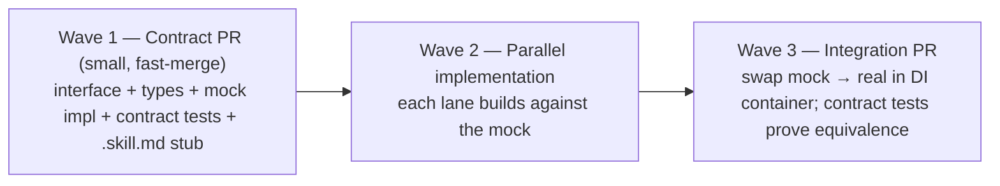

# Parallel Development Guide — Humans & Agents

> **Project:** Kagaz
> **Purpose:** How multiple developers/AI agents work on Kagaz simultaneously without stepping on each other.
> **Last Updated:** 2026-06-10

This guide operationalizes the protocol-based design in [CONTRIBUTING.md](../../CONTRIBUTING.md) for a world where most work is done by agents. The unit of parallelism is the **lane** (a module group); the coordination ledger is [DEVELOPMENT-CHECKLIST.md](../../DEVELOPMENT-CHECKLIST.md); the integration surface is **TypeScript interfaces + `.skill.md` files**, never implementations.

---

## Table of Contents

- [1. The Lanes](#1-the-lanes)
- [2. The Claim Protocol (claim-by-commit)](#2-the-claim-protocol-claim-by-commit)
- [3. Protocol-First Sequencing](#3-protocol-first-sequencing)
- [4. Contract Tests](#4-contract-tests)
- [5. Skill Files as Integration Docs](#5-skill-files-as-integration-docs)
- [6. Merge Rules](#6-merge-rules)
- [7. Agent Etiquette](#7-agent-etiquette)

---

## 1. The Lanes

After Phase 0, V1 work splits into six independent lanes. A lane = a set of modules with one owner at a time. Cross-lane changes are forbidden (file an interface request instead, §3).

| Lane | Modules (in `apps/kagaz/src/`) | Checklist items | Depends on |
|---|---|---|---|
| **A — Vault & Search** | `modules/document-vault`, `modules/search` | F-1, 9–12, 24–26, 30, 32–34 | Phase 0 (DB, FS) |
| **B — PDF Engine** | `modules/pdf-engine` | F-3–7, 21, 22, 28 | Phase 0 (workers, FS) |
| **C — Image & Scanner** | `modules/image-engine`, `modules/document-scanner` | F-2, 8, 29, F-20 (OCR) | Phase 0; A's repo interface (mock OK) |
| **D — AI Assistant** | `modules/ai-assistant` | F-13–15, 23 | Interfaces of A/B/C (mocks OK); Action Registry (P0-7) |
| **E — Auth, Settings & i18n** | `modules/auth`, `modules/settings`, `core/i18n` | F-16–18, 27, 31 | Phase 0 (secure storage) |
| **F — Platform** (gatekeeper lane) | `design-system/`, `app/`, `infrastructure/`, `packages/@kagaz/*`, CI | P0-1…P0-11, G1 gates | — |

Rules of thumb:

- Lane F is the only lane allowed to touch shared code; it reviews interface-change PRs from other lanes.
- A lane can start **before** its dependency is implemented — it codes against the interface + mock (§3). Only *integration* (swapping mock → real in the DI container) waits.
- V2/V3 lanes are defined the same way when their version starts; the checklist's version sections are the source.

---

## 2. The Claim Protocol (claim-by-commit)

The checklist is the **lock registry**. Claiming is a commit, so git history is the arbiter — no chat coordination needed.

1. **Claim**: edit the checklist item on `main` (or `develop` once it exists):
   ```
   - [ ] F-3 PDF Merge 🔴Must 🟨 claimed — feature/pdf-merge · agent:claude-A · 2026-06-12
   ```
   Commit *only this line change* (`docs: claim F-3`) and push **before** branching. First pushed claim wins; if your push rejects because someone claimed first, pick another item.
2. **Work** on branch `feature/pdf-merge` (naming per [CONTRIBUTING.md](../../CONTRIBUTING.md)).
3. **Release**: the PR that completes the work also updates the same line to `- [x] … ✅ <hash> (date)`. A claim older than **7 days** with no branch activity is stale — anyone may un-claim it (commit message must say so).

One item per claim. One claim per branch. Never claim from a lane someone else currently holds items in unless the lane table row is unowned.

---

## 3. Protocol-First Sequencing

Every cross-module surface lands in **three waves**, and only the first wave blocks anyone:



- **Wave 1** PRs touch only `types/`, `__contract__/`, and mocks. They merge within hours, not days — review is about the *shape*, not the implementation.
- Need something from another lane? Don't edit their module — open a **Wave 1 contract PR** proposing the interface change, tag the lane owner (Lane F arbitrates), and code against your proposed mock meanwhile.
- The DI container (`app/providers/`) is owned by Lane F; mock→real swaps are one-line changes there.

---

## 4. Contract Tests

For every repository/service interface, a shared test suite lives in `__contract__/` next to the interface and runs against **any** implementation:

```typescript
// modules/document-vault/types/__contract__/document-repository.contract.ts
export function documentRepositoryContract(makeRepo: () => Promise<IDocumentRepository>) {
  describe('IDocumentRepository contract', () => {
    it('round-trips a document', async () => { /* ... */ });
    it('search finds by name and tag', async () => { /* ... */ });
    it('delete is idempotent', async () => { /* ... */ });
  });
}

// SQLite impl test:    documentRepositoryContract(() => makeSqliteRepo());
// Mock impl test:      documentRepositoryContract(() => makeMockRepo());
// V2 cloud impl later: documentRepositoryContract(() => makeCloudRepo());
```

This is what makes mocks trustworthy: if the mock and the real implementation pass the same contract, Wave-2 work built on the mock integrates without surprises. **A Wave 1 PR without a contract suite is incomplete.**

---

## 5. Skill Files as Integration Docs

Agents integrating with another lane's module read its **`.skill.md` + `.agent.ts`** ([agent-interface.md](../design-system/agent-interface.md)) and its **module README** — never its implementation source. If you needed to read another module's implementation to integrate, the skill file is defective: file a PR against the *skill file*, not a workaround in your code.

This keeps every module's public surface honest, keeps agent context windows small, and means the in-app AI assistant, your coding agent, and human newcomers all learn the system from the same files.

---

## 6. Merge Rules

| Rule | Why |
|---|---|
| Rebase on target branch before PR; module boundaries mean conflicts ≈ 0 | Lanes touch disjoint files |
| Checklist conflicts: keep **both** lines, re-sort | Claims/completions are append-style edits |
| Wave 1 (contract) PRs get priority review — merge within a day | Everything else queues behind them |
| Lane F changes (design-system, infra, CI) merge **before** dependent lane PRs | Platform moves first |
| A PR may only modify: its claimed module(s) + its checklist line + its docs | Reviewable blast radius |
| Every PR satisfies [AGENT.md](../../AGENT.md) review checklist + Definition of Done | Non-negotiable gates |

---

## 7. Agent Etiquette

1. **Read order on session start**: `CLAUDE.md` → `DEVELOPMENT-CHECKLIST.md` (find claim) → the item's referenced docs → this guide if cross-lane.
2. `git status` first; commit or surface foreign changes before starting (Git Discipline in `CLAUDE.md`).
3. Never edit another lane's module, even for a "trivial fix" — file a contract PR or leave a checklist note under Doc Gaps.
4. Keep mock data realistic but **never real PII** — fabricated Aadhaar-like numbers must be syntactically invalid (e.g., start with `0000`).
5. When blocked, write the blocker into the checklist item (`🟨 blocked — waiting on F-x interface`) and pick another claim; don't idle or improvise around the boundary.

---

*Document maintained by the Kagaz Architecture Team*
