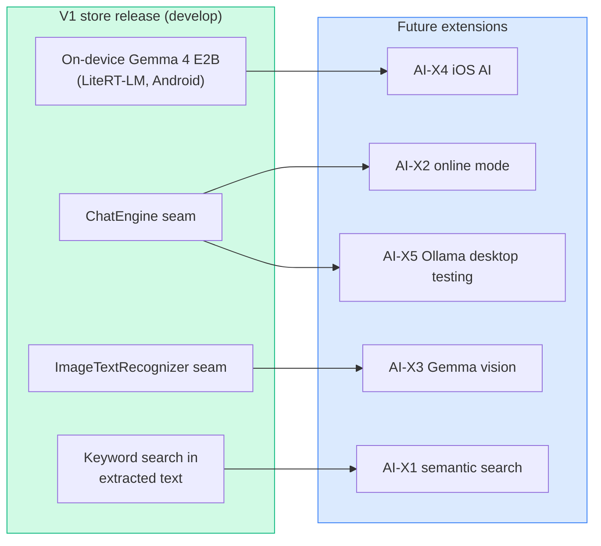

# Future Extensions — features removed for the V1 store release

> **Future Extensions** · Last Updated: 2026-11-18

These features were built on `feature/ai-ollama-embeddings` during the Gemma hackathon work. They were **removed from `develop` on 2026-11-18** so that the first Play Store and App Store release is on-device only and easy to declare. Their code is **kept unchanged on the branch `feature/ai-ollama-embeddings`**. Each entry says what the feature did, why it was removed, what has to be true before it comes back, and which seam in `develop` it plugs into.

Item ids (`AI-X1`…) are referenced from code comments and from `DEVELOPMENT-CHECKLIST.md`.

## Table of Contents

- [Summary](#summary)
- [AI-X1 — Semantic search (EmbeddingGemma)](#ai-x1--semantic-search-embeddinggemma)
- [AI-X2 — Online mode (hosted model fallback)](#ai-x2--online-mode-hosted-model-fallback)
- [AI-X3 — On-device Gemma vision transcription](#ai-x3--on-device-gemma-vision-transcription)
- [AI-X4 — On-device AI on iOS](#ai-x4--on-device-ai-on-ios)
- [AI-X5 — Desktop AI testing with Ollama](#ai-x5--desktop-ai-testing-with-ollama)
- [AI-X6 — Live model test harness](#ai-x6--live-model-test-harness)
- [AI-X7 — Smaller model tier](#ai-x7--smaller-model-tier)
- [AI-X8 — Fully offline voice input](#ai-x8--fully-offline-voice-input)
- [Bringing a feature back](#bringing-a-feature-back)

## Summary

| Id | Feature | Removed because | Earliest version |
|---|---|---|---|
| AI-X1 | Semantic search (`ai.semanticSearch`, EmbeddingGemma) | Model licence (Gemma Terms) and provenance not cleared; vectors not persisted; never device-verified | V1.x |
| AI-X2 | Online mode (Gemma 4 on Vertex AI) | Sends messages and documents to a cloud; needs a backend, India data residency, consent logging and a DPIA | V2 |
| AI-X3 | Gemma vision transcription on the phone | The native bridge is text-only; the browser version used Ollama/Vertex | V1.x |
| AI-X4 | On-device AI on iOS | The iOS plugin has no tool-calling bridge | V1.x |
| AI-X5 | Ollama engine for desktop testing | Not a shipped engine; needed a CSP widening | dev tooling |
| AI-X6 | Live model test harness | Only ran against Ollama/Vertex | dev tooling |
| AI-X7 | Smaller model tier | Not built | V1.x |
| AI-X8 | Offline-only voice input | Platform speech services may process audio on their servers | V1.x |

## AI-X1 — Semantic search (EmbeddingGemma)

**What it did.** `ai.semanticSearch` found documents by meaning and returned matching passages. On Android it used EmbeddingGemma-300M through the LiteRT-LM `EmbeddingEngine` (plugin method `embedTexts`), as an optional ~330 MB download with its own card on the AI page. Documents without text were transcribed first. Vectors were kept in memory and rebuilt after every restart. ADR-024 has the full decision.

**Code on the branch.** `apps/kagaz/src/modules/semantic-index/` (ports, providers, chunking, in-memory store), `ai-assistant/ai-semantic-search.actions.ts`, `services/document-search.service.ts`, `hooks/useSearchModel.ts`, `components/SearchModelCard.tsx`, and `LLMPlugin.java` `embedTexts`.

**Before it comes back.**
- Licence review: EmbeddingGemma is under the Gemma Terms of Use, not Apache-2.0. CLAUDE.md allows permissive licences only, so this needs legal sign-off.
- Artifact: replace the community conversion (`kasimtmc/embeddinggemma-litertlm`) with an official or self-built `.litertlm` that is pinned by hash.
- Persist vectors in SQLCipher (new migration) so a restart does not re-embed every document.
- The vectors and passages stay on-device, so no DPIA change is needed while the engine is on-device. Re-check if AI-X2 lands.
- Device-verify RAM use with the 2.6 GB chat model loaded at the same time.

**Plugs into.** The keyword tools `ai.findInDocuments` / `ai.readDocumentText` (`services/document-text.service.ts`) already answer content questions on-device. Semantic search would be an extra tool in the `document-search` skill.

## AI-X2 — Online mode (hosted model fallback)

**What it did.** One online/offline switch. Turning it on showed a data-sharing warning, then sent chat messages and transcription images to Gemma 4 26B on Vertex AI through a **dev-server-only** proxy that used the developer's gcloud credentials. ADR-023 has the details. Benchmarks: Gemma 4 26B passed 15/16 live scenarios.

**Code on the branch.** `infrastructure/cloud-ai/`, `services/cloud-chat-engine.ts`, `services/tool-loop-engine.ts`, `vite-plugins/cloud-ai-proxy.ts`, and the `mode.*` i18n keys.

**Before it comes back (this is a V2-class change):**
- A real backend in place of the dev proxy. Credentials never go to the device. India-region hosting (CLAUDE.md data-residency rule).
- Explicit, per-user, logged consent (DPDP §6; consent-log format in `code/code-standards-and-quality.md`), plus the warning copy from `docs/ux/consent-screens.md`.
- Document text and images go to the cloud only with a separate, explicit consent. 10-security §5.2 currently allows document text **only** for the on-device engine.
- Updates to the DPIA, the privacy policy, the Play Data safety form ("data collected/shared" changes), and the App Store privacy labels.
- Network access in the release CSP, which changes ADR-017. That needs its own ADR.

**Plugs into.** A new `ChatEngine` with `locality: 'cloud'`, selected in `services/chat-engine.registry.ts` only after consent. `useChat` needs no changes.

## AI-X3 — On-device Gemma vision transcription

**What it did.** "Transcribe with Gemma" sat next to "Extract text" in the document viewer and the vault item menu. It re-read every image or PDF page with Gemma's vision input and replaced the stored text. The branch ran this through Ollama or Vertex, never on the phone.

**What is already in `develop`.** The whole vault side: the `ExtractOptions.engine: 'vision'` path in `useDocumentOcr`, the PDF blob path in `pdf-ocr.ts`, the buttons and i18n, and their tests. They sit behind `getConfiguredVisionRecognizer()` (`image-engine/services/vision-ocr.service.ts`), which returns `null` in V1, so the option is hidden and ML Kit OCR is used.

**To do.**
- Native: give `@kagaz/capacitor-llm-litert` image input. LiteRT-LM has `Content.ImageBytes`. Initialise the vision backend (it is `null` today, see 05 §3.4 item 2). Expose a `transcribeImage` call.
- Return an `ImageTextRecognizer` from the seam when the model is `ready`.
- Measure memory and time per page on a real phone. The AVD cannot do this (see memory `avd-native-capture-limitation`).

## AI-X4 — On-device AI on iOS

**Status.** `isAiSupported()` is Android-only. The iOS app shows "not available on this platform" on the AI screens. Everything else in V1 works on iOS.

**To do.** Port the Kagaz fork additions to `packages/capacitor-llm-litert/ios/` (Swift): `tools` + `toolCallRequested` / `resolveToolCall`, `setToolSubset`, the `systemPrompt` on `createChat`, `sha256File`, `deleteModel`, and the atomic `.part` download. Check LiteRT-LM's iOS runtime support for Gemma 4 E2B. Add the 2.6 GB download to the App Store review notes (Guideline 4.2.3 / 2.5.2: the downloaded content is model weights, not executable code). This needs Xcode and a real iPhone.

## AI-X5 — Desktop AI testing with Ollama

**What it did.** `OllamaChatEngine` ran Gemma 4 E2B on a laptop through a local Ollama server, so the browser demo could exercise chat, tools and vision. It needed `connect-src` widened in a demo build. ADR-022 has the details.

**Current state.** The web demo (`pnpm --filter kagaz dev:web-demo`, ADR-025) tests the vault only. To test AI on a desktop again, bring back the engine as a **dev-server-only** `ChatEngine` with `locality: 'local-server'`, and widen the dev server's CSP in `vite-plugins/web-demo.ts` (never the build's).

## AI-X6 — Live model test harness

`apps/kagaz/src/test/live-harness.ts` plus `OLLAMA_LIVE=1` / cloud live suites ran the same ~16 scenarios (search-first, ask-user forms, multi-part requests) against a real model. That was valuable for prompt and tool-description regressions. Rebuild it against the on-device engine, for example as an instrumented Android test, or against AI-X5.

## AI-X7 — Smaller model tier

Gemma 4 E2B needs ~2.6 GB of storage and a phone with plenty of free RAM. A smaller tier for low-end phones would reuse the `MODEL_*` constants in `ai-engine.service.ts` and the management page. (Qwen3-0.6B was removed on 2026-10-31.)

## AI-X8 — Fully offline voice input

Voice input uses the platform speech recogniser (Android `SpeechRecognizer`, iOS `SFSpeechRecognizer`), which may send audio to Google or Apple. Prefer on-device recognition (Android `EXTRA_PREFER_OFFLINE`, iOS `requiresOnDeviceRecognition`). The plugin may need a fork for that. Until then, disclose it in the privacy policy and store forms ([store-release-checklist.md](../compliance/store-release-checklist.md)).

## Bringing a feature back

1. Cut `feature/<item>-<name>` from `develop`. Cherry-pick or port from `feature/ai-ollama-embeddings`, and do not merge that branch wholesale.
2. Clear the "Before it comes back" list above. Update 05, 08 (the ADR status), 10, the DPIA and the store declarations **first** (docs-as-code, `AGENT.md`).
3. Re-run the gates, `pnpm agent:lint`, the build check from ADR-025 (no demo code or CSP change in `dist`), and device verification.
