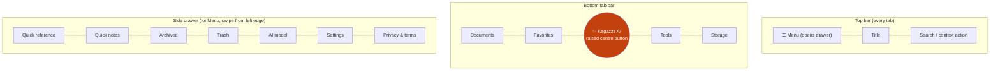

# Smart UI — Next-Best-Action, Progressive Disclosure & the App Shell

> **Smart UI plan** · Last Updated: 2026-11-19 · Status: in progress (each item below links its commit when done)

The working plan for making Kagazzz Docs feel like it knows what you want
next: the frameworks we design with, an audit of every section, the new app
shell (drawer + centre AI button), the visual-consistency rules, and the bug
list. It is the single checklist for this pass; items are done one by one,
in the order of [§8](#8-implementation-order).

---

## Table of Contents

- [1. Frameworks we design with](#1-frameworks-we-design-with)
- [2. Engineering rules for this pass](#2-engineering-rules-for-this-pass)
- [3. The app shell: drawer, tab bar, centre AI button](#3-the-app-shell-drawer-tab-bar-centre-ai-button)
- [4. Section-by-section audit (Trigger → Intent → Next action)](#4-section-by-section-audit-trigger--intent--next-action)
- [5. AI chat: documents as links, in-chat preview](#5-ai-chat-documents-as-links-in-chat-preview)
- [6. Visual consistency rules](#6-visual-consistency-rules)
- [7. Bugs found / reported](#7-bugs-found--reported)
- [8. Implementation order](#8-implementation-order)
- [9. Deliberately not doing (YAGNI)](#9-deliberately-not-doing-yagni)

---

## 1. Frameworks we design with

| Framework | What it asks | How we use it in this app |
|---|---|---|
| **Next-Best-Action (NBA) / contextual affordance** | Right after a task, what will the user most likely do next? Put *that* in their path. | Every completion surface (upload done, tool finished, AI made a file, document opened) offers the 1–3 most likely next actions inline — not a dead-end toast. |
| **Progressive disclosure** | Show the common thing; reveal the rest only after a first step. | Tab bar holds the 4 daily destinations; rarely-used screens live in the drawer; long menus split into "likely" (inline) and "more" (sheet). |
| **Direct manipulation** | Let people act on the object itself. | Tap a document *name* anywhere (chat text, history, results) to preview it; swipe cards; long-press to select; drag order in merge = tap order. |
| **Task analysis & user flows** | Break goals into steps, find friction on the happy path. | §4 maps each section's happy path and the friction we remove. |
| **Hook model** (Trigger → Action → Variable reward → Investment) | Each loop should reward and set up the next. | Reward = seeing the result immediately (preview thumbnail, Open button); investment = history, favourites, folders that make the next visit faster. |
| **Gulf of execution** (Norman) | Gap between intent and the actions the UI allows. | "Merge my two Aadhaar sides" → one AI sentence or 3 taps, never "remember the file name". Measured as taps-to-goal in §4. |
| **Anticipatory design** | Use context/history to pre-surface actions. | Recent strip, per-tool history, last-used tool first, suggested next tool by file type (PDF → compress/share; image → enhance/to-PDF). Only on-device signals — no tracking (privacy-first). |

**Privacy constraint on "anticipation":** every signal (recents, tool history,
last-used) is local, in the encrypted DB or preferences; nothing is sent
anywhere (10-security §3.5). No behavioural analytics.

---

## 2. Engineering rules for this pass

- **DRY** — one component per concept: `DocumentThumb` (any document visual), one
  `DocumentLink` (any tappable document name), one `DocumentPreviewModal` (any
  in-place preview), one `NextActions` row (any completion surface). No
  per-screen copies.
- **KISS** — CSS tokens and Ionic primitives (`IonMenu`, `IonTabBar`,
  `IonModal`) over custom gesture code.
- **YAGNI** — §9 lists what we explicitly do not build now.
- **SOLID** — screens depend on small interfaces (`onOpen(doc)`,
  `onShare(doc)`); the AI layer never imports UI; tools never import the chat.
- **Tokens only** — no literal colour/size in CSS (design-tokens.md); every new
  interactive element has `data-agent-id` (agent-interface.md).

---

## 3. The app shell: drawer, tab bar, centre AI button

### Today

- Top bar on Documents: **4 icon buttons** (AI chat ✨, Quick reference 🔑,
  Quick notes 📝, Settings ⚙️) — crowded, icon-only, unlabeled for first-time
  users, and different on every tab.
- Tab bar: Documents · Favorites · Tools · Storage.
- Upload FAB bottom-right on Documents.
- Archived, Trash, AI model, Legal are reachable only from Settings or menus.

### New shell

- **Centre AI button** in the tab bar (raised, saffron, the app's signature
  action). Replaces the ✨ header button. Hidden when AI is unsupported on the
  device (the tab bar then shows the 4 tabs evenly).
- **Drawer** (`IonMenu`, `type="overlay"`, swipe from the left edge, ☰ in every
  top bar): the second-level destinations, each with icon + label, grouped
  *Quick access* (Quick reference, Quick notes), *Library* (Archived, Trash),
  *App* (AI model, Settings, Privacy & terms). The drawer header shows the app
  mark and name.
- **Header** keeps only ☰, the title, and at most one context action.
- **Upload FAB** stays on Documents (bottom-right) — it is Documents' primary
  action; the centre button is the app's.
- Hardware back closes the drawer first (Ionic menu controller handles it).

Why: progressive disclosure (daily vs occasional destinations), consistent
headers across tabs, labels in the drawer fix "what does this icon do", and a
single obvious place for AI.

---

## 4. Section-by-section audit (Trigger → Intent → Next action)

| Section | Trigger (what just happened) | Predicted intent | Next-best action (inline) | Status |
|---|---|---|---|---|
| **Documents — upload done** | File(s) saved | Look at it / do something with it | Toast becomes an action toast: **Open**, **Ask AI**, (PDF) **Tools** | planned |
| **Documents — grid/list** | Opened a doc and came back | Continue browsing where I was | Layout and scroll position preserved (grid bug §7) | planned |
| **Recent strip** | Swipe up on a card | Run a tool on it | Already opens Tools (UX-16) | ✅ |
| **Document viewer** | Document open | Share / convert / ask about it | Bottom next-actions row: **Share**, **Tools** (PDF/image-aware), **Ask AI about this** | planned |
| **PDF Tools — run finished** | Output saved | See it / send it | Result sheet: preview, **Open**, **Share** | ✅ 6a6b840 |
| **PDF Tools — picking** | Choosing inputs | Recognise, not recall, the file | Thumbnail grid with names; order badges for merge | ✅ 159663d |
| **PDF Tools — returning** | Opened a tool again | Redo / find last output | Per-tool history in the sheet; combined on the page | ✅ 6a6b840 |
| **AI chat — answer mentions a document** | Text names a file | Look at it | Name rendered as a **link** → in-chat preview modal | planned |
| **AI chat — tool created a file** | Merge/compress/etc. done | See / share the new file | Result card names are links → preview modal with **Open** / **Share** / **Close** | planned |
| **AI chat — generating** | Model is answering | Prepare my next message | Typing allowed; only **Send** waits | planned |
| **Share** | Shared a document | Receiver sees a real name | Named copy (`PAN Card.pdf`) | ✅ b32ab7e |
| **Quick reference / notes** | Copied a value | Paste it elsewhere | Copy toast (existing); reachable from drawer | planned (drawer) |
| **Storage** | Sees space used | Free space | Existing manage actions; AI model size → AI model page | ✅ existing |

---

## 5. AI chat: documents as links, in-chat preview

- **Typing while generating:** the textarea stays enabled during streaming;
  only **Send** (and Attach, which would change the pending turn) waits.
  Pressing Enter while streaming does nothing.
- **Links in answers:** after the model's text is rendered, any exact mention
  of a document the conversation touched (attachments, tool results, search
  results) becomes a `DocumentLink`. Matching is by document **name** (the
  model never sees ids it could print — aliases are decoded), longest name
  first, whole-word, case-insensitive. Only documents already in the
  conversation are linked, so no lookup of arbitrary vault names.
- **Tool results:** the "documents created" card lists each new file as a
  `DocumentLink` (name + thumbnail).
- **In-chat preview:** a `DocumentPreviewModal` (sheet, same screen) shows the
  document (first page / image), its name, and **Open** (full viewer),
  **Share**, **Close**. Closing returns to the exact chat position.
- **[SEC]** locked documents are not previewed in the modal — the link opens
  the normal viewer, which asks for biometrics (10-security §3.1).

---

## 6. Visual consistency rules

| Rule | Why | Fix |
|---|---|---|
| **Search bars have a visible field**: surface-2 fill, 1px border, radius-lg, and a focus ring on `:focus-within` | The field had no border and `outline: none` with no replacement — invisible as a field, and no focus indicator (WCAG 2.4.7 fail) | `@kagaz/ui` `.kg-search` |
| **Icon colour by role**: *object-type* icons (file type, tool cards) = saffron; *actions* (toolbar, menus, row actions) = `--text-secondary`; *selected/active* = saffron; *destructive* = danger | Today some action icons are saffron and others grey with no rule | One rule, applied in CSS by role class, documented in design-tokens.md |
| **Header icons = labelled** in the drawer, not unlabeled rows of icons | Recognition over recall | §3 |
| **One document visual** (`DocumentThumb`) everywhere | Same file looks the same in Recent, picker, history, results, chat | ✅ 159663d |

---

## 7. Bugs found / reported

| # | Bug | Cause (verified) | Fix |
|---|---|---|---|
| B1 | Launcher icon looks small; the K and the page inside are tiny | The adaptive foreground is placed at scale 5 so the wide z³ fits the round safe circle — the page itself uses only ~55% of the icon | Launcher-only layout: larger page, K scaled up, z³ tucked inside the corner fold so the mark fills the safe zone |
| B2 | Grid view: open a document and come back → 2 columns become 1 | `useGridColumns` takes ResizeObserver's width; while Ionic hides the page (`display: none`) the width is 0 → 1 column, and that sticks | Ignore 0-width measurements |
| B3 | AI chat blocks typing while the model answers | Textarea `disabled={isStreaming}` | Only Send is disabled (§5) |
| B4 | Search field has no border / no focus ring | `.kg-search__input` border none, outline none | §6 |
| B5 | Inconsistent icon colours | No role rule | §6 |
| B6 | Shared file had a random name | Stored `<uuid>.ext` handed out | ✅ b32ab7e |

---

## 8. Implementation order

Small, independently shippable steps; each gets its own commit and is
checked off here.

1. [ ] B2 grid columns · B3 chat typing · B4 search field · B5 icon roles
2. [ ] B1 launcher icon fills the safe zone
3. [ ] Chat: document links + in-chat preview modal + linked result cards
4. [ ] Shell: centre AI button in the tab bar; drawer with second-level
   destinations; header slimmed
5. [ ] NBA: upload action toast; viewer next-actions row
6. [ ] Device check (light/dark, en/hi, hardware back from drawer and modal)

---

## 9. Deliberately not doing (YAGNI)

- **Predictive ranking/ML of next actions** — a static, file-type-aware rule
  set covers the cases; revisit only with evidence.
- **Drag-and-drop between apps / text-out-of-image drag** (the macOS example)
  — Android has no equivalent we can rely on in a WebView; OCR text copy
  already exists in the viewer.
- **Customisable tab bar / user-reorderable drawer** — no request for it.
- **Usage analytics to tune placement** — against the privacy promise;
  placement follows the task analysis in §4 instead.
